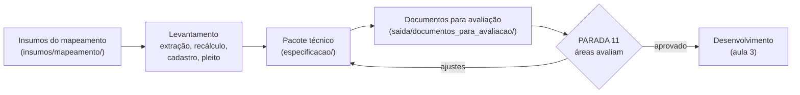

# 00. Visão geral: do processo mapeado ao sistema especificado

Este repositório é a segunda parte do curso. A primeira,
[mapeamento-processos-sei](https://github.com/RaulAraujoSilva/mapeamento-processos-sei), mapeia os processos de uma
agência reguladora a partir do SEI, avalia o AS-IS, desenha o TO-BE e prioriza qual processo vira piloto de um
sistema. Aqui o piloto escolhido vira uma **especificação de sistema**: o que um time, ou uma IA de desenvolvimento,
precisa para construir e testar o sistema. Vira também um conjunto de **documentos que as áreas da agência conseguem
ler, avaliar e aprovar**.

A regra é a mesma do mapeamento: **nenhum requisito sem origem**. Cada requisito aponta uma melhoria do TO-BE, uma
norma, uma cláusula de contrato ou um caso real com resultado conhecido.

Caso de referência: **Reajusta**, o sistema do reajuste tarifário anual (P01) da AGENERSA, com o contrato-piloto
Águas de Paraty (Contrato 008/2014).

## 1. Fluxo

| Etapa | Capítulo | Produto | Onde fica |
|---|---|---|---|
| Levantamento dos casos e das regras | [01](01_ESPECIFICACAO_SISTEMA.md) §3 a §6 | Cálculos da coorte refeitos, cadastro do contrato com trecho literal, layout do pleito e validador | `saida/levantamento/`, `scripts/` |
| Pacote técnico | [01](01_ESPECIFICACAO_SISTEMA.md) §7 e §8 | 15 documentos, ADRs, contratos (JSON Schema, OpenAPI), modelo Prisma, protótipo, fixtures de aceite, regras para a IA de desenvolvimento | `especificacao/` |
| Documentos para avaliação | [02](02_DOCUMENTOS_E_PASTA_DE_SAIDA.md) | Guia, cadernos por público, planilha de parecer, especificação completa, protótipo, um PDF por capítulo | `saida/documentos_para_avaliacao/` |
| Avaliação e aprovação | [02](02_DOCUMENTOS_E_PASTA_DE_SAIDA.md) §7 | Pareceres consolidados, nova versão, versão aprovada | `saida/pareceres/` (fora do git) |

O passo a passo, com comandos, aceites e PARADAs, está no [roteiro](ROTEIRO_ESPECIFICACAO.md).

## 2. Insumos que vêm do mapeamento

O mapeamento produz, para o tipo de processo escolhido como piloto, os arquivos abaixo. No caso de referência, eles
estão copiados em [`insumos/mapeamento/`](../../insumos/mapeamento/), e a especificação os cita pelo identificador
(fato, melhoria, requisito legal, indicador, tarefa do BPMN).

| Arquivo | O que traz | Como a especificação usa |
|---|---|---|
| `modelo_P01.json` | Modelo BPMN do processo: tarefas t1 a t16, raias, gatilhos e saídas | Casos de uso e jornadas citam a tarefa; o escopo cobre o processo de ponta a ponta |
| `fatos_P01.json` | Fatos calculados da coorte: durações, esperas, caminhos, percentuais | Problema e metas (capítulo 01 do pacote); todo número citado é um fato |
| `casos_P01.json` | Linha do tempo de cada caso da coorte | Fixtures de prazos e marcos (`ciclos_coorte.json`) |
| `avaliacao_P01.json` | Avaliação AS-IS: gargalo, desperdícios, potencial de IA por atividade | Ordem das ondas e funções a automatizar |
| `melhorias_P01.json` | Melhorias do TO-BE (M-P01-01 a 18) | Origem dos requisitos funcionais |
| `normas_P01.json` | Normas e requisitos legais (N-P01, R-P01) com trecho literal | Origem das regras de prazo e das exigências ao regulado |
| `conformidade_P01.csv/.json` | Conformidade de cada caso a cada requisito legal | Oráculo dos testes de conformidade |
| `controles_P01.json` | Indicadores (I-P01) e controles de qualidade (Q-P01), com linha de base e meta | Requisitos de indicadores e metas do sistema |

No seu órgão: rode o mapeamento até a priorização (PARADA 10) e copie os arquivos equivalentes do tipo-piloto para
`insumos/mapeamento/`, com o código do seu processo no nome.

## 3. Três tipos de etapa

| Tipo | Quem faz | Exemplo neste repositório | Como se confere |
|---|---|---|---|
| Determinística | Script | `recalcular_reajuste.py`, `validar_pleito.py`, `gerar_fixtures.py`, `gerar_documentos.py`, `consolidar_pareceres.py` | Testes em `tests/`; duas rodadas dão o mesmo resultado |
| Julgamento | IA seguindo uma especificação escrita | Extração dos cálculos das peças; cadastro do contrato; redação do pacote | Portões (recálculo fecha, trecho literal existe, fixture confere) e revisão humana |
| Decisão | Pessoas da agência | Regra da energia, instrumento que torna o layout obrigatório, onde o sistema roda | PARADA 11, com parecer na planilha |

## 4. O que não se negocia

- **Número só do código.** A especificação cita fatos e resultados de script; não digita número.
- **Regra com origem.** Parâmetro de contrato com trecho literal; requisito com melhoria, norma ou caso.
- **Hipótese marcada.** Horas e custos são hipótese até a calibração com os servidores.
- **Fonte única.** PDF e planilha são gerados da fonte; ninguém edita o PDF.
- **Pasta de saída legível.** Organizada pelo conteúdo, nomes que dizem o que o arquivo é e um `LEIA-ME.md` gerado.
- **Dados pessoais fora do git.** Pareceres com nome de avaliador, textos de contrato com assinaturas e caches ficam
  em pastas ignoradas.
