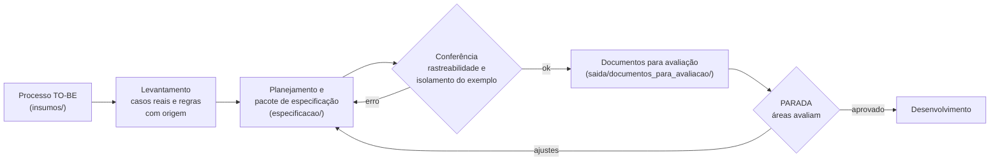

# 00. Visão geral: do processo TO-BE à especificação completa do sistema

Este repositório é um **framework** para especificar o sistema que automatiza um processo já mapeado. A entrada é o
processo TO-BE do seu órgão: atividades, raias, decisões, melhorias, normas e casos reais. A saída tem duas formas.

- Um **pacote de especificação** que uma equipe, ou uma IA de desenvolvimento, consegue construir e testar: escopo,
  perfis, casos de uso, requisitos, regras, estados, componentes, dados, contratos, telas, testes, backlog, operação
  e segurança.
- **Documentos que as áreas do órgão conseguem ler, avaliar e aprovar**: cadernos em PDF por público e uma planilha
  de parecer item a item.

A regra que sustenta tudo: **nenhum requisito sem origem**. Cada requisito aponta uma melhoria do TO-BE, uma norma,
uma cláusula ou um caso real com resultado conhecido.

## 1. Como usar este repositório

Você (ou a IA que trabalha com você) **não preenche este repositório**. Você cria o **seu projeto** a partir dos
modelos, numa pasta própria, e usa este repositório como referência de método, de formato e de ferramenta.

```bash
python scripts/iniciar_projeto.py ../meu-sistema --sistema "Nome do sistema" --orgao SIGLA
```

| Parte deste repositório | Para que serve | Como usar |
|---|---|---|
| [`docs/metodologia/`](.) | O método: o que fazer, em que ordem, com que critério | Leia o capítulo antes de cada etapa |
| [`modelos/projeto/`](../../modelos/projeto/) | Os modelos dos documentos, com marcadores `{{...}}` e orientação em comentário | `iniciar_projeto.py` copia para o seu projeto; você preenche |
| [`scripts/`](../../scripts/) | Conferência da rastreabilidade, geração dos PDFs e da planilha, consolidação dos pareceres | Rode com `--projeto <sua pasta>` |
| [`exemplo/reajusta/`](../../exemplo/reajusta/) | Um caso resolvido de ponta a ponta, de outro domínio | Só para ver formato e nível de detalhe. **Nunca copie conteúdo** ([capítulo 05](05_USO_DO_EXEMPLO.md)) |

## 2. Fluxo



| Etapa | Capítulo | Produto | Onde fica no seu projeto |
|---|---|---|---|
| Reunir os insumos do processo | [01](01_INSUMOS_DO_PROCESSO.md) | TO-BE, melhorias, normas, indicadores, casos | `insumos/` |
| Levantar casos reais e regras | [02](02_LEVANTAMENTO_DE_CASOS_E_REGRAS.md) | Casos com resultado conhecido, regras com trecho literal, conferência por script | `saida/levantamento/` |
| Planejar e escrever a especificação | [03](03_PLANEJAMENTO_DA_ESPECIFICACAO.md) | 15 documentos, ADRs, contratos, protótipo, regras para quem desenvolve | `especificacao/` |
| Gerar documentos para avaliação | [04](04_DOCUMENTOS_E_PASTA_DE_SAIDA.md) | Guia, cadernos por público, planilha de parecer, especificação completa, protótipo | `saida/documentos_para_avaliacao/` |
| Avaliar e aprovar | [04](04_DOCUMENTOS_E_PASTA_DE_SAIDA.md) §7 | Pareceres consolidados, nova versão, versão aprovada | `saida/pareceres/` (fora do git) |

O passo a passo, com comandos, aceites e PARADAs, está no [roteiro](ROTEIRO_ESPECIFICACAO.md).

## 3. Três tipos de etapa

| Tipo | Quem faz | Exemplos | Como se confere |
|---|---|---|---|
| Determinística | Script | Conferência da rastreabilidade, recálculo dos casos, geração dos documentos, consolidação dos pareceres | Duas rodadas dão o mesmo resultado; testes |
| Julgamento | Pessoa ou IA, seguindo o método | Extração dos casos, redação de casos de uso, requisitos, regras e estados | Conferidor (forma) e revisão humana (conteúdo) |
| Decisão | Pessoas do órgão | Regra que a norma não fecha, onde o sistema roda, que ato torna uma exigência obrigatória | PARADA, com parecer na planilha |

## 4. O que não se negocia

- **Origem em tudo.** Requisito com melhoria, norma, cláusula ou caso; regra com trecho literal; número com o fato ou
  o script que o produziu. Nada digitado de cabeça.
- **Lacuna vira decisão pendente.** Quando a norma não diz ou os casos divergem, abre-se uma `DEC` com dono e padrão
  provisório. Ninguém escolhe em silêncio.
- **O seu domínio, não o do exemplo.** O caso resolvido ensina forma. Nome, regra, número, perfil, módulo e tela do
  exemplo não entram na sua especificação; o conferidor barra.
- **Hipótese marcada.** Horas, custos e valores propostos levam "(proposto)" até a calibração.
- **Fonte única.** PDF e planilha são gerados da fonte; ninguém edita o PDF.
- **Pasta de saída legível.** Organizada pelo conteúdo, com nomes que dizem o que o arquivo é e um `LEIA-ME.md`
  gerado.
- **Dados pessoais fora do git.** Pareceres com nome de avaliador, textos com assinatura e caches ficam em pastas
  ignoradas. Nenhum nome de pessoa na especificação: use a função.
