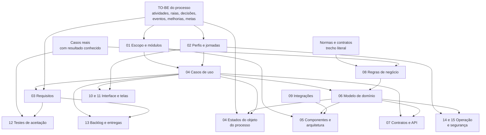

# 03. Planejamento da especificação: do TO-BE ao pacote completo

A especificação não se escreve documento por documento, cada um do zero. Ela é uma **cadeia de derivações**: cada
artefato sai do anterior e dos insumos do processo, por uma regra que outra pessoa consegue repetir. O caso de uso sai
de uma atividade do TO-BE. O requisito sai de um passo do caso de uso ou de uma melhoria. O estado sai de uma
atividade ou espera do processo. O componente sai de um módulo, e o teste sai de um caso real com resultado conhecido.
Quando a cadeia está inteira, nada na especificação é invenção. Quando quebra, o conferidor
(`scripts/conferir_especificacao.py`) aponta onde.

Este capítulo tem três partes:

- a ordem e a regra de cada derivação (§1);
- a convenção de identificadores que amarra tudo (§2);
- o passo a passo de cada artefato, com entrada, técnica, saída, armadilhas e critério de pronto (§3).

O formato de cada documento está em [`modelos/projeto/especificacao/`](../../modelos/projeto/especificacao/). O nível
de detalhe esperado se vê no caso resolvido. Antes de abri-lo, leia o [capítulo 05](05_USO_DO_EXEMPLO.md).

## 1. A cadeia de derivação

| # | Artefato | Documento | Deriva de | Regra de derivação | Técnica de referência |
|---|---|---|---|---|---|
| 1 | Escopo e módulos | 01 | Atividades do TO-BE, melhorias, metas | Cada atividade recebe um tratamento (automatiza, apoia, registra, fora); atividades afins formam um módulo | Quadro de escopo; ISO/IEC/IEEE 29148 (visão do sistema) |
| 2 | Perfis | 02 | Raias do BPMN, partes externas | Cada raia que usa o sistema vira um perfil; parte externa que só troca dados vira integração | Personas por função (sem nome de pessoa) |
| 3 | Jornadas | 02 | Caminhos do TO-BE | O caminho mais frequente contado do ponto de vista de cada perfil, tela por tela | Mapa de jornada |
| 4 | Casos de uso | 04 | Atividades em escopo, eventos, decisões | Cada atividade automatizada ou apoiada gera um caso de uso, ou um passo dele; decisão gera fluxo alternativo; evento de tempo gera caso de uso do sistema | UML 2.5; descrição no estilo de Cockburn |
| 5 | Requisitos funcionais | 03 | Passos dos casos de uso, melhorias | Cada passo que o sistema executa vira requisito, ou parte de um; cada melhoria do TO-BE gera ao menos um requisito | ISO/IEC/IEEE 29148 |
| 6 | Requisitos não funcionais | 03 | Metas, normas, operação | Cada meta mensurável e cada exigência legal ou de operação vira requisito com número e forma de medir | ISO/IEC 25010 |
| 7 | Regras de negócio | 08 | Normas, contratos, casos reais | Cada regra do processo, com trecho literal da fonte e um exemplo de caso real; lacuna vira decisão pendente | Tabela de decisão; regra declarativa |
| 8 | Modelo de domínio | 06 | Substantivos dos casos de uso e das regras | Cada coisa que o sistema guarda e sobre a qual há regra vira entidade; o vocabulário vira glossário | UML 2.5 (classes); DDD (linguagem do domínio) |
| 9 | Estados | 04 | Atividades e esperas do TO-BE, casos de uso | O objeto que percorre o processo tem uma máquina de estados: atividade ou espera vira estado, resultado vira transição rotulada com o evento ou o caso de uso | UML 2.5 (máquina de estados) |
| 10 | Componentes | 05 | Módulos, entidades, integrações | Um componente de domínio por módulo; uma porta por integração; regra de negócio fica no domínio | C4 (contexto, contêineres, componentes); arquitetura hexagonal |
| 11 | Decisões de arquitetura | 05 + adr/ | Escolhas que mudam o código | Toda escolha com alternativa real vira ADR, com contexto, opções e consequência | ADR (Nygard) |
| 12 | Contratos e API | 07 | Passos que cruzam fronteira | Cada passo de caso de uso que entra ou sai do sistema vira operação; dado que vem de fora tem esquema | OpenAPI 3.1; JSON Schema 2020-12 |
| 13 | Integrações | 09 | Sistemas externos do contexto | Uma ficha por sistema externo: dado, frequência, falha e contingência | — |
| 14 | Interface e telas | 10, 11 | Casos de uso com ator humano, jornadas | Cada caso de uso com pessoa usa ao menos uma tela; cada tela lista dados, ações, estados e critérios | Design system de governo; WCAG 2.2 AA; eMAG |
| 15 | Testes de aceitação | 12 | Casos reais, critérios de aceite | Cada caso real com resultado conhecido vira teste; cada requisito é citado por teste ou história | ISO/IEC/IEEE 29119 |
| 16 | Backlog | 13 | Casos de uso, requisitos, ondas | História é fatia vertical de caso de uso; releases seguem as ondas da priorização | Histórias com Dado/Quando/Então; DoR e DoD |
| 17 | Operação e segurança | 14, 15 | Perfis, entidades, dados pessoais | Permissão = perfil × caso de uso; inventário de dado pessoal; nível de verificação de segurança | LGPD; OWASP ASVS 5.0 |
| 18 | Regras para quem desenvolve | AGENTS_DESENVOLVIMENTO | Arquitetura, testes, backlog | Camadas, proibições, portões e definição de pronto que a IA de desenvolvimento lê antes de cada tarefa | — |

Escreva **nesta ordem**. Voltar a um documento anterior é normal (um caso de uso revela uma regra nova), mas o
identificador nasce sempre no 01, e o documento anterior é corrigido na hora, não "depois".

## 2. Convenção de identificadores

Todo item que alguém vai avaliar, testar ou implementar tem identificador estável. Ele **nasce na lista do documento
01** e é **descrito no documento dono**. Os demais documentos o citam pelo identificador, nunca por paráfrase.

| Família | Formato | Documento dono | Definido como |
|---|---|---|---|
| Módulo | `MOD-SIG` (sigla de 2 a 5 letras) | 01 | linha da tabela de módulos |
| Perfil | `PER-SIG` | 02 | título de seção `### PER-SIG Nome` |
| Caso de uso | `UC-01` | 04 | título `### UC-01 Verbo + objeto` |
| Requisito funcional | `RF-SIG-01` (sigla do módulo) | 03 | título `### RF-SIG-01 Verbo + objeto` |
| Requisito não funcional | `RNF-01` | 03 | título ou linha de tabela |
| Regra de negócio | `RN-SIG-01` | 08 | título `### RN-SIG-01 Nome` |
| Decisão pendente | `DEC-01` | 08 (e README do pacote) | linha da tabela de decisões |
| Integração | `INT-01` | 09 | título `## INT-01 Sistema` |
| Componente de interface | `CMP-01` | 10 | linha do inventário |
| Tela | `TL-01` | 11 | título `## TL-01 Nome` |
| Teste de aceitação | `AT-01` | 12 | título `### AT-01 Situação testada` |
| Épico | `EP-SIG` | 13 | título ou linha de tabela |
| História | `HIS-SIG-01` | 13 | linha da tabela ou título |
| Requisito de segurança | `SEG-SIG-01` | 15 | linha de tabela |
| Decisão de arquitetura | `ADR-0001` | `adr/0001-nome.md` | o próprio arquivo |

Regras:

1. **Estável.** Identificador publicado não muda de número. Item retirado fica na lista como "(retirado na versão
   1.1)", para que pareceres e testes antigos continuem fazendo sentido.
2. **Sigla do módulo no requisito, na regra e na história.** `RF-ANL-03` diz de qual módulo é; o conferidor usa a
   sigla para checar se todo módulo tem requisito.
3. **Citação, não paráfrase.** "Ver RN-ANL-02" em vez de repetir a regra. Repetir cria duas versões da verdade.
4. **Origem também tem identificador.** As melhorias, normas, indicadores e atividades do TO-BE trazem o código do
   processo de origem (por exemplo `M-<processo>-04` ou a tarefa `t7` do BPMN). Os documentos citam esse código.

## 3. Passo a passo

Cada passo tem o mesmo formato: **entrada** (o que você precisa ter), **como fazer**, **saída** (o que fica escrito)
e **pronto quando** (o que a pessoa revisora e o conferidor checam).

### 3.1 Escopo, metas e módulos (documento 01)

**Entrada:** modelo do TO-BE (atividades, raias, decisões, eventos), melhorias, metas e linha de base dos
indicadores ([capítulo 01](01_INSUMOS_DO_PROCESSO.md)).

**Como fazer:**

1. Monte o **quadro de escopo**: uma linha por atividade do TO-BE, com o tratamento que o sistema dá a ela.

   | Tratamento | Significa | Exemplo genérico |
   |---|---|---|
   | Automatiza | O sistema executa sem pessoa | conferir se um documento obrigatório foi enviado |
   | Apoia | A pessoa decide; o sistema prepara, calcula, sugere ou registra | minuta pré-preenchida que o analista revisa |
   | Registra | A atividade acontece fora; o sistema guarda marco e prazo | reunião deliberativa registrada com data |
   | Fora | O sistema não toca nesta atividade (diga por quê) | atividade rara, sem dado, ou de outro órgão |

2. Agrupe as atividades em **módulos** pelo objeto de trabalho, não pela unidade organizacional. Um módulo tem um
   conjunto coeso de entidades e regras (por exemplo, "recebimento", "análise", "prazos", "documentos").
3. Escreva o **problema** e as **metas** com números do diagnóstico, citando o fato de origem. Meta sem linha de base
   não é meta.
4. Escolha as **ondas**: comece pela função de regra mais fechada e dado mais disponível
   ([capítulo 02](02_LEVANTAMENTO_DE_CASOS_E_REGRAS.md) §1). As ondas viram as releases do backlog.
5. Abra as **listas de identificadores**: módulos, perfis, casos de uso, requisitos, telas, integrações, releases e
   glossário. Neste momento são listas com título curto; o detalhe vem nos documentos donos.

**Pronto quando:** toda atividade do TO-BE está no quadro de escopo; toda atividade "automatiza" ou "apoia" aponta um
módulo; toda meta cita a linha de base; as listas de identificadores existem.

### 3.2 Perfis e jornadas (documento 02)

**Entrada:** raias do BPMN, partes externas, quadro de escopo.

**Como fazer:**

1. Cada raia que **usa** o sistema vira um perfil `PER-SIG`. Descreva-o pela função: o que faz no processo, o que
   precisa ver, o que dói hoje (com o fato do diagnóstico) e o que o sistema muda para ele. **Nenhum nome de
   pessoa.**
2. Parte externa que só manda ou recebe dados, sem usar telas, vira integração (`INT-nn`), não perfil.
3. Conte a **jornada de ponta a ponta** do caso mais frequente do TO-BE, passo a passo, dizendo para cada passo o
   perfil, a tela e o caso de uso. Use um caso real (anonimizado) como fio da história.
4. Desenhe o **mapa de navegação** entre telas.

**Pronto quando:** cada perfil tem objetivo, dores com fato e telas que usa; a jornada percorre o TO-BE inteiro em
escopo sem pular etapa; cada passo da jornada aponta caso de uso e tela.

### 3.3 Casos de uso (documento 04)

**Entrada:** quadro de escopo, perfis, decisões e eventos do BPMN.

**Como fazer:**

1. **Encontre os casos de uso.** Percorra o TO-BE na ordem:
   - atividade "automatiza" ou "apoia" → caso de uso, ou passo de um caso de uso maior quando não entrega valor
     sozinha;
   - decisão (gateway) → fluxo alternativo do caso de uso em que ela acontece;
   - evento de tempo (prazo, lembrete, rotina) → caso de uso do sistema, com ator "sistema (agendado)";
   - mensagem de parte externa → caso de uso disparado por integração.

   Acrescente os casos que o TO-BE não mostra e todo sistema precisa: administrar perfis e acessos, manter tabelas
   de parâmetros e consultar histórico.
2. **Acerte o tamanho.** Um caso de uso é **um objetivo de um ator que entrega um resultado observável** (o "nível do
   mar" de Cockburn). "Clicar em salvar" é pequeno demais; "gerir o processo" é grande demais. Nome no formato
   verbo + objeto: "Registrar pedido", "Emitir parecer técnico".
3. **Descreva cada um** com: ator principal e secundários, objetivo, pré-condições, gatilho, **fluxo principal
   numerado**, fluxos alternativos (`3a.`), exceções (falha de integração, dado ausente), pós-condições e a tabela de
   rastreio (regras, requisitos, telas, atividade do BPMN e origem).
4. Desenhe o **diagrama de casos de uso** (perfis à esquerda, sistemas externos à direita) e a **tabela de
   correspondência BPMN × caso de uso**. Toda atividade em escopo aparece nela.
5. Desenhe **diagramas de sequência** para os casos de uso que cruzam mais de uma fronteira (pessoa, sistema e
   sistema externo) ou têm ordem crítica.
6. Desenhe a **máquina de estados** do objeto do processo (§3.6).

**Armadilhas:** caso de uso que descreve tela ("o usuário clica..."); caso de uso por unidade organizacional em vez
de por objetivo; fluxo principal com decisão no meio (decisão vai para alternativo); exceção esquecida (o que
acontece quando a integração cai?).

**Pronto quando:** todo caso de uso da lista do 01 tem descrição (C07); todo caso de uso cita requisito (C12); toda
atividade em escopo do TO-BE aparece na correspondência; existem os diagramas de casos de uso, de sequência e de
estados (C10).

### 3.4 Requisitos (documento 03)

**Entrada:** passos dos casos de uso, melhorias do TO-BE, metas, normas.

**Como fazer:**

1. **Funcionais.** Percorra cada passo que o **sistema** executa nos fluxos dos casos de uso e escreva o que o
   sistema deve fazer, agrupando passos que fazem a mesma coisa. Depois confira o caminho inverso: **toda melhoria do
   TO-BE gera ao menos um requisito**. Melhoria sem requisito ou foi descartada (diga por quê no 01) ou foi
   esquecida.
2. Cada requisito funcional tem:
   - **Descrição:** "o sistema deve...", com o comportamento observável;
   - **Origem:** melhoria, norma (com artigo), cláusula, atividade do BPMN ou caso real. Sem origem, o requisito não
     entra (C06);
   - **Critério de aceite:** numerado e verificável, de preferência com o dado de um caso real ("o caso X, enviado
     sem o documento Y, é devolvido com a pendência Z");
   - **Rastreio:** UC, TL, release e, quando houver, operação da API.
3. **Não funcionais.** Cada um com número e forma de medir, pelas características da ISO/IEC 25010 (desempenho,
   confiabilidade, segurança, usabilidade, manutenibilidade, portabilidade, compatibilidade). "Rápido" não é
   requisito; "a validação responde em até 60 s com os dados em cache, medido no teste de carga" é.
4. Agrupe por módulo, na ordem do fluxo.

**Armadilhas:** requisito de solução ("usar uma caixa de seleção") em vez de necessidade; dois requisitos em um ("e
também..."); critério de aceite que repete a descrição; requisito "nice to have" sem melhoria nem meta por trás.

**Pronto quando:** todo requisito tem origem e critério de aceite (C06); a lista do 01 e as seções do 03 batem (C09);
todo módulo tem requisito (C14); todo requisito é citado por teste ou história (C11).

### 3.5 Regras de negócio e decisões pendentes (documento 08)

**Entrada:** normas e contratos com trecho literal, casos reais com resultado conhecido
([capítulo 02](02_LEVANTAMENTO_DE_CASOS_E_REGRAS.md)).

**Como fazer:**

1. Separe **regra** de **requisito**. O requisito diz o que o sistema faz ("calcular o prazo"). A regra diz a lei
   do negócio ("o prazo conta em dias úteis a partir da intimação, excluídos os feriados do estado"). A regra existe
   mesmo sem sistema.
2. Para cada regra: enunciado; **fonte com trecho literal** (norma, cláusula, deliberação); parâmetros (com valor,
   unidade e vigência); **exemplo calculado com um caso real**; exceções.
3. Regras com muitas combinações viram **tabela de decisão** (condições × resultado), que vira teste direto.
4. Convenções transversais primeiro: arredondamento, casas decimais, calendário (dias úteis, feriados), fuso.
5. **Lacuna vira decisão pendente.** Quando a norma não diz, os casos divergem ou falta dado, abra `DEC-nn` com: o que
   decidir, quem decide, o **padrão provisório** que o sistema adota até a decisão e o impacto. Nunca escolha em
   silêncio.

**Pronto quando:** toda regra tem fonte e exemplo; toda regra é citada por requisito, caso de uso, tela ou teste
(C13); toda lacuna tem DEC com dono e padrão provisório.

### 3.6 Modelo de domínio e estados (documentos 06 e 04)

**Entrada:** substantivos dos casos de uso e das regras, glossário, TO-BE.

**Como fazer o modelo de domínio:**

1. Liste os substantivos que aparecem nos casos de uso e nas regras. Fica como **entidade** o que o sistema guarda e
   tem identidade (o pedido, o documento, o prazo). Vira **atributo** o que só qualifica outra coisa (data, valor,
   situação). E vira **valor** (sem identidade) o que se compara pelo conteúdo (período, endereço, percentual).
2. Para cada entidade: atributos com tipo, obrigatoriedade, unidade e **origem do dado** (quem informa, de onde vem);
   relacionamentos com cardinalidade; regras de integridade.
3. **Parâmetros que mudam no tempo** (valores de norma, cláusulas, tabelas) têm **vigência**. Uma versão nova herda
   da anterior e muda só o que mudou. Cálculo antigo continua reproduzível com a versão da época.
4. **Trilha de auditoria:** quem fez o quê e quando, em toda entidade que muda de situação ou que vira prova.
5. Desenhe o **diagrama de classes** (ou entidade-relacionamento) por módulo (C10) e mapeie o dado que vem de fora
   (formulário, arquivo, integração) para as entidades.

**Como fazer a máquina de estados.** Todo processo tem um **objeto que o percorre**: o pedido, o processo, o caso, a
solicitação. A máquina de estados dele é a ponte mais direta entre o TO-BE e o sistema.

1. Cada **atividade** do TO-BE em que o objeto fica parado com alguém vira um **estado** ("Em análise técnica"). Cada
   **espera** (por resposta externa, por prazo) também vira estado ("Aguardando resposta").
2. Cada saída de atividade ou resultado de decisão vira **transição**, rotulada com o **evento ou o caso de uso** que a
   dispara: `EmAnalise --> Devolvido: pendência encontrada (UC-04)` (C16).
3. Cada estado tem **dono** (o perfil da raia) e, quando houver, **prazo** com a regra que o conta.
4. Use estado composto para sub-processos com vida própria (uma diligência, uma reanálise).
5. Confira:
   - todo estado é alcançável a partir do inicial;
   - todo estado não final tem saída;
   - todo caso de uso que muda a situação do objeto aparece numa transição;
   - todo caminho observado nos casos reais é possível na máquina.
6. Outros objetos com ciclo de vida próprio (um documento que vai de rascunho a assinado) ganham máquina de estados
   própria, menor.

**Pronto quando:** entidades com atributos, origem e integridade; diagrama de classes; máquina de estados do objeto do
processo com transições rotuladas; caminhos dos casos reais conferidos contra a máquina.

### 3.7 Componentes e arquitetura (documento 05 e ADRs)

**Entrada:** módulos, entidades, integrações, requisitos não funcionais, restrições da TI do órgão.

**Como fazer:**

1. **Contexto (C4 nível 1):** o sistema no centro, os perfis de um lado e os sistemas externos (`INT-nn`) do outro.
2. **Contêineres (C4 nível 2):** aplicação web, processos de fundo (jobs), banco de dados, armazenamento de arquivos,
   serviços auxiliares. Cada um com tecnologia e responsabilidade.
3. **Componentes (C4 nível 3), planejados por esta tabela:**

   | Módulo | Componente de domínio | Casos de uso atendidos | Entidades | Regras | Portas (integrações) |
   |---|---|---|---|---|---|
   | `MOD-SIG` | serviço que concentra as regras do módulo | UC-nn | entidades do módulo | RN-SIG-nn | porta para cada INT usado |

   Toda regra de negócio fica no **domínio**, sem depender de tela, banco ou integração. Todo sistema externo entra
   por uma **porta** (interface) com um **adaptador**, para poder ser trocado e simulado nos testes.
4. **Camadas e regra de dependência:** interface → aplicação → domínio; adaptadores implementam as portas. A regra de
   dependência tem de ser **verificável por ferramenta** na integração contínua, não só desenhada.
5. **Onde fica cada regra:** tabela regra → componente → teste.
6. **Jobs:** cada evento de tempo dos casos de uso vira um job com agenda, idempotência e tratamento de falha.
7. **Erros, logs e configuração:** formato de erro, o que se registra (sem dado pessoal) e variáveis de ambiente.
8. **ADRs:** toda escolha com alternativa real vira um ADR (contexto, opções consideradas, decisão, consequências):
   stack, banco, autenticação, hospedagem, integração, design system, uso de modelo de linguagem quando houver.
   Escolha que depende da TI do órgão fica "proposta" até a avaliação.

**Pronto quando:** existem os diagramas de contexto e de componentes (C10); todo módulo tem componente; toda
integração tem porta; toda decisão com alternativa tem ADR; a regra de dependência tem ferramenta que a verifica.

### 3.8 Contratos e API (documento 07)

**Entrada:** passos dos casos de uso que cruzam a fronteira do sistema; entidades.

**Como fazer:**

1. Cada passo em que dado **entra** ou **sai** do sistema (tela chama servidor, parte externa envia, sistema publica)
   vira operação. Monte a tabela **operação × caso de uso × perfil**.
2. Dado que vem de fora (formulário de terceiro, arquivo, integração) tem **esquema** (JSON Schema) com tipos,
   obrigatoriedade, casas decimais e exemplos reais.
3. Convenções: nomes, datas e fusos, números, erros (RFC 9457), paginação, idempotência, versionamento, autenticação.
4. Escreva o OpenAPI a partir da tabela. Ele é o contrato que gera código e testes.

**Pronto quando:** toda operação aponta caso de uso e perfil; todo dado de fora tem esquema; os erros seguem um
formato só.

### 3.9 Integrações (documento 09)

Uma ficha `INT-nn` por sistema externo: finalidade, dado trocado, direção, frequência, formato, autenticação,
**o que acontece quando ele falha** (cache, fila, "a refazer", operação manual), porta e adaptador, e quem é o dono do
outro lado. Integração que depende de decisão de outro órgão ou da TI vira `DEC` e começa com contingência manual.

### 3.10 Interface e telas (documentos 10 e 11)

**Entrada:** casos de uso com ator humano, jornadas, perfis.

**Como fazer:**

1. **Guia de interface (10):** princípios, design system adotado (no governo federal, o padrão gov.br), tokens de
   cor e tipografia com contraste medido, **inventário de componentes reutilizáveis** (`CMP-nn`), guia de mensagens
   (tom, erros, confirmações) e regras de acessibilidade (WCAG 2.2 AA, eMAG).
2. **Telas (11):** cada caso de uso com pessoa usa ao menos uma tela. Para cada tela `TL-nn`: objetivo, perfis,
   dados exibidos (com origem na entidade), ações (com o caso de uso que disparam), **estados** (vazio, carregando,
   erro, sem permissão, sucesso) e critérios de aceite da tela.
3. **Protótipo** de baixa fidelidade em HTML, com dados de um caso real anonimizado, uma seção por tela. Ele vira o
   `07_Prototipo_de_telas.pdf` ([capítulo 04](04_DOCUMENTOS_E_PASTA_DE_SAIDA.md)).

**Pronto quando:** lista do 01 e seções do 11 batem (C08); toda tela tem os cinco estados; todo componente usado está
no inventário.

### 3.11 Testes de aceitação (documento 12)

**Entrada:** casos reais com resultado conhecido, critérios de aceite dos requisitos.

**Como fazer:**

1. Cada caso real do levantamento vira um teste `AT-nn`, com entrada (fixture), resultado esperado **tirado dos
   autos** e a regra que exercita. Caso em que os autos têm erro vira teste de que o sistema **acusa** o erro.
2. Inclua testes de borda (feriado, prazo no fim de semana, dado ausente, integração fora) e de permissão (perfil
   errado não vê).
3. Estratégia: pirâmide de testes, dublês das integrações e portões da integração contínua.
4. **Matriz de rastreabilidade** requisito × teste × história.

**Pronto quando:** todo requisito é coberto por teste ou história (C11); todo teste tem resultado esperado com
origem; os fixtures são gerados por script a partir do levantamento.

### 3.12 Backlog e entregas (documento 13)

**Entrada:** casos de uso, requisitos, ondas.

**Como fazer:**

1. **Épicos** por módulo (`EP-SIG`).
2. **Histórias** como **fatias verticais** de caso de uso, cada uma entregando algo testável de ponta a ponta: "Como
   PER-SIG, quero..., para...", com critérios Dado/Quando/Então tirados dos critérios de aceite e a lista de RF, UC,
   RN e TL que implementa (C15).
3. **Releases** pelas ondas: a primeira é um esqueleto que anda (fluxo principal ponta a ponta, com o mínimo de
   cada camada), não um módulo inteiro isolado.
4. **Definition of Ready** (o que a história precisa ter para começar) e **Definition of Done** (testes, revisão,
   portões, documentação, acessibilidade).

**Pronto quando:** toda história cita requisito ou caso de uso; toda release tem critério de aceite; toda história
está numa release.

### 3.13 Operação e segurança (documentos 14 e 15)

1. **Matriz de permissões:** perfil × caso de uso (e × dado, quando o acesso depende de a quem o dado pertence).
2. **Autenticação e sessão**, **trilha de auditoria** imutável, **LGPD** (inventário de dado pessoal: qual, por quê,
   base legal, retenção, quem acessa), **ambientes**, **implantação**, **cópias de segurança** e **observabilidade**.
3. **Segurança:** nível do OWASP ASVS adotado e os requisitos `SEG-nn` que ele exige, cabeçalhos, limite de
   requisições, segredos, dependências e cadeia de suprimentos, gestão de vulnerabilidades com prazos, resposta a
   incidente e a matriz de verificações por etapa.
4. Plano de implantação no piloto e medição dos indicadores antes e depois (linha de base do TO-BE).

### 3.14 Regras para quem desenvolve (AGENTS_DESENVOLVIMENTO.md)

O arquivo que a IA de desenvolvimento lê antes de cada tarefa:

- linguagem do domínio (o glossário);
- camadas e dependências permitidas;
- onde procurar o que já existe;
- proibições;
- testes antes do código, com os fixtures;
- portões da integração contínua;
- commits;
- como pegar uma história e quando ela está pronta;
- o que perguntar a um humano antes de decidir.

Ele é copiado como `AGENTS.md` na raiz do repositório do sistema.

## 4. O que o conferidor verifica

`python scripts/conferir_especificacao.py --projeto <pasta>` aplica as regras abaixo. **Erro** impede a geração dos
documentos para avaliação. **Aviso** a pessoa revisa: ou corrige, ou registra por que fica.

| Regra | Nível | O que confere | Passo |
|---|---|---|---|
| C01 | erro | Os 15 documentos, o README, o AGENTS_DESENVOLVIMENTO e o documentos.json existem | — |
| C02 | erro | Nenhum marcador `{{...}}` do modelo ficou no texto | — |
| C03 | erro | Nenhum termo do caso resolvido, salvo os declarados em `termos_permitidos` com justificativa | [05](05_USO_DO_EXEMPLO.md) |
| C04 | aviso | Nenhum trecho de 12 palavras ou mais igual ao do caso resolvido | [05](05_USO_DO_EXEMPLO.md) |
| C05 | erro | Todo identificador citado está definido | §2 |
| C06 | erro | Todo requisito funcional tem origem e critério de aceite | §3.4 |
| C07 | erro | Casos de uso do 01 e do 04 batem | §3.3 |
| C08 | erro | Telas do 01 e do 11 batem | §3.10 |
| C09 | erro | Requisitos funcionais do 01 e do 03 batem | §3.4 |
| C10 | erro | Diagramas de casos de uso, sequência, estados, componentes e classes existem | §3.3, §3.6, §3.7 |
| C11 | aviso | Todo requisito é citado por teste ou história | §3.11 |
| C12 | aviso | Todo caso de uso cita requisito | §3.3 |
| C13 | aviso | Toda regra de negócio é citada fora do 08 | §3.5 |
| C14 | aviso | Todo módulo tem requisito | §3.1 |
| C15 | aviso | Toda história cita requisito ou caso de uso | §3.12 |
| C16 | aviso | Toda transição de estado tem evento ou caso de uso no rótulo | §3.6 |
| C17 | erro | Documentos para avaliação atualizados em relação à fonte (com `--documentos`) | [04](04_DOCUMENTOS_E_PASTA_DE_SAIDA.md) |

O conferidor checa a **forma** da rastreabilidade. O **conteúdo** (a regra está certa? o caso de uso é o que a área
faz?) só a revisão humana e a avaliação das áreas garantem.

## 5. Revisão cruzada antes da avaliação

Além do conferidor, a pessoa responsável lê com estas perguntas:

- [ ] Percorrendo a jornada do 02, todo passo tem caso de uso, tela e requisito?
- [ ] Percorrendo a máquina de estados, toda transição tem caso de uso, e todo prazo tem regra?
- [ ] Cada caso real do levantamento passa pela máquina de estados e tem teste?
- [ ] Toda melhoria do TO-BE aparece em algum requisito ou está registrada como fora do escopo, com o motivo?
- [ ] Toda decisão pendente tem dono, padrão provisório e prazo?
- [ ] Os números citados (metas, linhas de base, prazos) vêm de um fato ou de um script, nunca digitados?

## 6. Quanto detalhar

O detalhe é proporcional ao risco, não ao volume. Detalhe mais onde o erro custa caro: regras de cálculo e de prazo,
dados que vêm de fora, permissões. Detalhe menos em telas administrativas simples. Um sistema de uma onda com três ou
quatro módulos costuma ter de 6 a 12 casos de uso, de 15 a 40 requisitos funcionais e de 5 a 10 telas. O caso
resolvido tem 20 casos de uso porque especifica o processo inteiro. Para o primeiro sistema, especifique a primeira
onda com profundidade e as demais só na lista do 01.
