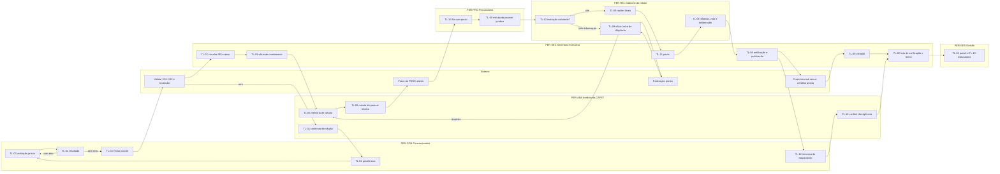
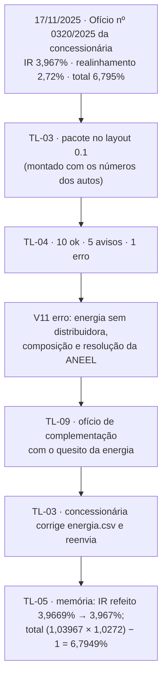
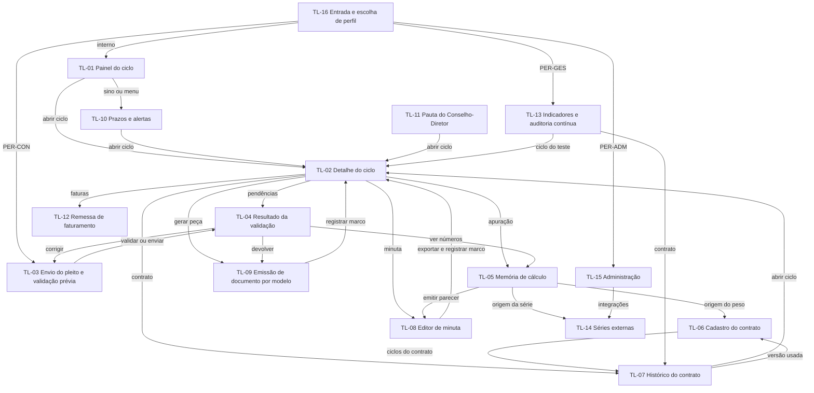

# 02. Perfis e jornadas

Para cada perfil do documento-base (`01_VISAO_ESCOPO.md`, seção 6): objetivo, tarefas frequentes, dores medidas no
AS-IS e o que o Reajusta muda. Depois, a jornada de um ciclo do protocolo ao arquivamento, por perfil e por tela, e o
mapa de navegação. As telas estão em [`11_TELAS.md`](11_TELAS.md); os componentes e as mensagens, em
[`10_UX_UI.md`](10_UX_UI.md); o protótipo, em [`prototipos/wireframes.html`](prototipos/wireframes.html).

Fontes dos números:
- `insumos/mapeamento/fatos_P01.json`: fatos da coorte de 18 processos com trilha nativa (`coorte.*`), do caso típico
  (`tipico.*`, SEI-480002/001914/2024) e do caso crítico (`critico.*`, SEI-220007/004053/2022, o ciclo de 2023 de
  Águas de Paraty);
- `insumos/mapeamento/avaliacao_P01.json`: avaliação AS-IS (gargalo, desperdícios, aplicação por atividade);
- `insumos/mapeamento/conformidade_P01.json`: conformidade aos requisitos legais R-P01;
- `saida/levantamento/calculo/`: extrações e recálculo (inclui o pleito de Paraty 2026, SEI-480002/009982/2025).

Notas de leitura:
- "du" é dia útil; "dc", dia corrido.
- Horas são **hipótese até a calibração com servidores**, dadas como faixa piso–teto por ocorrência ou por caso.
- t1 a t16 são as tarefas do BPMN (`insumos/mapeamento/modelo_P01.json`).
- As melhorias M-P01-* estão em `insumos/mapeamento/melhorias_P01.json`.

## 1. Perfis

### 1.1 PER-CON — Concessionária

| Item | Conteúdo |
|---|---|
| Objetivo | Ter o reajuste homologado antes da data de vigência, com o menor número de idas e vindas. |
| Tarefas frequentes | Montar e enviar o pleito anual (UC-01); validar o pacote antes de enviar (RF-PLE-05); ver o resultado da validação e as pendências (TL-04); corrigir e reenviar; responder diligências; acompanhar os marcos do ciclo; enviar a remessa periódica de faturamento (UC-16). |
| Telas | TL-16, TL-03, TL-04, TL-12 (visão própria). |
| Uso no celular | Sim: TL-03, TL-04 e TL-12 funcionam a 375 px (`10_UX_UI.md`, seção 8). |

Dores no AS-IS:
- **O pleito chega incompleto e a agência pede o resto por ofício.** Em Paraty 2026, a CAPET pediu os arquivos em
  Excel (memória de cálculo e tabela tarifária) pelo Ofício CAPET nº 136/2025, com prazo de 3 dias úteis
  (`extracao_SEI-480002_009982_2025.json`).
- **Diligências em série.** A Secretaria diligencia em 61% dos casos, com laço em 10 dos 11. O gabinete diligencia em
  50%, com laço em 8 dos 9. A mediana é de 5,5 ofícios por caso (`coorte.t14.*`, `coorte.t4.*`, `coorte.caso.oficios`).
- **Nada diz o que falta.** As séries vêm só com as pontas e com nome e código diferentes para a mesma série. A
  energia vem sem a resolução da ANEEL e sem a regra de composição (`docs/ESPECIFICACAO_DADOS_PLEITO.md`, seção 2).
- **Prazo de manifestação.** O ofício de razões finais concede os 10 dias do Regimento em só 22,2% dos casos (R-P01-04).
- **Acesso aos autos.** É concedido em 9 dos 18 casos; 22% das saídas da notificação de razões finais vão para um
  pedido de acesso (`coorte.t16.casos`, `coorte.transicao.t7.t16.pct`).
- **Faturas pedidas mais de uma vez.** No caso crítico, as faturas foram pedidas duas vezes à concessionária
  (`avaliacao_P01.json`, desperdício "Movimentação").

O que o sistema muda:
- Validação prévia do pacote com as mesmas regras V01 a V12, sem registro (RF-PLE-05, M-P01-10).
- Resultado com cada pendência, o número que falhou e o que fazer, na linguagem do reajuste (RNF-09).
- Pleito com erro volta sem passar por análise, com ofício único de complementação (RF-PLE-04, RF-DOC-03, M-P01-08).
- Ofícios por modelo com o prazo da norma já preenchido (RF-DOC-01).
- Remessa de faturamento no layout próprio, sem dados pessoais, no lugar dos pedidos de fatura por ofício (RF-FAT-01,
  M-P01-11).

### 1.2 PER-ANA — Analista da CAPET

| Item | Conteúdo |
|---|---|
| Objetivo | Emitir o parecer técnico com o índice certo, na primeira vez, e conferir que a tarifa homologada chegou às faturas. |
| Tarefas frequentes | Abrir o ciclo recebido; ler o resultado da validação (TL-04); conferir a memória de cálculo e as séries (TL-05, TL-14); confirmar a devolução de pleito com erro (UC-04); revisar e exportar a minuta do parecer técnico (UC-05, TL-08); consultar o histórico do contrato (UC-07, TL-07); conferir faturas (UC-17, TL-12). |
| Telas | TL-01, TL-02, TL-04, TL-05, TL-07, TL-08, TL-10, TL-12, TL-14. |

Dores no AS-IS:
- **Cálculo à mão, refeito.** O cálculo da CAPET ocorre em 100% dos casos e se repete em 13 dos 18. O refazimento
  aparece em 5 casos e o pedido de complementação em 4 (`coorte.t2.*`). A faixa é de 4,1 a 9,0 h por ocorrência
  (hipótese).
- **Parecer que não fecha.** Dos 28 cálculos refeitos, 2 pareceres da CAPET não fecham com os próprios índices
  (`saida/levantamento/calculo/resumo.json`). Um é o de Paraty 2023: IR escrito de 10,37%, refeito de 9,5601% pelos índices.
- **Erro de digitação no parecer.** O Parecer Técnico CAPET nº 343/2025 (Paraty 2026) escreve o peso P1 como 0,195
  na definição e 0,1951 no cálculo. O item 5 chama de "reajuste da fórmula" os 2,72% do realinhamento. A data do
  ofício do pleito está com o ano errado. O extenso de 6,795% está errado (`inconsistencias_textuais` da extração).
- **Coleta manual de séries.** Técnicos e gerentes coletam INCC, IPCA, ICC, tarifas da ANEEL e tarifa da CEDAE
  (desperdício "Talento não aproveitado").
- **Conferência de faturas lenta e sem marco.** A conferência ocorre em 67% dos casos. A execução tem mediana de 16 du,
  a espera antes chega a 290 du e a faixa é de 3,1 a 3,4 h por ocorrência (hipótese). Só 50% começam em até 90 dias
  da publicação (R-P01-16) (`coorte.t10.*`).

O que o sistema muda:
- Recálculo do IR e do total por máquina, com os pesos e as casas da versão contratual (RF-CAL-01, RF-CAL-02, M-P01-09).
- Busca, cache e conferência das séries públicas, e comparação das séries pagas entre pleitos (RF-SER-01, RF-SER-02).
- Memória de cálculo com a origem de cada número (RF-CAL-05, RNF-02).
- Minuta do parecer técnico gerada da apuração: os números e os extensos vêm do motor, não de digitação (RF-MIN-01,
  M-P01-15).
- Conferência de faturas por regra sobre a remessa, listando só as divergências (RF-FAT-02, M-P01-11).
- Marco de início da conferência com dono e prazo (M-P01-01).

### 1.3 PER-GCA — Gestor do cadastro

| Item | Conteúdo |
|---|---|
| Objetivo | Manter, para cada contrato, as regras de reajuste vigentes com a fonte literal de cada parâmetro. |
| Tarefas frequentes | Cadastrar contrato e versões por aditivo ou deliberação (UC-06); registrar o trecho de cada parâmetro e conferir na base de textos (V02); manter o cronograma de realinhamento; manter o calendário de data-base (RF-CAD-04); resolver pendências de cadastro apontadas por V02. |
| Telas | TL-06, TL-07, TL-10. |

Dores no AS-IS (do levantamento do contrato-piloto, `saida/levantamento/contratos/paraty_008_2014.json`):
- **Regras em quatro lugares.** A regra de Paraty fica na cláusula 20 do contrato (índices, códigos, mês de
  referência), no Anexo X (pesos), no 3º termo aditivo (combinação e cronograma de realinhamento) e na Deliberação
  4.830/2024.
- **Texto que não fecha.** O Anexo X declara que os pesos somam 1,000, mas os seis valores escritos somam 0,9999.
- **Mesma série, nomes diferentes.** Cada processo dá outro nome e outro código à mesma série. O IPC de Paraty não tem
  código no contrato, e os mesmos valores aparecem em outro processo como "IPC-Brasil DI (1390594)".
- **Componente sem regra nos autos.** A composição do IEE (TUSD + TE, tributos, bandeira) não está nos autos. O pedido
  de alteração do IEE (SEI-480002/003110/2024) foi remetido à revisão ordinária.
- **Histórico incompleto.** O 1º e o 2º termos aditivos de Paraty, que trazem as parcelas anteriores de realinhamento,
  ainda não entraram no cadastro.

O que o sistema muda:
- Versões contratuais com herança: a nova versão guarda só o que mudou (RF-CAD-01).
- Trecho literal obrigatório por parâmetro, conferido no texto do contrato (RF-CAD-02, V02).
- Cronograma de realinhamento por versão (RF-CAD-03).
- Pendência de cadastro visível no próprio parâmetro (ex.: IEE).
- Calendário de data-base com alerta antes do início da instrução (RF-CAD-04).

### 1.4 PER-PRO — Procurador

| Item | Conteúdo |
|---|---|
| Objetivo | Emitir o parecer jurídico sobre a legalidade do reajuste no prazo, sem retrabalho, com as citações certas. |
| Tarefas frequentes | Ver a fila com o prazo interno (TL-10); ler a memória de cálculo e o histórico do contrato (TL-05, TL-07); revisar a minuta do parecer jurídico com o checklist legal (UC-11, TL-08); exportar para o SEI. |
| Telas | TL-01, TL-02, TL-05, TL-07, TL-08, TL-10. |

Dores no AS-IS:
- **Prazo interno não acompanhado.** O parecer sai em até 15 dias do parecer da CAPET (art. 17, VI, do Regimento) em
  58,8% dos casos (R-P01-07, I-P01-04). A espera antes tem mediana de 3 du, mas chega a 308 du (`avaliacao_P01.json`,
  variabilidade).
- **Retrabalho.** O pedido de complementação aparece no parecer jurídico em 8 casos e o refazimento em 4. O parecer
  se repete em 8 casos, inclusive sobre embargos (`coorte.t3.*`).
- **Peças longas para homologar índice de fórmula.** Nos pilotos, as peças da Procuradoria somam 58 a 71 laudas por
  caso. A faixa é de 4,0 a 17,3 h por ocorrência (hipótese) (desperdício "Superprocessamento").
- **Consulta de rotina dispensável.** A Procuradoria opinou sobre o arquivamento em 1 dos 18 casos; 50% das saídas
  da conferência de faturas vão direto ao termo de encerramento.

O que o sistema muda:
- Prazo interno contado a partir do parecer técnico, com fila por antiguidade e alerta (RF-PRZ-05, M-P01-05).
- Minuta do parecer jurídico com o checklist legal R-P01 (interstício, antecedência de 30 dias, termo aditivo) e os
  precedentes do contrato (RF-MIN-02, M-P01-16).
- Toda citação conferida contra o texto da fonte, com marcação da inválida (RF-MIN-04).
- Encerramento sem consulta jurídica de rotina (M-P01-03).

### 1.5 PER-SEC — Secretaria Executiva

| Item | Conteúdo |
|---|---|
| Objetivo | Receber, distribuir, notificar, pautar, publicar, certificar e encerrar cada ciclo sem perder prazo e sem deixar processo parado. |
| Tarefas frequentes | Abrir o ciclo e vinculá-lo ao número SEI (RF-PLE-06); acusar recebimento; emitir documentos por modelo (UC-09, TL-09); registrar marcos (TL-02); pautar no Conselho-Diretor (UC-13, TL-11); publicar e notificar, com o prazo recursal (UC-14); certificar ausência de recurso e encerrar por lista de verificação (UC-15). |
| Telas | TL-01, TL-02, TL-09, TL-10, TL-11. |

Dores no AS-IS:
- **Recebimento repetido.** O recebimento pela Secretaria se repete em 15 dos 18 casos, em 40 ocorrências
  (`coorte.t1.casos_com_laco`; desperdício "Transporte").
- **Duas portas de diligência.** As saídas do cálculo da CAPET se dividem entre diligência do gabinete (31%) e da
  Secretaria (29%), para destinatários que se sobrepõem (`coorte.transicao.t2.*`).
- **Encerramento sem certidão.** Só 25% dos encerramentos vêm depois da certidão de ausência de recurso, exigida pela
  Resolução CODIR 787/2022 (R-P01-17, I-P01-10).
- **Esperas depois da deliberação.** A espera antes da certidão tem mediana de 51 du. A espera antes do termo de
  encerramento chega a 175 du, e o termo aparece em só 8 dos 18 casos (`coorte.t12.*`, `coorte.t13.*`).
- **Publicação que volta.** A publicação se repete em 8 casos, e 16% das saídas da publicação voltam à deliberação
  (I-P01-08).

O que o sistema muda:
- Peças de rotina por modelo versionado, com os dados do ciclo (RF-DOC-01, M-P01-13).
- Dono obrigatório por etapa (RF-PRZ-02).
- Inclusão na pauta no vencimento das razões finais (RF-PRZ-06, M-P01-06).
- Prazo recursal contado da publicação (RF-PRZ-07).
- Certidão pela regra e encerramento por lista de verificação (RF-PRZ-08, M-P01-02, M-P01-03, M-P01-14).

### 1.6 PER-REL — Gabinete do relator

| Item | Conteúdo |
|---|---|
| Objetivo | Levar o reajuste instruído à deliberação no prazo, com relatório, voto e deliberação motivados e com os números do parecer técnico. |
| Tarefas frequentes | Acompanhar a fila do gabinete (TL-10); decidir se a instrução basta; conduzir a diligência em rodada única (UC-10); emitir ofício de razões finais (TL-09); revisar as minutas de relatório, voto e deliberação (UC-12, TL-08). |
| Telas | TL-01, TL-02, TL-05, TL-07, TL-08, TL-09, TL-10. |

Dores no AS-IS:
- **O processo fica no gabinete.** O gabinete do relator tem a maior posse por caso: mediana de 74,5 du, terceiro
  quartil de 113 du e máximo de 324 du no caso crítico (`coorte.posse.CONS-02.mediana`; gargalo da avaliação).
- **Reiteração manual.** A reiteração ocorre em 6 casos (33%). A espera antes vai de 4,5 a 38 du entre quartis, com
  máximo de 85 du: no caso típico, 85 du entre o ofício à FIPE e a reiteração (`coorte.t5.*`).
- **Prazos legais perdidos.** O pronunciamento sai em até 30 dias do pleito em 17,6% dos casos (R-P01-05). A
  deliberação sai em até 40 dias do ofício de razões finais em 71,4% (R-P01-06).
- **Decisões fora da sessão e deliberações refeitas.** Há decisão do Conselho em reunião interna, cautelar ou de
  dilação do prazo de julgamento, em 44% dos casos. A deliberação se repete em 7 casos, por pedido de vista,
  voto-vista ou embargos (`coorte.t15.*`, `coorte.t8.casos_com_laco`).
- **Peças longas.** Relatório, voto e deliberação somam 27 a 65 laudas nos pilotos. A faixa da relatoria é de 5,5 a
  17,0 h por ocorrência (hipótese).

O que o sistema muda:
- Prazo de cada diligência com alerta, e reiteração gerada no dia seguinte ao vencimento, pronta para assinatura
  (RF-PRZ-03, RF-PRZ-04, M-P01-07).
- Ofício de diligência único por fase (RF-DOC-03).
- Inclusão na pauta no vencimento das razões finais (RF-PRZ-06).
- Minutas de relatório, voto e deliberação a partir dos autos, com os números do parecer da CAPET e citação
  verificada (RF-MIN-03, RF-MIN-04, M-P01-17).
- Painel da idade do ciclo no gabinete (RF-PRZ-09).

### 1.7 PER-GES — Gestão

| Item | Conteúdo |
|---|---|
| Objetivo | Saber onde cada ciclo está, quem o tem e se os prazos legais e as metas do TO-BE estão sendo cumpridos. Só leitura. |
| Tarefas frequentes | Ver o painel de ciclos (TL-01); acompanhar indicadores e auditoria contínua (UC-18, TL-13); consultar o histórico de um contrato (UC-07, TL-07). |
| Telas | TL-01, TL-02 (leitura), TL-07, TL-13. |

Dores no AS-IS:
- **Nenhum caso igual ao outro.** São 17 caminhos distintos em 18 casos; o mais frequente reúne só 2 casos
  (`coorte.n_caminhos`).
- **Processo sem dono e sem ninguém ver.** Em 10 dos 18 casos o processo ficou sem nenhuma unidade com ele aberto:
  mediana de 41 du, máximo de 225 du (I-P01-06). A ASSCONTR, unidade de apoio sem atividade no modelo, manteve a
  posse em 6 casos, com mediana de 233 du.
- **Duração.** A mediana do lead time é de 337,5 du por caso, com 137,5 du de espera entre atividades contra 26,5 du
  de execução (`coorte.caso.*`). O caso crítico, Paraty 2023, levou 698 du, com 676 du de espera.
- **Sem indicador.** Nenhum dos indicadores I-P01-01 a 10 é medido hoje (`insumos/mapeamento/controles_P01.json`).

O que o sistema muda:
- Indicadores I-P01 calculados dos marcos registrados (RF-IND-01).
- Testes contínuos dos requisitos R-P01 em cada ciclo (RF-IND-02).
- Controles de qualidade da IA Q-P01-01 a 04 medidos (RF-IND-03).
- Painel de prazos e idade por unidade (RF-PRZ-09).
- Ciclo sem dono aparece como erro no painel (RF-PRZ-02).

### 1.8 PER-ADM — Administrador

| Item | Conteúdo |
|---|---|
| Objetivo | Manter usuários, perfis, modelos de documento e integrações funcionando com segurança e trilha de auditoria. |
| Tarefas frequentes | Criar usuários internos e externos vinculados à concessionária (RF-ADM-01); atribuir perfis; publicar versão de modelo de documento (RF-ADM-03); acompanhar a situação das integrações e das séries (TL-14); consultar a trilha de auditoria (RF-ADM-02). |
| Telas | TL-14, TL-15. |
| Dores no AS-IS | Não medidas: o AS-IS não tem sistema próprio para o P01. O risco a evitar vem dos requisitos: segredo no código, sessão sem expiração, ação sem trilha (RNF-10, RNF-11). |
| O que o sistema muda | Perfis por papel, usuário externo preso à própria concessionária, modelos versionados, trilha imutável, situação das integrações e do cache numa tela. |

SIS-EXT (sistemas externos) não tem jornada de tela. Aparece em TL-14 (séries e integrações) e nas origens dos números
(CMP-05).

## 2. Jornada de ponta a ponta de um ciclo

A jornada segue o fluxo TO-BE de um ciclo de reajuste, do protocolo ao arquivamento. Ela usa o pleito real de
Paraty 2026 como fio condutor até a devolução; os passos depois são o caminho previsto. A assinatura, o protocolo, o
arquivamento e a decisão do Conselho-Diretor ficam fora do sistema (seção 3 do documento-base). O sistema registra o
marco desses atos.

### 2.1 Passo a passo

| Passo | Marco | Perfil | Tela | Ação | UC / RF | Tarefa AS-IS |
|---|---|---|---|---|---|---|
| J-01 | data-base próxima | PER-GCA, PER-ANA | TL-10 | Recebe o alerta da data-base e confere se o cadastro do contrato está vigente | RF-CAD-04 | — |
| J-02 | — | PER-GCA | TL-06 | Atualiza a versão contratual, se houver aditivo ou deliberação nova | UC-06, RF-CAD-01 a 03 | — |
| J-03 | — | PER-CON | TL-03 → TL-04 | Monta o pacote e roda a validação prévia, sem registro | RF-PLE-05 | — |
| J-04 | protocolo | PER-CON | TL-03 | Envia o pacote e recebe o recibo com os hashes | UC-01, RF-PLE-01 | t1 |
| J-05 | — | sistema | TL-04 | Valida V01 a V12, recalcula e confere séries; registra o resultado com as versões usadas | UC-02, UC-03, RF-PLE-03 | t2 (parte) |
| J-06 | abertura do ciclo | PER-SEC | TL-02 | Vincula o ciclo ao número SEI e confirma o dono (gabinete sorteado e CAPET) | RF-PLE-06, RF-PRZ-02 | t1 |
| J-07a | devolução | PER-ANA | TL-04 → TL-09 | Pleito com erro: confirma a devolução e gera o ofício de complementação com as pendências (Paraty 2026: V11, energia) | UC-04, RF-PLE-04, RF-DOC-03 | t4, t14 |
| J-07b | — | PER-CON | TL-04 → TL-03 | Vê as pendências, corrige e reenvia; volta a J-05 | UC-01 | — |
| J-08 | — | PER-SEC | TL-09 | Pleito sem erro: emite o ofício de recebimento por modelo | UC-09, RF-DOC-01 | t1 |
| J-09 | parecer técnico | PER-ANA | TL-05 → TL-08 | Confere a memória de cálculo, trata séries "a refazer" (TL-14), revisa e exporta a minuta do parecer técnico; registra o marco | UC-05, RF-CAL-05, RF-MIN-01 | t2 |
| J-10 | — | sistema | TL-10 | Abre o prazo interno da Procuradoria a partir do parecer técnico | RF-PRZ-05 | — |
| J-11 | parecer jurídico | PER-PRO | TL-10 → TL-08 | Revisa a minuta do parecer jurídico com o checklist legal e exporta; registra o marco | UC-11, RF-MIN-02, RF-MIN-04 | t3 |
| J-12 | diligência (se houver) | PER-REL | TL-02 → TL-09 | Instrução insuficiente: emite o ofício único de diligência com os quesitos e o prazo | UC-10, RF-DOC-03 | t4, t14 |
| J-13 | reiteração (se vencer) | sistema → PER-REL | TL-10 → TL-09 | No dia seguinte ao vencimento, a reiteração fica pronta para assinatura | RF-PRZ-04 | t5 |
| J-14 | razões finais | PER-REL ou PER-SEC | TL-09 | Emite o ofício de razões finais com 10 dias; o prazo começa a contar | UC-09, RF-DOC-01 | t7 |
| J-15 | pauta | PER-SEC | TL-11 | No vencimento das razões finais, inclui o ciclo na pauta | UC-13, RF-PRZ-06 | t8 (espera) |
| J-16 | deliberação | PER-REL | TL-08 → TL-02 | Revisa as minutas de relatório, voto e deliberação. O Conselho-Diretor decide fora do sistema; a SCEXEC registra o marco | UC-12, RF-MIN-03 | t8 |
| J-17 | publicação | PER-SEC | TL-09 → TL-02 | Gera a notificação e registra a publicação; o prazo recursal começa a contar | UC-14, RF-PRZ-07 | t9 |
| J-18 | início da conferência | PER-CON → PER-ANA | TL-12 | A concessionária envia a remessa de faturamento; a CAPET confere e vê só as divergências | UC-16, UC-17, RF-FAT-01, RF-FAT-02 | t10 |
| J-19 | certidão | sistema → PER-SEC | TL-10 → TL-09 | No vencimento do prazo recursal sem recurso, a certidão fica pronta; a SCEXEC confere | UC-15, RF-PRZ-08 | t12 |
| J-20 | encerramento | PER-SEC | TL-02 → TL-09 | Lista de verificação completa (certidão, conferência de faturas): gera o termo de encerramento; o arquivamento é no SEI | UC-15, RF-PRZ-08 | t13 (t11 dispensada: M-P01-03) |
| J-21 | contínuo | PER-GES | TL-01, TL-13 | Acompanha idade, dono, prazos, indicadores e testes contínuos | UC-18, RF-IND-01 a 03 | — |

### 2.2 Jornada por perfil e por tela

Leitura: as caixas são telas (TL-*) na raia do perfil que age. As setas que cruzam raias são as passagens de dono
(RF-PRZ-02). O sistema nunca decide: devolve só depois de PER-ANA confirmar (UC-04) e encerra só por PER-SEC (UC-15).

### 2.3 Jornada do pleito de Paraty 2026 (dados reais até a devolução)

No AS-IS, o mesmo pleito levou a CAPET a pedir os arquivos em Excel por ofício (prazo de 3 du). O parecer técnico saiu
em 03/12/2025, sem a regra de composição da energia nos autos, e foi a deliberação nº 4.997 que homologou 6,795%
(`extracao_SEI-480002_009982_2025.json`). No TO-BE, a pendência da energia aparece na entrada, antes de qualquer
análise.

## 3. Mapa de navegação

Itens do menu lateral por perfil (CMP-20). "●" é acesso com ação; "○", só leitura; vazio, sem acesso (CMP-18).

| Tela | CON | ANA | GCA | PRO | SEC | REL | GES | ADM |
|---|---|---|---|---|---|---|---|---|
| TL-01 Painel do ciclo | | ● | ○ | ● | ● | ● | ○ | ○ |
| TL-02 Detalhe do ciclo | | ● | ○ | ● | ● | ● | ○ | ○ |
| TL-03 Envio do pleito | ● | | | | | | | |
| TL-04 Resultado da validação | ● (só o próprio) | ● | ○ | ○ | ○ | ○ | ○ | |
| TL-05 Memória de cálculo | | ● | ○ | ○ | | ○ | ○ | |
| TL-06 Cadastro do contrato | | ○ | ● | ○ | | ○ | ○ | |
| TL-07 Histórico do contrato | | ● | ○ | ○ | | ○ | ○ | |
| TL-08 Editor de minuta | | ● (parecer técnico) | | ● (parecer jurídico) | | ● (relatório, voto, deliberação) | | |
| TL-09 Emissão de documento | | ● (ofício de complementação) | | | ● | ● | | |
| TL-10 Prazos e alertas | | ● | ● | ● | ● | ● | ○ | ○ |
| TL-11 Pauta | | | | | ● | ○ | ○ | |
| TL-12 Remessa de faturamento | ● (só a própria) | ● | | | | | ○ | |
| TL-13 Indicadores | | ○ | | | ○ | ○ | ○ | |
| TL-14 Séries externas | | ● | | | | | | ● |
| TL-15 Administração | | | | | | | | ● |
| TL-16 Entrada | ● | ● | ● | ● | ● | ● | ● | ● |

O documento-base dá TL-04 a PER-CON e PER-ANA, TL-05 a PER-ANA, PER-PRO e PER-REL, e TL-07 a PER-ANA e PER-GES. A
leitura por outros perfis internos (○) e o acesso de PER-ANA a TL-09 para o ofício de complementação (UC-04) estão
marcados como "(proposto)" em [`11_TELAS.md`](11_TELAS.md).
