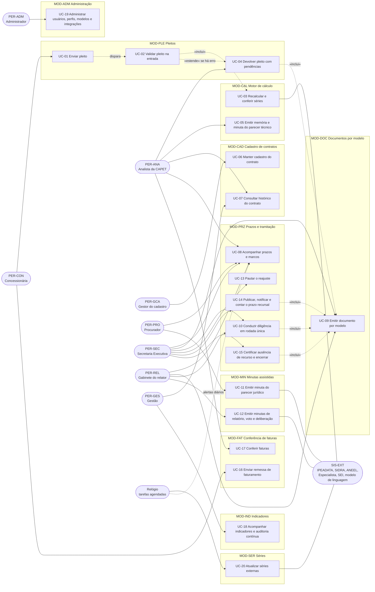
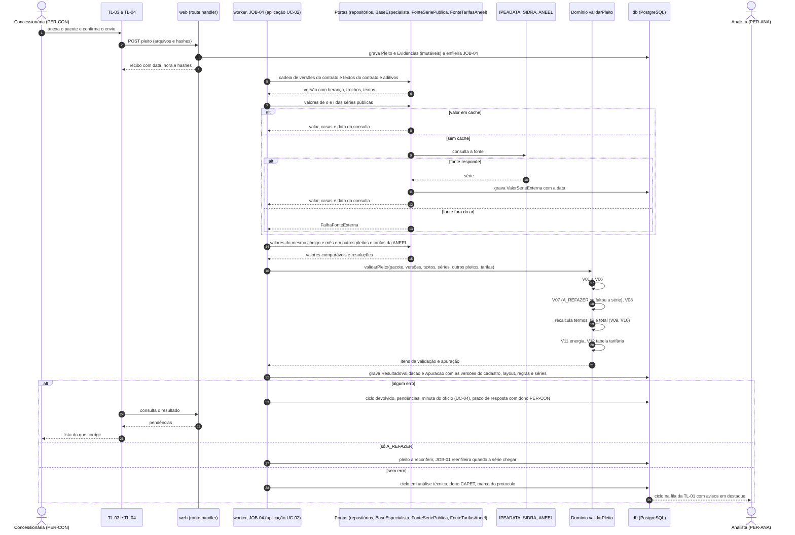
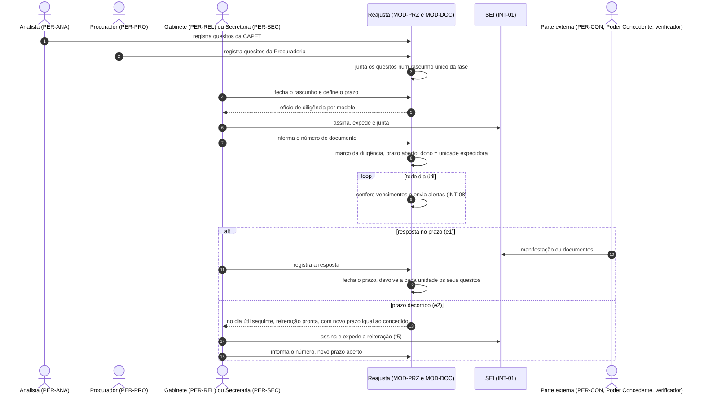
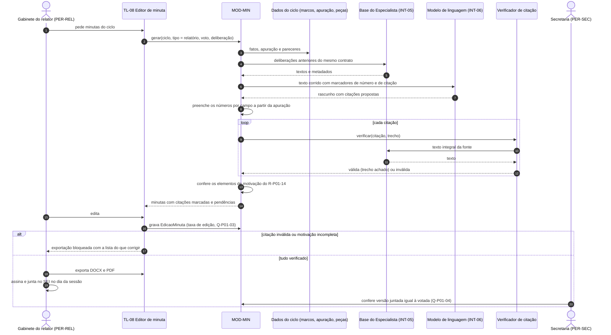
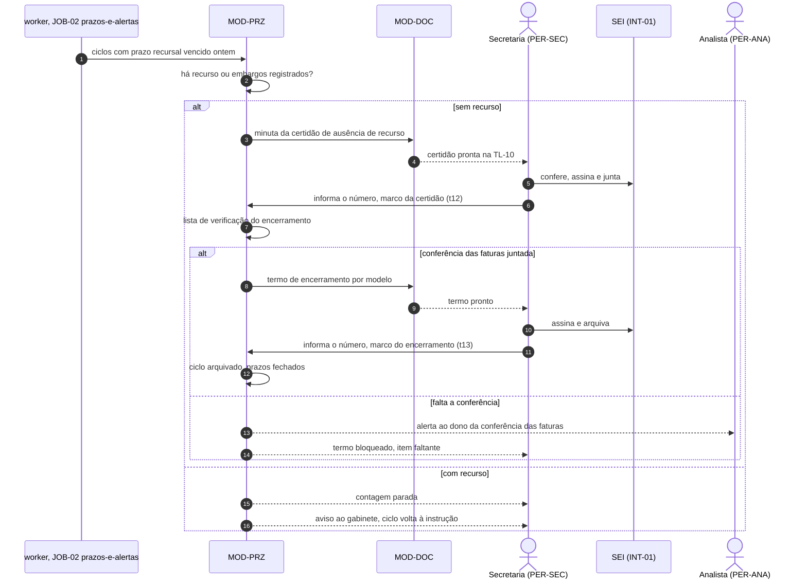
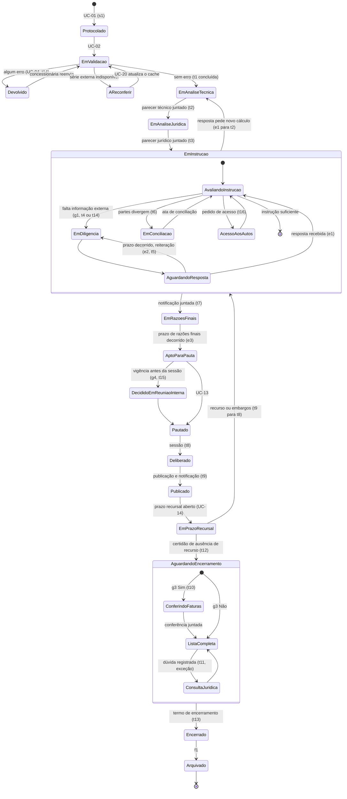

# 04. Casos de uso, sequências e estados do ciclo

Este documento descreve os 20 casos de uso fixados em [01_VISAO_ESCOPO.md](01_VISAO_ESCOPO.md) (seção 8), no estilo
de Cockburn. Cada caso aponta os requisitos (RF-*, RNF-*), as telas (TL-*), as atividades do BPMN
(`insumos/mapeamento/modelo_P01.json`, t1 a t16) e as melhorias do TO-BE (`insumos/mapeamento/melhorias_P01.json`) que lhe dão
origem.

**Convenções**

- "O sistema" é o Reajusta. Ele não assina, não protocola e não homologa (RNF-07). Toda peça sai como minuta para
  revisão e assinatura humana no SEI.
- As regras de negócio são numeradas em [08_REGRAS_NEGOCIO.md](08_REGRAS_NEGOCIO.md). Aqui elas aparecem pelo nome,
  com a marca "RN a numerar": as regras de validação V01 a V12 e os prazos do rito.
- Prazos citados pelo nome, com a origem:

| Nome do prazo | Valor | Origem |
|---|---|---|
| Prazo de pronunciamento | 30 dias corridos do recebimento do pleito até a deliberação | R-P01-05 |
| Prazo da Procuradoria | 15 dias do último parecer técnico; dilação de mais 15 só com justificativa | R-P01-07, M-P01-05 |
| Prazo de razões finais | 10 dias úteis concedidos no ofício; nenhum ato antes de decorrido | R-P01-04, R-P01-20 |
| Prazo de deliberação | 40 dias corridos do último ofício de razões finais | R-P01-06, M-P01-06 |
| Prazo da diligência | o concedido no ofício, sem encurtar; reiteração no dia útil seguinte ao vencimento | M-P01-07 |
| Prazo recursal | 10 dias úteis da publicação da deliberação (RF-PRZ-07); a ciência da concessionária aparece ao lado; certidão no dia útil seguinte | M-P01-02, M-P01-14, R-P01-17 |
| Antecedência da vigência | 30 dias entre a publicação e a aplicação da tarifa | R-P01-09 |
| Prazo da conferência das faturas | início em até 90 dias corridos da publicação | R-P01-16 |
| Interstício | 12 meses entre reajustes (V03) | R-P01-10, cadastro do contrato |

- Correspondência, na data desta versão, entre os nomes usados aqui e a numeração de
  [08_REGRAS_NEGOCIO.md](08_REGRAS_NEGOCIO.md) (em caso de diferença, vale o 08):

| Nome usado aqui | Regra em 08 |
|---|---|
| V01 a V12 | RN-V01 a RN-V12 (situação e decisão: RN-VAL-00) |
| Fórmula, combinação, realinhamento, mês de referência, interstício, encadeamento, memória | RN-CAL-01 a RN-CAL-08 |
| Versão com herança, trecho literal, pesos como escritos, data-base | RN-CAD-01 a RN-CAD-04 |
| Dias úteis e feriados | RN-PRZ-01 |
| Pronunciamento, razões finais, deliberação, Procuradoria, recursal, faturas, antecedência da vigência, diligência | RN-PRZ-03, RN-PRZ-04, RN-PRZ-05, RN-PRZ-06, RN-PRZ-07, RN-PRZ-08, RN-PRZ-10, RN-PRZ-13 |
| Marcos, dono, alertas, reiteração, pauta e certidão, encerramento, ofício único | RN-TRA-01 a RN-TRA-07 |
| Citação verificada, números por campo, taxa de edição, decisão humana | RN-MIN-01 a RN-MIN-04 |
| Remessa, tabela aplicável, recálculo da fatura, prazo da conferência | RN-FAT-01 a RN-FAT-04 |
| Testes R-P01, indicadores, controles | RN-IND-01 a RN-IND-03 |

- Dias úteis contam com os feriados do estado do Rio de Janeiro (RF-PRZ-01). Os vencimentos reais do ciclo de
  Paraty 2026 estão em `fixtures/ciclos_coorte.json` e são testados em [12_TESTES.md](12_TESTES.md).

## 1. Diagrama de casos de uso

O "Relógio" não é perfil: representa as tarefas agendadas do próprio sistema (alertas de prazo, UC-20). As ligações
com SIS-EXT passam pelas integrações INT-01 a INT-08 ([09_INTEGRACOES.md](09_INTEGRACOES.md)).

## 2. Correspondência com o BPMN

| Atividade (raia) | Nome no BPMN | Caso de uso | Melhoria |
|---|---|---|---|
| s1, t1 (SCEXEC) | Pleito protocolado; acusar recebimento e sortear relator | UC-01, UC-02, UC-09 | M-P01-08, M-P01-10 |
| t2 (CAPET) | Calcular reajuste pela fórmula paramétrica | UC-03, UC-05 | M-P01-09, M-P01-15 |
| t3 (PROC) | Analisar legalidade do reajuste | UC-11 | M-P01-05, M-P01-16 |
| g1, t4, g2, e1, e2, t5 (CONS-02) | Diligenciar, aguardar resposta, reiterar | UC-10 | M-P01-07, M-P01-08 |
| t14 (SCEXEC) | Diligenciar Poder Concedente e concessionária | UC-04 (na entrada), UC-10 (na instrução) | M-P01-08 |
| t6 (CONS-02) | Conduzir conciliação entre as partes | UC-08 (marco), UC-09 (convocação e ata) | — |
| t16 (CONS-02) | Conceder acesso aos autos às partes | UC-09 | M-P01-13 |
| t7, e3 (CONS-02) | Notificar partes para razões finais; prazo decorrido | UC-09, UC-13 | M-P01-06, M-P01-13 |
| g4, t15 (SCEXEC) | Decisão do Conselho em reunião interna | UC-13 (fluxo alternativo) | — |
| t8 (CONS-02) | Relatar, votar e deliberar | UC-12, UC-13 | M-P01-17, M-P01-18 |
| t9 (SCEXEC) | Publicar deliberação e notificar concessionária | UC-14 | M-P01-02, M-P01-13 |
| g3, t10 (CAPET) | Verificar aplicação das tarifas nas faturas | UC-16, UC-17 | M-P01-01, M-P01-11 |
| t11 (PROC) | Opinar sobre o arquivamento | UC-15 (só por exceção) | M-P01-03 |
| t12 (SCEXEC) | Certificar ausência de recurso | UC-15 | M-P01-02, M-P01-14 |
| t13, f1 (SCEXEC) | Encerrar e arquivar | UC-15 | M-P01-03, M-P01-14 |
| todas | marcos, donos, prazos e idade | UC-08, UC-18 | M-P01-04, M-P01-12 |

## 3. Descrições

### UC-01 Enviar pleito

| Campo | Conteúdo |
|---|---|
| Ator principal | PER-CON |
| Atores secundários | sistema (UC-02); SIS-EXT SEI (INT-01), onde o ofício do pleito continua sendo protocolado |
| Objetivo | Entregar o pleito de um ciclo de reajuste no layout 0.1, com as evidências, e saber na hora se ele passa |
| Módulo | MOD-PLE |
| Pré-condições | 1. O usuário externo está autenticado e vinculado à concessionária (RF-ADM-01). 2. O contrato tem cadastro com versão vigente publicada (UC-06). 3. O ciclo ainda não tem pleito aceito |
| Gatilho | Aproximação da data-base do contrato (alerta do RF-CAD-04) ou decisão da concessionária de pleitear |

**Fluxo principal**

1. A concessionária abre a TL-03 e escolhe o contrato. A tela mostra a versão contratual vigente, as siglas e os
   códigos de série do cadastro e os meses de referência que a regra do contrato manda.
2. A concessionária anexa `pleito.json`, `series.csv`, `energia.csv`, `tabela_tarifaria.csv`, as exportações das
   fontes, a memória de cálculo e a publicação (layout em `saida/levantamento/pleito/pleito_reajuste.schema.json`).
3. O sistema calcula o SHA-256 de cada arquivo e confere com o hash declarado no `pleito.json` (RF-PLE-01).
4. A concessionária pede a validação prévia. O sistema roda as mesmas regras de UC-02, sem registro no ciclo
   (RF-PLE-05), e mostra o resultado na TL-04.
5. A concessionária corrige o que precisar e confirma o envio.
6. O sistema grava o `Pleito` e as `Evidencia`s, emite o recibo com data, hora e hashes e dispara UC-02.
7. A concessionária protocola o ofício do pleito no SEI com o recibo anexado. O número do processo SEI é informado
   no envio ou registrado depois pela Secretaria (RF-PLE-06).

**Fluxos alternativos**

- 4a. A validação prévia aponta erro: a tela mostra as pendências; a concessionária pode corrigir e validar de novo
  quantas vezes quiser. Nada fica registrado no ciclo.
- 5a. A concessionária envia com erro mesmo assim: o envio é aceito e UC-02 devolve o pleito por UC-04.

**Exceções**

- 3a. Hash diferente do declarado: o envio é recusado com a lista dos arquivos divergentes.
- 3b. Arquivo com dado pessoal (por exemplo, coluna de CPF ou nome de usuário na tabela): o envio é recusado
  (RNF-05) e o arquivo não é gravado.
- 1a. Contrato sem versão vigente no cadastro: a tela informa e não aceita o envio; o gestor do cadastro é avisado.

**Pós-condições:** pleito gravado e imutável, com recibo; UC-02 iniciado; trilha de auditoria registrada (RF-ADM-02).

| Campo | Conteúdo |
|---|---|
| Regras de negócio | V01 (layout); hash dos anexos; recusa de dado pessoal; regra do mês de referência da versão (RN a numerar) |
| Requisitos | RF-PLE-01, RF-PLE-05, RF-PLE-06, RF-ADM-01, RF-ADM-02, RNF-05, RNF-09 |
| Telas | TL-03, TL-04 |
| BPMN e origem | s1, t1; M-P01-08, M-P01-10; `docs/ESPECIFICACAO_DADOS_PLEITO.md`, seção 3 |

### UC-02 Validar pleito na entrada

| Campo | Conteúdo |
|---|---|
| Ator principal | sistema (gatilho: UC-01) |
| Atores secundários | SIS-EXT IPEADATA e IBGE SIDRA (INT-02, INT-03), ANEEL (INT-04), base do Especialista (INT-05); PER-ANA recebe o resultado |
| Objetivo | Aplicar as regras V01 a V12 ao pleito e decidir, sem análise humana, se ele segue para a CAPET ou volta à concessionária |
| Módulo | MOD-PLE (inclui UC-03 de MOD-CAL e MOD-SER) |
| Pré-condições | Pleito gravado por UC-01; cadastro do contrato com a versão informada no pleito |
| Gatilho | Envio confirmado em UC-01 |

**Fluxo principal**

1. O sistema valida o arquivo contra o layout 0.1 (V01). Erro de layout encerra a validação neste passo.
2. Carrega a versão contratual informada, com os campos herdados das versões anteriores, e confere que cada trecho
   do cadastro existe no texto do contrato ou do aditivo (V02).
3. Confere o interstício (V03) e os meses de referência o e i pela regra do contrato (V04).
4. Confere as siglas e os códigos de série contra o cadastro (V05) e a série mensal completa de o até i (V06).
5. Inclui UC-03: busca as séries públicas e compara (V07), compara as pagas com outros pleitos (V08), recalcula o IR
   e o total (V09, V10).
6. Confere a energia (V11) e a tabela tarifária (V12).
7. Grava o `ResultadoValidacao` com um `ItemValidacao` por conferência e as versões do cadastro, do layout, das
   regras e das séries usadas (RF-PLE-03, RNF-03).
8. Sem erro: abre o ciclo de reajuste (RF-PLE-06) na situação "em análise técnica", atribui o dono CAPET
   (RF-PRZ-02), registra o marco do protocolo e põe o pleito na fila do analista na TL-01, com os avisos em destaque.

**Fluxos alternativos**

- 8a. Há pelo menos um erro: segue UC-04. O ciclo fica "devolvido", com dono PER-CON e o prazo de resposta
  correndo.
- 5a. Componente de fonte "outro reajuste" (preço da água da CEDAE): o sistema usa a variação da apuração
  homologada no ciclo correspondente; se o pleito escreveu o insumo com menos casas, registra aviso de
  arredondamento (caso dos Blocos 1 e 4, AT-04).

**Exceções**

- 5b. Fonte pública fora do ar: o sistema usa o cache; sem valor em cache, marca V07 como "a refazer", segue com as
  demais regras e agenda nova conferência (RF-SER-04, RNF-06). O ciclo não é devolvido só por isso.
- 2a. Textos dos contratos indisponíveis (INT-05 fora): V02 dá aviso "trechos não conferidos nesta execução", como
  o oráculo `scripts/validar_pleito.py`.

**Pós-condições:** resultado de validação imutável e reproduzível (mesma entrada, mesmo resultado); ciclo aberto ou
pleito devolvido; tempo total abaixo de 60 s com séries em cache (RNF-13).

| Campo | Conteúdo |
|---|---|
| Regras de negócio | V01 a V12; regra de situação final: um erro devolve, aviso segue com destaque (RN a numerar) |
| Requisitos | RF-PLE-02, RF-PLE-03, RF-PLE-04, RF-PLE-06, RF-CAL-01 a RF-CAL-04, RF-SER-01 a RF-SER-04, RNF-01 a RNF-03, RNF-06, RNF-13 |
| Telas | TL-04, TL-01, TL-02 |
| BPMN e origem | antes de t2; M-P01-08, M-P01-09, M-P01-10; Paraty 2026 deu 10 ok, 5 avisos e 1 erro (`saida/levantamento/pleito/exemplo_paraty_2026.validacao.json`) |

### UC-03 Recalcular e conferir séries

| Campo | Conteúdo |
|---|---|
| Ator principal | sistema (incluído em UC-02; chamado também por UC-05 e UC-07) |
| Atores secundários | SIS-EXT IPEADATA, IBGE SIDRA, ANEEL; FGV Dados quando houver licença (INT-07) |
| Objetivo | Refazer o IR e o total com os pesos da versão contratual e mostrar de onde vem cada número |
| Módulo | MOD-CAL, MOD-SER |
| Pré-condições | Versão contratual carregada; meses o e i definidos; valores de o e i de cada componente no pleito |
| Gatilho | Passo 5 de UC-02, ou pedido de recálculo na TL-05 |

**Fluxo principal**

1. Para cada componente público, o sistema obtém o valor de o e i na série da fonte, do cache ou da API, com a data
   da consulta (RF-SER-01), e compara nas casas decimais enviadas (V07).
2. Para cada componente pago, compara o valor com o do mesmo código de série e mês em outros pleitos (V08,
   RF-SER-02). Sem outro pleito, registra aviso.
3. Para a energia, lê as tarifas homologadas da ANEEL e aplica a regra de composição da versão (V11, RF-SER-03).
4. Calcula cada termo: peso × (Ii / Io − 1). Na família de índice único, IR = Ii / Io − 1.
5. Soma os termos, arredonda nas casas do contrato e compara com o IR declarado, com tolerância de 0,01 ponto
   percentual (V09, RF-CAL-01, RNF-01).
6. Busca a parcela de realinhamento do mês da vigência no cronograma da versão e compõe o total pela regra de
   combinação da versão (V10, RF-CAL-02).
7. Grava a `Apuracao` com um `TermoApuracao` por componente e a origem de cada número (RF-CAL-05, RNF-02).

**Fluxos alternativos**

- 4a. O pleito trouxe só a variação, sem números-índice: o termo usa a variação escrita, e a memória marca "variação
  informada, não recalculada".
- 6a. A versão não tem cronograma de realinhamento para o mês: o total é o próprio IR combinado com os demais
  componentes informados.

**Exceções**

- 1a. Fonte fora do ar e sem cache: termo marcado "a refazer" (RF-SER-04); IR calculado com o valor do pleito e
  identificado como não conferido.
- 3a. Regra de composição da energia ausente na versão: V11 dá erro "regra de composição não cadastrada" (decisão
  em aberto da CAPET, ver [09_INTEGRACOES.md](09_INTEGRACOES.md), INT-04).

**Pós-condições:** apuração gravada com as versões das séries; cada número da TL-05 aponta a sua origem.

| Campo | Conteúdo |
|---|---|
| Regras de negócio | V07 a V11; fórmula de índices ponderados e de índice único; regra de combinação (produto ou soma, parâmetro da versão); arredondamento nas casas do contrato (RN a numerar) |
| Requisitos | RF-CAL-01, RF-CAL-02, RF-CAL-05, RF-SER-01 a RF-SER-04, RNF-01 a RNF-04 |
| Telas | TL-05, TL-14 |
| BPMN e origem | t2; M-P01-09; 24 de 28 cálculos da coorte conferem (`saida/levantamento/calculo/resumo.json`) |

### UC-04 Devolver pleito com pendências

| Campo | Conteúdo |
|---|---|
| Ator principal | PER-ANA (confirma) |
| Atores secundários | sistema; PER-CON (recebe); PER-SEC (assina e expede no SEI quando o canal é o ofício) |
| Objetivo | Devolver numa só vez tudo o que falta, em vez de diligências sucessivas |
| Módulo | MOD-PLE, MOD-DOC |
| Pré-condições | Resultado de validação com pelo menos um erro |
| Gatilho | Fim de UC-02 com erro |

**Fluxo principal**

1. O sistema gera a lista de pendências: um item por `ItemValidacao` com erro, na linguagem de quem analisa, com o
   que corrigir. Os avisos vão em seção separada, como observação.
2. O sistema gera a minuta do ofício de complementação pelo modelo vigente (UC-09), com as pendências e o prazo de
   resposta.
3. O analista revisa a lista e a minuta na TL-04 e confirma.
4. O sistema muda o ciclo para "devolvido", registra o marco e o prazo de resposta com dono PER-CON (RF-PRZ-01,
   RF-PRZ-02) e mostra as pendências à concessionária na TL-03.
5. A Secretaria assina e expede o ofício no SEI e registra o número do documento (INT-01).

**Fluxos alternativos**

- 3a. O analista discorda de um erro: registra a justificativa; o item passa a "aceito pelo analista" e não entra no
  ofício. A justificativa fica na trilha de auditoria. Se não sobrar erro, o ciclo segue como em UC-02, passo 8.
- 4a. A concessionária reenvia o pleito corrigido: novo `Pleito` vinculado ao mesmo ciclo; UC-02 roda de novo.

**Exceções**

- 4b. Prazo de resposta vence sem reenvio: alerta ao analista e à Secretaria (UC-08); reiteração por UC-10.

**Pós-condições:** uma só devolução por rodada de validação; pendências visíveis para a concessionária.

| Campo | Conteúdo |
|---|---|
| Regras de negócio | V01 a V12 (só os erros viram pendência); prazo da diligência (RN a numerar) |
| Requisitos | RF-PLE-04, RF-DOC-01, RF-DOC-03, RF-PRZ-01, RF-PRZ-02, RNF-07, RNF-09 |
| Telas | TL-04, TL-09, TL-03 |
| BPMN e origem | t14 na entrada; M-P01-08; diligência pela Secretaria em 61% dos casos (`insumos/mapeamento/fatos_P01.json`) |

### UC-05 Emitir memória e minuta do parecer técnico

| Campo | Conteúdo |
|---|---|
| Ator principal | PER-ANA |
| Atores secundários | sistema; SIS-EXT modelo de linguagem (INT-06), só para o texto corrido |
| Objetivo | Ter a memória de cálculo e a minuta do parecer técnico prontas para revisão, com todo número vindo da apuração |
| Módulo | MOD-CAL, MOD-MIN |
| Pré-condições | Ciclo "em análise técnica"; apuração gravada sem erro de V09 e V10 |
| Gatilho | O analista abre o ciclo na TL-02 e pede a minuta |

**Fluxo principal**

1. O sistema monta a memória de cálculo: índice, peso, o, i, variação e termo ponderado de cada componente, o IR, a
   parcela de realinhamento e o total, cada número com a origem (RF-CAL-05). A TL-05 a mostra.
2. O sistema gera a minuta do parecer técnico no padrão das peças da CAPET da coorte (fatos, análise, apuração,
   conclusão), com os números inseridos por campo a partir da apuração (RF-MIN-01).
3. O sistema verifica as citações de cláusula e deliberação (RF-MIN-04) e marca as inválidas.
4. O analista revisa e edita na TL-08. O sistema grava cada edição (RF-MIN-05).
5. O analista exporta a peça em DOCX ou PDF (RF-DOC-02), assina no SEI e registra o número do documento. O sistema
   registra o marco do parecer técnico, o que inicia o prazo da Procuradoria (UC-08).

**Fluxos alternativos**

- 2a. Apuração com aviso: a minuta traz o aviso numa seção "pontos de atenção", para o analista decidir.
- 4a. O analista muda um número: o sistema não aceita edição de número na minuta; o número só muda refazendo a
  apuração (UC-03), para manter a origem.

**Exceções**

- 2b. Modelo de linguagem indisponível: a minuta sai só com as seções estruturadas (memória e conclusão por modelo);
  o texto corrido fica para o analista.

**Pós-condições:** memória e minuta versionadas; marco do parecer técnico registrado quando o número SEI é informado.

| Campo | Conteúdo |
|---|---|
| Regras de negócio | V09, V10; números só da apuração; prazo da Procuradoria começa no marco (RN a numerar) |
| Requisitos | RF-CAL-05, RF-MIN-01, RF-MIN-04, RF-MIN-05, RF-DOC-02, RF-PRZ-05, RNF-02, RNF-07 |
| Telas | TL-05, TL-08, TL-02 |
| BPMN e origem | t2; M-P01-09, M-P01-15; Q-P01-01 |

### UC-06 Manter cadastro do contrato

| Campo | Conteúdo |
|---|---|
| Ator principal | PER-GCA |
| Atores secundários | SIS-EXT base do Especialista (INT-05) |
| Objetivo | Manter as regras de reajuste de cada contrato, com uma versão por ato que as muda e o trecho literal de cada parâmetro |
| Módulo | MOD-CAD |
| Pré-condições | Texto do contrato ou do aditivo disponível na base (INT-05) |
| Gatilho | Novo contrato, termo aditivo ou deliberação que muda o reajuste |

**Fluxo principal**

1. O gestor abre a TL-06 e cria uma `VersaoContratual` a partir da vigente. A nova versão herda todos os campos
   (RF-CAD-01).
2. Informa o ato, a data de vigência e só os parâmetros que o ato muda: periodicidade, regra do mês de referência,
   fórmula, pesos, componentes, códigos de série, casas decimais, regra de combinação, cronograma de realinhamento
   (RF-CAD-03), regra de composição da energia e data-base (RF-CAD-04).
3. Para cada parâmetro, informa o documento e o trecho literal (`FonteRegra`).
4. O sistema confere cada trecho no texto do documento, com espaços normalizados (V02, RF-CAD-02).
5. Com todos os trechos achados, o gestor publica a versão. Ela passa a valer para pleitos com vigência a partir da
   data informada.

**Fluxos alternativos**

- 4a. Texto de OCR com a fórmula ilegível (caso de Paraty): o gestor registra o parâmetro pela definição de cada
  índice e marca "reconstruído", com justificativa. A versão publica com aviso permanente.
- 1a. Contrato novo: o gestor cria o `Contrato` e a primeira versão, sem herança.

**Exceções**

- 4b. Trecho não achado: a versão não publica; a tela mostra o parâmetro e o trecho procurado.
- 5a. Já existe ciclo aberto que usa a versão anterior: a nova versão não altera a apuração gravada (RNF-03); o
  analista pode pedir recálculo com a nova versão, que gera nova apuração.

**Pós-condições:** versão publicada, imutável depois de usada por um pleito; trilha de auditoria.

| Campo | Conteúdo |
|---|---|
| Regras de negócio | V02; herança de versão; cronograma de realinhamento; calendário de data-base (RN a numerar) |
| Requisitos | RF-CAD-01 a RF-CAD-04, RF-ADM-02, RNF-02, RNF-03, RNF-11 |
| Telas | TL-06 |
| BPMN e origem | transversal a t2; M-P01-09; `saida/levantamento/contratos/paraty_008_2014.json` (12 trechos achados) |

### UC-07 Consultar histórico do contrato

| Campo | Conteúdo |
|---|---|
| Ator principal | PER-ANA, PER-GES |
| Objetivo | Ver, por contrato, cada ciclo com índices, resultado declarado, refeito e deliberado, e o encadeamento dos meses |
| Módulo | MOD-CAD, MOD-CAL |
| Pré-condições | Contrato cadastrado; ao menos um ciclo |
| Gatilho | Consulta na TL-07 ou link a partir da TL-02 |

**Fluxo principal**

1. O usuário escolhe o contrato.
2. A TL-07 lista os ciclos em ordem de vigência: versão contratual, meses o e i, IR declarado, IR refeito, total
   deliberado, deliberação e situação.
3. O sistema confere que o mês o de cada ciclo é o mês i do ciclo anterior e marca a quebra (RF-CAL-06).
4. O usuário abre um ciclo e vê a memória de cálculo (TL-05).

**Fluxos alternativos**

- 3a. Ciclo anterior não homologado: o sistema mostra o acúmulo de meses do ciclo seguinte (caso dos resíduos
  sólidos de 2023, set/2021 a set/2023) e não marca quebra quando a versão prevê o acúmulo.
- 2a. Perfil PER-GES: os valores de séries pagas aparecem só como variação, sem o número-índice (RNF-04).

**Pós-condições:** nenhuma alteração de dado.

| Campo | Conteúdo |
|---|---|
| Regras de negócio | encadeamento o = i anterior; acúmulo quando o anterior não foi homologado; licença das séries pagas (RN a numerar) |
| Requisitos | RF-CAL-06, RNF-02, RNF-04 |
| Telas | TL-07, TL-05 |
| BPMN e origem | t2, t8; AT-08 |

### UC-08 Acompanhar prazos e marcos do ciclo

| Campo | Conteúdo |
|---|---|
| Ator principal | PER-SEC, PER-REL, PER-ANA, PER-PRO |
| Atores secundários | sistema (tarefa diária de alertas); INT-08 correio |
| Objetivo | Saber, por ciclo e por unidade, qual é o próximo ato, quem é o dono e quando vence |
| Módulo | MOD-PRZ |
| Pré-condições | Ciclo aberto |
| Gatilho | Abertura da TL-10 ou da TL-01; tarefa diária de alertas |

**Fluxo principal**

1. Cada ato do rito registrado no sistema (ou informado com o número do documento SEI) vira um `Marco` datado.
2. A partir de cada marco, o sistema abre os prazos que dele decorrem, em dias corridos ou úteis com os feriados do
   estado (RF-PRZ-01), e atribui o dono (RF-PRZ-02).
3. A TL-10 mostra a fila do usuário: ciclos com prazo correndo, vencimento, dias restantes e idade do ciclo.
4. A TL-01 mostra a fila geral por unidade, com a idade de cada ciclo e os ciclos parados (RF-PRZ-09).
5. Todo dia útil, o sistema avisa o dono antes do vencimento e no dia do vencimento, na tela e por correio (RF-PRZ-03).

**Fluxos alternativos**

- 2a. Ato sem dono definido pela regra (por exemplo, depois da deliberação): o dono é a Secretaria Executiva; nenhum
  ciclo fica sem unidade (RF-PRZ-02, M-P01-04).
- 5a. Prazo vencido: o alerta sobe para a chefia da unidade dona.
- 1a. Conciliação entre as partes (t6): o relator registra a convocação e a ata como marcos; os prazos seguem.

**Exceções**

- 5b. Correio fora do ar: o alerta fica na tela e o envio é refeito (INT-08).

**Pós-condições:** marcos, prazos e alertas gravados; indicadores de UC-18 alimentados.

| Campo | Conteúdo |
|---|---|
| Regras de negócio | todos os prazos do quadro de convenções; contagem em dias úteis; dono padrão (RN a numerar) |
| Requisitos | RF-PRZ-01 a RF-PRZ-03, RF-PRZ-09, RNF-09 |
| Telas | TL-10, TL-01, TL-02 |
| BPMN e origem | todas as atividades; M-P01-04, M-P01-12; I-P01-06 (41 du sem unidade na linha de base) |

### UC-09 Emitir documento por modelo

| Campo | Conteúdo |
|---|---|
| Ator principal | PER-SEC, PER-REL |
| Objetivo | Gerar a peça de rotina com os dados do ciclo, pronta para conferência e assinatura |
| Módulo | MOD-DOC |
| Pré-condições | Modelo de documento publicado para o tipo de peça (UC-19) |
| Gatilho | Ato do rito que pede peça: recebimento, diligência, reiteração, razões finais, acesso aos autos, convocação de conciliação, notificação da deliberação, certidão, termo de encerramento |

**Fluxo principal**

1. O usuário escolhe o ciclo e o tipo de peça na TL-09 (ou o sistema propõe a peça devida pela situação do ciclo).
2. O sistema preenche o modelo vigente com partes, contrato, processo SEI, prazo, consequência do silêncio e
   referência aos documentos (RF-DOC-01).
3. O usuário confere, ajusta o texto livre e gera DOCX e PDF (RF-DOC-02).
4. O usuário assina e inclui no SEI e informa o número do documento. O sistema registra a `Peca`, a versão do modelo
   e o marco correspondente (UC-08).

**Fluxos alternativos**

- 2a. Campo obrigatório sem dado (por exemplo, prazo não definido): a geração para e aponta o campo.

**Exceções**

- 4a. O número SEI não é informado: a peça fica "gerada, não juntada" e não abre prazo.

**Pós-condições:** peça gravada com a versão do modelo; marco e prazos abertos quando juntada.

| Campo | Conteúdo |
|---|---|
| Regras de negócio | conteúdo mínimo de cada peça; prazo de razões finais de 10 dias; acesso aos autos liberado na notificação (RN a numerar) |
| Requisitos | RF-DOC-01, RF-DOC-02, RF-ADM-03, RNF-07 |
| Telas | TL-09 |
| BPMN e origem | t1, t4, t5, t6, t7, t9, t12, t13, t14, t16; M-P01-13 |

### UC-10 Conduzir diligência em rodada única

| Campo | Conteúdo |
|---|---|
| Ator principal | PER-REL, PER-SEC |
| Atores secundários | PER-ANA e PER-PRO (informam quesitos); PER-CON, Poder Concedente ou verificador (respondem) |
| Objetivo | Pedir numa só vez, por uma só porta, tudo o que falta na fase, e não deixar o prazo correr sem dono |
| Módulo | MOD-PRZ, MOD-DOC |
| Pré-condições | Ciclo em instrução (depois de t2 ou t3); gateway "Instrução suficiente?" respondido "falta informação externa" |
| Gatilho | Quesito registrado pela CAPET, pela Procuradoria ou pelo relator |

**Fluxo principal**

1. Cada unidade registra seus quesitos no ciclo. O sistema os junta numa única `Peca` em rascunho por fase
   (RF-DOC-03).
2. A unidade que conduz a diligência (gabinete ou Secretaria, uma só porta) fecha o rascunho e define o prazo.
3. O sistema gera o ofício de diligência por modelo (UC-09), com os quesitos e a consequência do silêncio.
4. Juntado o ofício, o sistema abre o prazo da diligência; a unidade expedidora é dona enquanto ele corre.
5. A resposta chega (e1): a unidade registra o marco; o sistema fecha o prazo e devolve o ciclo à unidade que pediu
   cada quesito.

**Fluxos alternativos**

- 5a. Prazo decorrido sem resposta (e2): no dia útil seguinte ao vencimento, o sistema deixa a reiteração pronta para
  assinatura, com novo prazo igual ao concedido (RF-PRZ-04, t5).
- 1a. Quesito chega depois de o ofício ser expedido: entra no rascunho da próxima fase, ou exige justificativa para
  nova diligência na mesma fase (registrada na trilha).
- 1b. Pedido de acesso aos autos (t16): o sistema gera o ofício de acesso por UC-09, com prazo.

**Exceções**

- 4a. Pedido de dilação pela parte: o relator decide; o sistema registra a decisão e o novo vencimento.

**Pós-condições:** uma diligência por fase; prazo com dono; reiteração no dia útil seguinte ao vencimento.

| Campo | Conteúdo |
|---|---|
| Regras de negócio | ofício único por fase; prazo da diligência sem encurtar; reiteração no dia útil seguinte (RN a numerar) |
| Requisitos | RF-DOC-03, RF-PRZ-01 a RF-PRZ-04 |
| Telas | TL-10, TL-09, TL-02 |
| BPMN e origem | g1, t4, g2, e1, e2, t5, t14, t16; M-P01-07, M-P01-08; diligências repetidas pela Secretaria em 61% e pelo gabinete em 50% dos casos |

### UC-11 Emitir minuta do parecer jurídico

| Campo | Conteúdo |
|---|---|
| Ator principal | PER-PRO |
| Atores secundários | SIS-EXT base do Especialista (INT-05), modelo de linguagem (INT-06) |
| Objetivo | Receber o processo com a pré-análise legal feita e as partes repetitivas minutadas, com citação verificada |
| Módulo | MOD-MIN |
| Pré-condições | Parecer técnico juntado (marco); prazo da Procuradoria correndo |
| Gatilho | Marco do parecer técnico, ou consulta do relator, ou embargos |

**Fluxo principal**

1. O sistema monta a linha do tempo da instrução a partir dos marcos e o resumo do pleito e da apuração.
2. Levanta os reajustes anteriores do mesmo contrato e as deliberações e normas aplicáveis (INT-05).
3. Roda o checklist legal com os requisitos R-P01 aplicáveis ao momento (`insumos/mapeamento/normas_P01.json`):
   interstício, antecedência de 30 dias, termo aditivo, ordem dos atos, e marca o que está em desacordo
   (RF-MIN-02).
4. Gera a minuta das partes repetitivas do parecer e verifica cada citação contra o texto da fonte (RF-MIN-04).
5. O procurador revisa e edita na TL-08; o sistema grava as edições (RF-MIN-05). A interpretação e a conclusão são
   do procurador.
6. O procurador exporta, assina no SEI e informa o número. O sistema registra o marco do parecer jurídico.

**Fluxos alternativos**

- 3a. Embargos: o sistema confronta cada alegação com a deliberação embargada e lista as alegações.
- 5a. Pedido de dilação do prazo: exige justificativa e registro de autorização do Procurador-Geral (M-P01-05).

**Exceções**

- 4a. Citação não achada na fonte: fica marcada como inválida e bloqueia a exportação até ser corrigida ou removida.

**Pós-condições:** minuta revista; marco registrado; taxa de edição medida (Q-P01-02).

| Campo | Conteúdo |
|---|---|
| Regras de negócio | checklist legal R-P01; prazo da Procuradoria; citação verificada (RN a numerar) |
| Requisitos | RF-MIN-02, RF-MIN-04, RF-MIN-05, RF-PRZ-05, RNF-07 |
| Telas | TL-08, TL-02 |
| BPMN e origem | t3; M-P01-05, M-P01-16; Q-P01-02; R-P01-07 conforme em 58,8% dos casos |

### UC-12 Emitir minutas de relatório, voto e deliberação

| Campo | Conteúdo |
|---|---|
| Ator principal | PER-REL |
| Atores secundários | SIS-EXT base do Especialista (INT-05), modelo de linguagem (INT-06); PER-SEC (confere antes da publicação) |
| Objetivo | Ter relatório, voto e deliberação minutados a partir dos autos, no padrão das deliberações anteriores do contrato, com citações verificadas |
| Módulo | MOD-MIN |
| Pré-condições | Pareceres técnico e jurídico juntados; prazo de razões finais decorrido ou ciclo pautado (UC-13) |
| Gatilho | Inclusão em pauta ou pedido do relator |

**Fluxo principal**

1. O sistema reúne os fatos do ciclo: marcos, apuração, pareceres, manifestações e razões finais.
2. Busca as deliberações anteriores do mesmo contrato (INT-05) como padrão de forma.
3. Gera as minutas de relatório, voto e deliberação com a fórmula contratual, os índices, o percentual e as razões
   de eventual divergência dos pareceres (RF-MIN-03). Os números vêm da apuração e dos pareceres, por campo.
4. Verifica cada citação contra o texto da fonte; as inválidas ficam marcadas (RF-MIN-04).
5. Confere a presença dos quatro elementos de motivação do R-P01-14 e mostra o que faltar.
6. O gabinete revisa e edita; o sistema grava as edições (RF-MIN-05).
7. Depois da sessão, o gabinete ajusta a minuta ao votado, assina e junta no SEI no dia da sessão; a Secretaria
   confere que a versão juntada é a votada (Q-P01-04).

**Fluxos alternativos**

- 3a. Pedido de vista: o sistema prepara o quadro das divergências entre as manifestações.
- 3b. Decisão em reunião interna antes da sessão (t15): a minuta de decisão do Conselho segue o mesmo fluxo.

**Exceções**

- 4a. Citação inválida: bloqueia a exportação até ser corrigida.
- 3c. Número da minuta diferente do parecer da CAPET: o sistema marca a divergência; ela só sai com justificativa do
  relator escrita na minuta (motivação do R-P01-14).

**Pós-condições:** minutas versionadas, com citações verificadas e taxa de edição medida (Q-P01-03).

| Campo | Conteúdo |
|---|---|
| Regras de negócio | motivação com fórmula, índices, percentual e razões de divergência; citação verificada; números por campo (RN a numerar) |
| Requisitos | RF-MIN-03, RF-MIN-04, RF-MIN-05, RNF-02, RNF-07 |
| Telas | TL-08, TL-02 |
| BPMN e origem | t8, t15; M-P01-17, M-P01-18; Q-P01-03, Q-P01-04; R-P01-14 |

### UC-13 Pautar o reajuste no Conselho-Diretor

| Campo | Conteúdo |
|---|---|
| Ator principal | PER-SEC |
| Atores secundários | PER-REL |
| Objetivo | Incluir o ciclo na primeira sessão com pauta aberta logo que vencem as razões finais |
| Módulo | MOD-PRZ |
| Pré-condições | Ofício de razões finais juntado (t7) |
| Gatilho | Vencimento do prazo de razões finais (e3) |

**Fluxo principal**

1. No vencimento das razões finais, o sistema põe o ciclo na lista de aptos, ordenada pela data de vencimento
   (RF-PRZ-06).
2. A TL-11 mostra as sessões do calendário e propõe a primeira com pauta aberta.
3. A Secretaria confirma a inclusão; o sistema registra o marco e abre o prazo de deliberação.
4. Na sessão, a Secretaria registra o resultado; segue UC-12 (passo 7) e UC-14.

**Fluxos alternativos**

- 1a. Vigência antes da sessão ou pedido de dilação do julgamento (g4 "Sim"): o relator pede decisão em reunião
  interna (t15); o sistema registra a decisão e mantém o ciclo apto para a sessão.
- 3a. Retirada de pauta: exige motivo; o ciclo volta à lista de aptos com a idade correndo.

**Exceções**

- 1b. Razões finais apresentadas antes do vencimento por todas as partes: o ciclo fica apto na data da última
  manifestação (RN a numerar com a Procuradoria).

**Pós-condições:** ciclo pautado com dono e prazo; nenhum ato antes de decorrido o prazo de razões finais.

| Campo | Conteúdo |
|---|---|
| Regras de negócio | prazo de razões finais; prazo de deliberação; calendário de sessões (RN a numerar) |
| Requisitos | RF-PRZ-06, RF-PRZ-01, RF-PRZ-02 |
| Telas | TL-11, TL-10 |
| BPMN e origem | t7, e3, g4, t15, t8; M-P01-06; R-P01-06 conforme em 71,4%, R-P01-20 em 64,3% dos casos (`insumos/mapeamento/conformidade_P01.csv`) |

### UC-14 Publicar, notificar e contar o prazo recursal

| Campo | Conteúdo |
|---|---|
| Ator principal | PER-SEC |
| Objetivo | Publicar a deliberação, notificar a concessionária e deixar o prazo recursal contando sozinho |
| Módulo | MOD-PRZ, MOD-DOC |
| Pré-condições | Deliberação assinada (marco de t8) |
| Gatilho | Juntada da deliberação |

**Fluxo principal**

1. O sistema gera a notificação da deliberação por modelo (UC-09) e confere que a vigência fixada respeita a
   antecedência de 30 dias da publicação.
2. A Secretaria publica no Diário Oficial, expede a notificação e registra as datas de publicação e de notificação.
3. O sistema abre o prazo recursal de 10 dias úteis a partir da publicação (RF-PRZ-07), com dono PER-SEC. Se a ciência
   da concessionária for posterior, a tela mostra as duas datas e o vencimento pela ciência ao lado.
4. O sistema abre o prazo da conferência das faturas (90 dias da publicação), com dono PER-ANA (M-P01-01).

**Fluxos alternativos**

- 3a. Recurso ou embargos registrados: a contagem para, o gabinete é avisado e o ciclo volta à instrução (UC-11 e
  UC-12); indicador I-P01-08.

**Exceções**

- 1a. Vigência com menos de 30 dias da publicação prevista: alerta bloqueante à Secretaria e ao relator; a
  notificação só sai com a data corrigida ou justificativa registrada.

**Pós-condições:** publicação e notificação registradas; dois prazos correndo com dono.

| Campo | Conteúdo |
|---|---|
| Regras de negócio | prazo recursal; antecedência da vigência; prazo da conferência das faturas (RN a numerar) |
| Requisitos | RF-PRZ-07, RF-DOC-01, RF-PRZ-02 |
| Telas | TL-09, TL-10 |
| BPMN e origem | t9, g3; M-P01-01, M-P01-02, M-P01-13; R-P01-08, R-P01-09, R-P01-16 |

### UC-15 Certificar ausência de recurso e encerrar

| Campo | Conteúdo |
|---|---|
| Ator principal | PER-SEC |
| Atores secundários | sistema (tarefa diária); PER-PRO só por exceção |
| Objetivo | Encerrar o ciclo assim que o rito estiver completo, sem consulta de rotina e sem estoque sem dono |
| Módulo | MOD-PRZ, MOD-DOC |
| Pré-condições | Prazo recursal aberto (UC-14) |
| Gatilho | Primeiro dia útil depois do vencimento do prazo recursal |

**Fluxo principal**

1. No dia útil seguinte ao vencimento, o sistema confere se há recurso ou embargos registrados no ciclo e nos
   processos relacionados.
2. Sem recurso, gera a minuta da certidão de ausência de recurso (RF-PRZ-08).
3. A Secretaria confere no SEI, assina e informa o número; o sistema registra o marco da certidão.
4. O sistema avalia a lista de verificação do encerramento: certidão juntada, conferência das faturas juntada,
   providências da deliberação cumpridas.
5. Lista completa: o sistema gera o termo de encerramento (UC-09); a Secretaria assina e informa o número.
6. O sistema registra o encerramento e o arquivamento, fecha os prazos e põe o ciclo como "arquivado".

**Fluxos alternativos**

- 1a. Há recurso: não gera certidão; avisa o gabinete; o ciclo volta à instrução.
- 4a. Falta a conferência das faturas: o termo fica bloqueado; o alerta vai ao dono da conferência (PER-ANA).
- 4b. Dúvida jurídica registrada pela Secretaria: consulta à Procuradoria (t11), com prazo; não é rotina (M-P01-03).

**Exceções**

- 5a. Tentativa de gerar o termo com a lista incompleta: o sistema recusa e mostra o item faltante (teste contínuo do
  R-P01-17 e do R-P01-18).

**Pós-condições:** ciclo arquivado, com certidão antes do termo; I-P01-10 alimentado.

| Campo | Conteúdo |
|---|---|
| Regras de negócio | prazo recursal; lista de verificação do encerramento; certidão antes do termo (RN a numerar) |
| Requisitos | RF-PRZ-08, RF-DOC-01, RF-IND-02 |
| Telas | TL-02, TL-09, TL-10 |
| BPMN e origem | t11, t12, t13, f1; M-P01-02, M-P01-03, M-P01-14; R-P01-17 conforme em 25% dos encerramentos |

### UC-16 Enviar remessa de faturamento

| Campo | Conteúdo |
|---|---|
| Ator principal | PER-CON |
| Objetivo | Enviar a base de faturamento periódica no layout próprio, sem dado pessoal |
| Módulo | MOD-FAT |
| Pré-condições | Layout da remessa publicado; tabela homologada do ciclo em vigor |
| Gatilho | Calendário da remessa (mensal, M-P01-11) |

**Fluxo principal**

1. A concessionária anexa a remessa na TL-12: por fatura ou amostra definida pela CAPET, com consumo, faixa,
   categoria, tarifa e valor cobrado.
2. O sistema valida o layout, recusa colunas de identificação pessoal (RNF-05) e calcula o hash.
3. O sistema grava a `RemessaFaturamento` e dispara UC-17.

**Exceções**

- 2a. Dado pessoal ou layout inválido: recusa com a lista do que corrigir; nada é gravado.

**Pós-condições:** remessa gravada e imutável; recibo à concessionária.

| Campo | Conteúdo |
|---|---|
| Regras de negócio | layout da remessa; recusa de dado pessoal (RN a numerar) |
| Requisitos | RF-FAT-01, RNF-05 |
| Telas | TL-12 |
| BPMN e origem | t10; M-P01-11; hoje há 1 fatura nos 1.228 documentos da coorte (`docs/LEVANTAMENTO_MOTOR_CALCULO.md`, seção 5) |

### UC-17 Conferir faturas contra a tabela homologada

| Campo | Conteúdo |
|---|---|
| Ator principal | PER-ANA |
| Objetivo | Concluir sobre a aplicação da tarifa olhando só as divergências |
| Módulo | MOD-FAT |
| Pré-condições | Remessa gravada; tabela homologada do ciclo |
| Gatilho | Fim de UC-16 |

**Fluxo principal**

1. O sistema recalcula cada fatura com a tabela homologada vigente na data de leitura (RF-FAT-02).
2. Lista só as divergências, agrupadas por faixa e categoria, com o valor cobrado e o devido.
3. O analista analisa na TL-12 e registra a conclusão.
4. O sistema gera o despacho de conferência por modelo (UC-09) e, juntado, registra o marco da conferência, que
   alimenta a lista de verificação do encerramento (UC-15).

**Fluxos alternativos**

- 2a. Nenhuma divergência: o despacho sai com a conclusão de conformidade proposta.
- 3a. Divergência confirmada: o analista pede providência à concessionária por UC-10.

**Pós-condições:** `FaturaConferida` e `DivergenciaFatura` gravadas; marco t10.

| Campo | Conteúdo |
|---|---|
| Regras de negócio | tarifa vigente por data de leitura; tolerância de arredondamento na casa da tarifa (RN a numerar) |
| Requisitos | RF-FAT-02, RF-DOC-01 |
| Telas | TL-12 |
| BPMN e origem | g3, t10; M-P01-01, M-P01-11; R-P01-15, R-P01-16 |

### UC-18 Acompanhar indicadores e auditoria contínua

| Campo | Conteúdo |
|---|---|
| Ator principal | PER-GES |
| Objetivo | Ver os indicadores I-P01, os controles de qualidade Q-P01 e os testes contínuos dos requisitos R-P01 |
| Módulo | MOD-IND |
| Pré-condições | Ciclos com marcos registrados |
| Gatilho | Consulta na TL-13; cálculo periódico na frequência de cada indicador (`insumos/mapeamento/controles_P01.json`) |

**Fluxo principal**

1. O sistema calcula os indicadores I-P01-01 a 10 a partir dos marcos, na frequência de cada um (RF-IND-01).
2. Roda os testes computáveis dos requisitos R-P01 sobre cada ciclo (precede, exige, prazo máximo, prazo mínimo,
   prazo concedido) e grava `TesteRequisito` (RF-IND-02).
3. Mede os controles Q-P01-01 a 04 a partir das citações verificadas e das edições das minutas (RF-IND-03).
4. A TL-13 mostra cada indicador com linha de base, meta, série no tempo e os ciclos que o puxam.

**Fluxos alternativos**

- 4a. O gestor abre um teste não conforme: vai para o ciclo na TL-02 (somente leitura).

**Pós-condições:** `MedicaoIndicador` gravada; nenhuma alteração em ciclo.

| Campo | Conteúdo |
|---|---|
| Regras de negócio | definição de cada indicador; testes dos R-P01 (RN a numerar) |
| Requisitos | RF-IND-01 a RF-IND-03, RNF-04 |
| Telas | TL-13 |
| BPMN e origem | todas; `insumos/mapeamento/controles_P01.json` (linhas de base), `insumos/mapeamento/normas_P01.json` (testes) |

### UC-19 Administrar usuários, perfis, modelos e integrações

| Campo | Conteúdo |
|---|---|
| Ator principal | PER-ADM |
| Objetivo | Manter quem acessa o quê, os modelos de documento e a configuração das integrações |
| Módulo | MOD-ADM |
| Pré-condições | Usuário com perfil PER-ADM |
| Gatilho | Pedido de acesso, novo modelo, mudança de integração |

**Fluxo principal**

1. O administrador cria ou desativa usuários e atribui perfis (RF-ADM-01). O usuário externo é vinculado a uma
   concessionária.
2. Publica nova versão de modelo de documento; a anterior fica para as peças já geradas (RF-ADM-03).
3. Configura as integrações INT-01 a INT-08 (endereços, frequência, chaves por referência a segredo).
4. Consulta a trilha de auditoria (RF-ADM-02).

**Exceções**

- 1a. Tentativa de excluir usuário com histórico: o sistema só desativa.
- 3a. Segredo digitado na tela: o sistema não grava o valor; aceita só a referência ao cofre de segredos
  ([14_OPERACAO.md](14_OPERACAO.md)).

**Pós-condições:** alterações na trilha de auditoria.

| Campo | Conteúdo |
|---|---|
| Regras de negócio | matriz de permissões; versionamento de modelos (RN a numerar) |
| Requisitos | RF-ADM-01 a RF-ADM-03, RNF-10, RNF-11 |
| Telas | TL-15, TL-16 |
| BPMN e origem | — |

### UC-20 Atualizar séries externas

| Campo | Conteúdo |
|---|---|
| Ator principal | sistema (agendado) |
| Atores secundários | SIS-EXT IPEADATA, IBGE SIDRA, ANEEL |
| Objetivo | Manter o cache das séries públicas e das tarifas atualizado, para que a validação não dependa da fonte no momento |
| Módulo | MOD-SER |
| Pré-condições | Integrações configuradas |
| Gatilho | Agenda de cada fonte ([09_INTEGRACOES.md](09_INTEGRACOES.md)); pedido manual na TL-14 |

**Fluxo principal**

1. Para cada série cadastrada em algum componente, o sistema consulta a fonte.
2. Grava os valores novos em `ValorSerieExterna`, com a data da consulta, sem apagar a consulta anterior.
3. Se um valor já usado mudou na fonte (revisão), registra a mudança e avisa o analista dos ciclos afetados.
4. Reprocessa as conferências marcadas "a refazer".

**Exceções**

- 1a. Fonte fora do ar: registra a falha, mantém o cache e tenta de novo na próxima janela (RF-SER-04, RNF-06).

**Pós-condições:** cache atualizado; TL-14 mostra a situação de cada série.

| Campo | Conteúdo |
|---|---|
| Regras de negócio | frequência por fonte; revisão de série não altera apuração gravada (RN a numerar) |
| Requisitos | RF-SER-01, RF-SER-03, RF-SER-04, RNF-03, RNF-06 |
| Telas | TL-14 |
| BPMN e origem | t2; M-P01-09 |

## 4. Diagramas de sequência

### 4.1 UC-02 com UC-03: validar e recalcular o pleito

A aplicação carrega os insumos pelas portas e só então chama o domínio, que é puro
([05_ARQUITETURA.md](05_ARQUITETURA.md), seções 9 a 12). A validação roda no JOB-04 do `worker`.

### 4.2 UC-10: diligência em rodada única

### 4.3 UC-12: minutas de relatório, voto e deliberação com verificação de citação

### 4.4 UC-15: certidão de ausência de recurso e encerramento

## 5. Estados do ciclo de reajuste

O ciclo vai do protocolo ao arquivamento. Cada estado tem um dono (RF-PRZ-02) e se liga a uma atividade do BPMN.
O diagrama substitui o de estados do pleito da Aula 2, que cobria só a onda 1.

| Estado | Atividade BPMN | Dono (raia) | Prazo que corre | Caso de uso |
|---|---|---|---|---|
| Protocolado, EmValidacao | s1, t1 | sistema; SCEXEC | prazo de pronunciamento (desde o recebimento) | UC-01, UC-02 |
| Devolvido | t14 | PER-CON (EXT) | prazo da diligência | UC-04 |
| AReconferir | — | sistema | — | UC-02, UC-20 |
| EmAnaliseTecnica | t2 | CAPET | — | UC-03, UC-05 |
| EmAnaliseJuridica | t3 | PROC | prazo da Procuradoria | UC-11 |
| EmInstrucao | g1, t4, t5, t6, t14, t16, e1, e2 | CONS-02 ou SCEXEC (expedidora) | prazo da diligência | UC-10, UC-09 |
| EmRazoesFinais | t7, e3 | CONS-02; partes | prazo de razões finais | UC-09, UC-13 |
| AptoParaPauta, DecididoEmReuniaoInterna, Pautado | g4, t15 | SCEXEC | prazo de deliberação | UC-13 |
| Deliberado | t8 | CONS-02 | prazo de deliberação (fecha) | UC-12 |
| Publicado, EmPrazoRecursal | t9 | SCEXEC | prazo recursal; antecedência da vigência | UC-14 |
| AguardandoEncerramento | g3, t10, t11, t12 | CAPET (faturas), SCEXEC (certidão) | prazo da conferência das faturas | UC-15, UC-16, UC-17 |
| Encerrado, Arquivado | t13, f1 | SCEXEC | — | UC-15 |

**Regras dos estados (RN a numerar em [08_REGRAS_NEGOCIO.md](08_REGRAS_NEGOCIO.md))**

- Todo estado tem dono; o estado "sem unidade" não existe no sistema (I-P01-06).
- "Deliberado" exige os marcos de t2, t3 e t7 antes (R-P01-01 a R-P01-03); a transição falha se faltar um.
- "Encerrado" exige a certidão (t12) e, quando g3 for "Sim", a conferência (t10) antes (R-P01-17, R-P01-18).
- "Pautado" só depois de decorrido o prazo de razões finais (R-P01-20).
- Cada transição grava `RegistroAuditoria` com usuário, data e documento SEI (RF-ADM-02).
