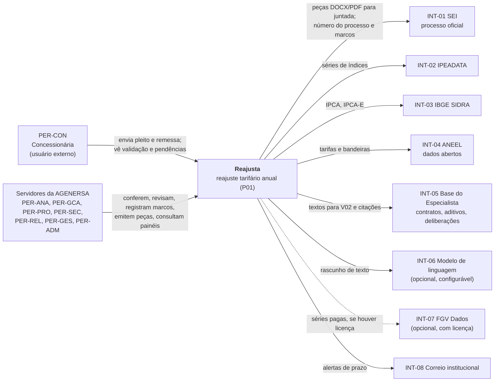
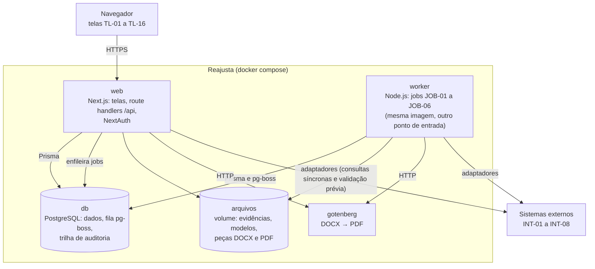
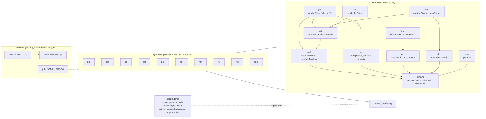
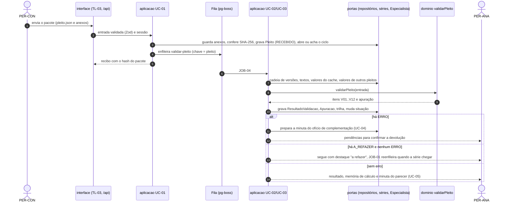

# 05. Arquitetura

Como o Reajusta é dividido, o que cada parte pode importar, onde fica cada regra e como o oráculo em Python entra nos
testes. Os identificadores (MOD-*, UC-*, RF-*, RNF-*, TL-*, INT-*) são os de [`01_VISAO_ESCOPO.md`](01_VISAO_ESCOPO.md).
As decisões estão nos ADRs da pasta [`adr/`](adr/) (índice na §19). O modelo de dados está em
[`06_MODELO_DADOS.md`](06_MODELO_DADOS.md).

Identificadores deste documento: regras de arquitetura `ARQ-nn`, jobs `JOB-nn`, divergências aceitas em relação ao
oráculo `DIV-nn`, decisões abertas `DA-ARQ-nn`.

## 1. Princípios

| ID | Princípio | Origem |
|---|---|---|
| ARQ-01 | A regra de negócio mora no domínio, em TypeScript puro. Tela, rota, job e adaptador não decidem nada que o domínio decide | RNF-12; ADR-0002 |
| ARQ-02 | Dependência só aponta para dentro (interface → aplicação → domínio). Verificada por máquina a cada commit | ADR-0002 |
| ARQ-03 | Toda chamada externa (banco, HTTP, SMTP, arquivo, modelo de linguagem) passa por uma porta e um adaptador | RNF-06; ADR-0002 |
| ARQ-04 | Fonte externa fora do ar não bloqueia o fluxo: cache e marcação "a refazer" | RNF-06; ADR-0007 |
| ARQ-05 | Todo número exibido aponta a origem; toda apuração guarda as versões usadas | RNF-02; RNF-03; ADR-0004 |
| ARQ-06 | O sistema não assina, não protocola e não homologa. Peça só vira aprovada por ação humana | RNF-07; ADR-0005; ADR-0006 |
| ARQ-07 | O Python é o oráculo: divergência é defeito do sistema até prova em contrário | ADR-0003 |
| ARQ-08 | Nenhum número de negócio no código. Parâmetro com fonte fica no cadastro, em `RegraPrazo` ou em `dominio/comum/parametros.ts` com a origem ao lado | `AGENTS_DESENVOLVIMENTO.md` §5 |
| ARQ-09 | Datas de negócio são datas civis (`AAAA-MM-DD`) e meses (`AAAA-MM`); o fuso só existe na borda | ADR-0011 |
| ARQ-10 | Tudo sobe com Docker e PostgreSQL, sem serviço pago obrigatório | RNF-14; ADR-0001 |

## 2. C4 — nível 1: contexto



## 3. C4 — nível 2: contêineres



| Contêiner | Responsabilidade | Observação |
|---|---|---|
| `web` | Telas, API, autenticação, casos de uso síncronos | Sem estado local além do cache do Next.js |
| `worker` | Jobs agendados e de fila (§12) | Uma instância ativa por job agendado (pg-boss com `singletonKey`) |
| `db` | Dados, fila, agenda e trilha | PostgreSQL na última major estável (18 em 01/11/2026; SEG-SUP-09) (proposto); papéis separados para migração e aplicação |
| `arquivos` | Arquivos binários | Acessado só pela porta `ArmazenamentoArquivos`; disco local na fase 1, armazenamento compatível com S3 depois (decisão da TI) |
| `gotenberg` | Conversão para PDF | Sem acesso à internet |

Onde o sistema roda (infraestrutura da agência ou nuvem) é decisão aberta da TI (PARADA 11, `README.md`).
Ambientes e implantação em `14_OPERACAO.md`.

## 4. C4 — nível 3: componentes do domínio e da aplicação



Matriz de dependência entre módulos do domínio (ARQ-11). Linha importa coluna; o resto é proibido. Todo módulo importa
`comum`.

| Módulo | cad | ser | cal | ple | prz | doc | min | fat | ind | adm |
|---|---|---|---|---|---|---|---|---|---|---|
| cad | — | | | | | | | | | |
| ser | | — | | | | | | | | |
| cal | sim | | — | | | | | | | |
| ple | sim | sim | sim | — | | | | | | |
| prz | | | | | — | | | | | |
| doc | | | | | | — | | | | |
| min | | | sim | | | sim | — | | | |
| fat | | | sim | | | | | — | | |
| ind | | | | | sim | | | | — | |
| adm | | | | | | | | | | — |

Na aplicação vale a mesma matriz, mais: `ple` → `doc` (ofício de complementação, UC-04); `prz` → `doc` (reiteração,
certidão); `min` → `prz` (marcos como fatos da minuta); `ind` → `min` (Q-P01). Sem ciclos.

## 5. Camadas

| ID | Camada | Pasta | Contém | Pode importar | Não pode |
|---|---|---|---|---|---|
| ARQ-12 | contratos | `src/contratos` | JSON Schema do layout do pleito e da remessa; esquemas Zod da API; tipos gerados | `zod` | qualquer outra pasta de `src` |
| ARQ-13 | dominio | `src/dominio/<mod>` | entidades e objetos de valor, regras V01 a V12, recálculo, prazos, máquina de estados do ciclo, verificação de citação, permissões, parâmetros com origem | `contratos`, o próprio `dominio`, `decimal.js`, `ajv`, `ajv-formats` | `next`, `react`, `@prisma/client`, `node:*`, `fetch`, `Date.now()`, `new Date()` sem argumento, `Math.random()`, `process.env` |
| ARQ-14 | portas | `src/portas` | interfaces TypeScript (repositórios, fontes externas, serviços) | `dominio` (tipos), `contratos` | implementação |
| ARQ-15 | aplicacao | `src/aplicacao/<mod>` | casos de uso UC-01 a UC-20 como funções fábrica; autorização; transação; auditoria; orquestração de portas | `dominio`, `portas`, `contratos` | `adaptadores`, `interface`, `composicao`, bibliotecas de infraestrutura |
| ARQ-16 | adaptadores | `src/adaptadores/<sistema>` | Prisma, IPEADATA, SIDRA, ANEEL, base do Especialista, SEI, modelo de linguagem, SMTP, DOCX/PDF, arquivos, fila, relógio, senha, log | `portas`, `dominio` (tipos), `contratos`, `adaptadores/comum`, bibliotecas de infraestrutura | `aplicacao`, `interface`, outro adaptador (exceto `comum`) |
| ARQ-17 | composicao | `src/composicao` | `config.ts` (variáveis de ambiente validadas), `container.ts` (liga portas a adaptadores e entrega os casos de uso) | todas, menos `interface`, `app`, `jobs` | — |
| ARQ-18 | interface | `src/app`, `src/components`, `src/interface`, `src/jobs` | rotas do Next.js (`page.tsx`, `route.ts`) e `globals.css` com o `@theme`; componentes do inventário de `10_UX_UI.md` em `src/components/reajusta/`; telas, handlers da API, ganchos do React Query, configuração do NextAuth, definição dos jobs | `aplicacao` (tipos e casos de uso via contêiner), `contratos`, `composicao/container`, `dominio` só com `import type` | `@prisma/client`, `adaptadores`, função (não tipo) do `dominio` |

Regras complementares:

| ID | Regra |
|---|---|
| ARQ-19 | Cada módulo expõe sua API pública em `index.ts`. Outro módulo só importa por ali |
| ARQ-20 | `src/app/**` só delega: a página monta a tela de `src/interface/telas`, a rota chama o handler de `src/interface/api`. Nenhuma regra em `src/app` |
| ARQ-21 | O route handler faz, nesta ordem: lê a sessão, valida a entrada com o esquema Zod de `contratos`, chama o caso de uso, mapeia o resultado para HTTP (§13). Nada mais |
| ARQ-22 | Componente React só formata e exibe o que o caso de uso devolveu. Número de negócio (percentual, prazo, situação) vem pronto da API |
| ARQ-23 | O `PrismaClient` é criado só em `adaptadores/prisma` e entregue pelo contêiner. Nenhum `import` de `@prisma/client` fora dali |
| ARQ-24 | `fetch` e clientes HTTP só em adaptadores. O cliente do React Query (`src/interface/consultas`) chama a API do próprio sistema por um único `clienteApi` |

## 6. Regra de dependência verificável

Dois portões, ambos no `npm run verificar` (§17) e no CI.

**dependency-cruiser** (`.dependency-cruiser.cjs`, esboço; o portão tem de passar sem exceção):

```js
/** @type {import('dependency-cruiser').IConfiguration} */
module.exports = {
  forbidden: [
    { name: 'sem-ciclos', severity: 'error', from: {}, to: { circular: true } },
    { name: 'contratos-isolado', severity: 'error',
      from: { path: '^src/contratos' },
      to: { path: '^src/(?!contratos)' } },
    { name: 'dominio-puro', severity: 'error',
      from: { path: '^src/dominio' },
      to: { pathNot: ['^src/(dominio|contratos)/', 'node_modules/(decimal\\.js|ajv|ajv-formats)/'] } },
    { name: 'dominio-sem-node', severity: 'error',
      from: { path: '^src/(dominio|portas|aplicacao)' }, to: { dependencyTypes: ['core'] } },
    { name: 'portas-so-tipos-do-dominio', severity: 'error',
      from: { path: '^src/portas' },
      to: { pathNot: ['^src/(dominio|contratos|portas)/'] } },
    { name: 'aplicacao-para-dentro', severity: 'error',
      from: { path: '^src/aplicacao' },
      to: { pathNot: ['^src/(dominio|portas|contratos|aplicacao)/', 'node_modules/zod/'] } },
    { name: 'adaptador-nao-sobe', severity: 'error',
      from: { path: '^src/adaptadores' },
      to: { path: '^src/(aplicacao|interface|app|jobs|composicao)/' } },
    { name: 'adaptador-nao-chama-adaptador', severity: 'error',
      from: { path: '^src/adaptadores/([^/]+)/' },
      to: { path: '^src/adaptadores/', pathNot: ['^src/adaptadores/$1/', '^src/adaptadores/comum/'] } },
    { name: 'interface-sem-infra', severity: 'error',
      from: { path: '^src/(app|components|interface|jobs)' },
      to: { path: ['^src/adaptadores/', 'node_modules/@prisma/'] } },
    { name: 'interface-so-tipos-do-dominio', severity: 'error',
      from: { path: '^src/(app|components|interface|jobs)' },
      to: { path: '^src/dominio/', dependencyTypesNot: ['type-only'] } },
    { name: 'prisma-so-no-adaptador', severity: 'error',
      from: { pathNot: '^src/adaptadores/prisma/' },
      to: { path: 'node_modules/@prisma/client' } },
    { name: 'modulo-pela-api-publica', severity: 'error',
      from: { path: '^src/(dominio|aplicacao)/([^/]+)/' },
      to: { path: '^src/(dominio|aplicacao)/[^/]+/.+', pathNot: ['^src/$1/$2/', '^src/(dominio|aplicacao)/[^/]+/index\\.ts$'] } },
    // Uma regra por linha da matriz de ARQ-11, gerada a partir dela. Exemplo:
    { name: 'dominio-prz-isolado', severity: 'error',
      from: { path: '^src/dominio/prz/' },
      to: { path: '^src/dominio/(?!prz/|comum/)' } },
  ],
  options: { tsPreCompilationDeps: true, tsConfig: { fileName: 'tsconfig.json' } },
};
```

**ESLint** (`eslint.config.mjs`), por pasta:

| Pasta | Regras |
|---|---|
| todas | `@typescript-eslint/no-explicit-any: error`; `@typescript-eslint/no-non-null-assertion: error`; `@typescript-eslint/consistent-type-imports: error`; `no-console: error` (usar a porta `Log`) |
| `src/dominio`, `src/aplicacao`, `src/portas` | `no-restricted-globals` para `fetch`, `process`, `window`, `document`; `no-restricted-syntax` para `Date.now()`, `new Date()` sem argumento e `Math.random()`; `no-restricted-imports` para `next`, `next/*`, `react`, `@prisma/client`, `node:*`, `pino`, `pg-boss` |
| `src/interface`, `src/components`, `src/app` | `no-restricted-imports` para `@prisma/client` e `@/adaptadores/*`; `jsx-a11y` recomendado |
| `src/dominio` | `no-magic-numbers` com exceções `0`, `1`, `-1`, `100` (pontos percentuais); demais constantes vêm de `parametros.ts` ou do cadastro |

## 7. Estrutura de pastas do repositório do sistema

```text
reajusta/
├── AGENTS.md                      # cópia de AGENTS_DESENVOLVIMENTO.md
├── CLAUDE.md                      # mesma cópia
├── docs/especificacao/            # este pacote
├── prisma/
│   ├── schema.prisma              # cópia de especificacao/prisma/schema.prisma
│   ├── migrations/                # inclui <carimbo>_integridade/migration.sql (06 §5.2)
│   └── seed/                      # cadastro de Paraty, feriados, unidades, perfis, indicadores, testes R-P01, regras de prazo
├── oraculo/
│   ├── VERSAO                     # commit fixado do repositório do curso
│   ├── diferencial.py             # recebe pleitos gerados e devolve o resultado do oráculo
│   └── DIVERGENCIAS.md            # DIV-01 a DIV-07 e as que forem aprovadas depois
├── src/
│   ├── contratos/
│   │   ├── pleito-reajuste-0.1.schema.json
│   │   ├── remessa-faturamento.schema.json
│   │   └── api/                   # esquemas Zod por recurso (07_CONTRATOS_API.md)
│   ├── dominio/
│   │   ├── comum/                 # decimal.ts, mes.ts, data-civil.ts, calendario.ts, resultado.ts, erros.ts, parametros.ts
│   │   ├── cad/                   # MOD-CAD
│   │   ├── ple/                   # MOD-PLE (validar-pleito.ts, regras/, versao.ts)
│   │   ├── cal/                   # MOD-CAL
│   │   ├── ser/                   # MOD-SER
│   │   ├── prz/                   # MOD-PRZ
│   │   ├── doc/                   # MOD-DOC
│   │   ├── min/                   # MOD-MIN
│   │   ├── fat/                   # MOD-FAT
│   │   ├── ind/                   # MOD-IND
│   │   └── adm/                   # MOD-ADM
│   ├── portas/
│   │   ├── repositorios/          # um arquivo por agregado
│   │   ├── externas/              # fonte-serie-publica.ts, fonte-tarifas-aneel.ts, base-especialista.ts, sei.ts, modelo-linguagem.ts, correio.ts
│   │   └── servicos/              # gerador-documento.ts, armazenamento-arquivos.ts, fila.ts, relogio.ts, log.ts, cifrador-senha.ts, auditoria.ts, unidade-de-trabalho.ts
│   ├── aplicacao/
│   │   └── <mod>/                 # um arquivo por caso de uso: uc01-enviar-pleito.ts ... uc20-atualizar-series.ts
│   ├── adaptadores/
│   │   ├── comum/                 # http com tempo máximo, novas tentativas e tradução de falha
│   │   ├── prisma/  ipeadata/  sidra/  aneel/  especialista/  sei/  llm/
│   │   ├── smtp/  documentos/  arquivos/  fila/  relogio/  senha/  log/
│   ├── composicao/
│   │   ├── config.ts              # variáveis de ambiente validadas com Zod (§15)
│   │   └── container.ts
│   ├── components/reajusta/       # inventário de 10_UX_UI.md; nada fora dele
│   ├── interface/
│   │   ├── telas/<mod>/           # uma pasta por tela TL-xx
│   │   ├── api/<mod>/             # handlers chamados pelos route.ts
│   │   ├── consultas/             # ganchos do React Query e clienteApi
│   │   ├── autenticacao/          # NextAuth
│   │   └── mensagens/             # textos do guia de mensagens de 10_UX_UI.md
│   ├── app/                       # rotas do App Router (só delegam, ARQ-20) e globals.css com o @theme de 10_UX_UI.md
│   └── jobs/                      # worker.ts e uma definição por job (§12)
├── tests/
│   ├── fakes/                     # portas em memória para os testes da aplicação
│   ├── integracao/                # adaptadores contra PostgreSQL de teste e MSW
│   ├── paridade/                  # diferencial com o oráculo (§16)
│   └── e2e/                       # Playwright, fluxos de R1 em diante
├── public/fontes/
├── docker-compose.yml  Dockerfile  .env.example
└── .dependency-cruiser.cjs  eslint.config.mjs  vitest.config.ts  playwright.config.ts  tsconfig.json
```

Testes unitários ficam ao lado do código (`recalcular-ir.test.ts` junto de `recalcular-ir.ts`). Os fixtures de aceite são
os de [`12_TESTES.md`](12_TESTES.md) (`fixtures/calculos_coorte.json`, `paraty_2026.json`, `ciclos_coorte.json`),
gerados pelo oráculo com `ferramentas/gerar_fixtures.py`, copiados para `docs/especificacao/fixtures/` e lidos de lá;
não são duplicados.

## 8. Módulos

| Módulo | Pasta | Casos de uso | Domínio (principais funções) | Portas usadas |
|---|---|---|---|---|
| MOD-PLE | `ple` | UC-01, UC-02, UC-04 | `validarPleito`, `conferirLayout`, `conferirComponentes`, `concluirValidacao` | RepositorioPleitos, RepositorioCiclos, ArmazenamentoArquivos, Fila, Auditoria |
| MOD-CAD | `cad` | UC-06, UC-07 | `resolverVersao`, `conferirTrechos`, `versaoVigenteEm`, `proximaDataBase` | RepositorioContratos, BaseEspecialista |
| MOD-CAL | `cal` | UC-03, UC-05 (memória) | `conferirIntersticio`, `mesesReferencia`, `recalcularIr`, `comporTotal`, `parcelaDoCronograma`, `conferirTabela`, `montarMemoria`, `encadearCiclo` | RepositorioApuracoes |
| MOD-SER | `ser` | UC-03, UC-20 | `serieCompleta`, `conferirSeriePublica`, `conferenciaCruzada`, `conferirEnergia`, `situacaoDaSerie` | FonteSeriePublica, FonteTarifasAneel, RepositorioSeries |
| MOD-PRZ | `prz` | UC-08, UC-10, UC-13, UC-14, UC-15 | `transicaoCiclo`, `donoDaEtapa`, `abrirPrazos`, `vencimentoPrazo`, `alertasDevidos`, `podeEncerrar` | RepositorioMarcosPrazos, RepositorioCalendario, Correio, Sei |
| MOD-DOC | `doc` | UC-04, UC-09, UC-10, UC-14, UC-15 | `preencherModelo`, `camposFaltantes`, `quesitosDasPendencias` | GeradorDocumento, RepositorioPecas, Sei |
| MOD-MIN | `min` | UC-05, UC-11, UC-12 | `fatosDaMinuta`, `verificarCitacao`, `podeAprovarMinuta`, `taxaEdicao` | ModeloLinguagem, BaseEspecialista, RepositorioPecas |
| MOD-FAT | `fat` | UC-16, UC-17 | `conferirRemessa`, `recalcularFatura`, `contemDadoPessoal` | RepositorioFaturas, ArmazenamentoArquivos |
| MOD-IND | `ind` | UC-18 | `medirIndicador` (I-P01 e Q-P01), `executarTeste` (R-P01), `verificarCadeiaAuditoria` | RepositorioIndicadores, RepositorioMarcosPrazos |
| MOD-ADM | `adm` | UC-19 e TL-16 | `permite`, `perfisValidos` | RepositorioUsuarios, CifradorSenha |

Os nomes de função são o ponto de partida; o nome final segue o glossário e fica registrado no `index.ts` do módulo.

## 9. Portas e adaptadores

| Porta | Operações principais | Adaptadores | INT | Módulos |
|---|---|---|---|---|
| `FonteSeriePublica` | `buscarSerie(serie)` → valores com mês, casas e data da consulta, ou falha tipada | `ipeadata` (OData), `sidra`, `fgv-dados` (opcional) | INT-02, INT-03, INT-07 | SER |
| `FonteTarifasAneel` | `buscarResolucoes(distribuidora, periodo)` | `aneel` (arquivo de dados abertos) | INT-04 | SER |
| `BaseEspecialista` | `textoDocumento(documento)`, `deliberacoesDoContrato(contrato)`, `versaoDaExportacao()` | `especialista-arquivo` (exportação periódica), `especialista-api` (se houver) | INT-05 | CAD, MIN |
| `Sei` | `vincularProcesso`, `registrarJuntada`, `listarAndamentos`, `entregarPeca` | `sei-manual`, `sei-webservice` | INT-01 | PLE, PRZ, DOC |
| `ModeloLinguagem` | `gerarEstruturado({ tarefa, versaoPrompt, entrada, esquemaSaida })` | `desligado`, `openai-compativel`, `anthropic` | INT-06 | MIN |
| `Correio` | `enviar(mensagem)` | `smtp`; `memoria` nos testes | INT-08 | PRZ |
| `GeradorDocumento` | `gerarDocx(modelo, dados)`, `converterParaPdf(docx)` | `docxtemplater`, `gotenberg` | — | DOC, MIN |
| `ArmazenamentoArquivos` | `guardar`, `ler`, `sha256` | `disco-local`; `s3` depois | — | PLE, DOC, FAT |
| `Fila` | `enfileirar(job, dados, chaveIdempotencia)`, `agendar` | `pg-boss` | — | PLE, SER, PRZ |
| `Relogio` | `agora()`, `hoje()` (data civil no `FUSO_HORARIO`) | `sistema`; `fixo` nos testes | — | todos |
| `Log` | `info`, `aviso`, `erro` com campos estruturados | `pino` | — | todos |
| `Auditoria` | `registrar(acao, entidade, antes, depois)` dentro da transação | `prisma` | — | todos |
| `UnidadeDeTrabalho` | `executar(fn)` em transação | `prisma` | — | todos |
| `CifradorSenha` | `cifrar`, `conferir` | `argon2` | — | ADM |
| Repositórios | um por agregado: Contratos, Ciclos, Pleitos, Validacoes, Apuracoes, Series, MarcosPrazos, Calendario, Pecas, Faturas, Indicadores, Usuarios | `prisma`; em memória em `tests/fakes` | — | por módulo |

Todo adaptador externo: tempo máximo configurável, novas tentativas só em operação idempotente (leitura), tradução da
falha para `FalhaFonteExterna { fonte, tipo: 'TEMPO_ESGOTADO' | 'HTTP' | 'FORMATO' | 'INDISPONIVEL' }`, nenhuma resposta
bruta repassada. Detalhes de cada integração em `09_INTEGRACOES.md`.

## 10. Onde fica cada regra V01 a V12

A orquestração é `validarPleito(entrada)` em `src/dominio/ple/validar-pleito.ts`. Ela recebe o pacote, a cadeia de
versões do contrato e os insumos já carregados (textos, valores das séries, valores de outros pleitos, tarifas da ANEEL)
e devolve a lista de itens na mesma ordem e com os mesmos cortes do oráculo: erro em V01 encerra a validação; versão
contratual inexistente em V02 encerra a validação. O caso de uso UC-02 (`src/aplicacao/ple/uc02-validar-pleito.ts`)
carrega os insumos pelas portas, chama o domínio, grava `ResultadoValidacao` e a `Apuracao` (UC-03) e muda a situação
do pleito e do ciclo. Regra de negócio detalhada em `08_REGRAS_NEGOCIO.md`.

| Regra | Confere | Função de domínio (arquivo) | Insumo trazido pela aplicação (porta) | Requisito |
|---|---|---|---|---|
| V01 | o arquivo segue o layout 0.1 | `conferirLayout` (`dominio/ple/regras/v01-layout.ts`), Ajv 2020-12 sobre `contratos/pleito-reajuste-0.1.schema.json` | nenhum | RF-PLE-02 |
| V02 | trechos do cadastro achados no texto; versão contratual existe | `conferirTrechos` (`dominio/cad/conferir-trechos.ts`) e `resolverVersao` (`dominio/cad/resolver-versao.ts`) | textos (`BaseEspecialista`); cadeia de versões (`RepositorioContratos`) | RF-CAD-02, RF-CAD-01 |
| V03 | interstício | `conferirIntersticio` (`dominio/cal/intersticio.ts`) | nenhum | RF-CAL-03 |
| V04 | meses o e i pela regra do contrato | `mesesReferencia` (`dominio/cal/meses-referencia.ts`) | nenhum | RF-CAL-03 |
| V05 | componentes e códigos iguais ao cadastro | `conferirComponentes` (`dominio/ple/regras/v05-componentes.ts`) | nenhum | RF-PLE-03 |
| V06 | série mensal completa | `serieCompleta` (`dominio/ser/serie-completa.ts`) | nenhum | RF-PLE-03 |
| V07 | valor igual à série pública nos meses o e i | `conferirSeriePublica` (`dominio/ser/conferir-serie-publica.ts`) | valores do cache com data da consulta (`RepositorioSeries`); `A_REFAZER` se faltar | RF-SER-01, RF-SER-04 |
| V08 | valor igual ao de outros pleitos no mesmo mês (séries pagas) | `conferenciaCruzada` (`dominio/ser/conferencia-cruzada.ts`) | valores da base `PLEITOS` (`RepositorioSeries`) | RF-SER-02 |
| V09 | IR recalculado com os pesos do cadastro, nas casas do contrato | `recalcularIr` (`dominio/cal/recalcular-ir.ts`) | nenhum | RF-CAL-01 |
| V10 | parcela do cronograma e total pela regra de combinação | `parcelaDoCronograma` e `comporTotal` (`dominio/cal/compor-total.ts`) | nenhum | RF-CAL-02, RF-CAD-03 |
| V11 | energia com distribuidora, composição e resolução | `conferirEnergia` (`dominio/ser/energia.ts`) | resoluções da ANEEL (`FonteTarifasAneel`), quando a regra de composição estiver decidida | RF-SER-03 |
| V12 | tabela proposta = vigente × (1 + total) | `conferirTabela` (`dominio/cal/conferir-tabela.ts`) | nenhum | RF-CAL-04 |

Funções do mesmo fluxo fora de V01 a V12: `montarMemoria` (`dominio/cal/memoria.ts`, RF-CAL-05), `encadearCiclo`
(`dominio/cal/encadear.ts`, RF-CAL-06), `concluirValidacao` (`dominio/ple/concluir.ts`: `DEVOLVER`, `A_REFAZER` ou
`SEGUE_PARA_ANALISE`), `quesitosDasPendencias` (`dominio/doc`, RF-DOC-03).

A validação prévia (RF-PLE-05, TL-03) chama a mesma `validarPleito`, com os insumos que estiverem em cache, e não grava
nada.

Parâmetros usados pelas regras ficam em `dominio/comum/parametros.ts`, cada um com a origem:

| Parâmetro | Valor | Origem |
|---|---|---|
| `TOLERANCIA_RECALCULO_PP` | 0,01 | RNF-01; `comum.TOL_RECALCULO_PP` |
| `DIAS_MINIMOS_INTERSTICIO` | 365 | V03 do oráculo (aviso abaixo disso); N-P01-17 (periodicidade inferior a um ano) |
| `VERSAO_LAYOUT_PLEITO` | `0.1` | `pleito_reajuste.schema.json` |

## 11. Fluxo do caso principal entre camadas



## 12. Jobs

Todos rodam no contêiner `worker`, com pg-boss. Cada job é uma definição em `src/jobs/` que só chama um caso de uso da
aplicação. Horários por variável de ambiente; os valores iniciais são proposta, a confirmar com a TI e a Secretaria.

| ID | Job | Gatilho | Caso de uso e requisitos | O que faz | Idempotência | Em falha |
|---|---|---|---|---|---|---|
| JOB-01 | `atualizar-series` | agenda `JOB_SERIES_CRON` (proposto: diário, de madrugada) e botão na TL-14 | UC-20; RF-SER-01, RF-SER-03, RF-SER-04 | Para cada `SerieExterna` usada por componente de versão publicada e para as tarifas da ANEEL: consulta a fonte, grava valores novos, marca revisões com `substituidoEm`, atualiza `situacao` e `consultadaEm`. Reenfileira JOB-04 dos pleitos `A_RECONFERIR` que dependem da série; valor revisado pela fonte gera alerta `SERIE_DIVERGENTE` | valor só entra se mudou; chave por série e dia | marca a série `INDISPONIVEL`, mantém o cache, registra `ultimaFalha`, alerta o PER-ADM na TL-14 |
| JOB-02 | `prazos-e-alertas` | agenda `JOB_PRAZOS_CRON` (proposto: diário, antes do expediente) | UC-08, UC-10, UC-13, UC-14, UC-15; RF-PRZ-03, RF-PRZ-04, RF-PRZ-06, RF-PRZ-07, RF-PRZ-08, RF-CAD-04 | Atualiza a situação dos prazos (`A_VENCER`, `VENCIDO`); cria `Alerta` pelas antecedências da `RegraPrazo`, no vencimento e no dia útil seguinte (RN-TRA-03); alerta `SEM_DONO` para ciclo sem unidade com o processo aberto; no dia útil seguinte ao vencimento de diligência sem resposta, gera a peça de reiteração pronta para assinatura; no vencimento das razões finais, inclui o ciclo na lista da próxima pauta (TL-11) para a Secretaria confirmar; no fim do prazo recursal sem recurso registrado, gera a minuta da certidão de ausência de recurso; avisa antes da data-base de cada contrato | `chaveIdempotencia` do alerta; peça gerada uma vez por prazo | nada é enviado em dobro; erro por ciclo não para os demais; resumo de falhas na TL-15 |
| JOB-03 | `indicadores-e-auditoria` | agenda `JOB_INDICADORES_CRON` (proposto: diário, de madrugada) | UC-18; RF-IND-01, RF-IND-02, RF-IND-03 | Calcula `MedicaoIndicador` de I-P01-01 a 10 por ciclo e por período e de Q-P01-01 a 04; roda os testes R-P01 automatizáveis sobre cada ciclo (`ExecucaoTesteRequisito`); confere a cadeia de hash da trilha | grava nova medição com `versaoRegras`; não altera as anteriores | ciclo sem marco suficiente vira `SEM_EVIDENCIA`, não erro |
| JOB-04 | `validar-pleito` | fila, ao receber o pleito (UC-01) e ao chegar série pendente (JOB-01) | UC-02, UC-03; RF-PLE-03; RNF-13 | Executa o fluxo da §11 | chave = pleito + versão do cache usada | três novas tentativas; depois, pleito fica `A_RECONFERIR` com aviso ao PER-ANA |
| JOB-05 | `enviar-email` | fila, a cada `Alerta` de canal `EMAIL` | RF-PRZ-03; INT-08 | Envia pela porta `Correio` | `chaveIdempotencia` do alerta | novas tentativas com espera crescente; depois, `Alerta.situacao = FALHOU` e o alerta continua no painel (TL-10) |
| JOB-06 | `importar-base-especialista` | agenda `JOB_ESPECIALISTA_CRON` (proposto: semanal) | INT-05; RF-CAD-02; RF-MIN-04 | Lê a exportação periódica da base do Especialista; registra a versão da exportação; reconfere os trechos das versões publicadas e avisa o PER-GCA quando um trecho deixou de ser achado | por versão da exportação | mantém a exportação anterior |

Jobs não decidem: cada ação com efeito no processo (reiteração, certidão, inclusão em pauta) gera minuta ou proposta,
que uma pessoa confirma (RNF-07).

## 13. Tratamento de erro

| ID | Camada | Regra |
|---|---|---|
| ARQ-25 | dominio | Falha esperada é valor: `Resultado<T, ErroDominio>` (`{ ok: true, valor }` ou `{ ok: false, erro }`). Resultado de regra de validação (`ERRO`, `AVISO`) é dado, não exceção. Exceção só para invariante violada (`ErroInvariante`), que indica defeito |
| ARQ-26 | aplicacao | Devolve `Resultado<T, ErroAplicacao>` com `codigo` estável, igual ao `codigo` da tabela de erros de `07_CONTRATOS_API.md` §2.4 (`requisicao-invalida`, `nao-autenticado`, `sem-permissao`, `nao-encontrado`, `conflito`, `pacote-duplicado`, `campo-fora-do-layout`, `dado-pessoal`, `regra-negocio`, `fonte-indisponivel` e os demais de lá), mais `erro-interno`. Falha de regra de negócio leva o ID da RN (`regra`). Registro de outra concessionária devolve `nao-encontrado`, sem revelar que existe |
| ARQ-27 | adaptadores | Traduzem falha externa em `FalhaFonteExterna` ou `FalhaPersistencia`. Erro do gatilho de integridade (`P0001`) vira `conflito`. Nunca repassam corpo de resposta, SQL ou pilha |
| ARQ-28 | interface | Mapeia `codigo` para o status HTTP da tabela de `07_CONTRATOS_API.md` §2.4 (`erro-interno` → 500). Corpo `application/problem+json` (RFC 9457) com `codigo`, `regra`, `erros[]` e `correlacao_id`. Pendência de validação não é erro HTTP: o resultado traz `decisao = devolver` |
| ARQ-29 | interface | A tela mostra a mensagem do guia de `10_UX_UI.md` para cada `codigo`, nunca a mensagem técnica. Cada segmento do App Router tem `error.tsx` e `not-found.tsx` com essas mensagens |
| ARQ-30 | jobs | Erro num item (ciclo, série, alerta) não interrompe os outros. Falha final fica registrada na entidade (`ultimaFalha`, `situacao`) e aparece em TL-14 ou TL-15 |

## 14. Logs

| ID | Regra |
|---|---|
| ARQ-31 | Log estruturado em JSON (pino), na saída padrão do contêiner. Campos: `nivel`, `em`, `servico` (`web` ou `worker`), `correlacaoId`, `usuarioId`, `perfilAtivo`, `casoDeUso`, `duracaoMs`, `resultado`, `codigo` |
| ARQ-32 | `correlacaoId` nasce na requisição (ou no job) e segue para a aplicação, os adaptadores e o registro de auditoria |
| ARQ-33 | **Proibido em log:** nome, e-mail, CPF, telefone ou qualquer dado pessoal; senha, hash de senha, token, cookie, `DATABASE_URL`, chave de API; conteúdo de peça, de minuta, de prompt ou de resposta do modelo de linguagem; valores de série paga. O pino é configurado com redação desses caminhos, e um teste confere que um log de exemplo com esses campos sai redigido |
| ARQ-34 | Log não é trilha de auditoria. Quem fez o quê e quando fica em `RegistroAuditoria` (RNF-11); o log serve à operação |
| ARQ-35 | Níveis: `erro` para falha que exige ação; `aviso` para fonte indisponível, nova tentativa e item `A_REFAZER`; `info` para início e fim de caso de uso e de job; `depuracao` só fora de produção |

## 15. Configuração por variável de ambiente

Toda configuração vem do ambiente, é validada com Zod em `src/composicao/config.ts` na partida e derruba o processo se
faltar ou estiver mal formada. O repositório tem `.env.example` sem segredo. Segredo nunca entra no código nem no
repositório (RNF-10). Só `composicao/config.ts` lê `process.env`.

| Variável | Obrigatória | Uso |
|---|---|---|
| `APP_AMBIENTE` | sim | `desenvolvimento`, `homologacao` ou `producao` |
| `DATABASE_URL` | sim | conexão do papel da aplicação (`reajusta_app`) |
| `DATABASE_URL_MIGRACAO` | na implantação | papel dono do esquema, usado só por `prisma migrate deploy` |
| `NEXTAUTH_URL`, `NEXTAUTH_SECRET` | sim | NextAuth (ADR-0009) |
| `SESSAO_MAX_MINUTOS` | sim | expiração da sessão (valor em `14_OPERACAO.md`) |
| `FUSO_HORARIO` | sim | `America/Sao_Paulo` (ADR-0011) |
| `ARQUIVOS_DIR` | sim | raiz do armazenamento local de arquivos |
| `IPEADATA_URL_BASE` | sim | `http://www.ipeadata.gov.br/api/odata4` (endereço usado pelo oráculo) |
| `SIDRA_URL_BASE` | sim | `https://apisidra.ibge.gov.br/values` (endereço usado pelo oráculo) |
| `ANEEL_URL_BASE` | sim | portal de dados abertos da ANEEL (conjunto em `09_INTEGRACOES.md`) |
| `FONTES_TIMEOUT_S` | não | tempo máximo por consulta externa; valor inicial 120, o do oráculo (`recalcular_reajuste.py`) |
| `ESPECIALISTA_MODO` | sim | `arquivo` ou `api` |
| `ESPECIALISTA_DIR` ou `ESPECIALISTA_URL` | conforme o modo | origem da exportação da base do Especialista |
| `SEI_MODO` | sim | `manual` (fase 1) ou `webservice` (ADR-0005) |
| `SEI_WS_URL`, `SEI_WS_SIGLA_SISTEMA`, `SEI_WS_IDENTIFICACAO` | só com `webservice` | credenciais do sistema no SEI |
| `LLM_PROVEDOR` | sim | `desligado`, `openrouter` (padrão, adendo do ADR-0006), `openai-compativel` ou `anthropic` |
| `OPENROUTER_API_KEY` | com `openrouter` | chave do OpenRouter; nunca em log |
| `LLM_URL_BASE`, `LLM_MODELO`, `LLM_CHAVE`, `LLM_TIMEOUT_S` | se o provedor não for `desligado` | com `openrouter`, `LLM_URL_BASE` = `https://openrouter.ai/api/v1` e `LLM_MODELO` = slug conferido em `/api/v1/models` |
| `PACOTE_MAX_BYTES`, `ARQUIVO_MAX_BYTES` | não | limites de upload (SEG-ENT, `15_SEGURANCA.md`) |
| `INTEGRACOES_HOSTS_PERMITIDOS` | sim | lista de hosts externos permitidos (SEG-ENT, contra SSRF) |
| `SMTP_HOST`, `SMTP_PORTA`, `SMTP_USUARIO`, `SMTP_SENHA`, `SMTP_REMETENTE`, `SMTP_TLS` | sim | INT-08 |
| `GOTENBERG_URL` | sim | conversão para PDF |
| `FGV_DADOS_URL`, `FGV_DADOS_CHAVE` | não | INT-07, só com licença (ADR-0008) |
| `JOB_SERIES_CRON`, `JOB_PRAZOS_CRON`, `JOB_INDICADORES_CRON`, `JOB_ESPECIALISTA_CRON` | sim no `worker` | agenda dos jobs (§12) |
| `LOG_NIVEL` | não | `info` por padrão |

Parâmetro de negócio não é variável de ambiente. Prazo, tolerância, antecedência de alerta, peso e casas decimais ficam
no cadastro, em `RegraPrazo` ou em `dominio/comum/parametros.ts`, com a fonte.

## 16. Oráculo em Python nos testes

O oráculo é o código do repositório do curso: `scripts/validar_pleito.py` (função `validar(pleito, cadastro)`) e
`scripts/recalcular_reajuste.py`. O sistema fixa um commit em `oraculo/VERSAO`. O oráculo nunca roda em produção.

### 16.1 Esperados dos fixtures (golden)

1. Os esperados são os fixtures de [`12_TESTES.md`](12_TESTES.md) §1.2, gerados pelo oráculo com
   `ferramentas/gerar_fixtures.py`, da raiz do repositório do curso. O script não acessa a rede, ordena tudo e para com
   erro se o resultado não bater com o levantamento. `--conferir` só confere.
2. `fixtures/paraty_2026.json` traz o pleito, o cadastro, o resultado esperado de V01 a V12 (10 ok, 5 avisos, 1 erro,
   o mesmo de `../saida/levantamento/pleito/exemplo_paraty_2026.validacao.json`) e as mutações do AT-05.
   `fixtures/calculos_coorte.json` traz os 28 cálculos completos da coorte. `fixtures/ciclos_coorte.json` traz os
   marcos reais e o resultado esperado de cada R-P01.
3. O teste do domínio (Vitest) lê o fixture, valida a forma com Zod e compara:
   - a sequência de `(regra, situacao)`, que tem de ser igual, salvo as divergências aceitas (§16.4);
   - os números de V09 e V10 e o IR recalculado, dentro da tolerância do fixture (0,01 ponto percentual, RNF-01);
   - a mensagem não é comparada (o sistema usa o guia de mensagens); a comparação é pelo `detalhe` estruturado.
4. O job `paridade` do CI roda `gerar_fixtures.py --conferir` no commit fixado do repositório do curso
   (`oraculo/VERSAO`) e compara os hashes de `origem.arquivos` com os fixtures copiados no repositório do sistema.
   Mudou o oráculo ou a fonte: regenerar, revisar a diferença e registrar no commit.

### 16.2 Teste diferencial

1. `tests/paridade/` gera variações dos fixtures com fast-check: IR declarado alterado, mês de referência deslocado,
   parcela de realinhamento trocada, componente sem evidência, valor de série com menos casas, componente a mais ou a
   menos.
2. Cada variação passa pelo domínio TypeScript e por `oraculo/diferencial.py`, que chama `validar()` de
   `scripts/validar_pleito.py` e devolve o resultado em JSON. O oráculo roda sem rede: o cache de séries vem dos
   fixtures, apontado por `SEI_DADOS` (pasta `series/<nome>.json`, no formato do cache do oráculo), e os textos dos
   contratos por `TEXTOS_CONTRATOS`.
3. O teste falha em qualquer diferença fora das divergências aceitas. A semente do gerador é registrada para reproduzir.
4. Roda no CI em job próprio (`paridade`), com Python 3, `jsonschema` e `pandas`, na versão do commit fixado. Localmente,
   `npm run paridade`.

### 16.3 Recálculo da coorte

`recalcularIr` e `comporTotal` são conferidos contra as 28 apurações completas de `../saida/levantamento/calculo/recalculo.csv`:
as 24 que conferem têm de conferir; as 4 que divergem têm de divergir, com o mesmo IR recalculado (AT-01 a AT-04,
`fixtures/calculos_coorte.json`).

As funções de calendário e de prazo são conferidas contra os marcos reais e os vencimentos de
`fixtures/ciclos_coorte.json`, e `contarDiasUteis` e `somarDiasUteis` contra `dias_uteis` e `somar_du` de
`../scripts/comum.py` (ADR-0011).

### 16.4 Divergências aceitas

Cada divergência abaixo é intencional, documentada em `oraculo/DIVERGENCIAS.md` e tratada no teste por regra explícita,
nunca por tolerância genérica. **Divergência nova exige aprovação humana antes do código.** As sete abaixo estão
propostas e aguardam aprovação da CAPET e da TI.

| ID | Regra | Oráculo | Sistema | Motivo |
|---|---|---|---|---|
| DIV-01 | V07 | procura o valor em qualquer mês da série pública | confere no mês o e no mês i | a regra é "valor igual à série pública" no mês (`ESPECIFICACAO_DADOS_PLEITO.md` §4); o cache do oráculo não guarda o mês |
| DIV-02 | V08 | compara com valores do mesmo código em qualquer mês (`componentes.csv` não tem o mês) | compara no mesmo código e no mesmo mês | a regra é "o mesmo índice no mesmo mês" (`LEVANTAMENTO_MOTOR_CALCULO.md` §6) |
| DIV-03 | V01 | não confere `format` do JSON Schema (o `jsonschema` sem verificador de formato aceita data inválida) | confere `format: date` com ajv-formats | data inválida quebraria V03 e V04 |
| DIV-04 | V02, V07 | sem textos dos contratos, V02 dá `aviso`; sem rede e sem cache, V07 falha com exceção | `A_REFAZER`, pleito `A_RECONFERIR` | RNF-06; RF-SER-04 |
| DIV-05 | V10 | o total é sempre multiplicativo, qualquer que seja `combinacao` | aplica a regra da versão (`MULTIPLICATIVA` ou `ADITIVA`) | a regra de combinação é parâmetro do contrato (`LEVANTAMENTO_MOTOR_CALCULO.md` §1); em Paraty os dois dão o mesmo resultado |
| DIV-06 | todas | mensagem em texto livre | mensagem do guia de `10_UX_UI.md` e `detalhe` estruturado | RNF-09 |
| DIV-07 | V09, V12 | `round()` sobre ponto flutuante binário | meio para o par sobre decimal (RN-NUM-03) | ADR-0003; só difere em empate exato de casa decimal; DEC-06 |

## 17. Testes por camada e portões

| Camada | Ferramenta | O que cobre | Portão |
|---|---|---|---|
| dominio | Vitest | regras V01 a V12, recálculo, prazos, máquina de estados, citação, permissões; fixtures de aceite; esperados do oráculo | cobertura ≥ 90% de linhas e de ramos em `src/dominio` (RNF-12) |
| aplicacao | Vitest com `tests/fakes` | casos de uso, autorização, transição de situação, auditoria gravada, isolamento entre concessionárias | todos os casos de uso com teste |
| adaptadores | Vitest com MSW e PostgreSQL de teste | tradução de respostas e falhas de IPEADATA, SIDRA, ANEEL, LLM; repositórios; gatilhos de integridade de `06_MODELO_DADOS.md` §5 | cada gatilho com teste que confirma o bloqueio |
| interface | Testing Library | componentes do inventário e estados de tela (vazio, carregando, erro, sem permissão) | — |
| ponta a ponta | Playwright com @axe-core/playwright | fluxos de R1: cadastro do contrato, envio do pleito, validação, devolução com pendências, memória de cálculo; depois os de R2 a R4 | fluxos de R1 verdes; nenhuma violação WCAG 2.2 AA de impacto sério ou crítico (`12_TESTES.md` §1.1) |
| paridade | Vitest + Python | §16 | sem diferença fora de DIV-01 a DIV-07 |

`npm run verificar` roda, nesta ordem: `typecheck`, `lint`, `depcruise`, `test` (com cobertura), `prisma validate`. O
CI roda também `paridade`, `build` e `e2e`. Lista completa dos portões em `AGENTS_DESENVOLVIMENTO.md` §7.

## 18. Itens propostos e decisões abertas

**Propostos neste documento** (precisam entrar no documento-base ou ser aprovados na PARADA 11):

- entidades `Unidade`, `RegraPrazo`, `Feriado`, `ExecucaoTesteRequisito` (`06_MODELO_DADOS.md`);
- jobs JOB-01 a JOB-06 e seus horários;
- complementos da stack: decimal.js, Ajv, pg-boss, docxtemplater, Gotenberg, pino, argon2, dependency-cruiser, fast-check,
  @axe-core/playwright (ADR-0001);
- divergências DIV-01 a DIV-07.

**Decisões abertas de arquitetura.** Somam-se às da PARADA 11 (`README.md`) e às DEC-01 a DEC-08 de
`08_REGRAS_NEGOCIO.md`. Duas decisões que tocam a arquitetura já estão lá: o modo de arredondamento (DEC-06, meio para o
par até decidir) e a contagem e a prorrogação dos prazos (DEC-05).

| ID | Decisão | Quem | Enquanto não decide |
|---|---|---|---|
| DA-ARQ-01 | Hospedagem do armazenamento de arquivos (disco da agência ou serviço compatível com S3) | TI | disco local em volume Docker |
| DA-ARQ-02 | Formato da exportação de andamentos do SEI para importação (fase 1) | TI | registro manual dos marcos |
| DA-ARQ-03 | Formato e periodicidade da exportação da base do Especialista | TI | pasta de arquivos de texto, como a convenção do oráculo (`TEXTOS_CONTRATOS`) |

## 19. Índice dos ADRs

| ADR | Título | Situação |
|---|---|---|
| [0001](adr/0001-stack.md) | Stack do sistema | aceita; complementos propostos |
| [0002](adr/0002-arquitetura-hexagonal.md) | Arquitetura hexagonal e regra de dependência verificável | aceita |
| [0003](adr/0003-dominio-typescript-oraculo-python.md) | Domínio em TypeScript, com o Python como oráculo | aceita; arredondamento na DEC-06 |
| [0004](adr/0004-postgresql-prisma-versionamento-cadastro.md) | PostgreSQL com Prisma e versionamento do cadastro | aceita |
| [0005](adr/0005-integracao-sei.md) | Integração com o SEI: manual na fase 1, webservice depois | aceita para a fase 1 |
| [0006](adr/0006-modelo-de-linguagem-por-adaptador.md) | Modelo de linguagem por adaptador, decisão humana e citação verificada | aceita; adendo de 31/10/2026: OpenRouter como provedor padrão; política de dados em aberto |
| [0007](adr/0007-series-publicas-cache.md) | Séries públicas com cache e marcação "a refazer" | aceita |
| [0008](adr/0008-series-pagas-conferencia-cruzada.md) | Séries pagas pela conferência cruzada, sem redistribuição | aceita |
| [0009](adr/0009-autenticacao-nextauth-usuario-externo.md) | Autenticação com NextAuth e usuário externo | aceita |
| [0010](adr/0010-design-system-govbr-tailwind.md) | Design System gov.br sobre Tailwind v4 | aceita |
| [0011](adr/0011-dias-uteis-feriados-rj.md) | Dias úteis com calendário de feriados do RJ | aceita; prorrogação na DEC-05 |
| [0012](adr/0012-cadeia-de-suprimentos.md) | Cadeia de suprimentos: lockfile, Renovate com idade mínima, SBOM e nenhum merge automático | aceita (provisório de aula até a PARADA 14); revisada em 01/11/2026: todo componente na última versão estável |
| [0013](adr/0013-deploy-railway.md) | Implantação no Railway, com homologação e produção, por etiqueta de versão | aceita como padrão provisório de aula; hospedagem com dado real em aberto (PARADA 11) |
