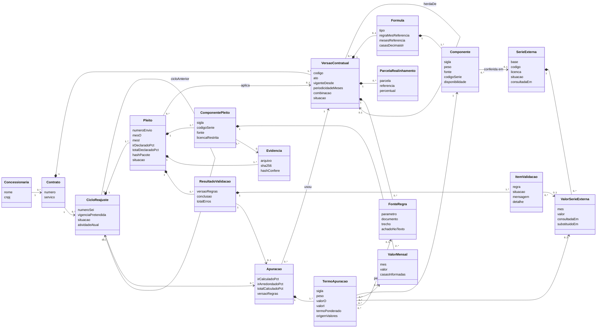
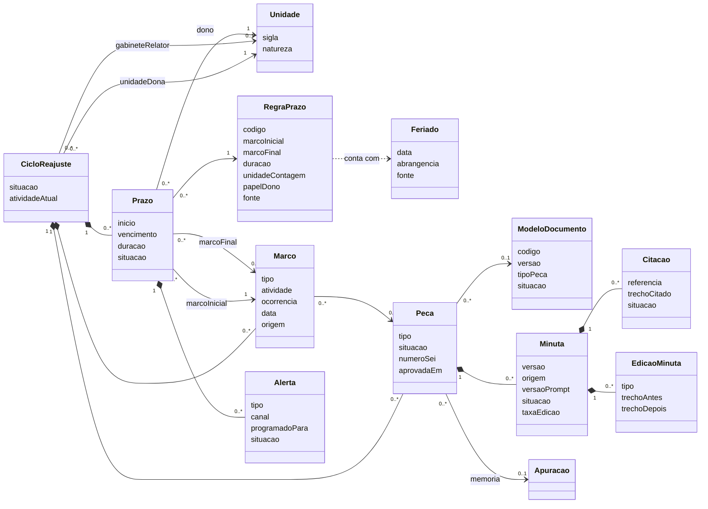
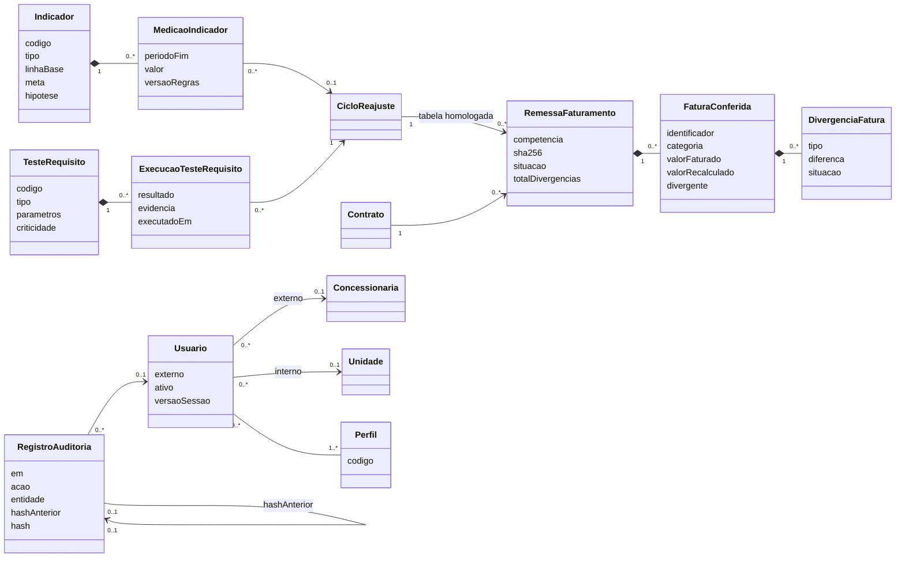

# 06. Modelo de dados

Modelo lógico e físico do Reajusta. O modelo físico executável é [`prisma/schema.prisma`](prisma/schema.prisma), validado
com `prisma validate` na versão em uso quando o pacote foi escrito (Prisma 6.x, em 31/10/2026). O sistema usa a última
versão estável do Prisma (7.x em 01/11/2026; ADR-0012, revisão de 01/11/2026); a adaptação do esquema a cada major entra
no PR da major. O que o Prisma não expressa (gatilhos, `CHECK`, permissões) está na §5 e vai para a primeira migração. Decisões em [ADR-0004](adr/0004-postgresql-prisma-versionamento-cadastro.md).

Entidades: as 35 da seção 11 de [`01_VISAO_ESCOPO.md`](01_VISAO_ESCOPO.md), mais 4 marcadas **(proposto)**, que
precisam entrar no documento-base: `Unidade`, `RegraPrazo`, `Feriado`, `ExecucaoTesteRequisito`.

## 1. Convenções

| ID | Convenção |
|---|---|
| MD-01 | Nomes do glossário (`01_VISAO_ESCOPO.md` §7), em português, sem acento: modelos em `PascalCase` (`VersaoContratual`), campos em `camelCase` (`cicloReajuste`, `vigenteDesde`), enums em `MAIUSCULAS_COM_SUBLINHADO` |
| MD-02 | Tabelas em `snake_case` por `@@map` (`versao_contratual`); colunas com o nome do campo (SQL usa aspas: `"versaoContratualId"`) |
| MD-03 | Chave primária `id` uuid (`@default(uuid())`). Exceção: `RegistroAuditoria.id` é sequencial (`BigInt`), para a ordem da cadeia de hash |
| MD-04 | Mês de referência como texto `AAAA-MM` (`Char(7)`), igual ao layout do pleito (`pleito_reajuste.schema.json`). Data civil em `@db.Date`. Instante em `DateTime` (UTC no banco; conversão por `FUSO_HORARIO` na borda, ADR-0011) |
| MD-05 | Percentual em pontos percentuais: `6,30` quer dizer 6,30%. Sufixo `Pct` no nome (`irDeclaradoPct`) |
| MD-06 | Número-índice, peso, percentual e tarifa em `Decimal` com escala fixa; nunca `Float` (ADR-0003). As casas informadas pela fonte ficam em campo próprio (`casasInformadas`, `casasPublicadas`) |
| MD-07 | Atributo herdável da `VersaoContratual` é anulável: `null` quer dizer "herda da versão anterior" |
| MD-08 | Composição (a parte não existe sem o todo) usa `onDelete: Cascade`; o resto, `Restrict`. Os gatilhos da §5 impedem o `Cascade` sobre versão já usada |
| MD-09 | Bloco do layout validado pelo JSON Schema e sem consulta por campo (energia, tabela tarifária, publicação, outros componentes declarados) fica em `Json`, com o esquema Zod correspondente em `src/contratos` |
| MD-10 | Sem `@updatedAt` nas tabelas imutáveis; mudança de situação é registrada na trilha de auditoria |

## 2. Enums

| Enum | Valores | Origem |
|---|---|---|
| `Servico` | `SANEAMENTO`, `RESIDUOS` | escopo (`01_VISAO_ESCOPO.md` §3) |
| `SituacaoVersao` | `RASCUNHO`, `PUBLICADA`, `SUBSTITUIDA` | ADR-0004 |
| `TipoFormula` | `INDICES_PONDERADOS`, `INDICE_UNICO` | glossário "Fórmula" |
| `RegraMesReferencia` | `MESES_ANTES_DA_VIGENCIA`, `MESES_ANTES_DA_DATA_BASE` | levantamento §4 (3º ou 4º mês anterior, data-base) |
| `RegraCombinacao` | `MULTIPLICATIVA`, `ADITIVA` | levantamento §1 (a regra é parâmetro do contrato) |
| `FonteComponente` | `FGV`, `IBGE`, `ANEEL`, `ACORDO_COLETIVO`, `DELIBERACAO_AGENERSA`, `OUTRA` | campo `fonte` do layout 0.1 |
| `DisponibilidadeFonte` | `PUBLICA`, `PUBLICA_COM_REGRA`, `ASSINATURA`, `OUTRO_REAJUSTE`, `DOCUMENTO`, `INSUMO_INFORMADO` | `comum.FONTES_COMPONENTE`; ITS e IDG entram como insumo informado (escopo) |
| `SituacaoCiclo` | `PROTOCOLADO`, `EM_VALIDACAO`, `DEVOLVIDO`, `A_RECONFERIR`, `EM_ANALISE_TECNICA`, `EM_ANALISE_JURIDICA`, `EM_INSTRUCAO`, `EM_RAZOES_FINAIS`, `APTO_PARA_PAUTA`, `DECIDIDO_EM_REUNIAO_INTERNA`, `PAUTADO`, `DELIBERADO`, `PUBLICADO`, `EM_PRAZO_RECURSAL`, `AGUARDANDO_ENCERRAMENTO`, `ENCERRADO`, `ARQUIVADO` | estados de nível de cima do diagrama de `04_CASOS_DE_USO.md` §5; as transições ficam em `dominio/prz/maquina-ciclo.ts` |
| `SubsituacaoCiclo` | `AVALIANDO_INSTRUCAO`, `EM_DILIGENCIA`, `AGUARDANDO_RESPOSTA`, `EM_CONCILIACAO`, `ACESSO_AOS_AUTOS`, `CONFERINDO_FATURAS`, `LISTA_COMPLETA`, `CONSULTA_JURIDICA` | subestados de `EmInstrucao` e `AguardandoEncerramento` (`04_CASOS_DE_USO.md` §5) |
| `AtividadeBpmn` | `T1` a `T16` | ids `t1` a `t16` de `insumos/mapeamento/modelo_P01.json` |
| `SituacaoPleito` | `RECEBIDO`, `EM_VALIDACAO`, `A_RECONFERIR`, `DEVOLVIDO`, `VALIDADO`, `SUBSTITUIDO` | diagrama de estados do pleito da aula 2; `SUBSTITUIDO` quando a concessionária reenvia |
| `BaseSerie` | `IPEADATA`, `IBGE_SIDRA`, `ANEEL`, `FGV_DADOS`, `PLEITOS` | INT-02, INT-03, INT-04, INT-07; `PLEITOS` = conferência cruzada (ADR-0008) |
| `LicencaSerie` | `PUBLICA`, `RESTRITA` | RNF-04 |
| `SituacaoSerie` | `ATUALIZADA`, `DESATUALIZADA`, `INDISPONIVEL` | RF-SER-04, TL-14 |
| `RegraValidacao` | `V01` a `V12` | regras de validação (glossário) |
| `SituacaoItemValidacao` | `OK`, `AVISO`, `ERRO`, `A_REFAZER` | glossário "Regra de validação" e RF-SER-04 |
| `ConclusaoValidacao` | `SEGUE_PARA_ANALISE`, `DEVOLVER`, `A_REFAZER` | campo `decisao` de `contratos/resultado_validacao.schema.json`; RF-PLE-04 |
| `OrigemValor` | `PLEITO`, `SERIE_EXTERNA` | RNF-02 |
| `TipoMarco` | `PROTOCOLO`, `VALIDACAO`, `DEVOLUCAO`, `PARECER_TECNICO`, `PARECER_JURIDICO`, `DILIGENCIA`, `RESPOSTA_DILIGENCIA`, `REITERACAO`, `CONCILIACAO`, `ACESSO_AUTOS`, `RAZOES_FINAIS`, `DECISAO_REUNIAO_INTERNA`, `INCLUSAO_PAUTA`, `DELIBERACAO`, `PUBLICACAO`, `NOTIFICACAO`, `DIVULGACAO`, `ENVIO_ALERJ`, `VIGENCIA_TARIFA`, `RECURSO`, `CONFERENCIA_FATURAS`, `PARECER_ARQUIVAMENTO`, `CERTIDAO_AUSENCIA_RECURSO`, `ENCERRAMENTO` | tabela de marcos de `08_REGRAS_NEGOCIO.md` §7 e `TipoMarco` de `contratos/openapi.yaml`; `RESPOSTA_DILIGENCIA` **(proposto)**: evento e1 do BPMN, que encerra o prazo da diligência e evita a reiteração (RN-TRA-04) |
| `ModoArredondamento` | `MEIO_PARA_O_PAR`, `MEIO_PARA_CIMA` | RN-NUM-03 e DEC-06 de `08_REGRAS_NEGOCIO.md` (campo `formula.modo_arredondamento`, proposto lá) |
| `OrigemMarco` | `MANUAL`, `SISTEMA`, `IMPORTACAO_SEI` | ADR-0005 |
| `UnidadeContagem` | `DIAS_UTEIS`, `DIAS_CORRIDOS` | ADR-0011; N-P01-15; unidade `dc` dos testes R-P01 |
| `PapelDono` | `SECRETARIA`, `CAMARA_TECNICA`, `PROCURADORIA`, `GABINETE_RELATOR` | raias do BPMN; RF-PRZ-02 |
| `SituacaoPrazo` | `CORRENDO`, `A_VENCER`, `VENCIDO`, `CUMPRIDO`, `SUSPENSO`, `PRORROGADO` | `SituacaoPrazo` de `contratos/openapi.yaml`; RF-PRZ-01 a RF-PRZ-03 |
| `TipoAlerta` | `ANTES_DO_VENCIMENTO`, `NO_VENCIMENTO`, `VENCIDO`, `SEM_DONO`, `DATA_BASE`, `SERIE_DIVERGENTE`, `A_REFAZER` | tipo do alerta em `contratos/openapi.yaml`; RF-PRZ-03, RF-CAD-04, RF-SER-04 |
| `CanalAlerta` | `EMAIL`, `PAINEL` | INT-08, TL-10 |
| `SituacaoAlerta` | `PENDENTE`, `ENVIADO`, `FALHOU`, `LIDO` | JOB-02 |
| `TipoPeca` | `OFICIO_RECEBIMENTO`, `OFICIO_COMPLEMENTACAO`, `OFICIO_DILIGENCIA`, `OFICIO_REITERACAO`, `NOTIFICACAO_RAZOES_FINAIS`, `OFICIO_ACESSO_AUTOS`, `NOTIFICACAO_DELIBERACAO`, `OFICIO_ALERJ`, `OFICIO_PEDIDO_FATURAS`, `CERTIDAO_AUSENCIA_RECURSO`, `TERMO_ENCERRAMENTO`, `PARECER_TECNICO`, `PARECER_JURIDICO`, `RELATORIO`, `VOTO`, `DELIBERACAO`, `MEMORIA_CALCULO` | `tipo_peca` de `contratos/openapi.yaml`; `MEMORIA_CALCULO` **(proposto)** para guardar a memória de cálculo como peça (RF-CAL-05) |
| `SituacaoPeca` | `MINUTA`, `PRONTA_PARA_ASSINATURA`, `JUNTADA`, `DESCARTADA` | situação da peça em `contratos/openapi.yaml`; `DESCARTADA` **(proposto)**; RNF-07; ADR-0005 |
| `SituacaoModelo` | `RASCUNHO`, `ATIVO`, `OBSOLETO` | RF-ADM-03 |
| `OrigemMinuta` | `MODELO`, `MODELO_LINGUAGEM` | ADR-0006 |
| `SituacaoMinuta` | `GERADA`, `EM_REVISAO`, `REVISADA`, `DESCARTADA` | situação da minuta em `contratos/openapi.yaml`; `DESCARTADA` **(proposto)**; RNF-07 |
| `TipoFonteCitacao` | `NORMA`, `CONTRATO`, `DELIBERACAO`, `PECA_DO_PROCESSO` | glossário "Citação" |
| `SituacaoCitacao` | `NAO_VERIFICADA`, `VERIFICADA`, `INVALIDA`, `CONFERIDA_PELO_REVISOR` | RF-MIN-04; ADR-0006 |
| `TipoEdicao` | `INCLUSAO`, `EXCLUSAO`, `ALTERACAO` | RF-MIN-05 |
| `SituacaoRemessa` | `RECEBIDA`, `RECUSADA`, `EM_CONFERENCIA`, `CONFERIDA` | RF-FAT-01; RNF-05 (dado pessoal recebido é recusado) |
| `TipoDivergencia` | `TARIFA_DIFERENTE`, `CATEGORIA_INEXISTENTE`, `FAIXA_INEXISTENTE`, `VALOR_DIFERENTE` | RF-FAT-02 |
| `SituacaoDivergencia` | `ABERTA`, `JUSTIFICADA`, `CONFIRMADA` | UC-17 |
| `TipoIndicador` | `LEAD`, `HORAS`, `CONFORMIDADE`, `POSSE_SEM_UNIDADE`, `LACO`, `QUALIDADE_IA` | campo `formula.tipo` de `controles_P01.json`; `QUALIDADE_IA` para Q-P01-01 a 04 |
| `TipoTesteRequisito` | `PRECEDE`, `PRAZO_MAX`, `PRAZO_MIN`, `PRAZO_CONCEDIDO_MIN`, `EXIGE`, `MANUAL` | campo `teste.tipo` de `normas_P01.json` |
| `Criticidade` | `ALTA`, `MEDIA`, `BAIXA` | `normas_P01.json` |
| `ResultadoTeste` | `CONFORME`, `NAO_CONFORME`, `SEM_EVIDENCIA`, `NAO_APLICAVEL` | `ResultadoTeste` de `contratos/openapi.yaml`; RF-IND-02 |
| `CodigoPerfil` | `CON`, `ANA`, `GCA`, `PRO`, `SEC`, `REL`, `GES`, `ADM` | PER-CON a PER-ADM (a API usa a forma `PER-CON`; o adaptador converte) |
| `NaturezaUnidade` | `SECRETARIA`, `CAMARA_TECNICA`, `PROCURADORIA`, `GABINETE`, `CONSELHO`, `TI`, `CONTROLE_INTERNO` | perfis e raias |
| `AbrangenciaFeriado` | `NACIONAL`, `ESTADUAL`, `MUNICIPAL`, `PONTO_FACULTATIVO` | ADR-0011 |
| `OrigemAcao` | `TELA`, `API`, `JOB` | RF-ADM-02 |

Correspondência com a API: os enums de `contratos/openapi.yaml` são os mesmos valores em minúsculas
(`A_REFAZER` ↔ `a_refazer`); a conversão é feita só em `src/interface/api`. `SituacaoCiclo` e `SubsituacaoCiclo`
seguem o diagrama de estados de 04 nos dois lados (acertado na revisão do pacote).

## 3. Entidades e atributos

Tipos: `uuid`, `texto`, `inteiro`, `decimal(p,e)`, `data` (civil), `instante`, `booleano`, `json`, `mes` (`AAAA-MM`),
`hash` (64 caracteres hexadecimais do SHA-256). "PK" chave primária, "FK" chave estrangeira, "UQ" única, "IX" índice.
Todo `id` é PK uuid e não é repetido nas tabelas.

### 3.1 MOD-CAD — Cadastro de contratos

**Concessionaria** — UQ `cnpj`.

| Atributo | Tipo | Nulo | Regra |
|---|---|---|---|
| nome | texto | não | |
| cnpj | texto(14) | não | 14 dígitos, sem máscara (layout 0.1) |
| ativa | booleano | não | padrão verdadeiro |

**Contrato** — UQ `numero`; IX `concessionariaId`.

| Atributo | Tipo | Nulo | Regra |
|---|---|---|---|
| numero | texto | não | como no cadastro da agência; é o `contrato.numero` do pleito |
| concessionariaId | uuid FK | não | → Concessionaria |
| servico | `Servico` | não | |
| poderConcedente | texto | sim | |
| assinadoEm | data | sim | |
| ativo | booleano | não | |

**VersaoContratual** — UQ (`contratoId`, `codigo`); IX (`contratoId`, `vigenteDesde`).

| Atributo | Tipo | Nulo | Regra |
|---|---|---|---|
| contratoId | uuid FK | não | → Contrato |
| codigo | texto | não | código do cadastro, ex. `contrato-2014`, `3TA-2024`; é o `contrato.versao_contratual` do pleito |
| ato | texto | não | contrato, termo aditivo ou deliberação que sustenta a versão |
| vigenteDesde | data | sim | nulo só na versão original sem data no cadastro |
| herdaDeId | uuid FK | sim | → VersaoContratual (a anterior); diferente do próprio id |
| periodicidadeMeses | inteiro | sim | herdável |
| combinacao | `RegraCombinacao` | sim | herdável; ausente em toda a cadeia vale `MULTIPLICATIVA`, como no oráculo |
| dataBaseDia, dataBaseMes | inteiro | sim | herdáveis; calendário de data-base (RF-CAD-04) |
| defineRealinhamento | booleano | não | verdadeiro: as parcelas desta versão substituem as herdadas |
| observacao | texto | sim | |
| situacao | `SituacaoVersao` | não | `RASCUNHO` até publicar |
| publicadaEm, publicadaPorId | instante, uuid FK | sim | obrigatórios ao publicar |

A `Formula` é herdável como um todo: a versão sem fórmula usa a da anterior.

**Formula** — UQ `versaoContratualId` (uma por versão, opcional).

| Atributo | Tipo | Nulo | Regra |
|---|---|---|---|
| versaoContratualId | uuid FK | não | → VersaoContratual (composição) |
| tipo | `TipoFormula` | não | |
| expressao | texto | não | como escrita no contrato, ex. `IR = Σ Pk × (Ik_i − Ik_o) / Ik_o` |
| regraMesReferencia | `RegraMesReferencia` | não | |
| mesesReferencia | inteiro | não | ≥ 0; em Paraty, 3 (terceiro mês anterior) |
| casasDecimaisIr | inteiro | não | ≥ 0; em Paraty, 3 |
| modoArredondamento | `ModoArredondamento` | não | padrão `MEIO_PARA_O_PAR` (RN-NUM-03, DEC-06) |
| observacao | texto | sim | ex. soma dos pesos escritos |

**Componente** — UQ (`formulaId`, `sigla`) e (`formulaId`, `ordem`); IX `codigoSerie`.

| Atributo | Tipo | Nulo | Regra |
|---|---|---|---|
| formulaId | uuid FK | não | → Formula (composição) |
| sigla | texto | não | sigla do cadastro (IMO, IEE, IPA, IPQ, IPC, ICC em Paraty); o pleito usa a mesma |
| ordem | inteiro | não | ordem de exibição e da memória |
| peso | decimal(12,8) | sim | 0 < peso ≤ 1; nulo em índice único; usado como escrito (os seis pesos de Paraty somam 0,9999) |
| fonte | `FonteComponente` | não | |
| disponibilidade | `DisponibilidadeFonte` | não | |
| codigoSerie | texto | sim | código na fonte (159401, 1006819, ...) |
| indice | texto | não | descrição literal do índice |
| serieExternaId | uuid FK | sim | → SerieExterna pública usada em V07 (ex. IPEADATA `IGP12_IPC12`) |
| pendencia | texto | sim | ex. composição do IEE a confirmar com a CAPET |

**ParcelaRealinhamento** — UQ (`versaoContratualId`, `parcela`) e (`versaoContratualId`, `referencia`).

| Atributo | Tipo | Nulo | Regra |
|---|---|---|---|
| versaoContratualId | uuid FK | não | → VersaoContratual (composição) |
| parcela | inteiro | não | 1, 2, ... |
| referencia | mes | não | mês a partir do qual a parcela se aplica |
| percentual | decimal(9,4) | não | em pontos percentuais |

**FonteRegra** — IX (`versaoContratualId`, `parametro`).

| Atributo | Tipo | Nulo | Regra |
|---|---|---|---|
| versaoContratualId | uuid FK | não | → VersaoContratual (composição) |
| parametro | texto | não | ex. `periodicidade`, `pesos`, `IMO.codigo_serie`, `realinhamento.2` |
| documento | texto | não | nome do texto na base do Especialista |
| trecho | texto | não | literal; conferido no texto do documento (V02, RF-CAD-02) |
| hashDocumento | hash | sim | do texto em que o trecho foi achado |
| achadoNoTexto, conferidoEm | booleano, instante | sim | resultado da conferência feita na publicação da versão; reconferências posteriores ficam nos itens de V02 |

### 3.2 MOD-PLE — Pleitos

**CicloReajuste** — UQ `numeroSei`; UQ (`contratoId`, `vigenciaPretendida`); UQ `cicloAnteriorId`; IX `situacao`;
IX (`unidadeDonaId`, `situacao`).

| Atributo | Tipo | Nulo | Regra |
|---|---|---|---|
| contratoId | uuid FK | não | → Contrato |
| numeroSei | texto | sim | número do processo SEI (RF-PLE-06); obrigatório antes de sair de `EM_VALIDACAO` |
| vigenciaPretendida | data | não | |
| situacao | `SituacaoCiclo` | não | |
| subsituacao | `SubsituacaoCiclo` | sim | só em `EM_INSTRUCAO` e `AGUARDANDO_ENCERRAMENTO` |
| atividadeAtual | `AtividadeBpmn` | não | etapa do BPMN em que o ciclo está |
| unidadeDonaId | uuid FK | **não** | → Unidade; nenhum ciclo sem unidade responsável (RF-PRZ-02, I-P01-06) |
| gabineteRelatorId | uuid FK | sim | → Unidade sorteada (t1) |
| cicloAnteriorId | uuid FK | sim | → CicloReajuste; encadeamento (RF-CAL-06) |
| totalHomologadoPct | decimal(12,6) | sim | percentual deliberado (insumo da conferência de faturas) |
| tabelaHomologada | json | sim | tabela tarifária homologada, no formato da `tabela_tarifaria` do layout |
| abertoEm, encerradoEm | instante | não, sim | `encerradoEm` obrigatório em `ENCERRADO` |

**Pleito** — UQ (`cicloId`, `numeroEnvio`); IX `situacao`.

| Atributo | Tipo | Nulo | Regra |
|---|---|---|---|
| cicloId | uuid FK | não | → CicloReajuste |
| numeroEnvio | inteiro | não | 1 no primeiro envio; soma 1 a cada reenvio após devolução |
| versaoLayout | texto | não | `0.1` |
| codigoVersaoDeclarada | texto | não | `contrato.versao_contratual` como veio |
| versaoContratualId | uuid FK | sim | versão resolvida; nulo se o código não existe (V02 erro) |
| vigenciaPretendida, tarifaVigenteDesde | data | não | |
| atoTarifaEmVigor | texto | não | |
| mesO, mesI | mes | não | `periodo_referencia` |
| irDeclaradoPct, totalDeclaradoPct | decimal(18,10) | não | `resultado_declarado` |
| outrosDeclarados | json | não | `resultado_declarado.outros` (realinhamento, ITS, IDG...) |
| energia, tabelaTarifaria, publicacao | json | sim | blocos do layout |
| casasIndice, casasIr, casasTarifa | inteiro | não | `casas_decimais` |
| conteudo | json | não | o `pleito.json` inteiro como recebido; imutável |
| hashPacote | hash | não | SHA-256 do pacote (RF-PLE-01) |
| situacao | `SituacaoPleito` | não | única coluna que muda depois da inserção |
| enviadoPorId | uuid FK | não | → Usuario (PER-CON) |
| recebidoEm | instante | não | |

A validação prévia (RF-PLE-05) não grava `Pleito` nem `ResultadoValidacao`.

**ComponentePleito** — UQ (`pleitoId`, `sigla`); IX `codigoSerie`.

| Atributo | Tipo | Nulo | Regra |
|---|---|---|---|
| pleitoId | uuid FK | não | → Pleito |
| sigla | texto | não | |
| codigoSerie | texto | sim | |
| fonte | `FonteComponente` | não | |
| evidenciaId | uuid FK | sim | → Evidencia (o anexo citado em `evidencia.arquivo`) |
| evidenciaPagina | inteiro | sim | |
| evidenciaExtraidaEm | data | sim | |
| licencaRestrita | booleano | não | verdadeiro para fonte FGV (RNF-04, ADR-0008) |

**ValorMensal** — UQ (`componentePleitoId`, `mes`); IX `mes`.

| Atributo | Tipo | Nulo | Regra |
|---|---|---|---|
| componentePleitoId | uuid FK | não | → ComponentePleito |
| mes | mes | não | |
| valor | decimal(24,10) | não | como publicado pela fonte |
| casasInformadas | inteiro | não | casas do número recebido (V07 aviso de arredondamento) |

**Evidencia** — UQ (`pleitoId`, `arquivo`).

| Atributo | Tipo | Nulo | Regra |
|---|---|---|---|
| pleitoId | uuid FK | não | → Pleito |
| arquivo, tipo | texto | não | `anexos[].arquivo`, `anexos[].tipo` |
| sha256 | hash | não | declarado no pleito |
| hashConfere | booleano | não | SHA-256 recalculado do arquivo recebido igual ao declarado |
| tamanhoBytes | inteiro | não | |
| tipoMime | texto | não | |
| caminhoArmazenamento | texto | não | chave na porta `ArmazenamentoArquivos`; nunca caminho absoluto de máquina |

**ResultadoValidacao** — IX (`pleitoId`, `executadoEm`).

| Atributo | Tipo | Nulo | Regra |
|---|---|---|---|
| pleitoId | uuid FK | não | → Pleito |
| versaoContratualId | uuid FK | sim | versão usada (RNF-03) |
| versaoRegras | texto | não | versão semântica das regras do domínio |
| versaoLayout | texto | não | |
| conclusao | `ConclusaoValidacao` | não | `DEVOLVER` se há `ERRO`; senão `A_REFAZER` se há item `A_REFAZER` (o pleito fica `A_RECONFERIR`); senão `SEGUE_PARA_ANALISE` |
| totalOk, totalAvisos, totalErros, totalARefazer | inteiro | não | contagens dos itens |
| duracaoMs | inteiro | não | medição de RNF-13 |
| executadoEm | instante | não | |

**ItemValidacao** — UQ (`resultadoId`, `ordem`); IX (`regra`, `situacao`).

| Atributo | Tipo | Nulo | Regra |
|---|---|---|---|
| resultadoId | uuid FK | não | → ResultadoValidacao |
| ordem | inteiro | não | ordem de emissão, a mesma do oráculo |
| regra | `RegraValidacao` | não | |
| situacao | `SituacaoItemValidacao` | não | |
| componenteSigla | texto | sim | quando o item é de um componente |
| mensagem | texto | não | na linguagem de quem analisa (RNF-09; guia de mensagens de `10_UX_UI.md`) |
| detalhe | json | sim | valores comparados, esperado e encontrado, origem; é o que o teste de paridade compara |
| valorSerieExternaId | uuid FK | sim | → ValorSerieExterna usado na conferência (V07, V08) |

### 3.3 MOD-SER — Séries

**SerieExterna** — UQ (`base`, `codigo`).

| Atributo | Tipo | Nulo | Regra |
|---|---|---|---|
| base | `BaseSerie` | não | |
| codigo | texto | não | ex. `IGP12_IPC12`, `1737/n1/all/v/2266`, código da FGV |
| nome | texto | não | |
| licenca | `LicencaSerie` | não | `RESTRITA` para FGV |
| enderecoConsulta | texto | sim | caminho relativo à URL base configurada |
| situacao | `SituacaoSerie` | não | |
| consultadaEm | instante | sim | última consulta bem-sucedida |
| ultimaFalhaEm, ultimaFalha | instante, texto | sim | sem corpo de resposta bruto |

**ValorSerieExterna** — UQ (`serieExternaId`, `mes`, `consultadaEm`); IX (`serieExternaId`, `mes`).

| Atributo | Tipo | Nulo | Regra |
|---|---|---|---|
| serieExternaId | uuid FK | não | → SerieExterna |
| mes | mes | não | |
| valor | decimal(24,10) | não | |
| casasPublicadas | inteiro | não | |
| consultadaEm | instante | não | data da consulta (RF-SER-01, RNF-02) |
| substituidoEm | instante | sim | preenchido quando a fonte revisa o valor; o registro antigo fica (ADR-0007) |
| origem | texto | sim | para base `PLEITOS`: processo e documento de onde veio o valor |

O valor vigente de um mês é o registro com `substituidoEm` nulo.

### 3.4 MOD-CAL — Motor de cálculo

**Apuracao** — UQ `resultadoValidacaoId`; IX (`cicloId`, `calculadaEm`).

| Atributo | Tipo | Nulo | Regra |
|---|---|---|---|
| cicloId | uuid FK | não | → CicloReajuste |
| pleitoId | uuid FK | sim | → Pleito apurado |
| resultadoValidacaoId | uuid FK | sim | → validação que produziu a apuração |
| versaoContratualId | uuid FK | não | só versão publicada, nunca rascunho (gatilho I-05) |
| versaoRegras, versaoLayout | texto | não, sim | RNF-03 |
| irCalculadoPct | decimal(24,12) | não | Σ peso × (i/o − 1), sem arredondar |
| irArredondadoPct | decimal(18,10) | não | nas casas da fórmula |
| casasIr | inteiro | não | |
| regraCombinacao | `RegraCombinacao` | não | da versão resolvida |
| parcelaRealinhamento, realinhamentoPct | inteiro, decimal(9,4) | sim | parcela do cronograma no mês da vigência |
| outrosComponentes | json | não | ITS, IDG e outros insumos informados, com evidência |
| totalCalculadoPct | decimal(24,12) | não | |
| confereComDeclarado | booleano | sim | dentro da tolerância de RNF-01 |
| calculadaEm | instante | não | |

**TermoApuracao** — UQ (`apuracaoId`, `sigla`) e (`apuracaoId`, `ordem`).

| Atributo | Tipo | Nulo | Regra |
|---|---|---|---|
| apuracaoId | uuid FK | não | → Apuracao |
| componenteId | uuid FK | não | → Componente da versão usada |
| sigla, ordem | texto, inteiro | não | |
| peso | decimal(12,8) | não | |
| valorO, valorI | decimal(24,10) | não | |
| variacao | decimal(24,12) | não | i/o − 1 |
| termoPonderado | decimal(24,12) | não | peso × variação |
| origemValores | `OrigemValor` | não | |
| valorMensalOId, valorMensalIId | uuid FK | sim | → ValorMensal, quando a origem é o pleito |
| valorSerieExternaOId, valorSerieExternaIId | uuid FK | sim | → ValorSerieExterna, quando a origem é a série |
| fontePesoId | uuid FK | sim | → FonteRegra que sustenta o peso (RNF-02) |

A memória de cálculo (RF-CAL-05) é uma `Peca` de tipo `MEMORIA_CALCULO` com `apuracaoId`.

### 3.5 MOD-PRZ — Prazos e tramitação

**Unidade (proposto)** — UQ `sigla`.

| Atributo | Tipo | Nulo | Regra |
|---|---|---|---|
| sigla | texto | não | SCEXEC, CAPET, PROC, CONS-02 ... (raias do BPMN) |
| nome | texto | não | |
| natureza | `NaturezaUnidade` | não | |
| ativa | booleano | não | |

**RegraPrazo (proposto)** — UQ `codigo`. Nenhum prazo é escrito no código; ele vem daqui (ADR-0011).

| Atributo | Tipo | Nulo | Regra |
|---|---|---|---|
| codigo | texto | não | o ID da regra em `08_REGRAS_NEGOCIO.md` (RN-PRZ-03 a RN-PRZ-13) |
| nome | texto | não | o `tipo` do prazo na API (`pronunciamento`, `razoes_finais`, ...) sai do `codigo`, no adaptador |
| marcoInicial | `TipoMarco` | não | o prazo abre neste marco |
| marcoFinal | `TipoMarco` | sim | marco que cumpre o prazo; nulo para prazo que só decorre (razões finais, recurso) |
| duracao | inteiro | sim | > 0; nulo quando a duração é a concedida em cada ato (RN-PRZ-13, diligência): o `Prazo` recebe a do ofício |
| contaParaTras | booleano | não | verdadeiro para antecedência mínima contada para trás de uma data de referência (RN-PRZ-10 a RN-PRZ-12) |
| unidadeContagem | `UnidadeContagem` | não | |
| papelDono | `PapelDono` | não | resolve a unidade dona no ciclo (o gabinete do relator é o do ciclo) |
| diasAlertaAntes | inteiro[] | não | antecedências de alerta em dias úteis (RN-TRA-03); vazio = só alerta no vencimento |
| fonte | texto | não | norma, requisito ou melhoria (N-P01, R-P01, M-P01) |
| vigenteDesde | data | não | |
| ativa | booleano | não | |

**Feriado (proposto)** — UQ `data`.

| Atributo | Tipo | Nulo | Regra |
|---|---|---|---|
| data | data | não | |
| nome | texto | não | |
| abrangencia | `AbrangenciaFeriado` | não | |
| fonte | texto | não | lei, decreto ou regra do perfil do órgão |

**Marco** — UQ (`cicloId`, `tipo`, `ocorrencia`); IX (`cicloId`, `data`).

| Atributo | Tipo | Nulo | Regra |
|---|---|---|---|
| cicloId | uuid FK | não | → CicloReajuste |
| tipo | `TipoMarco` | não | |
| atividade | `AtividadeBpmn` | não | tarefa do BPMN do marco; base dos testes R-P01 e dos indicadores |
| ocorrencia | inteiro | não | 1, 2, ... (diligências e reiterações se repetem) |
| data | data | não | data do ato no SEI |
| origem | `OrigemMarco` | não | |
| numeroDocumentoSei | texto | sim | |
| pecaId | uuid FK | sim | → Peca que realiza o marco |
| registradoPorId | uuid FK | sim | nulo só quando `origem = SISTEMA` |
| registradoEm | instante | não | |
| observacao | texto | sim | |

**Prazo** — IX (`situacao`, `vencimento`), (`unidadeDonaId`, `situacao`), `cicloId`.

| Atributo | Tipo | Nulo | Regra |
|---|---|---|---|
| cicloId | uuid FK | não | |
| regraPrazoId | uuid FK | não | → RegraPrazo |
| marcoInicialId | uuid FK | não | → Marco que abriu o prazo |
| marcoFinalId | uuid FK | sim | → Marco que cumpriu o prazo |
| inicio, vencimento | data | não | `vencimento` = `vencimentoPrazo(...)` (ADR-0011) |
| duracao | inteiro | não | copiada da regra; a do ato quando a regra não fixa (diligência) ou quando o ato concede outra, com registro na trilha |
| unidadeContagem | `UnidadeContagem` | não | copiada da regra |
| unidadeDonaId | uuid FK | não | → Unidade (RF-PRZ-02) |
| usuarioDonoId | uuid FK | sim | → Usuario, quando atribuído a uma pessoa |
| situacao | `SituacaoPrazo` | não | |
| cumpridoEm | data | sim | |

**Alerta** — UQ `chaveIdempotencia`; IX (`situacao`, `programadoPara`).

| Atributo | Tipo | Nulo | Regra |
|---|---|---|---|
| tipo | `TipoAlerta` | não | |
| canal | `CanalAlerta` | não | |
| prazoId | uuid FK | sim | obrigatório em `ANTES_DO_VENCIMENTO`, `NO_VENCIMENTO` e `VENCIDO` |
| cicloId | uuid FK | sim | obrigatório em `SEM_DONO` e `A_REFAZER` |
| contratoId | uuid FK | sim | obrigatório em `DATA_BASE` (RF-CAD-04) |
| serieExternaId | uuid FK | sim | obrigatório em `SERIE_DIVERGENTE` (revisão de valor pela fonte) |
| unidadeId, destinatarioId | uuid FK | sim | ao menos um preenchido |
| programadoPara, enviadoEm | instante | não, sim | |
| situacao | `SituacaoAlerta` | não | |
| tentativas, ultimaFalha | inteiro, texto | não, sim | sem endereço de e-mail na mensagem de falha |
| chaveIdempotencia | texto | não | tipo + prazo (ou contrato) + data; impede alerta duplicado se o JOB-02 rodar duas vezes |

### 3.6 MOD-DOC e MOD-MIN — Documentos e minutas

**ModeloDocumento** — UQ (`codigo`, `versao`); IX (`tipoPeca`, `situacao`).

| Atributo | Tipo | Nulo | Regra |
|---|---|---|---|
| codigo | texto | não | ex. `oficio-complementacao` |
| versao | inteiro | não | nova versão a cada mudança (RF-ADM-03); versão usada não muda |
| nome | texto | não | |
| tipoPeca | `TipoPeca` | não | |
| arquivoModelo | texto | não | chave do DOCX-modelo no armazenamento |
| hashArquivo | hash | não | |
| camposEsperados | json | não | esquema dos campos que o modelo usa |
| situacao | `SituacaoModelo` | não | um `ATIVO` por `codigo` |
| vigenteDesde | instante | sim | |
| criadoPorId | uuid FK | não | → Usuario (PER-ADM) |

**Peca** — IX (`cicloId`, `tipo`).

| Atributo | Tipo | Nulo | Regra |
|---|---|---|---|
| cicloId | uuid FK | não | |
| tipo | `TipoPeca` | não | |
| titulo | texto | não | |
| situacao | `SituacaoPeca` | não | |
| modeloDocumentoId | uuid FK | sim | versão exata do modelo usado |
| apuracaoId | uuid FK | sim | para memória de cálculo e parecer técnico |
| dadosPreenchidos | json | sim | dados do ciclo inseridos no modelo, para reprodução |
| arquivoDocx, arquivoPdf | texto | sim | chaves no armazenamento (RF-DOC-02) |
| hashArquivo | hash | sim | |
| numeroSei, juntadaEm | texto, data | sim | obrigatórios em `JUNTADA` (ADR-0005) |
| geradaPorId | uuid FK | sim | nulo quando gerada por job (ex. reiteração, RF-PRZ-04) |
| aprovadaPorId, aprovadaEm | uuid FK, instante | sim | obrigatórios em `PRONTA_PARA_ASSINATURA` e `JUNTADA` (RNF-07) |

**Minuta** — UQ (`pecaId`, `versao`).

| Atributo | Tipo | Nulo | Regra |
|---|---|---|---|
| pecaId | uuid FK | não | |
| versao | inteiro | não | |
| origem | `OrigemMinuta` | não | |
| provedorModelo, nomeModelo, versaoPrompt | texto | sim | obrigatórios se `origem = MODELO_LINGUAGEM` |
| conteudo | texto | não | texto gerado; não muda |
| conteudoRevisado | texto | sim | texto depois da revisão humana |
| situacao | `SituacaoMinuta` | não | |
| revisadaPorId, revisadaEm | uuid FK, instante | sim | obrigatórios em `REVISADA` |
| taxaEdicao | decimal(7,4) | sim | trechos alterados / trechos da minuta (Q-P01-03) |

**Citacao** — UQ (`minutaId`, `ordem`); IX `situacao`.

| Atributo | Tipo | Nulo | Regra |
|---|---|---|---|
| minutaId | uuid FK | não | |
| ordem | inteiro | não | |
| tipoFonte | `TipoFonteCitacao` | não | |
| referencia | texto | não | ex. dispositivo da norma ou cláusula |
| documentoFonte | texto | não | documento na base do Especialista |
| trechoCitado | texto | não | literal |
| situacao | `SituacaoCitacao` | não | |
| verificadaEm, motivo | instante, texto | sim | |
| conferidaPorId | uuid FK | sim | obrigatório em `CONFERIDA_PELO_REVISOR` |

**EdicaoMinuta** — IX (`minutaId`, `em`).

| Atributo | Tipo | Nulo | Regra |
|---|---|---|---|
| minutaId, usuarioId | uuid FK | não | |
| tipo | `TipoEdicao` | não | |
| posicao | inteiro | não | posição do trecho no texto |
| trechoAntes, trechoDepois | texto | sim | |
| em | instante | não | |

### 3.7 MOD-FAT — Conferência de faturas

**RemessaFaturamento** — UQ (`contratoId`, `competencia`, `sha256`); IX (`contratoId`, `competencia`).

| Atributo | Tipo | Nulo | Regra |
|---|---|---|---|
| concessionariaId, contratoId | uuid FK | não | |
| cicloId | uuid FK | não | ciclo cuja tabela homologada é a referência |
| competencia | mes | não | |
| versaoLayout | texto | não | layout próprio da remessa (`07_CONTRATOS_API.md`) |
| arquivo, sha256 | texto, hash | não | |
| situacao | `SituacaoRemessa` | não | `RECUSADA` se trouxer dado pessoal (RNF-05) |
| motivoRecusa | texto | sim | sem repetir o dado pessoal recebido |
| totalFaturas, totalDivergencias | inteiro | sim | |
| enviadaPorId | uuid FK | não | → Usuario (PER-CON) |
| recebidaEm, conferidaEm | instante | não, sim | |

**FaturaConferida** — UQ (`remessaId`, `identificador`); IX (`remessaId`, `divergente`).

| Atributo | Tipo | Nulo | Regra |
|---|---|---|---|
| remessaId | uuid FK | não | |
| identificador | texto | não | código da fatura sem dado pessoal (nem matrícula ligável a pessoa sem a base da concessionária) |
| categoria | texto | não | categoria tarifária |
| faixaInicio, faixaFim | decimal(18,4) | sim | |
| quantidade | decimal(18,4) | não | |
| unidade | texto | não | |
| valorFaturado, valorRecalculado | decimal(18,6) | não | |
| divergente | booleano | não | a tela lista só as divergentes (RF-FAT-02) |

**DivergenciaFatura** — IX `situacao`.

| Atributo | Tipo | Nulo | Regra |
|---|---|---|---|
| faturaId | uuid FK | não | |
| tipo | `TipoDivergencia` | não | |
| valorEsperado, valorEncontrado, diferenca | decimal(18,6) | sim | |
| situacao | `SituacaoDivergencia` | não | |
| justificativa | texto | sim | obrigatória em `JUSTIFICADA` |

### 3.8 MOD-IND — Indicadores e auditoria contínua

**Indicador** — UQ `codigo`.

| Atributo | Tipo | Nulo | Regra |
|---|---|---|---|
| codigo | texto | não | I-P01-01 a I-P01-10 e Q-P01-01 a Q-P01-04 (`controles_P01.json`) |
| nome | texto | não | |
| tipo | `TipoIndicador` | não | |
| definicao | json | não | o bloco `formula` do indicador (atividades, requisito) |
| unidadeMedida | texto | não | du, h, %, casos |
| linhaBase | decimal(18,6) | sim | de `controles_P01.json` |
| meta | json | sim | metas por fase do TO-BE |
| fonte | texto | não | arquivo e campo de origem |
| hipotese | booleano | não | verdadeiro para horas e custos até a calibração com servidores |
| ativo | booleano | não | |

**MedicaoIndicador** — IX (`indicadorId`, `periodoFim`), `cicloId`.

| Atributo | Tipo | Nulo | Regra |
|---|---|---|---|
| indicadorId | uuid FK | não | |
| cicloId | uuid FK | sim | nulo na medição agregada do período |
| periodoInicio, periodoFim | data | não | |
| valor, numerador, denominador | decimal(18,6) | sim | `valor` nulo quando faltam marcos (o detalhe diz quais) |
| versaoRegras | texto | não | |
| detalhe | json | sim | |
| calculadaEm | instante | não | |

**TesteRequisito** — UQ `codigo`.

| Atributo | Tipo | Nulo | Regra |
|---|---|---|---|
| codigo | texto | não | R-P01-01 a R-P01-20 |
| exigencia | texto | não | |
| tipo | `TipoTesteRequisito` | não | |
| parametros | json | não | o bloco `teste` de `normas_P01.json` (a, b, de, ate, max, min, unidade, de_ocorrencia) |
| criticidade | `Criticidade` | não | |
| normas | texto[] | não | N-P01-xx |
| atividades | `AtividadeBpmn`[] | não | |
| ativo | booleano | não | `MANUAL` não roda no job; vira lista de verificação na TL-13 |

**ExecucaoTesteRequisito (proposto)** — IX (`testeRequisitoId`, `resultado`), (`cicloId`, `executadoEm`).

| Atributo | Tipo | Nulo | Regra |
|---|---|---|---|
| testeRequisitoId, cicloId | uuid FK | não | |
| resultado | `ResultadoTeste` | não | |
| evidencia | json | não | marcos e datas usados |
| versaoRegras | texto | não | |
| executadoEm | instante | não | |

### 3.9 MOD-ADM — Administração

**Usuario** — UQ `email`; IX `concessionariaId`, `unidadeId`.

| Atributo | Tipo | Nulo | Regra |
|---|---|---|---|
| nome, email | texto | não | dado pessoal: não vai para log nem para o token (ADR-0009) |
| senhaHash | texto | não | argon2id |
| externo | booleano | não | |
| concessionariaId | uuid FK | sim | obrigatório se externo, nulo se interno (C-01) |
| unidadeId | uuid FK | sim | obrigatório se interno, nulo se externo (C-01) |
| ativo | booleano | não | |
| tentativasFalhas, bloqueadoAte | inteiro, instante | não, sim | |
| versaoSessao | inteiro | não | sobe para revogar sessões (ADR-0009) |
| ultimoAcessoEm | instante | sim | |

**Perfil** — UQ `codigo`. Atributos: `codigo` (`CodigoPerfil`), `nome`, `descricao`. Relação m:n com `Usuario` (tabela
de junção gerada pelo Prisma). Usuário externo só tem `CON` (regra de domínio em `dominio/adm`).

**RegistroAuditoria** — PK sequencial; UQ `hash`; IX (`entidade`, `entidadeId`), (`usuarioId`, `em`).

| Atributo | Tipo | Nulo | Regra |
|---|---|---|---|
| em | instante | não | |
| usuarioId | uuid FK | sim | nulo para ação de job |
| perfilAtivo | `CodigoPerfil` | sim | perfil da sessão (TL-16) |
| origem | `OrigemAcao` | não | |
| acao | texto | não | verbo do caso de uso, ex. `publicarVersaoContratual` |
| entidade, entidadeId | texto | não | |
| antes, depois | json | sim | estado alterado; para `Usuario`, só os nomes dos campos alterados, sem os valores pessoais |
| correlacaoId | texto | não | o mesmo do log da requisição |
| hashAnterior | hash | sim | `hash` do registro anterior; nulo só no primeiro |
| hash | hash | não | SHA-256 do JSON canônico (chaves ordenadas) de todos os campos acima |

## 4. Diagramas de classes

Atributos resumidos; a lista completa está na §3.

### 4.1 Cadastro, pleito, séries e cálculo



### 4.2 Tramitação, documentos e minutas



### 4.3 Faturas, indicadores e administração



## 5. Regras de integridade

### 5.1 Lista

| ID | Regra | Onde é imposta | Origem |
|---|---|---|---|
| I-01 | Versão contratual usada por `Apuracao` ou `ResultadoValidacao` não muda nem é apagada, nem suas partes (`Formula`, `Componente`, `ParcelaRealinhamento`, `FonteRegra`). Só `situacao` muda | caso de uso (`VERSAO_EM_USO`) e gatilho `bloquear_versao_usada` | ADR-0004; RNF-03 |
| I-02 | Trilha de auditoria só aceita inserção; cadeia de hash contínua | gatilho `somente_insercao`, `REVOKE`, verificação da cadeia no JOB-03 | RF-ADM-02; RNF-11 |
| I-03 | Dado recebido é imutável: `valor_mensal`, `evidencia`, `componente_pleito`; em `pleito`, só `situacao` muda | gatilhos `somente_insercao` e `so_altera_colunas` | RNF-02, RNF-03 |
| I-04 | Resultado e cálculo são imutáveis: `resultado_validacao`, `item_validacao`, `apuracao`, `termo_apuracao`, `edicao_minuta`, `execucao_teste_requisito`, `medicao_indicador`. Refazer cria registro novo | gatilho `somente_insercao` | RNF-03 |
| I-05 | Apuração só com versão publicada (`PUBLICADA`, ou `SUBSTITUIDA` para refazer um ciclo antigo); nunca com `RASCUNHO` | gatilho `exigir_versao_publicada` e caso de uso | ADR-0004 |
| I-06 | Valor de série revisado não sobrescreve: em `valor_serie_externa`, só `substituidoEm` muda | gatilho `so_altera_colunas` | ADR-0007 |
| I-07 | Minuta só chega a `REVISADA` por pessoa e sem citação `INVALIDA` ou `NAO_VERIFICADA` | `CHECK` C-04 e gatilho `exigir_citacoes_conferidas`; domínio `dominio/min` | RNF-07; RF-MIN-04 |
| I-08 | Peça pronta para assinatura ou juntada tem aprovador; peça juntada tem número SEI e data | `CHECK` C-02 e C-03 | RNF-07; ADR-0005 |
| I-09 | Usuário externo tem concessionária e não tem unidade; interno tem unidade e não tem concessionária | `CHECK` C-01 | RF-ADM-01 |
| I-10 | Todo ciclo tem unidade dona | `NOT NULL` em `unidadeDonaId` | RF-PRZ-02 |
| I-11 | Encerramento só depois da certidão de ausência de recurso e da lista de verificação | domínio (`dominio/prz/encerramento.ts`) e caso de uso UC-15; teste R-P01-17 na auditoria contínua | RF-PRZ-08; R-P01-17; N-P01-16 |
| I-12 | Mês sempre no formato `AAAA-MM` | `CHECK` C-05 | layout 0.1 |
| I-13 | Peso entre 0 e 1; casas e meses de referência não negativos; data-base válida; versão não herda de si | `CHECK` C-06 a C-08 | cadastro de Paraty |
| I-14 | Ciclo encerrado tem data de encerramento | `CHECK` C-09 | RF-PRZ-08 |
| I-15 | Ciclos encadeados formam cadeia linear (um posterior por ciclo) | `UNIQUE` em `cicloAnteriorId` | RF-CAL-06 |
| I-16 | Alerta não se repete | `UNIQUE` em `chaveIdempotencia` | RF-PRZ-03 |

### 5.2 SQL complementar da primeira migração

O arquivo vai em `prisma/migrations/<carimbo>_integridade/migration.sql`, depois da migração gerada pelo Prisma. O
papel da aplicação é `reajusta_app`; o dono do esquema, usado só pelas migrações, é outro (`14_OPERACAO.md`). O teste
de integração do banco confere que cada gatilho existe e barra a operação.

```sql
-- I-02, I-03, I-04: tabelas só de inserção
CREATE OR REPLACE FUNCTION somente_insercao() RETURNS trigger AS $$
BEGIN
  RAISE EXCEPTION 'a tabela % aceita só inserção', TG_TABLE_NAME USING ERRCODE = 'P0001';
END $$ LANGUAGE plpgsql;

DO $$
DECLARE t text;
BEGIN
  FOREACH t IN ARRAY ARRAY['registro_auditoria', 'valor_mensal', 'evidencia', 'componente_pleito',
                           'resultado_validacao', 'item_validacao', 'apuracao', 'termo_apuracao',
                           'edicao_minuta', 'execucao_teste_requisito', 'medicao_indicador'] LOOP
    EXECUTE format('CREATE TRIGGER %I BEFORE UPDATE OR DELETE ON %I
                    FOR EACH ROW EXECUTE FUNCTION somente_insercao()', t || '_somente_insercao', t);
    EXECUTE format('CREATE TRIGGER %I BEFORE TRUNCATE ON %I
                    FOR EACH STATEMENT EXECUTE FUNCTION somente_insercao()', t || '_sem_truncate', t);
  END LOOP;
END $$;

REVOKE UPDATE, DELETE, TRUNCATE ON registro_auditoria FROM reajusta_app;

-- I-03, I-06: só as colunas listadas podem mudar
CREATE OR REPLACE FUNCTION so_altera_colunas() RETURNS trigger AS $$
BEGIN
  IF (to_jsonb(NEW) - TG_ARGV) IS DISTINCT FROM (to_jsonb(OLD) - TG_ARGV) THEN
    RAISE EXCEPTION 'na tabela %, só podem mudar: %', TG_TABLE_NAME, TG_ARGV USING ERRCODE = 'P0001';
  END IF;
  RETURN NEW;
END $$ LANGUAGE plpgsql;

CREATE TRIGGER pleito_so_situacao BEFORE UPDATE ON pleito
  FOR EACH ROW EXECUTE FUNCTION so_altera_colunas('situacao');
CREATE TRIGGER pleito_sem_exclusao BEFORE DELETE ON pleito
  FOR EACH ROW EXECUTE FUNCTION somente_insercao();
CREATE TRIGGER valor_serie_externa_so_substituicao BEFORE UPDATE ON valor_serie_externa
  FOR EACH ROW EXECUTE FUNCTION so_altera_colunas('substituidoEm');
CREATE TRIGGER valor_serie_externa_sem_exclusao BEFORE DELETE ON valor_serie_externa
  FOR EACH ROW EXECUTE FUNCTION somente_insercao();

-- I-01: versão contratual usada é imutável
CREATE OR REPLACE FUNCTION versao_usada(v uuid) RETURNS boolean AS $$
  SELECT EXISTS (SELECT 1 FROM apuracao WHERE "versaoContratualId" = v)
      OR EXISTS (SELECT 1 FROM resultado_validacao WHERE "versaoContratualId" = v);
$$ LANGUAGE sql STABLE;

CREATE OR REPLACE FUNCTION bloquear_versao_usada() RETURNS trigger AS $$
DECLARE
  linha jsonb;
  v uuid;
BEGIN
  IF TG_OP = 'INSERT' THEN linha := to_jsonb(NEW); ELSE linha := to_jsonb(OLD); END IF;
  IF TG_TABLE_NAME = 'versao_contratual' THEN
    v := (linha ->> 'id')::uuid;
    IF TG_OP = 'UPDATE' AND (to_jsonb(NEW) - 'situacao') = (to_jsonb(OLD) - 'situacao') THEN
      RETURN NEW;  -- só a situação mudou
    END IF;
  ELSIF TG_TABLE_NAME = 'componente' THEN
    SELECT f."versaoContratualId" INTO v FROM formula f WHERE f.id = (linha ->> 'formulaId')::uuid;
  ELSE
    v := (linha ->> 'versaoContratualId')::uuid;
  END IF;
  IF versao_usada(v) THEN
    RAISE EXCEPTION 'versão contratual % já usada em apuração ou validação: crie uma versão nova', v
      USING ERRCODE = 'P0001';
  END IF;
  IF TG_OP = 'DELETE' THEN RETURN OLD; END IF;
  RETURN NEW;
END $$ LANGUAGE plpgsql;

CREATE TRIGGER versao_contratual_usada BEFORE UPDATE OR DELETE ON versao_contratual
  FOR EACH ROW EXECUTE FUNCTION bloquear_versao_usada();
CREATE TRIGGER formula_versao_usada BEFORE INSERT OR UPDATE OR DELETE ON formula
  FOR EACH ROW EXECUTE FUNCTION bloquear_versao_usada();
CREATE TRIGGER componente_versao_usada BEFORE INSERT OR UPDATE OR DELETE ON componente
  FOR EACH ROW EXECUTE FUNCTION bloquear_versao_usada();
CREATE TRIGGER parcela_versao_usada BEFORE INSERT OR UPDATE OR DELETE ON parcela_realinhamento
  FOR EACH ROW EXECUTE FUNCTION bloquear_versao_usada();
CREATE TRIGGER fonte_regra_versao_usada BEFORE INSERT OR UPDATE OR DELETE ON fonte_regra
  FOR EACH ROW EXECUTE FUNCTION bloquear_versao_usada();

-- I-05: apuração só com versão publicada
CREATE OR REPLACE FUNCTION exigir_versao_publicada() RETURNS trigger AS $$
BEGIN
  IF NOT EXISTS (SELECT 1 FROM versao_contratual
                 WHERE id = NEW."versaoContratualId" AND situacao IN ('PUBLICADA', 'SUBSTITUIDA')) THEN
    RAISE EXCEPTION 'apuração exige versão contratual publicada' USING ERRCODE = 'P0001';
  END IF;
  RETURN NEW;
END $$ LANGUAGE plpgsql;
CREATE TRIGGER apuracao_versao_publicada BEFORE INSERT ON apuracao
  FOR EACH ROW EXECUTE FUNCTION exigir_versao_publicada();

-- I-07: minuta revisada sem citação inválida ou não verificada
CREATE OR REPLACE FUNCTION exigir_citacoes_conferidas() RETURNS trigger AS $$
BEGIN
  IF NEW.situacao = 'REVISADA' AND EXISTS (
       SELECT 1 FROM citacao WHERE "minutaId" = NEW.id AND situacao IN ('INVALIDA', 'NAO_VERIFICADA')) THEN
    RAISE EXCEPTION 'minuta com citação inválida ou não verificada não pode ser revisada' USING ERRCODE = 'P0001';
  END IF;
  RETURN NEW;
END $$ LANGUAGE plpgsql;
CREATE TRIGGER minuta_citacoes_conferidas BEFORE UPDATE ON minuta
  FOR EACH ROW EXECUTE FUNCTION exigir_citacoes_conferidas();

-- C-01 a C-09
ALTER TABLE usuario ADD CONSTRAINT c01_usuario_vinculo CHECK (
  (externo AND "concessionariaId" IS NOT NULL AND "unidadeId" IS NULL) OR
  (NOT externo AND "unidadeId" IS NOT NULL AND "concessionariaId" IS NULL));
ALTER TABLE peca ADD CONSTRAINT c02_peca_aprovador CHECK (
  situacao NOT IN ('PRONTA_PARA_ASSINATURA', 'JUNTADA') OR ("aprovadaPorId" IS NOT NULL AND "aprovadaEm" IS NOT NULL));
ALTER TABLE peca ADD CONSTRAINT c03_peca_juntada CHECK (
  situacao <> 'JUNTADA' OR ("numeroSei" IS NOT NULL AND "juntadaEm" IS NOT NULL));
ALTER TABLE minuta ADD CONSTRAINT c04_minuta_revisor CHECK (
  situacao <> 'REVISADA' OR ("revisadaPorId" IS NOT NULL AND "revisadaEm" IS NOT NULL));
ALTER TABLE pleito ADD CONSTRAINT c05_pleito_meses CHECK (
  "mesO" ~ '^[0-9]{4}-(0[1-9]|1[0-2])$' AND "mesI" ~ '^[0-9]{4}-(0[1-9]|1[0-2])$');
ALTER TABLE valor_mensal ADD CONSTRAINT c05_valor_mensal_mes CHECK (mes ~ '^[0-9]{4}-(0[1-9]|1[0-2])$');
ALTER TABLE valor_serie_externa ADD CONSTRAINT c05_valor_serie_mes CHECK (mes ~ '^[0-9]{4}-(0[1-9]|1[0-2])$');
ALTER TABLE parcela_realinhamento ADD CONSTRAINT c05_parcela_mes CHECK (referencia ~ '^[0-9]{4}-(0[1-9]|1[0-2])$');
ALTER TABLE remessa_faturamento ADD CONSTRAINT c05_remessa_mes CHECK (competencia ~ '^[0-9]{4}-(0[1-9]|1[0-2])$');
ALTER TABLE componente ADD CONSTRAINT c06_peso CHECK (peso IS NULL OR (peso > 0 AND peso <= 1));
ALTER TABLE formula ADD CONSTRAINT c07_formula CHECK ("casasDecimaisIr" >= 0 AND "mesesReferencia" >= 0);
ALTER TABLE versao_contratual ADD CONSTRAINT c08_versao CHECK (
  ("herdaDeId" IS NULL OR "herdaDeId" <> id) AND
  ("dataBaseMes" IS NULL OR "dataBaseMes" BETWEEN 1 AND 12) AND
  ("dataBaseDia" IS NULL OR "dataBaseDia" BETWEEN 1 AND 31) AND
  ("periodicidadeMeses" IS NULL OR "periodicidadeMeses" > 0));
ALTER TABLE ciclo_reajuste ADD CONSTRAINT c09_ciclo_encerrado CHECK (
  situacao NOT IN ('ENCERRADO', 'ARQUIVADO') OR "encerradoEm" IS NOT NULL);
ALTER TABLE regra_prazo ADD CONSTRAINT c10_regra_prazo CHECK (duracao IS NULL OR duracao > 0);
ALTER TABLE prazo ADD CONSTRAINT c11_prazo_duracao CHECK (duracao > 0);
```

### 5.3 Cadeia de hash da trilha

1. A inserção em `registro_auditoria` é feita só pelo adaptador `adaptadores/prisma/auditoria.ts`, dentro da mesma
   transação do caso de uso que mudou o dado.
2. O adaptador toma uma trava consultiva da transação (`pg_advisory_xact_lock`, com chave fixa definida no próprio
   adaptador), lê o `hash` do último registro e calcula o novo `hash` sobre o JSON canônico do registro mais o
   `hashAnterior`.
3. O JOB-03 percorre a cadeia e registra quebra como achado de auditoria (alerta ao PER-ADM).

## 6. Do layout do pleito para as entidades

Layout: `../saida/levantamento/pleito/pleito_reajuste.schema.json` (0.1). O caso de uso UC-01 grava; o domínio não depende do
banco.

| Campo do `pleito.json` | Entidade.atributo |
|---|---|
| `versao_layout` | `Pleito.versaoLayout` |
| `contrato.numero` | localiza `Contrato` por `numero` |
| `contrato.versao_contratual` | `Pleito.codigoVersaoDeclarada`; resolvido para `Pleito.versaoContratualId` |
| `concessionaria.cnpj` | confere com `Contrato.concessionaria.cnpj` e com a concessionária do usuário |
| `vigencia_pretendida` | `Pleito.vigenciaPretendida`; `CicloReajuste.vigenciaPretendida` |
| `tarifa_em_vigor.vigente_desde`, `.ato` | `Pleito.tarifaVigenteDesde`, `Pleito.atoTarifaEmVigor` |
| `periodo_referencia.o`, `.i` | `Pleito.mesO`, `Pleito.mesI` |
| `componentes[]` | `ComponentePleito` (sigla, codigoSerie, fonte, evidência) |
| `componentes[].serie[]` | `ValorMensal` (mes, valor, casasInformadas) |
| `energia` | `Pleito.energia` |
| `resultado_declarado.ir_pct`, `.total_pct` | `Pleito.irDeclaradoPct`, `Pleito.totalDeclaradoPct` |
| `resultado_declarado.outros` | `Pleito.outrosDeclarados` |
| `tabela_tarifaria` | `Pleito.tabelaTarifaria` |
| `casas_decimais` | `Pleito.casasIndice`, `casasIr`, `casasTarifa` |
| `publicacao` | `Pleito.publicacao` |
| `anexos[]` | `Evidencia` (arquivo, tipo, sha256, hashConfere) |
| o arquivo inteiro | `Pleito.conteudo`; SHA-256 do pacote em `Pleito.hashPacote` |

## 7. Dados iniciais (seed)

O seed é código (`prisma/seed/`), lê as fontes abaixo e nunca digita número à mão.

| Dados | Fonte | Observação |
|---|---|---|
| Contrato 008/2014 de Águas de Paraty, versões `contrato-2014` e `3TA-2024`, fórmula, 6 componentes, 7 parcelas e 12 fontes | `../saida/levantamento/contratos/paraty_008_2014.json` | situação "rascunho para validação com a CAPET": entra como `RASCUNHO` até a CAPET validar; o CNPJ real vem do PER-GCA (o do exemplo é fictício) |
| Séries públicas do catálogo | `SERIES_PUBLICAS` de `../scripts/comum.py` | IPEADATA `IGP12_INCC12`, `IGP12_IGPM12`, `IGP12_IPC12`; SIDRA `1737/n1/all/v/2266`, `3065/n1/all/v/1117` |
| Valores históricos para a conferência cruzada (base `PLEITOS`) | `../saida/levantamento/calculo/componentes.csv`, com o mês de `recalculo.csv` | ADR-0008 |
| Indicadores I-P01-01 a 10 e Q-P01-01 a 04 | `../insumos/mapeamento/controles_P01.json` | horas marcadas como hipótese |
| Testes R-P01-01 a 20 | `../insumos/mapeamento/normas_P01.json` | |
| Feriados | regras de `../perfis/rj_agenersa.py` (`FERIADOS_MOVEIS`, `FERIADOS_FIXOS`, `ANOS_FERIADOS`) | ADR-0011 |
| Unidades | raias de `../insumos/mapeamento/modelo_P01.json` (SCEXEC, CAPET, PROC, CONS-02 e demais gabinetes) | lista final com a Secretaria |
| Perfis | PER-CON a PER-ADM | |
| Regras de prazo | quadro RN-PRZ-02 de `08_REGRAS_NEGOCIO.md` (RN-PRZ-03 a RN-PRZ-13) | uma `RegraPrazo` por linha, com `codigo` igual ao ID da RN, duração, contagem, marco inicial, dono e norma da linha |
| Antecedências de alerta | RN-TRA-03 de `08_REGRAS_NEGOCIO.md` | `diasAlertaAntes` com os valores propostos lá, até a Secretaria Executiva confirmar |

Casos especiais do quadro:

- RN-PRZ-13, resposta a diligência: `duracao` nula na regra; cada `Prazo` guarda a duração concedida no seu ofício
  (`Prazo.duracao`), e o caso de uso recusa abrir o prazo sem ela.
- RN-PRZ-10 a RN-PRZ-12 são antecedências mínimas contadas para trás de uma data (vigência, data-base):
  `contaParaTras = true`. A data de referência e a conta são as de `08_REGRAS_NEGOCIO.md`.

## Adendo da revisão do pacote

- Entidade `Quesito` (enums `DestinatarioDiligencia`, `SituacaoQuesito`) incluída no `prisma/schema.prisma` para a
  diligência em rodada única (RN-TRA-07, RF-DOC-03). Os quesitos abertos entram no ofício único da fase (`pecaId`).
- `Tarefa` da API é o estado do job na fila (`05_ARQUITETURA.md` §12) e não tem tabela.
- `SituacaoCiclo` e `SubsituacaoCiclo` são os mesmos no Prisma e no `contratos/openapi.yaml`.
