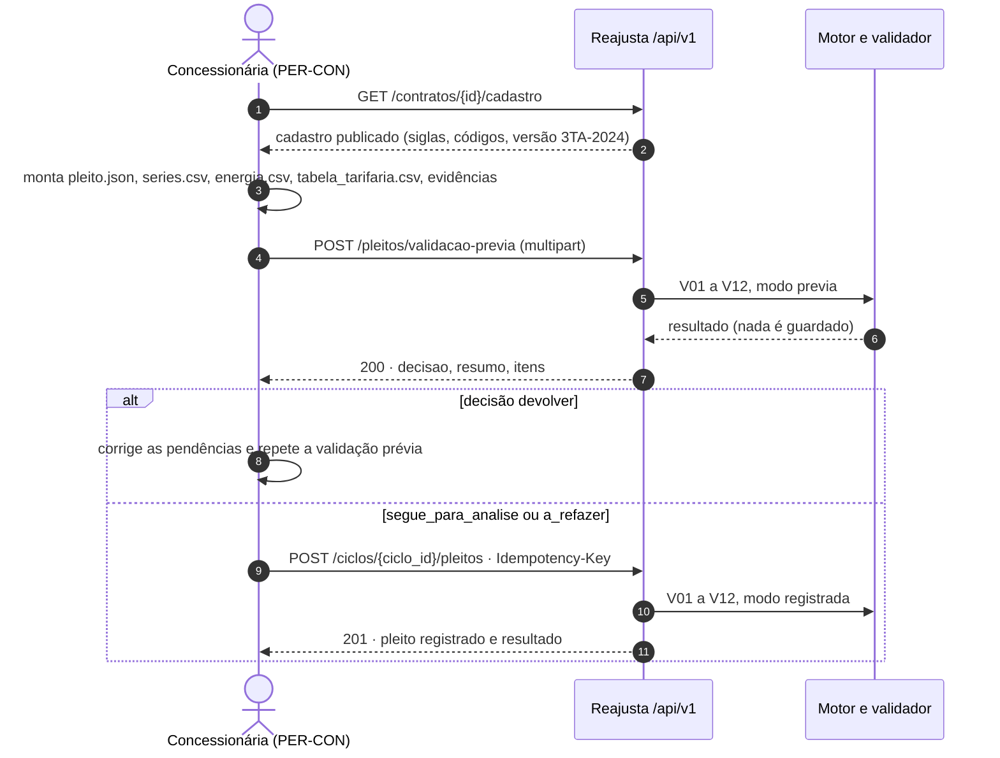

# 07. Contratos de dados e da API

Guia dos contratos que a implementação do Reajusta usa como fonte da verdade. A IA de desenvolvimento gera tipos,
validadores Zod e testes a partir deles; não inventa campo fora deles. Identificadores (UC, RF, PER, TL) são os de
[01_VISAO_ESCOPO.md](01_VISAO_ESCOPO.md); as regras citadas (RN-*) estão em [08_REGRAS_NEGOCIO.md](08_REGRAS_NEGOCIO.md).

## 1. Arquivos

| Arquivo | O que é | Quem produz | Quem consome | Validado contra |
|---|---|---|---|---|
| [contratos/pleito_reajuste.schema.json](contratos/pleito_reajuste.schema.json) | Layout 0.1 do pleito (cópia sem alteração de `saida/levantamento/pleito/`) | concessionária | MOD-PLE (V01), motor | `saida/levantamento/pleito/exemplo_paraty_2026.json` passa |
| [contratos/cadastro_contrato.schema.json](contratos/cadastro_contrato.schema.json) | Cadastro de parâmetros por contrato, versões por ato, herança, fontes com trecho literal | PER-GCA (UC-06) | motor, V02, concessionária (cadastro publicado) | `saida/levantamento/contratos/paraty_008_2014.json` passa |
| [contratos/resultado_validacao.schema.json](contratos/resultado_validacao.schema.json) | Resultado V01 a V12, com versões usadas, decisão e resumo da apuração | sistema (UC-02) | TL-04, concessionária, auditoria | os 16 itens de `exemplo_paraty_2026.validacao.json` passam como `itens` |
| [contratos/remessa_faturamento.schema.json](contratos/remessa_faturamento.schema.json) | Remessa de faturamento da onda 3, sem dados pessoais | concessionária (UC-16) | MOD-FAT (UC-17) | remessa com campo `cpf` é rejeitada |
| [contratos/openapi.yaml](contratos/openapi.yaml) | OpenAPI 3.1 com 80 operações | — | route handlers do Next.js, cliente da concessionária, testes de contrato (MSW) | YAML válido; referências internas e externas resolvidas; todo UC-01 a UC-20 e todo RF com operação |

Os quatro JSON Schemas são Draft 2020-12 e passam no `check_schema` do `jsonschema` (Python). O `openapi-spec-validator`
não estava instalado no ambiente desta especificação: a conferência do `openapi.yaml` foi estrutural (YAML, `$ref`,
parâmetros de caminho, `operationId` único, perfis, UC e RF existentes). Rodar o validador oficial é critério de
pronto da primeira história de API (HIS-PLE-02, em `13_BACKLOG.md`).

Campos e propriedades marcados "(proposto)" na descrição dos schemas não estão no documento-base nem nos insumos da
fase 5; precisam de confirmação na PARADA 11.

## 2. Convenções

### 2.1 Nomes

- Caminhos em português, minúsculas, sem acento, palavras separadas por hífen, recursos no plural
  (`/ciclos/{ciclo_id}/pleitos`, `/pleitos/validacao-previa`). Ações que não são CRUD viram substantivo de recurso
  (`/devolucao`, `/revalidacao`, `/encerramento`, `/inclusao-pauta`).
- Campos JSON em `snake_case`, sem acento, com os termos do glossário (seção 7 do documento-base): `ciclo`, `pleito`,
  `versao_contratual`, `apuracao`, `marco`, `prazo`, `peca`, `minuta`, `citacao`, `remessa`.
- Valores enumerados em minúsculas com sublinhado (`segue_para_analise`, `dias_uteis`), exceto quando copiam o texto
  da fonte (`"FGV"`, `"deliberação AGENERSA"`, `"resíduos sólidos"`), como no layout 0.1.
- Identificadores de registro: UUID. Identificadores de domínio mantêm o formato próprio: processo
  `SEI-480002/009982/2025`, versão `3TA-2024`, indicador `I-P01-01`, requisito `R-P01-05`, integração `INT-02`.

### 2.2 Datas, meses e instantes

- Data: `AAAA-MM-DD` (ISO 8601, `format: date`). Mês: `AAAA-MM`. Instante: ISO 8601 com fuso,
  `2026-01-02T10:00:00-03:00`. O banco guarda em UTC; a tela mostra no fuso de Brasília.
- Prazos são contados sobre datas (sem hora), pelo calendário da RN-PRZ-01.

### 2.3 Números

- Ponto decimal, sem separador de milhar, no JSON e nos CSV do pacote. Percentuais em pontos percentuais
  (`3.967` = 3,967%).
- O servidor lê os números do pleito **sem perda** (parser que preserva o texto do número), porque as casas escritas
  são dado de entrada da V07 e da V08 (RN-NUM-02). O domínio calcula em decimal (RN-NUM-01).
- A tela e as mensagens mostram no formato brasileiro (vírgula decimal, ponto de milhar).

### 2.4 Erros (RFC 9457)

- Todo erro HTTP responde `application/problem+json` com `type`, `title`, `status`, `detail`, `instance` e as
  extensões `codigo`, `regra` (RN violada, se houver), `erros[]` (`campo` em JSON Pointer e `mensagem`) e
  `correlacao_id`.
- `type` é referência relativa estável: `/problemas/<codigo>`.
- **Pendência de validação não é erro HTTP.** Um pleito com erro em V02 a V12 é registrado (201) ou validado
  previamente (200) e o resultado traz `decisao = devolver`.

| Status | `codigo` | Quando |
|---|---|---|
| 400 | `requisicao-invalida` | JSON malformado, multipart sem a parte `pleito`, parâmetro inválido |
| 401 | `nao-autenticado` | sem sessão ou token válido |
| 403 | `sem-permissao` | perfil sem a operação (`x-perfis`) |
| 404 | `nao-encontrado` | inexistente **ou** de outra concessionária (não revela existência) |
| 406 | `nao-aceitavel` | formato do `Accept` indisponível |
| 409 | `conflito`, `idempotencia-conflito`, `pacote-duplicado` | estado incompatível; mesma chave com outro conteúdo; mesmo SHA-256 já enviado no ciclo |
| 412 | `pre-condicao-falhou` | `If-Match` diferente do `ETag` atual |
| 413 | `pacote-grande-demais` | pacote acima do limite configurado |
| 415 | `tipo-nao-suportado` | `Content-Type` diferente do previsto |
| 422 | `campo-fora-do-layout` | propriedade fora do layout no pleito ou na remessa; nada é guardado (RNF-05) |
| 422 | `dado-pessoal` | dado pessoal achado em campo de texto livre ou cabeçalho de CSV; nada é guardado (RNF-05, AT-22) |
| 422 | `regra-negocio` | operação contrária a uma RN (ex.: encerrar sem certidão, RN-TRA-06; publicar versão com trecho não achado, RN-CAD-02) |
| 429 | `muitas-requisicoes` | limite de chamadas; `Retry-After` |
| 503 | `fonte-indisponivel` | fonte externa fora do ar e sem cache (só em operações que dependem dela sem alternativa) |

Exemplo:

```json
{
  "type": "/problemas/regra-negocio",
  "title": "Encerramento bloqueado",
  "status": 422,
  "detail": "Falta a certidão de ausência de recurso juntada depois do vencimento do prazo recursal (12/03/2026).",
  "instance": "/api/v1/ciclos/2b0c.../encerramento",
  "codigo": "regra-negocio",
  "regra": "RN-TRA-06",
  "erros": [{"campo": "/itens/1", "mensagem": "R-P01-17 não atendido"}],
  "correlacao_id": "f3a1..."
}
```

### 2.5 Paginação, filtro e ordenação

- Listas grandes recebem `pagina` (a partir de 1) e `por_pagina` (padrão 20, máximo 100) e respondem
  `{itens, pagina, por_pagina, total}`.
- Filtros por parâmetro de consulta com o nome do campo (`situacao`, `contrato_id`, `competencia`). Ordenação por
  `ordenar` com valores fechados.
- Listas pequenas e limitadas por ciclo (marcos, prazos, peças, minutas, versões) voltam sem paginação.

### 2.6 Idempotência e concorrência

- `POST /ciclos/{ciclo_id}/pleitos`, `POST /remessas`, `POST /diligencias/{id}/resposta` e `POST /series/atualizacoes`
  exigem o cabeçalho `Idempotency-Key` (UUID gerado pelo cliente por envio).
- O servidor guarda, por 30 dias "(proposto)", a chave, o SHA-256 do corpo e a resposta:
  - mesma chave e mesmo corpo → devolve a resposta original com `200`;
  - mesma chave e corpo diferente → `409 idempotencia-conflito`;
  - chave nova com pacote de SHA-256 já registrado no mesmo ciclo → `409 pacote-duplicado`, com o link do registro.
- Alterações de recurso editável (`PATCH` de ciclo e minuta, `PUT` de versão e de dono) exigem `If-Match` com o `ETag`
  do último `GET`; diferença → `412`.

### 2.7 Versionamento

- **API:** a versão maior está no caminho (`/api/v1`). Mudança incompatível cria `/api/v2`; a anterior fica ativa por
  pelo menos um ciclo anual completo "(proposto)".
- **Layout do pleito:** o campo `versao_layout` (`const "0.1"`) e o `$id` `agenersa/pleito_reajuste/0.1` identificam o
  layout. Versão nova do layout é arquivo novo (`pleito_reajuste.schema.json` com `$id .../0.2`); o servidor aceita as
  versões publicadas e vigentes, e o resultado registra qual usou (RNF-03). Mudança só de descrição não muda a versão.
- **Cadastro, resultado e remessa:** mesma regra, com `$id` próprio (`agenersa/cadastro_contrato/0.1`,
  `agenersa/resultado_validacao/0.1`, `agenersa/remessa_faturamento/0.1`).
- **Regras V01 a V12:** `versao_regras` no resultado (versão semântica do pacote de domínio). Mudança de regra muda a
  versão e só vale para validações novas; resultados antigos não são recalculados sem pedido (`/revalidacao`).

### 2.8 Autenticação e escopo

- Telas: sessão NextAuth em cookie httpOnly (`sessao`). Chamadas de sistema da concessionária: o mesmo JWT como
  `Bearer`. Usuário externo (PER-CON) é sempre vinculado a uma concessionária (RF-ADM-01).
- Cada operação declara `x-perfis`. Além do perfil, PER-CON só alcança ciclos, pleitos, contratos e remessas da própria
  concessionária; pedido fora do escopo responde 404.
- Toda operação que muda dado ou peça grava `RegistroAuditoria` com usuário, perfil, `operationId`, entidade, hash
  antes e depois e `correlacao_id` (RF-ADM-02).

### 2.9 Operações assíncronas

- Geração de minuta (INT-06), atualização de séries, conferência de remessa e auditoria contínua respondem `202` com
  uma `Tarefa`; o cliente consulta `GET /tarefas/{tarefa_id}`.
- O envio de pleito responde `201` com o resultado quando a validação termina em até 60 s (RNF-13); senão `202` com
  `Location` do resultado.

## 3. Endpoints × caso de uso × perfil

Prefixo `/api/v1`. Detalhe de cada operação (esquemas, respostas, requisitos) no [openapi.yaml](contratos/openapi.yaml).

| Método | Caminho | UC | Perfis | Operação |
|---|---|---|---|---|
| GET | `/ciclos` | UC-08 | PER-ANA, PER-GCA, PER-PRO, PER-SEC, PER-REL, PER-GES, PER-CON | Fila de ciclos com situação, dono, prazo e idade (TL-01) |
| POST | `/ciclos` | UC-08 | PER-SEC | Abrir o ciclo de reajuste de um contrato e vincular o processo SEI |
| GET | `/ciclos/{ciclo_id}` | UC-08 | PER-ANA, PER-GCA, PER-PRO, PER-SEC, PER-REL, PER-GES, PER-CON | Detalhe do ciclo com marcos, prazos, peças, pendências e apuração (TL-02) |
| PATCH | `/ciclos/{ciclo_id}` | UC-08 | PER-SEC | Vincular ou corrigir o número do processo SEI |
| POST | `/pleitos/validacao-previa` | UC-02 | PER-CON, PER-ANA | Validação prévia do pacote, com as mesmas regras e sem registro |
| GET | `/ciclos/{ciclo_id}/pleitos` | UC-02 | PER-CON, PER-ANA, PER-SEC, PER-REL, PER-PRO, PER-GES | Envios do ciclo (rodadas) com a decisão de cada validação |
| POST | `/ciclos/{ciclo_id}/pleitos` | UC-01 | PER-CON, PER-SEC | Enviar o pleito (pacote no layout 0.1) e disparar a validação registrada |
| GET | `/pleitos/{pleito_id}` | UC-02 | PER-CON, PER-ANA, PER-SEC, PER-REL, PER-PRO | Registro do pleito, com o conteúdo no layout e os anexos |
| GET | `/pleitos/{pleito_id}/resultado` | UC-02 | PER-CON, PER-ANA, PER-SEC, PER-REL, PER-PRO | Resultado da validação V01 a V12 (TL-04) |
| POST | `/pleitos/{pleito_id}/revalidacao` | UC-03 | PER-ANA | Refazer a validação depois de a fonte externa voltar |
| POST | `/pleitos/{pleito_id}/devolucao` | UC-04 | PER-ANA | Confirmar a devolução com pendências e gerar a minuta do ofício de complementação |
| GET | `/pleitos/{pleito_id}/anexos/{arquivo}` | UC-05 | PER-CON, PER-ANA, PER-PRO, PER-REL | Baixar um anexo do pacote (evidência) |
| GET | `/contratos` | UC-06 | PER-GCA, PER-ANA, PER-GES, PER-SEC, PER-REL, PER-PRO, PER-CON | Contratos com a versão contratual vigente |
| POST | `/contratos` | UC-06 | PER-GCA | Cadastrar contrato |
| GET | `/contratos/{contrato_id}` | UC-06 | PER-GCA, PER-ANA, PER-GES, PER-SEC, PER-REL, PER-PRO, PER-CON | Contrato |
| GET | `/contratos/{contrato_id}/cadastro` | UC-01 | PER-CON, PER-GCA, PER-ANA, PER-GES | Cadastro publicado, no formato `cadastro_contrato.schema.json` |
| GET | `/contratos/{contrato_id}/versoes` | UC-06 | PER-GCA, PER-ANA, PER-GES, PER-PRO, PER-REL | Versões contratuais (TL-06) |
| POST | `/contratos/{contrato_id}/versoes` | UC-06 | PER-GCA | Criar versão em rascunho, herdando da anterior |
| GET | `/contratos/{contrato_id}/versoes/{versao}` | UC-06 | PER-GCA, PER-ANA, PER-GES, PER-PRO, PER-REL, PER-CON | Versão como cadastrada ou resolvida com a herança |
| PUT | `/contratos/{contrato_id}/versoes/{versao}` | UC-06 | PER-GCA | Alterar versão em rascunho |
| POST | `/contratos/{contrato_id}/versoes/{versao}/conferencia-trechos` | UC-06 | PER-GCA, PER-ANA | Conferir os trechos literais no texto da base (V02) |
| POST | `/contratos/{contrato_id}/versoes/{versao}/publicacao` | UC-06 | PER-GCA | Publicar a versão (todos os trechos achados) |
| GET | `/contratos/{contrato_id}/historico` | UC-07 | PER-ANA, PER-GES, PER-GCA, PER-PRO, PER-REL | Ciclos encadeados com declarado, refeito e deliberado (TL-07) |
| GET | `/pleitos/{pleito_id}/apuracao` | UC-03 | PER-ANA, PER-PRO, PER-REL, PER-CON | Apuração do motor |
| GET | `/apuracoes/{apuracao_id}/memoria` | UC-05 | PER-ANA, PER-PRO, PER-REL | Memória de cálculo com a origem de cada número (TL-05) |
| GET | `/series` | UC-20 | PER-ANA, PER-ADM | Séries externas e situação do cache (TL-14) |
| GET | `/series/{serie_id}/valores` | UC-20 | PER-ANA, PER-ADM | Valores mensais de série pública (série paga não é servida) |
| POST | `/series/atualizacoes` | UC-20 | PER-ADM, PER-ANA | Disparar a atualização das séries |
| GET | `/ciclos/{ciclo_id}/marcos` | UC-08 | PER-ANA, PER-PRO, PER-SEC, PER-REL, PER-GES, PER-CON | Linha do tempo de marcos |
| POST | `/ciclos/{ciclo_id}/marcos` | UC-08 | PER-SEC, PER-ANA, PER-PRO, PER-REL | Registrar marco; abre e fecha prazos |
| GET | `/ciclos/{ciclo_id}/prazos` | UC-08 | PER-ANA, PER-PRO, PER-SEC, PER-REL, PER-GES, PER-CON | Prazos do ciclo |
| GET | `/prazos` | UC-08 | PER-ANA, PER-GCA, PER-PRO, PER-SEC, PER-REL | Minha fila de prazos (TL-10) |
| POST | `/prazos/{prazo_id}/prorrogacao` | UC-08 | PER-PRO, PER-REL, PER-ANA | Prorrogar prazo da agência com justificativa |
| PUT | `/ciclos/{ciclo_id}/dono` | UC-08 | PER-SEC, PER-ANA, PER-PRO, PER-REL | Passar o ciclo a outra unidade (troca atômica) |
| GET | `/alertas` | UC-08 | PER-ANA, PER-GCA, PER-PRO, PER-SEC, PER-REL | Alertas do usuário |
| POST | `/alertas/{alerta_id}/ciencia` | UC-08 | PER-ANA, PER-GCA, PER-PRO, PER-SEC, PER-REL | Marcar alerta como lido |
| POST | `/ciclos/{ciclo_id}/diligencias` | UC-10 | PER-REL, PER-SEC | Diligência em rodada única com os quesitos da fase |
| POST | `/ciclos/{ciclo_id}/quesitos` | UC-10 | PER-ANA, PER-PRO, PER-REL | Registrar quesito para a próxima diligência |
| POST | `/diligencias/{diligencia_id}/resposta` | UC-10 | PER-CON, PER-SEC, PER-REL | Responder diligência ou registrar a resposta recebida no SEI |
| GET | `/pauta` | UC-13 | PER-SEC, PER-REL, PER-GES | Aptos e incluídos na pauta (TL-11) |
| POST | `/ciclos/{ciclo_id}/inclusao-pauta` | UC-13 | PER-SEC | Incluir na sessão |
| POST | `/ciclos/{ciclo_id}/recursos` | UC-14 | PER-SEC | Registrar recurso ou embargos |
| POST | `/ciclos/{ciclo_id}/certidao-ausencia-recurso` | UC-15 | PER-SEC | Minuta da certidão de ausência de recurso |
| GET | `/ciclos/{ciclo_id}/encerramento` | UC-15 | PER-SEC, PER-REL, PER-GES, PER-PRO | Lista de verificação do encerramento |
| POST | `/ciclos/{ciclo_id}/encerramento` | UC-15 | PER-SEC | Encerrar e gerar o termo |
| GET | `/modelos` | UC-19 | PER-ADM, PER-SEC, PER-REL, PER-ANA, PER-PRO | Modelos de documento |
| POST | `/modelos` | UC-19 | PER-ADM | Criar modelo |
| POST | `/modelos/{modelo_id}/versoes` | UC-19 | PER-ADM | Nova versão do modelo |
| GET | `/ciclos/{ciclo_id}/pecas` | UC-09 | PER-ANA, PER-PRO, PER-SEC, PER-REL, PER-GES | Peças do ciclo |
| POST | `/ciclos/{ciclo_id}/pecas` | UC-09 | PER-SEC, PER-REL, PER-ANA | Emitir peça por modelo (TL-09) |
| GET | `/pecas/{peca_id}` | UC-09 | PER-ANA, PER-PRO, PER-SEC, PER-REL | Exportar peça em JSON, DOCX ou PDF |
| POST | `/pecas/{peca_id}/juntada` | UC-09 | PER-SEC, PER-REL, PER-ANA, PER-PRO | Registrar a juntada no SEI; cria o marco |
| POST | `/ciclos/{ciclo_id}/minutas` | UC-05 (também UC-11, UC-12 pelo tipo) | PER-ANA, PER-PRO, PER-REL | Gerar minuta |
| GET | `/ciclos/{ciclo_id}/minutas` | UC-12 | PER-ANA, PER-PRO, PER-REL | Minutas do ciclo |
| GET | `/minutas/{minuta_id}` | UC-12 | PER-ANA, PER-PRO, PER-REL | Minuta com citações (TL-08) |
| PATCH | `/minutas/{minuta_id}` | UC-12 | PER-ANA, PER-PRO, PER-REL | Editar trechos (taxa de edição) |
| POST | `/minutas/{minuta_id}/verificacao-citacoes` | UC-11 | PER-ANA, PER-PRO, PER-REL | Verificar citações contra a fonte |
| POST | `/minutas/{minuta_id}/revisao` | UC-12 | PER-ANA, PER-PRO, PER-REL | Marcar como revisada (zero citação inválida) |
| GET | `/tarefas/{tarefa_id}` | UC-05 | PER-ANA, PER-PRO, PER-REL, PER-ADM | Situação de tarefa assíncrona |
| GET | `/remessas` | UC-17 | PER-CON, PER-ANA, PER-GES | Remessas de faturamento (TL-12) |
| POST | `/remessas` | UC-16 | PER-CON | Enviar remessa sem dados pessoais |
| GET | `/remessas/{remessa_id}` | UC-17 | PER-CON, PER-ANA, PER-GES | Remessa com resumo da conferência |
| POST | `/remessas/{remessa_id}/conferencia` | UC-17 | PER-ANA | Recalcular as faturas |
| GET | `/remessas/{remessa_id}/divergencias` | UC-17 | PER-ANA, PER-CON | Só as divergências |
| PATCH | `/divergencias/{divergencia_id}` | UC-17 | PER-ANA | Registrar a análise da divergência |
| GET | `/indicadores` | UC-18 | PER-GES, PER-ANA, PER-SEC, PER-ADM | Indicadores I-P01 (TL-13) |
| GET | `/indicadores/{indicador_id}/medicoes` | UC-18 | PER-GES, PER-ANA, PER-SEC, PER-ADM | Série de medições |
| GET | `/auditoria-continua/testes` | UC-18 | PER-GES, PER-ADM, PER-SEC, PER-PRO | Testes R-P01 por ciclo |
| POST | `/auditoria-continua/execucoes` | UC-18 | PER-ADM, PER-GES | Rodar os testes R-P01 agora |
| GET | `/controles-qualidade` | UC-18 | PER-GES, PER-ADM, PER-ANA, PER-PRO, PER-REL | Controles Q-P01-01 a 04 |
| GET | `/usuarios/eu` | UC-19 | todos | Usuário da sessão (TL-16) |
| GET | `/usuarios` | UC-19 | PER-ADM | Usuários (TL-15) |
| POST | `/usuarios` | UC-19 | PER-ADM | Criar usuário |
| PATCH | `/usuarios/{usuario_id}` | UC-19 | PER-ADM | Alterar perfis, unidade, situação |
| GET | `/perfis` | UC-19 | PER-ADM | Perfis e permissões |
| GET | `/integracoes` | UC-19 | PER-ADM | Integrações INT-01 a INT-08 |
| PATCH | `/integracoes/{integracao_id}` | UC-19 | PER-ADM | Configurar integração (segredo nunca na resposta) |
| GET | `/calendario/feriados` | UC-19 | PER-ADM, PER-SEC, PER-ANA, PER-PRO, PER-REL, PER-GES | Feriados e pontos facultativos |
| POST | `/calendario/feriados` | UC-19 | PER-ADM | Incluir ponto facultativo |
| GET | `/registros-auditoria` | UC-19 | PER-ADM, PER-GES | Trilha de auditoria (imutável) |

UC sem ator humano: UC-02 e UC-03 rodam dentro do envio (`POST /ciclos/{ciclo_id}/pleitos`) e são reexpostos por
`/resultado`, `/apuracao` e `/revalidacao`; UC-20 roda agendado e por `POST /series/atualizacoes`.

## 4. Como a concessionária usa a validação prévia

A validação prévia aplica **as mesmas regras, na mesma versão** do envio, e não guarda nada: nem o pacote, nem o
resultado, nem os valores para a conferência cruzada (RF-PLE-05). Serve para a concessionária chegar ao envio sem
erro e evitar a devolução.



Passos:

1. **Baixar o cadastro publicado** do contrato (`GET /contratos/{contrato_id}/cadastro`). A sigla de cada componente,
   o código da série e o código da versão contratual são os do cadastro; a concessionária não escolhe nome nem código.
2. **Montar o pacote**: `pleito.json` no layout 0.1, todos os meses de o até i nas séries, energia com distribuidora,
   composição e resoluções, tabela tarifária, evidências e o SHA-256 de cada anexo em `pleito.anexos`. Nenhum dado
   pessoal.
3. **Validar previamente** (`POST /pleitos/validacao-previa`) quantas vezes precisar. A resposta é sempre `200` com o
   resultado; só um pacote ilegível (`400`) ou com propriedade fora do layout (`422 campo-fora-do-layout`) não tem
   resultado. A conferência cruzada (V08) na prévia compara com os pleitos já registrados de outros ciclos, mas a
   prévia não entra nessa base.
4. **Ler o resultado**: `decisao` diz o que acontecerá no envio; cada item traz regra, situação, mensagem e os números
   brutos em `valores`. Exemplo real (Paraty 2026): 10 ok, 5 avisos e 1 erro — **V11: energia sem distribuidora,
   composição e resolução da ANEEL**. Corrigido o bloco `energia`, a decisão passa a `segue_para_analise`; os avisos
   (série só com as pontas, INCC com 2 casas, interstício de 354 dias, IMO sem outro pleito para comparar, sem tabela)
   seguem para a CAPET em destaque, e os que dependem da concessionária (séries completas, casas da fonte, tabela)
   podem ser corrigidos antes.
5. **Enviar** (`POST /ciclos/{ciclo_id}/pleitos`) com uma `Idempotency-Key` nova. Reenvio pela rede com a mesma chave
   não duplica. O resultado registrado pode diferir do prévio só se, entre um e outro, mudou a série pública, a base
   de conferência cruzada ou a versão das regras; o resultado registra as versões usadas.
6. **Acompanhar**: com `devolver`, a CAPET confirma a devolução (UC-04) e a concessionária recebe o ofício de
   complementação com o prazo; o próximo envio no mesmo ciclo é uma nova rodada (`rodada` = 2, 3...).

Canal: enquanto o instrumento e o canal não forem decididos (DEC-03), a Secretaria pode registrar o pacote recebido
pelo peticionamento do SEI com `canal = sei`; a validação e o resultado são os mesmos.

## 5. Mapeamento layout 0.1 × entidades

| Layout (`pleito_reajuste.schema.json`) | Entidade (`01_VISAO_ESCOPO.md`, seção 11) |
|---|---|
| raiz do pleito | `Pleito`, ligado a `CicloReajuste` |
| `contrato.numero`, `contrato.versao_contratual` | `Contrato`, `VersaoContratual` |
| `componentes[]` | `ComponentePleito` |
| `componentes[].serie[]` | `ValorMensal` |
| `componentes[].evidencia`, `anexos[]` | `Evidencia` |
| `resultado_declarado`, `periodo_referencia`, `casas_decimais` | atributos de `Pleito` |
| resultado da validação | `ResultadoValidacao`, `ItemValidacao` |
| `apuracao` do resultado | `Apuracao`, `TermoApuracao` |

| Cadastro (`cadastro_contrato.schema.json`) | Entidade |
|---|---|
| `versoes[]` | `VersaoContratual` |
| `versoes[].formula` | `Formula` |
| `versoes[].formula.componentes[]` | `Componente` |
| `versoes[].realinhamento[]` | `ParcelaRealinhamento` |
| `versoes[].fontes[]`, `energia.fontes[]` | `FonteRegra` |

| Remessa (`remessa_faturamento.schema.json`) | Entidade |
|---|---|
| raiz | `RemessaFaturamento` |
| `faturas[]` conferidas | `FaturaConferida` |
| fatura com diferença acima da tolerância | `DivergenciaFatura` |

Recursos da API sem entidade própria no documento-base, a confirmar em `06_MODELO_DADOS.md`: `Quesito` "(proposto)",
`Feriado` (calendário editável) "(proposto)", `Tarefa` (técnica, fila de execução) "(proposto)". `Diligencia` é a
composição de `Peca`, `Prazo` e quesitos.
