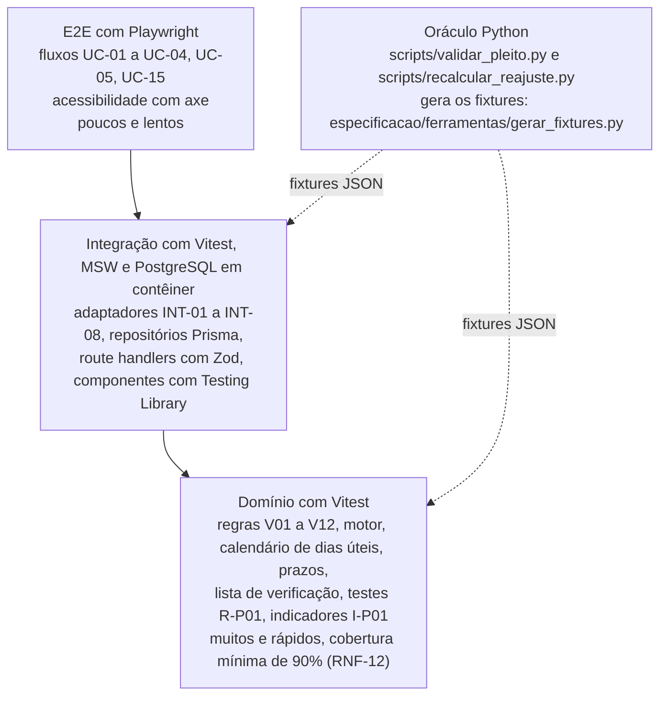

# 12. Testes

Estratégia de testes do Reajusta e testes de aceitação AT-01 em diante. O resultado esperado sai dos autos sempre que
possível: dos cálculos refeitos da coorte, do pleito real de Paraty 2026 no layout e dos marcos reais dos 18 casos
com trilha no SEI. Onde não há caso real (faturas, edição de minutas), o teste é sintético e diz isso.

A norma de referência é a ISO/IEC/IEEE 29119 (testes) e, para os requisitos, os IDs de
[01_VISAO_ESCOPO.md](01_VISAO_ESCOPO.md).

## 1. Estratégia

### 1.1 Pirâmide



| Nível | Ferramenta | O que cobre | Regra |
|---|---|---|---|
| Domínio | Vitest | funções puras do domínio, sem rede, banco nem framework | todo AT de cálculo, prazo e conformidade roda aqui primeiro, sobre os fixtures |
| Integração | Vitest + MSW + PostgreSQL de teste | adaptadores com respostas gravadas; persistência; API (status, validação Zod, permissões) | nenhuma chamada real à internet; MSW em modo `onUnhandledRequest: "error"` |
| Componentes | Vitest + Testing Library + axe-core | telas TL-01 a TL-16 nos estados vazio, carregando, erro, sem permissão e com dados | consultas por papel e nome acessível, nunca por classe CSS |
| Ponta a ponta | Playwright + @axe-core/playwright | jornadas principais no navegador, com banco semeado pelos fixtures | sem violação WCAG 2.2 AA de nível sério ou crítico (RNF-08) |
| Oráculo | Python (pytest do repositório do curso) | resultado de referência | em divergência entre o sistema e o oráculo nos fixtures, o sistema está errado até prova em contrário (README) |

### 1.2 O oráculo e os fixtures

O domínio é reimplementado em TypeScript. A implementação Python é a referência:

| Oráculo | Faz | Fixture que alimenta |
|---|---|---|
| `scripts/recalcular_reajuste.py` | recalcula o IR de 33 apurações pelos números-índice e pelas variações escritas | `fixtures/calculos_coorte.json` |
| `scripts/validar_pleito.py` | aplica V01 a V12 ao pleito no layout | `fixtures/paraty_2026.json` |
| `scripts/conformidade.py` (fase 3) | testa os requisitos R-P01 sobre os marcos | `fixtures/ciclos_coorte.json` |

**Como gerar.** Da raiz do repositório do curso:

```
python especificacao/ferramentas/gerar_fixtures.py            # grava os três fixtures
python especificacao/ferramentas/gerar_fixtures.py --conferir # só confere; sai com código 1 se estiverem desatualizados
```

O script usa só a biblioteca padrão do Python, não acessa a rede nem a pasta `dados/`, ordena tudo e não grava data
nem hora: duas rodadas com os mesmos arquivos dão os mesmos bytes. Ele refaz a conta e **para com erro** se o
resultado não bater com `saida/levantamento/calculo/recalculo.csv` (4 casas), com as contagens de `resumo.json`, com a
validação publicada de Paraty 2026 (10 ok, 5 avisos, 1 erro) ou com o detalhe de `conformidade_P01.csv`. Cada fixture
guarda o SHA-256 dos arquivos de origem em `origem.arquivos`.

| Fixture | Conteúdo | Contagens |
|---|---|---|
| `fixtures/calculos_coorte.json` | um caso por apuração completa: componentes (sigla, peso em fração, o, i, variação, textos), outros componentes, IR escrito, IR recalculado pelos índices e pelas variações, total pelo produto e pela soma, classificação ok/divergente, causa e testes de aceitação | 28 casos: 24 ok, 4 divergentes |
| `fixtures/paraty_2026.json` | pleito real de Paraty 2026 no layout 0.1, cadastro `paraty_008_2014`, resultado esperado de V01 a V12 e as 4 mutações do AT-05 em JSON Patch | 16 itens: 10 ok, 5 avisos, 1 erro |
| `fixtures/ciclos_coorte.json` | marcos reais (t1 a t16 com datas) de cada caso, resultado esperado de cada R-P01, lead pelos marcos e pela trilha, e os vencimentos do ciclo-piloto de Paraty 2026 | 18 casos, 11 encerrados |

**Leitura dos fixtures no TypeScript.** Os testes importam o JSON e validam a forma com um esquema Zod antes de usar
(o fixture é entrada, não código). A comparação numérica segue a regra do fixture:

- `ir_recalculado_pct` é comparado sem arredondar, com tolerância `regra.tolerancia_pp` (0,01 ponto percentual,
  RNF-01);
- `base_conferencia = "numeros_indice"` manda calcular pelo `o` e `i`; `"variacoes"` manda usar `variacao`;
- o total só é teste quando `total_conferivel` é verdadeiro (fecha pelo produto); no gás o total soma resíduo
  judicial, tributos e custo do gás, que estão fora do escopo.

### 1.3 Dublês das integrações (MSW)

Cada adaptador tem um conjunto de respostas gravadas em `tests/msw/` do repositório do sistema. A gravação é feita uma
vez, na história do adaptador ([13_BACKLOG.md](13_BACKLOG.md)), e versionada. O mínimo:

| Integração | Resposta gravada | Valores que precisam estar nela |
|---|---|---|
| INT-02 IPEADATA | `ValoresSerie` de `IGP12_IPC12` e `IGP12_INCC12` | IPC out/2024 = 761,643 e out/2025 = 789,092; INCC out/2025 = 1.222,356 e o valor de out/2024 que arredonda a 1.149,17 |
| INT-02 IPEADATA | os 70 números-índice públicos de `saida/levantamento/calculo/componentes.csv` | todos achados (`resumo.json`: 70 de 70) |
| INT-03 SIDRA | tabela 3065, variável 1117 | IPCA-E set/2024 = 6.855,40 e set/2025 = 7.220,07 |
| INT-04 ANEEL | recorte do arquivo de tarifas homologadas da distribuidora e subgrupo usados | as colunas de [09_INTEGRACOES.md](09_INTEGRACOES.md), seção 5 |
| todas | resposta 503 e tempo esgotado | para os testes de indisponibilidade (AT-23) |

As mesmas respostas gravadas, convertidas para o formato do cache do oráculo (`series/<nome>.json`), alimentam a geração
dos esperados pelo oráculo no repositório do sistema ([05_ARQUITETURA.md](05_ARQUITETURA.md), seção 16). Os fixtures
deste pacote não trazem séries: o cache do levantamento fica fora do repositório do curso.

### 1.4 Portões de integração contínua

Um pedido de integração só entra com todos verdes:

1. `tsc --noEmit` sem erro (TypeScript estrito, sem `any`) e lint sem aviso.
2. Testes de domínio com cobertura de linhas e ramos de pelo menos 90% em `src/dominio` (RNF-12).
3. Testes de integração e de componentes.
4. Testes de aceitação marcados com o ID (`describe("AT-06 …")`) da release em curso e das anteriores.
5. Playwright com axe nas telas tocadas.
6. Fixtures atualizados: o job de paridade roda `gerar_fixtures.py --conferir` no repositório do curso e compara os
   hashes de `origem.arquivos` com os fixtures copiados no repositório do sistema.

## 2. Testes de aceitação do motor (R1): AT-01 a AT-08

São os testes da Aula 2, agora com fixture. A coluna "Nível" diz onde o teste roda primeiro; todos rodam também pela
API na integração.

### AT-01 Os 24 cálculos que conferem

| Campo | Conteúdo |
|---|---|
| Dado | os casos de `fixtures/calculos_coorte.json` com `"AT-01"` em `testes_aceitacao` (24) |
| Quando | o motor calcula o IR de cada caso com as entradas e a `base_conferencia` do fixture |
| Então | o IR recalculado é igual a `esperado.ir_recalculado_pct` (4 casas) e fica a até 0,01 ponto percentual de `ir_escrito_pct`; nos casos com `total_conferivel`, o total pelo produto fica a até 0,01 ponto de `total_escrito_pct` |
| Nível | domínio |
| Requisitos | RF-CAL-01, RF-CAL-02, RNF-01 |
| Origem | `saida/levantamento/calculo/resumo.json` (24 de 28 conferem) |

Exemplo (Paraty 2026, parecer da CAPET, doc 120172748): IR recalculado 3,9669%; escrito 3,967%; total pelo produto
6,7949%; escrito 6,795%.

### AT-02 Paraty 2022: o parecer de 10,37% não fecha

| Campo | Conteúdo |
|---|---|
| Dado | o caso `SEI-220007/004053/2022#43014673` |
| Quando | o motor recalcula pelos números-índice |
| Então | IR = 9,5601%, contra 10,37% escritos: V09 dá **erro**; a mensagem mostra os dois valores e os termos de energia e IPC, cujas variações escritas (−0,0085 e 0,0546) não batem com os índices (−0,0840 e 0,0505); pelas variações escritas o IR seria 10,3223%, que também não fecha |
| Nível | domínio |
| Requisitos | RF-CAL-01, RNF-01, RNF-02 |
| Origem | `docs/LEVANTAMENTO_MOTOR_CALCULO.md`, seção 2. A causa está a confirmar com a CAPET pela planilha anexa |

### AT-03 Centro Sul 2025: o parecer de 4,1245% não fecha

| Campo | Conteúdo |
|---|---|
| Dado | o caso `SEI-480002/009058/2025#118597733` (índice único IPCA-E) |
| Quando | o motor recalcula IR = Ii / Io − 1 |
| Então | IR = 5,3195%, contra 4,1245% escritos: V09 dá **erro**. O percentual recalculado é o deliberado (Deliberação 5001) |
| Nível | domínio |
| Requisitos | RF-CAL-01, RNF-01 |
| Origem | `docs/LEVANTAMENTO_MOTOR_CALCULO.md`, seção 2 (erro de digitação no texto) |

### AT-04 Blocos 1 e 4: arredondamento do preço da água

| Campo | Conteúdo |
|---|---|
| Dado | os casos `SEI-480002/001912/2024#69248862` e `SEI-480002/001913/2024#69248357` (pleitos de 4,80%), com o componente D (preço da água da CEDAE) escrito com 2 casas (2,23 e 2,09) |
| Quando | o motor recalcula pelos números-índice e depois com a variação oficial do componente de fonte "outro reajuste" |
| Então | pelos índices escritos o IR é 4,7845% e não fecha; com a variação oficial de 6,75% o IR é 4,8038% e fecha com 4,80% (`causa.prova` no fixture). O resultado é **aviso** de arredondamento do insumo D, não erro, e a memória mostra as duas contas |
| Nível | domínio |
| Requisitos | RF-CAL-01, RF-SER-02, RNF-01, RNF-02 |
| Origem | `docs/LEVANTAMENTO_MOTOR_CALCULO.md`, seção 2. Na Aula 2 o teste estava "a implementar" |

### AT-05 Paraty 2026 com dado alterado

| Campo | Conteúdo |
|---|---|
| Dado | o pleito de `fixtures/paraty_2026.json` com cada mutação de `mutacoes` aplicada por JSON Patch |
| Quando | o validador roda V01 a V12 |
| Então | AT-05a (IR declarado 4,5): V09 contém erro. AT-05b (mês i = 2025-09): V04 contém erro. AT-05c (parcela 6,30%): V10 contém erro. AT-05d (componente sem evidência): V01 dá só erro e a validação para no V01 |
| Nível | domínio |
| Requisitos | RF-PLE-02, RF-PLE-03, RF-CAL-01 a RF-CAL-03 |
| Origem | `tests/test_regras.py`, `test_validador_barra_ir_errado_mes_errado_e_parcela_errada` |

### AT-06 Paraty 2026 como está nos autos

| Campo | Conteúdo |
|---|---|
| Dado | o pleito e o cadastro de `fixtures/paraty_2026.json`, os textos do contrato (INT-05) e as respostas gravadas do IPEADATA |
| Quando | o validador roda V01 a V12 |
| Então | 16 itens, iguais a `validacao_esperada` em regra e situação: **10 ok, 5 avisos, 1 erro**. O erro é V11 (energia sem distribuidora, composição e resolução). Os avisos: V03 (12 meses de referência, mas 354 dias), V06 (só as pontas), V07 do ICC (menos casas que a série), V08 do IMO (sem outro pleito para comparar) e V12 (sem tabela tarifária). V09: IR 3,9669%, arredondado 3,967%. V10: total 6,7949% pelo produto com a 2ª parcela (2,72%). O pleito é devolvido (UC-04) |
| Nível | domínio e integração |
| Requisitos | RF-PLE-03, RF-PLE-04, RF-CAL-01 a RF-CAL-04, RF-SER-01 a RF-SER-03, RNF-09, RNF-13 |
| Origem | `saida/levantamento/pleito/exemplo_paraty_2026.validacao.json`; `docs/ESPECIFICACAO_DADOS_PLEITO.md`, seção 5 |

Sem os textos do contrato, V02 dá aviso (comportamento do oráculo). O teste de domínio usa um dublê da
`BaseEspecialista` com os textos que contêm os 12 trechos do cadastro, e o teste de integração usa a exportação
real da base do Especialista.

### AT-07 Águas da Imperatriz com o cadastro próprio

| Campo | Conteúdo |
|---|---|
| Dado | o cadastro do contrato da Águas da Imperatriz (cláusula 28 e Anexo IV do edital; realinhamento na cláusula quarta do 1º termo aditivo) e os casos `SEI-480002/009822/2025#118742802` e `#119567172` de `fixtures/calculos_coorte.json` |
| Quando | o mesmo motor roda, sem mudança de código |
| Então | IR 2,7859%, arredondado 2,79%, igual ao declarado; total 6,5213% pelo produto, contra 6,52% escritos; V09 e V10 ok |
| Nível | domínio |
| Requisitos | RF-CAD-01, RF-CAL-01, RF-CAL-02 |
| Origem | `docs/ESPECIFICACAO_DADOS_PLEITO.md`, seção 1. **Bloqueio:** o cadastro da Imperatriz ainda não existe (pendência 3 da seção 6); a história HIS-CAD-04 o cria |

### AT-08 Ciclos de Paraty encadeados

| Campo | Conteúdo |
|---|---|
| Dado | os ciclos de Paraty com vigência em 01/01/2023 (meses out/2021 a out/2022, `extracao_SEI-220007_004053_2022.json`), em 12/01/2025 (tarifa em vigor do pleito de 2026) e em 01/01/2026 (meses out/2024 a out/2025) |
| Quando | o sistema monta o histórico do contrato (UC-07) |
| Então | o mês i de cada ciclo é o 3º mês anterior à sua vigência, e o mês o de cada ciclo é o mês i do anterior: out/2022 → out/2023 → out/2024 → out/2025. Quebra no encadeamento aparece marcada na TL-07 |
| Nível | domínio |
| Requisitos | RF-CAL-06, RF-CAL-03 |
| Origem | cláusula 20 de Paraty (regra do terceiro mês anterior). **Bloqueio parcial:** os ciclos de 2024 e de 2025 dependem do 1º e do 2º termos aditivos no cadastro (pendência 4) |

## 3. Testes de aceitação de prazos, documentos, minutas, faturas e indicadores: AT-09 em diante

Os vencimentos do ciclo de Paraty 2026 abaixo foram calculados pelo gerador de fixtures com os feriados de
`perfis/rj_agenersa.py` (`fixtures/ciclos_coorte.json`, `ciclo_piloto`). As regras de prazo são numeradas em
[08_REGRAS_NEGOCIO.md](08_REGRAS_NEGOCIO.md); o teste usa o mesmo valor.

### AT-09 Prazos do ciclo de Paraty 2026 com as datas reais

| Campo | Conteúdo |
|---|---|
| Dado | os marcos reais de `SEI-480002/009982/2025`: protocolo 17/11/2025, último parecer técnico 05/12/2025, parecer jurídico 14/12/2025, razões finais 17/12/2025, deliberação 24/02/2026, publicação 26/02/2026 (fim em 05/03/2026), conferência das faturas 10/03/2026, encerramento 16/04/2026 |
| Quando | o sistema registra os marcos na ordem e calcula os prazos |
| Então | ver a tabela abaixo; cada prazo tem dono e o resultado bate com `conformidade_esperada` do caso |
| Nível | domínio |
| Requisitos | RF-PRZ-01, RF-PRZ-02, RF-PRZ-05, RF-PRZ-07 |
| Origem | `insumos/mapeamento/casos_P01.json`, `insumos/mapeamento/conformidade_P01.csv` |

| Prazo | Início | Vencimento | Ato | Resultado esperado |
|---|---|---|---|---|
| Pronunciamento (R-P01-05) | 17/11/2025 | 17/12/2025 | deliberação em 24/02/2026, 99 dias corridos | vencido; não conforme |
| Procuradoria (R-P01-07) | 05/12/2025 | 20/12/2025 | parecer jurídico em 14/12/2025, 9 dias corridos | cumprido; conforme |
| Deliberação após razões finais (R-P01-06) | 17/12/2025 | 26/01/2026 | deliberação em 24/02/2026, 69 dias corridos | vencido; não conforme |
| Conferência das faturas (R-P01-16) | 05/03/2026 | 03/06/2026 | conferência em 10/03/2026, 5 dias corridos | cumprido; conforme |
| Razões finais (R-P01-20) | 17/12/2025 | 02/01/2026 (10 dias úteis) | deliberação em 24/02/2026, 69 dias corridos depois do ofício | mínimo respeitado; conforme |
| Recursal (RF-PRZ-07, M-P01-02) | publicação em 26/02/2026 | 12/03/2026 (10 dias úteis) | certidão esperada em 13/03/2026 | nos autos não houve certidão: R-P01-17 não conforme |

### AT-10 Alerta antes e no vencimento

| Campo | Conteúdo |
|---|---|
| Dado | o prazo da Procuradoria do AT-09 (vence em 20/12/2025, dono PROC) e o relógio do sistema simulado |
| Quando | o JOB-02 roda em cada dia de 15/12/2025 a 23/12/2025 |
| Então | pela RN-TRA-03 (antecedências de 3 e 1 dias úteis, proposto): "a vencer" em 17/12/2025 e 19/12/2025; o vencimento nominal cai num sábado, então "vence hoje" sai em 22/12/2025, o primeiro dia útil; sem a juntada do parecer, "vencido" ao dono e à chefia em 23/12/2025. Como o parecer foi juntado em 14/12/2025, o cenário real não gera alerta: o teste roda as duas variantes (com e sem a juntada) |
| Nível | domínio |
| Requisitos | RF-PRZ-03, RF-PRZ-05 |
| Origem | prazo real do AT-09; variante sem juntada é sintética |

### AT-11 Dias úteis com feriado estadual

| Campo | Conteúdo |
|---|---|
| Dado | um ofício de diligência juntado em 19/11/2025, com prazo de 3 dias úteis (o mesmo prazo do Ofício CAPET nº 136/2025 de Paraty 2026) |
| Quando | o sistema calcula o vencimento |
| Então | vence em 25/11/2025, porque 20/11 (Consciência Negra) não conta; a reiteração fica pronta em 26/11/2025 (dia útil seguinte) |
| Nível | domínio |
| Requisitos | RF-PRZ-01, RF-PRZ-04 |
| Origem | feriados de `perfis/rj_agenersa.py`; data de juntada sintética |

### AT-12 Diligência em rodada única

| Campo | Conteúdo |
|---|---|
| Dado | um ciclo em instrução; a CAPET registra 2 quesitos e a Procuradoria 1 quesito na mesma fase |
| Quando | o gabinete fecha o rascunho |
| Então | sai um único ofício com os 3 quesitos, cada um com a unidade de origem; um quesito novo depois da expedição entra no rascunho da fase seguinte ou exige justificativa registrada |
| Nível | domínio e componentes |
| Requisitos | RF-DOC-03, RF-PRZ-02 |
| Origem | M-P01-08 (sintético) |

### AT-13 Encerramento por lista de verificação

| Campo | Conteúdo |
|---|---|
| Dado | o ciclo de Paraty 2026 com os marcos dos autos: conferência das faturas juntada, **sem** certidão de ausência de recurso |
| Quando | a Secretaria pede o termo de encerramento |
| Então | o sistema recusa e mostra "falta a certidão de ausência de recurso" (`ciclo_piloto.encerramento.deve_bloquear_termo`); com a certidão registrada em 13/03/2026, o termo é gerado |
| Nível | domínio e ponta a ponta |
| Requisitos | RF-PRZ-08, RF-IND-02 |
| Origem | R-P01-17 não conforme no caso (`conformidade_P01.csv`) |

### AT-14 Auditoria contínua reproduz a conformidade da coorte

| Campo | Conteúdo |
|---|---|
| Dado | os marcos dos 18 casos de `fixtures/ciclos_coorte.json` e os testes computáveis de `insumos/mapeamento/normas_P01.json` (precede, exige, prazo máximo, prazo mínimo) |
| Quando | o sistema roda a auditoria contínua (UC-18) |
| Então | o resultado de cada requisito em cada caso é igual a `conformidade_esperada` (conforme, não conforme ou não aplicável), com o mesmo número de dias no detalhe. R-P01-04 (prazo concedido no ofício) fica fora: precisa do prazo escrito no ofício, que não está nos marcos; ele é testado no AT-16 |
| Nível | domínio |
| Requisitos | RF-IND-02 |
| Origem | `insumos/mapeamento/conformidade_P01.csv` |

### AT-15 Indicadores reproduzem a linha de base

| Campo | Conteúdo |
|---|---|
| Dado | o resultado do AT-14 |
| Quando | o sistema calcula os indicadores de conformidade sobre os casos em que o teste se aplica |
| Então | I-P01-03 = 50,0% (6 de 12); I-P01-04 = 58,8% (10 de 17); I-P01-05 = 71,4% (10 de 14); I-P01-09 = 17,6% (3 de 17); I-P01-10 = 25,0% (2 de 8). O lead pelos marcos (definição do I-P01-01, do t1 ao t13) do ciclo de Paraty 2026 é 101 dias úteis |
| Nível | domínio |
| Requisitos | RF-IND-01 |
| Origem | linhas de base de `insumos/mapeamento/controles_P01.json`; `fixtures/ciclos_coorte.json` |

A linha de base do I-P01-01 (337,5 du) usa o lead da trilha do SEI (abertura do processo ao último andamento ou à data
de apuração), que no caso de Paraty é 125 du (`lead_trilha_du`). O sistema mede pelos marcos, como a definição do
indicador manda; a comparação antes e depois do piloto tem de usar a mesma régua ([14_OPERACAO.md](14_OPERACAO.md),
seção 9).

### AT-16 Documento por modelo: notificação para razões finais

| Campo | Conteúdo |
|---|---|
| Dado | o ciclo de Paraty 2026 depois do parecer jurídico e o modelo publicado da notificação para razões finais |
| Quando | a Secretaria gera a peça (UC-09) |
| Então | o DOCX e o PDF trazem processo `SEI-480002/009982/2025`, concessionária Águas de Paraty, Contrato de Concessão nº 008/2014, prazo de 10 dias, acesso aos autos liberado e a versão do modelo; nenhum marcador fica sem valor; a peça registra o prazo concedido = 10, e R-P01-04 passa a conforme (nos autos o menor prazo concedido foi 5 dias) |
| Nível | integração |
| Requisitos | RF-DOC-01, RF-DOC-02, RF-ADM-03 |
| Origem | M-P01-13; R-P01-04 não conforme no caso ("menor prazo 5 dias") |

### AT-17 Devolução com pendências de Paraty 2026

| Campo | Conteúdo |
|---|---|
| Dado | o resultado do AT-06 |
| Quando | o analista confirma a devolução (UC-04) |
| Então | o ofício de complementação tem 1 pendência (V11: informar distribuidora, regra de composição e resolução da ANEEL) e os 5 avisos em seção separada; o ciclo fica "devolvido", com prazo de resposta e dono PER-CON; a concessionária vê a mesma lista na TL-03 |
| Nível | integração e ponta a ponta |
| Requisitos | RF-PLE-04, RF-DOC-03, RF-PRZ-02 |
| Origem | `saida/levantamento/pleito/exemplo_paraty_2026.validacao.json` |

### AT-18 Memória de cálculo e minuta do parecer técnico

| Campo | Conteúdo |
|---|---|
| Dado | a apuração de Paraty 2026 |
| Quando | o analista pede a memória e a minuta (UC-05) |
| Então | a memória tem as linhas da tabela abaixo; o IR é 3,967% e o total 6,795%, com a 2ª parcela de 2,72%; cada número aponta a origem (pleito, série com data da consulta, trecho do cadastro); a minuta não aceita edição de número |
| Nível | domínio e componentes |
| Requisitos | RF-CAL-05, RF-MIN-01, RNF-02 |
| Origem | protótipo da memória de cálculo da Aula 2 (etapa 11), com os números do validador |

| Índice | Peso | o | i | Variação | Ponderada |
|---|---|---|---|---|---|
| IMO | 0,1951 | 1.466,05 | 1.576,75 | 7,551% | 1,473% |
| IEE | 0,0974 | 511,75 | 471,91 | −7,785% | −0,758% |
| IPA | 0,1082 | 367,637 | 356,857 | −2,932% | −0,317% |
| IPQ | 0,0405 | 199,691 | 209,255 | 4,789% | 0,194% |
| IPC | 0,0662 | 761,643 | 789,092 | 3,604% | 0,239% |
| ICC | 0,4925 | 1.149,17 | 1.222,36 | 6,369% | 3,137% |

### AT-19 Verificação de citação

| Campo | Conteúdo |
|---|---|
| Dado | uma minuta com citações das normas de `insumos/mapeamento/normas_P01.json` (por exemplo, N-P01-01, Lei estadual nº 4.556/2005, art. 4º, III), com o trecho literal da norma |
| Quando | o verificador confere cada citação contra o texto integral (INT-05) |
| Então | as 31 citações com o trecho de `normas_P01.json` são válidas; a mesma citação com uma palavra trocada no trecho, ou com dispositivo inexistente, é inválida, fica marcada na TL-08 e bloqueia a exportação |
| Nível | integração |
| Requisitos | RF-MIN-04 |
| Origem | trechos conferidos por `scripts/verificar_normas.py`; mutação sintética |

### AT-20 Taxa de edição da minuta

| Campo | Conteúdo |
|---|---|
| Dado | uma minuta gerada e a versão revisada pelo usuário (sintéticas) |
| Quando | o revisor salva |
| Então | o sistema grava a `EdicaoMinuta` e calcula a taxa de edição pela RN-MIN-03 de 08_REGRAS_NEGOCIO.md; a taxa aparece no controle Q-P01-03 da TL-13 |
| Nível | domínio |
| Requisitos | RF-MIN-05, RF-IND-03 |
| Origem | Q-P01-03 (`insumos/mapeamento/controles_P01.json`) |

### AT-21 Conferência de faturas

| Campo | Conteúdo |
|---|---|
| Dado | uma tabela homologada com total de 6,795% e uma remessa sintética de 3 faturas: uma com a tarifa nova, uma com a tarifa antiga e uma com faixa errada |
| Quando | o sistema confere (UC-17) |
| Então | lista 2 divergências, com valor cobrado e devido, agrupadas por faixa e categoria; a fatura correta não aparece |
| Nível | domínio |
| Requisitos | RF-FAT-02 |
| Origem | sintético: há 1 fatura nos 1.228 documentos da coorte (`docs/LEVANTAMENTO_MOTOR_CALCULO.md`, seção 5) |

### AT-22 Remessa ou pleito com dado pessoal é recusado

| Campo | Conteúdo |
|---|---|
| Dado | uma remessa com coluna de CPF ou de nome do usuário; um pleito com nome de pessoa num campo livre |
| Quando | a concessionária envia |
| Então | o envio é recusado, nada é gravado e a mensagem diz qual coluna ou campo retirar |
| Nível | integração |
| Requisitos | RF-FAT-01, RNF-05 |
| Origem | bases de economias dos Blocos chegam ao SEI com dados pessoais (`docs/LEVANTAMENTO_MOTOR_CALCULO.md`, seção 5) |

### AT-23 Fonte externa fora do ar

| Campo | Conteúdo |
|---|---|
| Dado | o pleito de Paraty 2026; o MSW responde 503 ao IPEADATA |
| Quando | o validador roda (a) com cache e (b) sem cache |
| Então | (a) V07 usa o cache e o resultado é o do AT-06; (b) V07 fica "a refazer", as demais regras rodam, o pleito não é devolvido só por isso, e UC-20 reprocessa quando o MSW volta a responder |
| Nível | integração |
| Requisitos | RF-SER-04, RNF-06 |
| Origem | Aula 2, UC02, exceção 5a |

### AT-24 Séries pagas não saem do processo

| Campo | Conteúdo |
|---|---|
| Dado | o ciclo de Paraty 2026, com IMO, IPA e IPQ de fonte FGV |
| Quando | um usuário PER-GES abre a TL-07 e a TL-13; o sistema monta um pedido ao modelo de linguagem |
| Então | os números-índice dessas séries não aparecem (só a variação); o pedido ao modelo não contém os valores; a exportação de painel não as inclui |
| Nível | integração e ponta a ponta |
| Requisitos | RNF-04 |
| Origem | licença da FGV ([09_INTEGRACOES.md](09_INTEGRACOES.md), INT-07) |

### AT-25 Permissão por concessionária

| Campo | Conteúdo |
|---|---|
| Dado | dois usuários PER-CON, de Águas de Paraty e de Águas da Imperatriz |
| Quando | o usuário de Paraty pede o ciclo da Imperatriz pela tela e pela API |
| Então | a tela não lista o ciclo e a API responde 404, sem revelar que ele existe; a tentativa fica na trilha de auditoria |
| Nível | integração e ponta a ponta |
| Requisitos | RF-ADM-01, RNF-10 |
| Origem | matriz de permissões de [14_OPERACAO.md](14_OPERACAO.md) |

### AT-26 Trilha de auditoria imutável

| Campo | Conteúdo |
|---|---|
| Dado | um ciclo com cadastro alterado, pleito enviado e minuta editada |
| Quando | se consulta a trilha e se tenta alterar ou apagar um registro dela, inclusive direto no banco com o usuário da aplicação |
| Então | cada ação aparece com usuário, perfil, data e hora, recurso e valores antes e depois; a alteração e a exclusão são negadas |
| Nível | integração |
| Requisitos | RF-ADM-02, RNF-11 |
| Origem | [14_OPERACAO.md](14_OPERACAO.md), seção 3 |

### AT-27 Ciclo de Paraty 2026 de ponta a ponta (prova de aceite da R2)

| Campo | Conteúdo |
|---|---|
| Dado | o banco semeado com o cadastro de Paraty e o pleito de 2026 corrigido (energia informada) |
| Quando | os perfis executam no navegador UC-01, UC-02, UC-05, UC-11, UC-09, UC-13, UC-12, UC-14, UC-15, informando as datas reais dos autos |
| Então | o ciclo vai do protocolo ao arquivamento com os estados de [04_CASOS_DE_USO.md](04_CASOS_DE_USO.md), seção 5; os prazos são os do AT-09; o encerramento só sai depois da certidão; nenhuma tela tem violação séria de acessibilidade |
| Nível | ponta a ponta |
| Requisitos | RF-PRZ-01 a RF-PRZ-09, RF-DOC-01 a RF-DOC-03, RNF-08 |
| Origem | prova de aceite da R2 em 01_VISAO_ESCOPO.md, seção 14 |

## 4. Rastreabilidade

| Teste | Release | UC | Fixture |
|---|---|---|---|
| AT-01 a AT-04 | R1 | UC-03 | `calculos_coorte.json` |
| AT-05, AT-06 | R1 | UC-02, UC-03 | `paraty_2026.json` |
| AT-07 | R1 | UC-06, UC-03 | `calculos_coorte.json` + cadastro novo |
| AT-08 | R1 | UC-07 | extrações + cadastro com aditivos |
| AT-17, AT-18 | R1 | UC-04, UC-05 | `paraty_2026.json` |
| AT-22, AT-23, AT-25, AT-26 | R1 | UC-01, UC-02, UC-19 | sintético + `paraty_2026.json` |
| AT-09 a AT-13, AT-16, AT-27 | R2 | UC-08, UC-09, UC-10, UC-13 a UC-15 | `ciclos_coorte.json` |
| AT-19, AT-20 | R3 | UC-11, UC-12 | `normas_P01.json` + sintético |
| AT-14, AT-15, AT-21, AT-24 | R4 | UC-17, UC-18 | `ciclos_coorte.json` + sintético |

Os testes de R1 entram já no esqueleto andante ([13_BACKLOG.md](13_BACKLOG.md), seção 3): AT-06 no domínio e na CLI,
depois na API, depois na TL-04.
