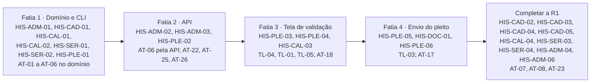

# 13. Backlog

Épicos por módulo, histórias com critérios de aceite, ordem por release e as definições de pronto. A IA de
desenvolvimento trabalha **uma história por vez, na ordem da seção 3**, e só fecha a história com a Definition of
Done cumprida.

Os IDs de módulo, perfil, caso de uso, requisito e tela são os de [01_VISAO_ESCOPO.md](01_VISAO_ESCOPO.md). Os testes
AT-* estão em [12_TESTES.md](12_TESTES.md).

**Tamanho** (estimativa de esforço de desenvolvimento, hipótese a calibrar com a equipe na primeira release):
P até 2 dias, M de 3 a 5 dias, G de 6 a 10 dias. História acima de G é quebrada antes de entrar na release.

## 1. Épicos

| Épico | Módulo | Objetivo | Releases | Histórias |
|---|---|---|---|---|
| EP-ADM Fundação e administração | MOD-ADM | repositório, autenticação, perfis, trilha de auditoria, modelos, integrações | R1 a R4 (transversal) | HIS-ADM-01 a 06 |
| EP-CAD Cadastro de contratos | MOD-CAD | versões por aditivo, trecho literal, cronograma, data-base | R1 | HIS-CAD-01 a 05 |
| EP-CAL Motor de cálculo | MOD-CAL | IR, total, memória, encadeamento | R1 | HIS-CAL-01 a 04 |
| EP-SER Séries | MOD-SER | séries públicas com cache, conferência cruzada, ANEEL, agenda | R1 | HIS-SER-01 a 04 |
| EP-PLE Pleitos | MOD-PLE | layout, validação, envio, devolução | R1 | HIS-PLE-01 a 06 |
| EP-PRZ Prazos e tramitação | MOD-PRZ | marcos, donos, alertas, diligência, pauta, recursal, encerramento | R2 | HIS-PRZ-01 a 09 |
| EP-DOC Documentos por modelo | MOD-DOC | peças de rotina por modelo versionado | R1 (núcleo) e R2 | HIS-DOC-01 a 03 |
| EP-MIN Minutas assistidas | MOD-MIN | minutas com número por campo e citação verificada | R3 | HIS-MIN-01 a 06 |
| EP-FAT Conferência de faturas | MOD-FAT | remessa e conferência | R4 | HIS-FAT-01 e 02 |
| EP-IND Indicadores | MOD-IND | I-P01, testes R-P01, controles Q-P01 | R4 | HIS-IND-01 a 03 |

## 2. Histórias

### EP-ADM Fundação e administração

#### HIS-ADM-01 Repositório, camadas e portões

Como PER-ADM, quero o repositório com a estrutura de camadas e os portões de qualidade desde o primeiro dia, para que
toda história nasça testada e no padrão.

- Dado o repositório vazio, quando a história termina, então existem `src/dominio` sem dependência de framework,
  `src/adaptadores`, `src/app` (Next.js, última estável), Prisma com PostgreSQL em Docker, e a integração contínua roda tipos,
  lint, Vitest com cobertura, Playwright com axe e a paridade dos fixtures ([12_TESTES.md](12_TESTES.md), seção 1.4).
- Dado um `any` ou um teste de domínio quebrado, quando se abre o pedido de integração, então o portão falha.

RF: — · RNF: RNF-12, RNF-14 · UC: — · TL: — · Tamanho: M · Depende de: nenhuma

#### HIS-ADM-02 Autenticação e perfis

Como usuário interno ou externo, quero entrar com credenciais e ver só o que meu perfil permite, para que cada um aja
no seu papel.

- Dado um usuário PER-CON de Águas de Paraty, quando ele pede o ciclo de outra concessionária pela tela ou pela API,
  então a tela não lista e a API responde 404 (AT-25).
- Dado um usuário sem ação na matriz de permissões, quando ele chama a rota, então recebe 403 e a tentativa vai para
  a trilha.
- Dada uma sessão parada além do tempo de expiração, quando o usuário age, então volta para a TL-16.

RF: RF-ADM-01 · RNF: RNF-10 · UC: UC-19 · TL: TL-16 · Tamanho: M · Depende de: HIS-ADM-01

#### HIS-ADM-03 Trilha de auditoria imutável

Como PER-GES, quero saber quem fez o quê e quando, para responder ao controle interno.

- Dada uma ação que muda dado ou peça, quando ela termina, então há um `RegistroAuditoria` com usuário, perfil, data e
  hora, recurso, ação e valores antes e depois.
- Dado o usuário de banco da aplicação, quando ele tenta `UPDATE` ou `DELETE` na trilha, então o banco nega (AT-26).

RF: RF-ADM-02 · RNF: RNF-11 · UC: UC-19 · TL: TL-15 · Tamanho: M · Depende de: HIS-ADM-02

#### HIS-ADM-04 Gestão de usuários e perfis na tela

Como PER-ADM, quero criar, desativar e atribuir perfis, para controlar o acesso sem mexer no banco.

- Dado um usuário com histórico, quando o administrador pede a exclusão, então o sistema só desativa.
- Dado um usuário externo, quando é criado, então tem de ser vinculado a uma concessionária.

RF: RF-ADM-01 · UC: UC-19 · TL: TL-15 · Tamanho: P · Depende de: HIS-ADM-02

#### HIS-ADM-05 Modelos de documento versionados

Como PER-ADM, quero publicar versões de modelo de documento, para mudar o texto sem afetar as peças já geradas.

- Dada uma peça gerada com a versão 1, quando a versão 2 é publicada, então a peça continua apontando a versão 1.

RF: RF-ADM-03 · UC: UC-19 · TL: TL-15 · Tamanho: P · Depende de: HIS-DOC-01

#### HIS-ADM-06 Configuração das integrações

Como PER-ADM, quero configurar endereço, frequência e segredo de cada integração, para trocar uma fonte sem mudar
código.

- Dado um campo de segredo, quando o administrador digita um valor, então o sistema recusa e pede a referência ao
  cofre ([14_OPERACAO.md](14_OPERACAO.md), seção 5).

RF: RF-ADM-01 · RNF: RNF-10 · UC: UC-19 · TL: TL-15, TL-14 · Tamanho: P · Depende de: HIS-SER-01

### EP-CAD Cadastro de contratos

#### HIS-CAD-01 Cadastro como dado, importado do JSON

Como PER-GCA, quero carregar o cadastro de Paraty a partir do JSON do levantamento, para que o motor rode antes de
existir a tela.

- Dado `fixtures/paraty_2026.json` (campo `cadastro`), quando a importação roda, então as versões `contrato-2014` e
  `3TA-2024` existem e a versão `3TA-2024`, resolvida com herança, tem os 6 componentes, os pesos e as 7 parcelas de
  realinhamento.
- Dado um cadastro que não segue o esquema, quando a importação roda, então nada é gravado.

RF: RF-CAD-01, RF-CAD-03 · UC: UC-06 · TL: — · Tamanho: P · Depende de: HIS-ADM-01

#### HIS-CAD-02 Tela do cadastro com versões e trecho conferido

Como PER-GCA, quero criar uma versão por aditivo com o trecho literal de cada parâmetro, para que toda regra tenha
fonte.

- Dado um trecho que existe no texto do aditivo, quando o gestor salva, então o parâmetro mostra "trecho achado no
  texto" (V02).
- Dado um trecho que não existe, quando o gestor tenta publicar a versão, então a publicação é recusada com o
  parâmetro e o trecho.
- Dada uma versão já usada por um pleito, quando o gestor tenta alterá-la, então o sistema recusa e oferece criar nova
  versão.

RF: RF-CAD-01, RF-CAD-02 · RNF: RNF-02, RNF-03 · UC: UC-06 · TL: TL-06 · Tamanho: G · Depende de: HIS-CAD-01,
HIS-PLE-01 (a conferência literal do trecho é a de V02; HIS-MIN-02 a reaproveita na R3)

#### HIS-CAD-03 Cronograma de realinhamento e calendário de data-base

Como PER-GCA, quero manter o cronograma de realinhamento e a data-base, para que a parcela certa entre no total e a
instrução comece a tempo.

- Dada a versão `3TA-2024` de Paraty, quando o pleito pede vigência em 2026-01, então a parcela aplicada é a 2ª, de
  2,72%.
- Dada a data-base de um contrato, quando faltam os dias configurados, então o gestor e a CAPET recebem alerta.

RF: RF-CAD-03, RF-CAD-04 · UC: UC-06 · TL: TL-06 · Tamanho: M · Depende de: HIS-CAD-02

#### HIS-CAD-04 Cadastro da Águas da Imperatriz

Como PER-ANA, quero o cadastro da Águas da Imperatriz, para provar que o motor generaliza trocando só o cadastro.

- Dado o cadastro novo e os casos da Imperatriz de `fixtures/calculos_coorte.json`, quando o motor roda sem mudança
  de código, então o IR é 2,7859%, arredondado a 2,79% (AT-07).

RF: RF-CAD-01, RF-CAL-01 · UC: UC-06 · TL: TL-06 · Tamanho: M · Depende de: HIS-CAD-02 e da leitura do contrato
pela CAPET (pendência 3 de `docs/ESPECIFICACAO_DADOS_PLEITO.md`)

#### HIS-CAD-05 1º e 2º termos aditivos de Paraty

Como PER-ANA, quero os aditivos anteriores de Paraty no cadastro, para validar os ciclos de 2022 a 2024 e o
encadeamento.

- Dados os ciclos de Paraty de 2023, 2025 e 2026, quando o histórico é montado, então o mês o de cada um é o mês i do
  anterior (AT-08).

RF: RF-CAD-01, RF-CAL-06 · UC: UC-06, UC-07 · TL: TL-06, TL-07 · Tamanho: M · Depende de: HIS-CAD-02, HIS-CAL-04 e
da extração dos aditivos (pendência 4)

### EP-CAL Motor de cálculo

#### HIS-CAL-01 Motor do IR e do total

Como PER-ANA, quero que o sistema refaça o IR e o total pela fórmula do contrato, para não depender da conta à mão.

- Dados os 24 casos AT-01 de `fixtures/calculos_coorte.json`, quando o motor calcula, então o IR bate com
  `ir_recalculado_pct` em 4 casas e fica a até 0,01 ponto do escrito; o total pelo produto bate onde
  `total_conferivel` (AT-01).
- Dados os casos de Paraty 2022 e Centro Sul 2025, quando o motor calcula, então dá 9,5601% e 5,3195% e a conferência
  falha (AT-02, AT-03).
- Dados os casos dos Blocos 1 e 4, quando o motor usa a variação oficial do componente D, então dá 4,8038% e aviso de
  arredondamento do insumo (AT-04).

RF: RF-CAL-01, RF-CAL-02 · RNF: RNF-01 · UC: UC-03 · TL: — · Tamanho: M · Depende de: HIS-ADM-01

#### HIS-CAL-02 Interstício, meses de referência e apuração gravada

Como PER-ANA, quero que o sistema confira interstício e meses de referência e grave cada termo da apuração, para que
a memória tenha a origem de cada número.

- Dado o pleito de Paraty 2026, quando V03 e V04 rodam, então V03 dá aviso (12 meses, 354 dias) e V04 dá ok
  (o = 2024-10, i = 2025-10).
- Dada a apuração, quando gravada, então cada `TermoApuracao` aponta pleito, série e consulta, ou trecho do cadastro.

RF: RF-CAL-03, RF-CAL-05 · RNF: RNF-02, RNF-03 · UC: UC-03 · TL: — · Tamanho: M · Depende de: HIS-CAL-01, HIS-CAD-01

#### HIS-CAL-03 Tela da memória de cálculo

Como PER-ANA, quero ver a memória de cálculo numa tela, para conferir e citar no parecer.

- Dada a apuração de Paraty 2026, quando a TL-05 abre, então mostra as 6 linhas, o IR de 3,967% e o total de 6,795%
  com a parcela de 2,72%, como no AT-18; cada número tem a origem acessível por teclado.

RF: RF-CAL-05 · RNF: RNF-02, RNF-08, RNF-09 · UC: UC-05 · TL: TL-05 · Tamanho: M · Depende de: HIS-CAL-02, HIS-PLE-02

#### HIS-CAL-04 Histórico do contrato

Como PER-GES, quero ver os ciclos de um contrato encadeados, para acompanhar a evolução da tarifa.

- Dados ciclos com quebra no encadeamento, quando a TL-07 abre, então a quebra aparece marcada.
- Dado o perfil PER-GES, quando abre um componente de série paga, então vê só a variação (RNF-04).

RF: RF-CAL-06 · RNF: RNF-04 · UC: UC-07 · TL: TL-07 · Tamanho: M · Depende de: HIS-CAL-02

### EP-SER Séries

#### HIS-SER-01 Séries públicas com cache (IPEADATA e SIDRA)

Como PER-ANA, quero que o sistema busque sozinho as séries públicas e guarde a consulta, para não digitar índice.

- Dadas as respostas gravadas do IPEADATA, quando V07 roda em Paraty 2026, então o IPC dá ok e o ICC dá aviso de
  menos casas que a série.
- Dado o MSW respondendo 503, quando V07 roda sem cache, então fica "a refazer" e o fluxo segue (AT-23).
- Gravar as respostas MSW do mínimo listado em [12_TESTES.md](12_TESTES.md), seção 1.3.

RF: RF-SER-01, RF-SER-04 · RNF: RNF-03, RNF-06 · UC: UC-03, UC-20 · TL: — · Tamanho: M · Depende de: HIS-ADM-01

#### HIS-SER-02 Conferência cruzada das séries pagas

Como PER-ANA, quero comparar a série paga com a de outros pleitos do mesmo mês, para pegar erro sem assinatura.

- Dados os valores de outros pleitos (`saida/levantamento/calculo/componentes.csv`, importado como semente), quando V08 roda
  em Paraty 2026, então IPA, IPQ e ICC dão ok e IMO dá aviso de falta de comparação.

RF: RF-SER-02 · RNF: RNF-04 · UC: UC-03 · TL: — · Tamanho: P · Depende de: HIS-SER-01

#### HIS-SER-03 Tarifas da ANEEL e V11

Como PER-ANA, quero que a energia seja conferida contra as tarifas homologadas, para saber de onde vem o valor.

- Dado o pleito de Paraty 2026, quando V11 roda, então dá erro: distribuidora, composição e resolução não informadas
  (AT-06).
- Dada a regra de composição cadastrada na versão (quando a CAPET decidir), quando V11 roda, então recalcula o valor a
  partir do recorte da ANEEL.

RF: RF-SER-03 · UC: UC-03 · TL: TL-14 · Tamanho: G · Depende de: HIS-SER-01; a segunda parte depende da decisão da
CAPET sobre a regra da energia

#### HIS-SER-04 Atualização agendada e tela das séries

Como PER-ADM, quero ver a situação de cada série e forçar uma atualização, para saber se a conferência está em dia.

- Dada uma série revisada na fonte, quando UC-20 roda, então grava nova linha, não altera a apuração e avisa o
  analista dos ciclos afetados.

RF: RF-SER-01, RF-SER-04 · UC: UC-20 · TL: TL-14 · Tamanho: M · Depende de: HIS-SER-01

### EP-PLE Pleitos

#### HIS-PLE-01 Validador V01 a V12 no domínio, com linha de comando

Como PER-ANA, quero que o sistema aplique V01 a V12 a um pleito, para receber só pleitos completos.

- Dado `fixtures/paraty_2026.json`, quando `reajusta validar <pleito.json> <cadastro.json>` roda, então imprime as 16
  conferências com 10 ok, 5 avisos e 1 erro, iguais a `validacao_esperada` (AT-06).
- Dadas as 4 mutações do fixture, quando o validador roda, então V09, V04, V10 e V01 dão erro (AT-05).

RF: RF-PLE-02, RF-PLE-03, RF-CAL-04 · RNF: RNF-01, RNF-03 · UC: UC-02 · TL: — · Tamanho: G · Depende de:
HIS-CAL-01, HIS-CAL-02, HIS-CAD-01, HIS-SER-01, HIS-SER-02

#### HIS-PLE-02 API do pleito e abertura do ciclo

Como PER-CON, quero enviar o pleito por API e receber o resultado, para integrar com os sistemas da concessionária.

- Dado um pacote válido, quando `POST` é chamado, então o pleito e as evidências são gravados com hash, a validação
  roda e a resposta traz o resultado e o recibo.
- Dado um hash que não confere ou um campo com dado pessoal, quando `POST` é chamado, então a resposta é 422 e nada é
  gravado (AT-22).
- Dado um pleito sem erro, quando a validação termina, então o ciclo é aberto com dono CAPET e vinculado ao número
  SEI informado.

RF: RF-PLE-01, RF-PLE-03, RF-PLE-06 · RNF: RNF-05, RNF-13 · UC: UC-01, UC-02 · TL: — · Tamanho: M · Depende de:
HIS-PLE-01, HIS-ADM-02, HIS-ADM-03

#### HIS-PLE-03 Tela do resultado da validação

Como PER-ANA, quero ver o resultado da validação numa tela, na minha linguagem, para decidir rápido.

- Dado o resultado de Paraty 2026, quando a TL-04 abre, então mostra 10 ok, 5 avisos e 1 erro, cada regra com a
  mensagem, a versão do cadastro (`3TA-2024`) e do layout (0.1), sem rolagem horizontal a 320 px.
- Dado um leitor de tela, quando percorre a TL-04, então cada situação é anunciada em texto, não só por cor.

RF: RF-PLE-03 · RNF: RNF-08, RNF-09 · UC: UC-02 · TL: TL-04 · Tamanho: M · Depende de: HIS-PLE-02

#### HIS-PLE-04 Fila mínima de ciclos

Como PER-ANA, quero a fila dos ciclos com situação, erros, avisos e dono, para saber o que está comigo.

- Dados dois ciclos, um devolvido e um em análise técnica, quando a TL-01 abre, então os dois aparecem com situação,
  dono e contagem de erros e avisos.

RF: RF-PRZ-09 (parcial) · UC: UC-08 · TL: TL-01 · Tamanho: P · Depende de: HIS-PLE-02

#### HIS-PLE-05 Envio do pleito e validação prévia pela concessionária

Como PER-CON, quero montar o pacote, validar antes de enviar e enviar, para não ter o pleito devolvido.

- Dado o pacote de Paraty 2026, quando a concessionária pede a validação prévia, então vê o mesmo resultado da TL-04
  e nada fica registrado no ciclo (RF-PLE-05).
- Dado o envio confirmado, quando termina, então a concessionária recebe o recibo com data, hora e hashes.

RF: RF-PLE-01, RF-PLE-05 · RNF: RNF-05, RNF-08, RNF-09 · UC: UC-01 · TL: TL-03, TL-04 · Tamanho: G · Depende de:
HIS-PLE-03

#### HIS-PLE-06 Devolução com pendências

Como PER-ANA, quero devolver o pleito com erro numa só vez, com a minuta do ofício, para acabar com as diligências
repetidas na entrada.

- Dado o resultado de Paraty 2026, quando o analista confirma a devolução, então o ofício tem 1 pendência (V11) e os 5
  avisos em seção separada; o ciclo fica "devolvido" com prazo de resposta e dono PER-CON (AT-17).
- Dado um erro que o analista não aceita, quando ele registra a justificativa, então o item sai do ofício e a
  justificativa vai para a trilha.

RF: RF-PLE-04, RF-DOC-01, RF-DOC-03 · RNF: RNF-07 · UC: UC-04 · TL: TL-04, TL-09, TL-03 · Tamanho: M · Depende de:
HIS-PLE-05, HIS-DOC-01

### EP-DOC Documentos por modelo

#### HIS-DOC-01 Motor de modelos e exportação DOCX e PDF

Como PER-SEC, quero gerar peças a partir de modelos com os dados do ciclo, para não redigir o que é rotina.

- Dado o modelo do ofício de complementação, quando a peça é gerada para Paraty 2026, então nenhum marcador fica sem
  valor e saem DOCX e PDF.
- Dado um campo obrigatório sem dado, quando a geração roda, então ela para e aponta o campo.

RF: RF-DOC-01, RF-DOC-02 · UC: UC-09 · TL: TL-09 · Tamanho: M · Depende de: HIS-ADM-01

#### HIS-DOC-02 Catálogo das peças do rito

Como PER-SEC, quero os modelos de recebimento, diligência, reiteração, razões finais, acesso aos autos, convocação de
conciliação, notificação da deliberação, certidão e termo de encerramento, para cobrir o rito inteiro.

- Dado o ciclo de Paraty 2026, quando a notificação para razões finais é gerada, então traz prazo de 10 dias e acesso
  aos autos liberado, e o prazo concedido fica registrado (AT-16).

RF: RF-DOC-01, RF-ADM-03 · UC: UC-09 · TL: TL-09 · Tamanho: M · Depende de: HIS-DOC-01, HIS-ADM-05

#### HIS-DOC-03 Registro da juntada no SEI

Como PER-SEC, quero informar o número do documento SEI de cada peça, para que o marco e os prazos abram sozinhos.

- Dada uma peça gerada, quando o número SEI é informado, então a peça passa a "juntada" e o marco é registrado; sem o
  número, a peça fica "gerada, não juntada" e não abre prazo.

RF: RF-DOC-01, RF-PRZ-01 · UC: UC-09 · TL: TL-09, TL-02 · Tamanho: P · Depende de: HIS-DOC-01, HIS-PRZ-01

### EP-PRZ Prazos e tramitação

#### HIS-PRZ-01 Calendário de dias úteis e marcos

Como PER-SEC, quero que os prazos contem dias úteis com os feriados do estado, para não errar vencimento.

- Dado um ofício juntado em 19/11/2025 com 3 dias úteis, quando o vencimento é calculado, então é 25/11/2025 (AT-11).
- Dados os marcos reais de Paraty 2026, quando registrados, então os vencimentos são os do AT-09.

RF: RF-PRZ-01 · UC: UC-08 · TL: TL-02 · Tamanho: M · Depende de: HIS-PLE-02

#### HIS-PRZ-02 Dono de cada etapa e minha fila

Como servidor interno, quero ver os prazos que estão comigo, para agir antes de vencer.

- Dado um ciclo deliberado e ainda não arquivado, quando nenhuma regra dá outro dono, então o dono é a Secretaria
  Executiva; nenhum ciclo fica sem unidade.
- Dado o usuário da Procuradoria, quando abre a TL-10, então vê o prazo da Procuradoria de cada ciclo com vencimento.

RF: RF-PRZ-02, RF-PRZ-05 · UC: UC-08 · TL: TL-10 · Tamanho: M · Depende de: HIS-PRZ-01

#### HIS-PRZ-03 Alertas na tela e por correio

Como dono de um prazo, quero ser avisado antes e no vencimento, para não perder o prazo.

- Dado o prazo da Procuradoria do AT-09 sem juntada, quando a tarefa diária roda, então há alerta "a vencer", "vence
  hoje" e "vencido" à chefia (AT-10).
- Dado o correio fora do ar, quando o alerta é gerado, então ele aparece na TL-10 e o envio é refeito.

RF: RF-PRZ-03 · UC: UC-08 · TL: TL-10 · Tamanho: M · Depende de: HIS-PRZ-02

#### HIS-PRZ-04 Diligência em rodada única e reiteração

Como gabinete do relator, quero juntar os quesitos de todos num ofício por fase e ter a reiteração pronta no
vencimento, para acabar com as rodadas sucessivas.

- Dados 2 quesitos da CAPET e 1 da Procuradoria, quando o gabinete fecha o rascunho, então sai um único ofício (AT-12).
- Dado um prazo de diligência vencido sem resposta, quando chega o dia útil seguinte, então a reiteração está pronta
  com novo prazo igual ao concedido.

RF: RF-DOC-03, RF-PRZ-04 · UC: UC-10 · TL: TL-10, TL-09 · Tamanho: G · Depende de: HIS-DOC-02, HIS-PRZ-03

#### HIS-PRZ-05 Pauta no vencimento das razões finais

Como PER-SEC, quero que o ciclo entre na lista de aptos no vencimento das razões finais, para pautar sem esperar
pedido.

- Dado o ofício de razões finais juntado, quando o prazo decorre, então o ciclo aparece na TL-11 ordenado pela data de
  vencimento e com a primeira sessão de pauta aberta proposta.
- Dado o prazo ainda correndo, quando a Secretaria tenta pautar, então o sistema recusa (R-P01-20).

RF: RF-PRZ-06 · UC: UC-13 · TL: TL-11 · Tamanho: M · Depende de: HIS-PRZ-02

#### HIS-PRZ-06 Publicação, notificação e prazo recursal

Como PER-SEC, quero que o prazo recursal conte sozinho a partir da publicação, para certificar no dia certo.

- Dada a publicação de Paraty 2026 em 26/02/2026, quando registrada, então o prazo recursal vence em 12/03/2026 e o
  prazo da conferência das faturas, contado da publicação em 05/03/2026, vence em 03/06/2026 (AT-09).
- Dada uma vigência com menos de 30 dias da publicação, quando a notificação é gerada, então há alerta bloqueante.

RF: RF-PRZ-07 · UC: UC-14 · TL: TL-09, TL-10 · Tamanho: M · Depende de: HIS-PRZ-02, HIS-DOC-02

#### HIS-PRZ-07 Certidão pela regra e encerramento por lista de verificação

Como PER-SEC, quero a certidão pronta no dia útil seguinte ao prazo recursal e o termo travado se faltar peça, para
encerrar sem consulta de rotina.

- Dado o prazo recursal de Paraty 2026 vencido em 12/03/2026 sem recurso, quando a tarefa diária roda em 13/03/2026,
  então a certidão está pronta.
- Dado o ciclo de Paraty sem certidão, quando a Secretaria pede o termo, então o sistema recusa (AT-13).

RF: RF-PRZ-08 · UC: UC-15 · TL: TL-10, TL-09, TL-02 · Tamanho: M · Depende de: HIS-PRZ-06

#### HIS-PRZ-08 Painel de prazos e idade por unidade

Como PER-GES, quero ver a idade dos ciclos por unidade e os parados, para cobrar o próximo ato.

- Dados os ciclos abertos, quando a TL-01 abre, então mostra, por unidade, os dias úteis desde o último marco e os
  prazos correndo.

RF: RF-PRZ-09 · UC: UC-08 · TL: TL-01 · Tamanho: M · Depende de: HIS-PRZ-02, HIS-PLE-04

#### HIS-PRZ-09 Importação dos andamentos do SEI

Como PER-SEC, quero importar os andamentos exportados do SEI e ver o que diverge dos marcos, para não depender só do
registro manual.

- Dado um CSV de andamentos com uma linha inválida, quando a importação roda, então as demais linhas entram e a
  inválida é listada; nenhum marco é sobrescrito.

RF: RF-PRZ-01 · UC: UC-08 · TL: TL-02 · Tamanho: M · Depende de: HIS-PRZ-01 · Integração: INT-01

**Prova de aceite da R2:** AT-27 (ciclo de Paraty 2026 de ponta a ponta), depois de HIS-PRZ-01 a 09 e HIS-DOC-01 a 03.

### EP-MIN Minutas assistidas

#### HIS-MIN-01 Adaptador do modelo de linguagem

Como PER-ADM, quero trocar o provedor do modelo de linguagem por configuração, para seguir a política de dados da
agência.

- Dado um pedido de redação, quando o adaptador envia, então o pedido não leva dado pessoal nem valor de série paga, e
  a resposta fica em cache pelo hash do pedido (AT-24).
- Dado o provedor fora do ar, quando a minuta é pedida, então sai só com as partes por modelo de documento.

RF: RF-MIN-01 · RNF: RNF-04, RNF-05, RNF-07 · UC: UC-05, UC-11, UC-12 · TL: TL-15 · Tamanho: M · Depende de:
HIS-ADM-06 e da decisão do provedor (TI e Procuradoria)

#### HIS-MIN-02 Verificador de citação

Como revisor de minuta, quero cada citação conferida contra o texto da fonte, para não assinar citação inexistente.

- Dadas as 31 normas de `insumos/mapeamento/normas_P01.json`, quando citadas com o trecho, então todas são válidas; com uma
  palavra trocada, a citação é inválida e bloqueia a exportação (AT-19).

RF: RF-MIN-04 · UC: UC-11, UC-12 · TL: TL-08 · Tamanho: M · Depende de: HIS-PLE-01 (conferência literal de V02) ·
Integração: INT-05

#### HIS-MIN-03 Minuta do parecer técnico

Como PER-ANA, quero a minuta do parecer técnico a partir da apuração, para revisar em vez de redigir.

- Dada a apuração de Paraty 2026, quando a minuta é gerada, então todos os números são os da apuração, a memória vai
  anexa e o analista não consegue editar número na minuta.

RF: RF-MIN-01, RF-CAL-05 · RNF: RNF-02 · UC: UC-05 · TL: TL-08, TL-05 · Tamanho: M · Depende de: HIS-MIN-01,
HIS-MIN-02, HIS-CAL-03

#### HIS-MIN-04 Minuta do parecer jurídico com checklist legal

Como PER-PRO, quero a linha do tempo, os precedentes do contrato e o checklist R-P01 prontos, para concentrar o tempo
na interpretação.

- Dado o ciclo de Paraty 2026 no momento do parecer jurídico, quando a minuta é gerada, então o checklist mostra os
  requisitos aplicáveis com o resultado e os precedentes do contrato vêm da base do Especialista.

RF: RF-MIN-02, RF-MIN-04 · UC: UC-11 · TL: TL-08 · Tamanho: G · Depende de: HIS-MIN-02, HIS-IND-02 (testes R-P01)

#### HIS-MIN-05 Minutas de relatório, voto e deliberação

Como PER-REL, quero as três minutas no padrão das deliberações anteriores do contrato, para juntar no dia da sessão.

- Dada a minuta, quando falta algum dos quatro elementos de motivação do R-P01-14, então o sistema aponta o elemento e
  bloqueia a exportação.
- Dado um percentual diferente do parecer da CAPET, quando a minuta é gerada, então a divergência fica marcada e exige
  justificativa escrita.

RF: RF-MIN-03, RF-MIN-04 · UC: UC-12 · TL: TL-08 · Tamanho: G · Depende de: HIS-MIN-02, HIS-MIN-03

#### HIS-MIN-06 Edições e taxa de edição

Como PER-GES, quero a taxa de edição das minutas, para medir se a IA ajuda (Q-P01-03).

- Dada uma minuta revista, quando o revisor salva, então a `EdicaoMinuta` é gravada e a taxa aparece na TL-13 (AT-20).

RF: RF-MIN-05, RF-IND-03 · UC: UC-05, UC-11, UC-12 · TL: TL-08, TL-13 · Tamanho: M · Depende de: HIS-MIN-03

**Prova de aceite da R3:** Q-P01-01 a 03 medidos em ciclos reais (01_VISAO_ESCOPO.md, seção 14).

### EP-FAT Conferência de faturas

#### HIS-FAT-01 Layout e recepção da remessa

Como PER-CON, quero enviar a remessa de faturamento num layout fixo, para que a CAPET deixe de pedir faturas por
ofício.

- Dada uma remessa com coluna de CPF, quando enviada, então é recusada e nada é gravado (AT-22).

RF: RF-FAT-01 · RNF: RNF-05 · UC: UC-16 · TL: TL-12 · Tamanho: M · Depende de: HIS-ADM-02 e da definição do layout
com as concessionárias (`docs/LEVANTAMENTO_MOTOR_CALCULO.md`, seção 5)

#### HIS-FAT-02 Conferência e lista de divergências

Como PER-ANA, quero ver só as faturas divergentes, para concluir sobre a aplicação da tarifa.

- Dada a remessa sintética do AT-21, quando a conferência roda, então lista 2 divergências e o despacho de conferência
  pode ser gerado; juntado, ele libera o item da lista de verificação do encerramento.

RF: RF-FAT-02 · UC: UC-17 · TL: TL-12 · Tamanho: M · Depende de: HIS-FAT-01, HIS-PRZ-07

### EP-IND Indicadores

#### HIS-IND-01 Indicadores I-P01

Como PER-GES, quero os indicadores I-P01-01 a 10 calculados dos marcos, para acompanhar as metas.

- Dados os marcos de `fixtures/ciclos_coorte.json`, quando os indicadores de conformidade são calculados, então dão
  50,0%, 58,8%, 71,4%, 17,6% e 25,0% (AT-15).

RF: RF-IND-01 · UC: UC-18 · TL: TL-13 · Tamanho: G · Depende de: HIS-IND-02

#### HIS-IND-02 Testes contínuos dos requisitos R-P01

Como PER-GES, quero os requisitos legais testados em cada ciclo, para ver a conformidade sem auditoria manual.

- Dados os 18 casos, quando a auditoria contínua roda, então cada resultado é igual a `conformidade_esperada` (AT-14).

RF: RF-IND-02 · UC: UC-18 · TL: TL-13 · Tamanho: M · Depende de: HIS-PRZ-01

#### HIS-IND-03 Painel de indicadores, controles e auditoria

Como PER-GES, quero um painel com linha de base, meta e série de cada indicador e controle, para decidir onde agir.

- Dado o painel, quando aberto por PER-GES, então nenhuma série paga aparece e cada número leva aos ciclos que o
  compõem (somente leitura).

RF: RF-IND-01 a RF-IND-03 · RNF: RNF-04, RNF-08 · UC: UC-18 · TL: TL-13 · Tamanho: M · Depende de: HIS-IND-01,
HIS-MIN-06

**Prova de aceite da R4:** I-P01 calculados; divergências de fatura listadas.

## 3. Ordem por release

### R1 Núcleo do cálculo, fatiado em esqueleto andante

O esqueleto andante atravessa todas as camadas com o caso real de Paraty 2026 antes de alargar cada uma. Cada fatia
termina com algo que roda de ponta a ponta.

| Fatia | Histórias, na ordem | Pronto quando |
|---|---|---|
| 1 Domínio e CLI | HIS-ADM-01, HIS-CAD-01, HIS-CAL-01, HIS-CAL-02, HIS-SER-01, HIS-SER-02, HIS-PLE-01 | `reajusta validar` dá, para Paraty 2026, o mesmo resultado do oráculo Python; AT-01 a AT-06 verdes no domínio |
| 2 API | HIS-ADM-02, HIS-ADM-03, HIS-PLE-02 | o pleito entra pela API, com autenticação, e o resultado fica gravado com as versões e na trilha |
| 3 Tela de validação | HIS-PLE-03, HIS-PLE-04, HIS-CAL-03 | o analista vê o resultado e a memória de Paraty 2026 no navegador, sem violação séria de acessibilidade |
| 4 Envio do pleito | HIS-PLE-05, HIS-DOC-01, HIS-PLE-06 | a concessionária valida, envia e recebe a devolução com a pendência de V11 |
| Completar | HIS-CAD-02, HIS-CAD-03, HIS-CAD-04, HIS-CAD-05, HIS-CAL-04, HIS-SER-03, HIS-SER-04, HIS-ADM-04, HIS-ADM-06 | AT-01 a AT-08 verdes (AT-07 e AT-08 dependem das pendências 3 e 4 da CAPET) |

### R2 Prazos e documentos

HIS-PRZ-01, HIS-DOC-03, HIS-PRZ-02, HIS-ADM-05, HIS-DOC-02, HIS-PRZ-03, HIS-PRZ-04, HIS-PRZ-05, HIS-PRZ-06,
HIS-PRZ-07, HIS-PRZ-08, HIS-PRZ-09. Aceite: AT-09 a AT-13, AT-16 e AT-27.

### R3 Minutas assistidas

HIS-MIN-02, HIS-MIN-01, HIS-MIN-03, HIS-IND-02 (antecipada: o checklist do parecer jurídico usa os testes R-P01),
HIS-MIN-04, HIS-MIN-05, HIS-MIN-06. Aceite: AT-19, AT-20 e Q-P01-01 a 03 medidos em ciclos reais.

### R4 Faturas e indicadores

HIS-FAT-01, HIS-FAT-02, HIS-IND-01, HIS-IND-03. Aceite: AT-14, AT-15, AT-21, AT-24.

## 4. Definition of Ready

Uma história só entra em desenvolvimento quando:

1. Tem o formato "Como <perfil>, quero…, para…" com perfil de [01_VISAO_ESCOPO.md](01_VISAO_ESCOPO.md), seção 6.
2. Cita os RF, UC e TL que implementa, e todos existem no documento-base.
3. Tem pelo menos um critério Dado/Quando/Então verificável, com o resultado esperado tirado de fixture ou dos autos;
   o critério sintético está marcado como sintético.
4. As regras de negócio que usa estão numeradas em [08_REGRAS_NEGOCIO.md](08_REGRAS_NEGOCIO.md).
5. As dependências estão prontas, ou a história traz o dublê que as substitui.
6. A tela, se houver, está em [11_TELAS.md](11_TELAS.md) com os estados (vazio, carregando, erro, sem permissão).
7. O contrato da API, se houver, está em [07_CONTRATOS_API.md](07_CONTRATOS_API.md).
8. Nenhuma decisão em aberto da PARADA 11 bloqueia o critério; se bloquear, a história é dividida e a parte bloqueada
   fica para depois.
9. O tamanho é P, M ou G.

## 5. Definition of Done

Uma história só fecha quando:

| Grupo | Critério |
|---|---|
| Testes | Testes escritos antes do código. Critérios de aceite automatizados e verdes. AT-* citados verdes. Cobertura de pelo menos 90% em `src/dominio` (RNF-12). Nenhum teste desativado ou marcado para pular |
| Paridade | Para regra de cálculo, validação ou prazo: resultado igual ao do oráculo Python nos fixtures; fixtures atualizados (`gerar_fixtures.py --conferir` verde) |
| Tipos e estilo | TypeScript estrito, sem `any` nem `@ts-ignore`; lint sem aviso; Zod em toda entrada da API e de arquivo |
| Camadas | Regra de negócio só em `src/dominio`; domínio sem import de Next.js, Prisma ou fetch; integração só por porta |
| Acessibilidade | Telas tocadas sem violação séria ou crítica no axe; navegação completa por teclado; foco visível; contraste AA; situação comunicada em texto além da cor; teste em 320 px sem rolagem horizontal (RNF-08, eMAG) |
| Segurança e privacidade | Rota com checagem de perfil e de vínculo da concessionária; nenhum segredo no código; logs sem dado pessoal e sem série paga ([14_OPERACAO.md](14_OPERACAO.md)) |
| Rastreabilidade | Commit e pedido de integração citam a HIS-* e os RF-*; todo número na tela aponta a origem (RNF-02); ação que muda dado grava a trilha (RF-ADM-02) |
| Revisão | Revisão por outra pessoa (ou outro agente às cegas, sem ver a explicação do autor) do código e dos testes; comentários resolvidos |
| Documentação | Se a história mudou regra, contrato ou tela, o documento do pacote foi atualizado no mesmo pedido de integração |
| Linguagem | Termos do glossário (01_VISAO_ESCOPO.md, seção 7) no código e na tela; textos em português com acentuação correta |
