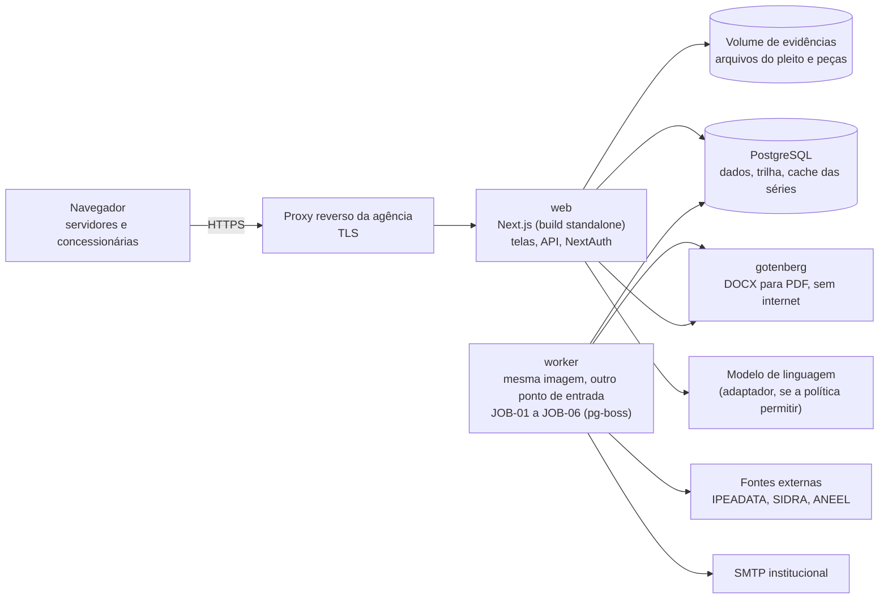

# 14. Operação

Permissões, autenticação, trilha de auditoria, LGPD, segredos e ambientes, implantação com Docker e PostgreSQL,
backups, observabilidade e o plano de implantação no piloto de Paraty. São requisitos que a IA de desenvolvimento não
deduz dos autos (`docs/metodologia/01_ESPECIFICACAO_SISTEMA.md`, seção 8).

Valores marcados "(proposto)" são parâmetros de operação sugeridos aqui e confirmados com a TI na PARADA 11.

## 1. Matriz de permissões

Ações: **L** ler · **C** criar · **A** alterar · **P** confirmar ou publicar · **X** exportar · **—** sem acesso.
Toda rota da API confere o perfil **e** o escopo; a tela só esconde, quem decide é a API.

| Recurso | PER-CON | PER-ANA | PER-GCA | PER-PRO | PER-SEC | PER-REL | PER-GES | PER-ADM |
|---|---|---|---|---|---|---|---|---|
| Pleito e evidências (TL-03) | C, L ¹ | L | L | L | L | L | L | — |
| Validação prévia (RF-PLE-05) | C ¹ | C | — | — | — | — | — | — |
| Resultado da validação (TL-04) | L ¹ | L, P ² | L | L | L | L | L | — |
| Devolução com pendências (UC-04) | L ¹ | P | — | — | X | — | — | — |
| Ciclo de reajuste (TL-01, TL-02) | L ¹ ³ | L | L | L | L, C ⁴ | L | L | — |
| Apuração e memória de cálculo (TL-05) | L ¹ | L, C, X | L | L | L | L | L ⁵ | — |
| Contrato, versões e parâmetros (TL-06) | L ⁶ | L | C, A, P | L | L | L | L | — |
| Histórico do contrato (TL-07) | L ¹ ⁵ | L | L | L | L | L | L ⁵ | — |
| Séries externas (TL-14) | — | L, C ⁷ | L | — | — | — | — | L, C ⁷ |
| Marcos e prazos (TL-10) | L ¹ ³ | L, C ⁸ | — | L, C ⁸ | L, C, A | L, C ⁸ | L | — |
| Peças por modelo (TL-09) | — | C, X | — | C, X | C, X | C, X | — | — |
| Minutas (TL-08) | — | C, A, X | — | C, A, X | L | C, A, X | — | — |
| Pauta (TL-11) | — | — | — | — | L, C, A | L | L | — |
| Remessa de faturamento (TL-12) | C, L ¹ | L | — | — | — | — | — | — |
| Divergências de fatura (TL-12) | L ¹ | L, P | — | — | — | — | L | — |
| Indicadores e auditoria contínua (TL-13) | — | L | L | L | L | L | L ⁵ | L |
| Usuários e perfis (TL-15) | — | — | — | — | — | — | — | C, A |
| Modelos de documento (TL-15) | — | — | — | — | — | — | — | C, A, P |
| Integrações (TL-15) | — | — | — | — | — | — | — | L, A |
| Trilha de auditoria | — | — | — | — | — | — | L | L |

Notas:

1. Só os pleitos, ciclos e remessas da concessionária a que o usuário está vinculado. Pedido de recurso de outra
   concessionária responde 404, sem revelar que existe (AT-25).
2. "P" é aceitar um erro com justificativa (UC-04, fluxo 3a) e confirmar a devolução.
3. A concessionária vê a situação, o prazo que corre contra ela e as pendências; não vê notas internas nem minutas.
4. A Secretaria abre o ciclo e registra o número do processo SEI (RF-PLE-06).
5. Séries pagas (FGV) aparecem só como variação, sem o número-índice (RNF-04). Para PER-CON, só as séries que a
   própria concessionária enviou.
6. A concessionária vê a versão publicada do cadastro do seu contrato (siglas, códigos, regras), que é o que ela deve
   seguir no pleito.
7. "C" é pedir atualização manual de uma série (UC-20).
8. Cada unidade registra os marcos dos seus atos (o número do documento SEI que juntou).

**Segregação (proposto):** quem publica uma versão do cadastro (PER-GCA) não é o mesmo usuário que confirma a validação do pleito
que a usa (PER-ANA) no mesmo ciclo; o sistema recusa se for. Nenhum perfil assina, protocola ou homologa (RNF-07).

## 2. Autenticação e sessão

| Item | Regra |
|---|---|
| Biblioteca | NextAuth com provedor de credenciais e sessão JWT (stack decidida) |
| Senha | guardada só como hash forte e lento (Argon2id ou bcrypt com custo alto); mínimo de 12 caracteres; troca obrigatória no primeiro acesso |
| Tentativas | bloqueio temporário depois de 5 falhas seguidas (proposto); a falha vai para a trilha sem a senha digitada |
| Cookie | `httpOnly`, `Secure`, `SameSite=Lax`; nada de token em `localStorage` |
| Expiração | 30 minutos sem uso e 8 horas no total (proposto; variável `SESSAO_MAX_MINUTOS`, 05_ARQUITETURA.md), com aviso antes de expirar (RNF-10; tempo ajustável conforme WCAG 2.2, critério 2.2.1) |
| Revogação | o JWT leva a versão da sessão do usuário; desativar o usuário ou trocar a senha muda a versão e derruba as sessões abertas |
| Escopo no token | identificador do usuário, perfis e identificador da concessionária (externo); nunca nome, e-mail ou CPF |
| CSRF | proteção do NextAuth nas rotas de autenticação; nas rotas de mutação, conferência de `Origin` |

**Usuário interno.** Criado pelo PER-ADM a pedido da chefia da unidade, com e-mail institucional como login e um ou
mais perfis. A integração com o diretório da agência (login único) fica em aberto com a TI.

**Usuário externo da concessionária (PER-CON).** Criado pelo PER-ADM a partir de pedido formal da concessionária no
SEI, que indica os representantes. O usuário fica vinculado a uma `Concessionaria`; todo acesso é filtrado por esse
vínculo. A concessionária pede no mesmo canal a desativação de quem sai. O PER-ADM revê os usuários externos a cada
6 meses (proposto) e desativa os sem uso.

## 3. Trilha de auditoria

| Item | Regra |
|---|---|
| O que registra | toda ação que muda dado ou peça (RF-ADM-02); entrada e saída; falha de autenticação e de permissão; exportação de peça e de memória; publicação de versão do cadastro e de modelo; chamada ao modelo de linguagem (só metadados) |
| Campos do `RegistroAuditoria` | data e hora (UTC), identificador do usuário, perfil, ação, recurso e identificador, valores antes e depois (só dos campos alterados), identificador da requisição, hash do registro anterior |
| Imutável | tabela só de inclusão: o usuário de banco da aplicação não tem `UPDATE` nem `DELETE`; um gatilho recusa a alteração; cada registro guarda o hash do anterior, e um teste diário confere a cadeia (RNF-11, AT-26) |
| Consulta | PER-GES e PER-ADM, com filtro por ciclo, usuário, recurso e período; exportação em CSV registrada na própria trilha |
| O que não entra | senha, token, conteúdo de séries pagas, texto integral de peça (só o hash) |

## 4. LGPD

O sistema foi desenhado para tratar o mínimo de dado pessoal: o layout do pleito e o da remessa não aceitam dado
pessoal (RNF-05), e a tarifa social entra só como agregado.

| Dado | Titular | Finalidade | Base legal (Lei 13.709/2018) | Minimização | Retenção |
|---|---|---|---|---|---|
| Nome, e-mail institucional, unidade e perfil do usuário interno | servidor | autenticação, permissão, trilha | art. 7º, III, e art. 23 (execução de competência legal da agência, Lei estadual nº 4.556/2005) | sem CPF; login pelo e-mail | enquanto ativo; depois, só o identificador na trilha |
| Nome e e-mail corporativo do representante da concessionária | representante | autenticação, envio do pleito, avisos | art. 7º, III, e art. 23; dever de informação da concessionária (art. 25 da Lei 11.445/2007; art. 30 da Lei 8.987/1995) | só os representantes indicados | enquanto ativo; depois, só o identificador na trilha |
| Endereço IP e agente do navegador na trilha | usuários | segurança e apuração de incidente | art. 7º, III, e art. 23 | só na trilha, não nos logs técnicos | prazo da trilha (proposto: 5 anos, a confirmar com a Procuradoria e a gestão documental) |
| Nomes de signatários nas peças do processo | servidores e representantes | instrução do processo | art. 7º, III, e art. 23 | não vão para logs nem para o modelo de linguagem (removidos antes do envio, INT-06) | a do processo no SEI, que é o arquivo oficial |
| Dado pessoal recebido por engano (CPF ou nome de consumidor em pleito ou remessa) | consumidor | nenhuma | — | **recusado na entrada**, não gravado (AT-22) | não há |

Regras:

- O sistema não guarda cópia de dado de consumidor. Se uma evidência anexada trouxer dado pessoal, ela é recusada e
  a concessionária reenvia sem ele.
- Logs técnicos e métricas usam o identificador do usuário, nunca nome ou e-mail (seção 7).
- O pedido de acesso ou correção do titular segue o canal do encarregado da agência; o sistema exporta os dados do
  usuário por identificador.
- Incidente com dado pessoal é comunicado ao encarregado no mesmo dia, para a avaliação de comunicação à ANPD
  (art. 48).
- Antes da produção, a agência decide se faz o relatório de impacto à proteção de dados (art. 38); o tratamento do
  modelo de linguagem pelo provedor depende dessa decisão (INT-06, em aberto).

## 5. Segredos e ambientes

| Ambiente | Para quê | Dados | Quem acessa | Integrações |
|---|---|---|---|---|
| Desenvolvimento | máquina do desenvolvedor e integração contínua | fixtures (`especificacao/fixtures/`) e sementes sintéticas | equipe de desenvolvimento | todas por MSW; nenhuma chamada real |
| Homologação | aceite com a CAPET, a Secretaria e a Procuradoria | cadastros reais, ciclos históricos dos fixtures, usuários de teste (nenhum usuário real de concessionária) | equipe e servidores do piloto | IPEADATA, SIDRA e ANEEL reais; modelo de linguagem só se a política permitir; correio só para endereços internos de teste |
| Produção | operação do piloto | dados reais | perfis da seção 1 | todas, conforme o quadro geral de [09_INTEGRACOES.md](09_INTEGRACOES.md), seção 1 |

**Segredos.** Nenhum segredo no repositório nem na imagem. O repositório tem só `.env.example` com os nomes. Os
valores vêm do cofre de segredos da agência, por variável de ambiente no contêiner.

| Segredo | Uso | Rotação |
|---|---|---|
| `DATABASE_URL` | conexão do app (usuário sem `UPDATE`/`DELETE` na trilha) | a cada troca de equipe ou incidente |
| `DATABASE_URL_MIGRACAO` | usuário de migração, só no passo de implantação | idem |
| `NEXTAUTH_SECRET` | assinatura do JWT do NextAuth | semestral (proposto); a troca derruba as sessões |
| `SMTP_USUARIO`, `SMTP_SENHA` | INT-08 | conforme a política da TI |
| `LLM_CHAVE` / `OPENROUTER_API_KEY` | INT-06 (OpenRouter é o provedor padrão, adendo do ADR-0006) | conforme o provedor; troca imediata se exposta |
| `RAILWAY_TOKEN` | deploy por ambiente (ADR-0013), só nos segredos de ambiente do GitHub | semestral (proposto) |
| `FGV_DADOS_CHAVE` | INT-07, se contratada | conforme o contrato |
| `SEI_WS_IDENTIFICACAO` | INT-01 na fase 2 | conforme a TI |

Um teste da integração contínua procura padrões de segredo no código e falha se achar.

## 6. Implantação com Docker e PostgreSQL

| Item | Regra |
|---|---|
| Imagens | uma imagem do app, construída em múltiplos estágios, executada sem root, com sistema de arquivos só de leitura, exceto a pasta temporária e o volume de evidências |
| Serviços | `web`, `worker`, `db`, `gotenberg` e o volume `arquivos`, como em [05_ARQUITETURA.md](05_ARQUITETURA.md), seção 3, num `docker-compose.yml` para desenvolvimento e homologação; em produção, o mesmo arranjo na infraestrutura que a TI escolher (README, PARADA 11) |
| Banco | PostgreSQL na versão suportada pela TI; acesso só pela rede interna dos contêineres |
| Migrações | `prisma migrate deploy` num passo próprio da implantação, com o usuário de migração; nunca na partida do app |
| Saúde | rota de saúde que confere o banco e devolve 200 ou 503; o orquestrador reinicia o contêiner que falha |
| Implantação | imagem com etiqueta da versão; homologação primeiro; produção só com o aceite da release registrado; volta à versão anterior pela etiqueta |
| Portabilidade | nenhuma dependência de serviço pago obrigatória (RNF-14) |

## 7. Backups e observabilidade

### 7.1 Backups

| Item | Regra |
|---|---|
| Banco | cópia completa diária e arquivamento contínuo do log de transações, para restaurar a qualquer ponto; perda máxima de dados de 24 h no pior caso e retorno em até 4 h (proposto) |
| Evidências e peças | cópia diária do volume, com o hash de cada arquivo conferido na restauração |
| Onde | fora do servidor do banco, cifrado, com acesso só da TI |
| Retenção | diárias por 30 dias, mensais por 12 meses (proposto) |
| Teste | restauração mensal em homologação, registrada; backup que nunca foi restaurado não conta |

### 7.2 Logs estruturados

Logs em JSON, uma linha por evento, com: data e hora, nível, evento, identificador da requisição, identificador do
usuário (não o nome), perfil, rota, situação HTTP, duração, identificador do ciclo quando houver.

**Nunca no log:** nome, e-mail, CPF, IP (fica só na trilha), senha, token, conteúdo de peça ou de minuta, valor de
série paga, corpo de pedido ao modelo de linguagem. Um teste automatizado passa pelas rotas e falha se algum desses
aparecer no log.

### 7.3 Métricas

| Métrica | Meta ou limiar | Origem |
|---|---|---|
| Tempo de validação de um pleito com séries em cache | menos de 60 s | RNF-13 |
| Situação de cada fonte externa (última consulta com sucesso) | consulta com sucesso nas últimas 24 h | RNF-06 |
| Conferências "a refazer" pendentes | zero ao fim de cada janela de UC-20 | RF-SER-04 |
| Tarefa diária de alertas executada | uma vez por dia útil | RF-PRZ-03 |
| Ciclos sem dono | zero | RF-PRZ-02, I-P01-06 |
| Alertas não entregues por correio | zero acumulado por mais de 1 dia | INT-08 |
| Erros 5xx e latência da API | sem limiar fixo; tendência semanal | RNF-10 |
| Chamadas ao modelo de linguagem, tokens e custo | acompanhamento; custo é hipótese até a medição | INT-06 |

### 7.4 Alertas de operação (para a TI)

- Fonte externa sem resposta há mais de 24 h.
- Tarefa diária não executada até o meio do dia útil.
- Backup ou teste de restauração com falha.
- Cadeia de hash da trilha quebrada.
- Ciclo sem dono (não deveria acontecer: indica defeito).
- Taxa de erros 5xx acima do normal da semana.
- Espaço do volume de evidências acima de 80%.

## 8. Plano de implantação no piloto (Paraty)

O piloto é o Contrato de Concessão nº 008/2014 (Águas de Paraty). A generalização é provada depois com a Águas da
Imperatriz, mesma família de fórmula (`docs/ESPECIFICACAO_DADOS_PLEITO.md`, seção 1).

Os pleitos de Paraty chegaram em 18/11/2022 e em 17/11/2025, para vigência em janeiro
(`saida/levantamento/calculo/extracao_*.json`). O ciclo real do piloto é, portanto, o primeiro pleito de novembro depois do
aceite da R2. O cronograma de realinhamento já prevê a 3ª parcela (2,72%) para janeiro de 2027 e a 4ª para janeiro
de 2028 (`saida/levantamento/contratos/paraty_008_2014.json`).

| Etapa | O que acontece | Quem | Saída | Critério para seguir |
|---|---|---|---|---|
| 0 Decisões | PARADA 11: regra da energia, interstício, instrumento do layout, canal de envio, infraestrutura, provedor do modelo de linguagem | CAPET, Procuradoria, Conselho-Diretor, TI | decisões registradas no pacote | regra da energia e instrumento do layout decididos |
| 1 Homologação com o passado | R1 e R2 em homologação; reprodução de AT-01 a AT-08 e do ciclo de Paraty 2026 com as datas reais (AT-27) | equipe, CAPET, Secretaria | aceite das releases | todos os AT da release verdes; servidores conferem as telas com os casos reais |
| 2 Medição antes | linha de base recalculada com a régua do sistema (seção 9) | equipe, Gestão | tabela "antes" | linha de base aprovada pela Gestão |
| 3 Operação assistida | o pleito real de Paraty entra pelo sistema; o SEI segue como registro oficial; a CAPET refaz a conta pelo método atual em paralelo | concessionária, CAPET, Secretaria, gabinete, Procuradoria | ciclo completo no sistema e no SEI | nenhuma divergência sem causa entre o sistema e a conta da CAPET |
| 4 Medição depois | indicadores do ciclo do piloto e apontamento de horas dos servidores | Gestão | tabela "antes e depois" | resultado apresentado ao Conselho-Diretor |
| 5 Ampliação | cadastro da Águas da Imperatriz e da Águas da Condessa (mesma família); depois índice único (Vale do Café, Centro Sul) | CAPET, gestor do cadastro | novos contratos em operação | AT-07 verde; mesmo motor sem mudança de código |

Treinamento: uma sessão por perfil antes da etapa 3, com o ciclo de Paraty 2026 em homologação como exercício. A
concessionária recebe o layout publicado, o cadastro do seu contrato e acesso à validação prévia antes de enviar o
pleito.

## 9. Medição dos indicadores antes e depois

**Régua igual.** O "antes" e o "depois" usam a mesma definição. O sistema mede pelos marcos (definição dos indicadores
em `insumos/mapeamento/controles_P01.json`). A linha de base do I-P01-01 (337,5 du) foi medida na trilha do SEI, da abertura
do processo ao último andamento ou à data de apuração; pelos marcos, o ciclo de Paraty 2026 tem 101 du, contra 125 du
na trilha (`fixtures/ciclos_coorte.json`). Antes da etapa 3, a linha de base é recalculada pelos marcos dos 18 casos,
e as duas réguas são mostradas lado a lado.

| Indicador | Linha de base (controles_P01.json) | Meta da fase | Como medir no piloto |
|---|---|---|---|
| I-P01-01 Duração do pleito ao encerramento | 337,5 du (trilha) | 155,8 du na fase 1; 149,3 na fase 2; 145,5 na fase 3 (simulação, cenário esperado) | dias úteis do protocolo ao encerramento pelos marcos; comparar com os ciclos anteriores de Paraty |
| I-P01-02 Horas de trabalho por processo | 64,0 h (teto; hipótese) | 63,4 h na fase 1; 60,0 na fase 2 (hipótese) | apontamento de horas por atividade pelos servidores no ciclo do piloto; é a primeira calibração das horas-base |
| I-P01-06 Dias sem unidade com o processo | 41 du | 23 du na fase 1; 5 na fase 2 | dias sem dono no sistema (deve ser zero) e dias sem unidade no SEI pela importação de andamentos |
| I-P01-07 Pareceres de cálculo refeitos ou cancelados | 5 casos | 0 na fase 2 | pareceres técnicos refeitos no ciclo, com a causa |
| I-P01-10 Encerramento precedido da certidão | 25% (2 de 8) | 100% | teste contínuo do R-P01-17 (AT-13) |
| I-P01-03, 04, 05, 09 (conformidade de prazos) | 50,0%, 58,8%, 71,4%, 17,6% | as de `controles_P01.json` | testes contínuos (AT-14, AT-15) |

**Limites da medição.** Um contrato tem um ciclo por ano: o piloto mede um caso, não uma estatística. O resultado do
piloto é lido como estudo de caso, ao lado do histórico de Paraty (o ciclo de 2022 levou 698 du pelos marcos; o de
2026, 101 du) e da coorte. Horas e custos continuam hipótese até a calibração com os servidores, e o pacote diz isso
em todo entregável que os mostre.
