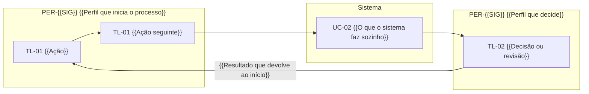
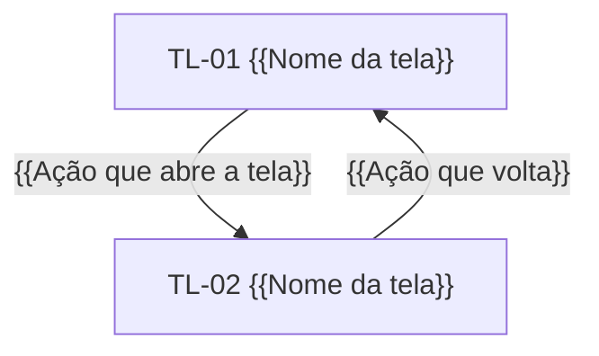

# 02. Perfis e jornadas

<!-- COMO PREENCHER: este documento deriva das raias do BPMN, das partes externas e do quadro de escopo do 01. Regras:
capítulo 03 da metodologia, §3.2 (perfis e jornadas). Cada raia que usa o sistema vira um perfil, descrito pela
função e nunca pelo nome de uma pessoa; parte externa que só troca dados vira integração. A jornada conta o caminho
mais frequente do TO-BE, passo a passo, usando um caso real anonimizado como fio. Pronto quando: cada perfil tem
objetivo, dores com fato e telas que usa; a jornada percorre todo o TO-BE em escopo sem pular etapa; cada passo
aponta caso de uso e tela. O equivalente do caso resolvido é exemplo/reajusta/especificacao/02_PERFIS_E_JORNADAS.md.
Ele serve só de referência de formato e de nível de detalhe: não copie nenhuma frase, nome ou termo dele. -->

Para cada perfil da lista do [01_VISAO_ESCOPO.md](01_VISAO_ESCOPO.md): o que busca, o que faz com frequência, o que
dói hoje (medido no AS-IS) e o que muda com o sistema. Depois, a jornada de um caso do início ao fim e o mapa de
navegação entre as telas descritas no [11_TELAS.md](11_TELAS.md).

Fontes dos números: {{Arquivos do mapeamento usados, por exemplo fatos e avaliação AS-IS do processo}}.

Notas de leitura:

- "du" quer dizer dia útil, e "dc", dia corrido.
- Horas são estimativa até a conferência com quem executa o processo.
- {{Como as atividades do BPMN são citadas, por exemplo t1 a t9}}.

## 1. Perfis

<!-- Repita o bloco abaixo para cada perfil da lista do 01, na ordem em que aparecem no processo. As dores vêm com
número e com o identificador do fato. Em "O que o sistema muda", cite o requisito e a melhoria. -->

### PER-{{SIG}} {{Nome do perfil}}

| Item | Conteúdo |
|---|---|
| Objetivo | {{O que esta pessoa quer alcançar no processo, numa frase}} |
| Raia do BPMN | {{Raia ou unidade}} |
| Tarefas frequentes | {{Tarefas, cada uma com o caso de uso, por exemplo UC-01}} |
| Telas | TL-01, TL-02 |
| Uso no celular | {{Sim ou não, e em quais telas}} |

Dores no AS-IS:

- **{{Dor em poucas palavras}}.** {{Fato do diagnóstico, com número e unidade}} ({{Identificador do fato}}).
- **{{Dor em poucas palavras}}.** {{Fato do diagnóstico, com número e unidade}} ({{Identificador do fato}}).

O que o sistema muda:

- {{Mudança concreta para este perfil}} (RF-{{SIG}}-01, {{Código da melhoria do TO-BE}}).

## 2. Partes externas sem tela

<!-- Quem só envia ou recebe dados, sem usar o sistema, aparece aqui e vira integração no 09. -->

| Parte externa | O que troca com o sistema | Integração |
|---|---|---|
| {{Órgão, sistema ou parte interessada}} | {{Dado que envia ou recebe}} | INT-01 |

## 3. Jornada de ponta a ponta

{{Que caminho do TO-BE esta jornada segue (o mais frequente) e que caso real anonimizado serve de fio}}. Os atos que
acontecem fora do sistema, como {{Ato externo, por exemplo assinatura ou decisão de colegiado}}, entram só como marco
registrado.

### 3.1 Passo a passo

<!-- Um passo por ação de um perfil ou do sistema, na ordem do TO-BE. Decisão do BPMN vira dois passos (a, b). Todo
passo aponta tela e caso de uso; o passo que o sistema executa sozinho tem perfil "sistema". -->

| Passo | Marco | Perfil | Tela | Ação | UC / RF | Atividade do TO-BE |
|---|---|---|---|---|---|---|
| J-01 | {{Marco registrado, ou —}} | PER-{{SIG}} | TL-01 | {{O que a pessoa faz}} | UC-01, RF-{{SIG}}-01 | {{Código da atividade}} |
| J-02 | {{Marco registrado, ou —}} | sistema | TL-02 | {{O que o sistema faz sozinho}} | UC-02 | {{Código da atividade}} |

### 3.2 Jornada por perfil e por tela

<!-- Uma raia (subgraph) por perfil e uma para o sistema. Cada caixa é uma tela com a ação feita nela. Setas que
cruzam raias são passagens de dono. Rótulos com marcador sempre entre aspas. -->

Leitura: {{Uma ou duas frases sobre o que o diagrama mostra, por exemplo onde o dono muda e o que o sistema nunca decide}}.

### 3.3 O caso real usado como fio

<!-- Conte o caso real anonimizado pelos marcos, com datas e números tirados dos autos. Compare com o que aconteceu
no AS-IS e diga em que passo o TO-BE muda o resultado. -->

1. {{Data e marco do caso real}}: {{O que aconteceu e o passo da jornada correspondente}}.
2. {{Data e marco do caso real}}: {{O que aconteceu e o passo da jornada correspondente}}.

No AS-IS, {{O que aconteceu com este caso sem o sistema}}. No TO-BE, {{O que muda e em qual passo}}.

## 4. Mapa de navegação

<!-- Uma caixa por tela da lista do 01; setas com a ação que leva de uma tela à outra. -->

Acesso de cada perfil às telas: "●" é acesso com ação, "○" é só leitura e vazio é sem acesso. A matriz completa de
permissões fica no 14.

| Tela | {{Sigla do primeiro perfil}} | {{Sigla do segundo perfil}} |
|---|---|---|
| TL-01 {{Nome da tela}} | ● | ○ |
| TL-02 {{Nome da tela}} | ○ | ● |

## Pronto quando

- [ ] Todo perfil da lista do 01 tem seção, com objetivo, tarefas, telas, dores com fato e mudanças com requisito.
- [ ] Nenhum perfil tem nome de pessoa.
- [ ] Toda parte externa sem tela aponta uma integração.
- [ ] A jornada percorre todo o TO-BE em escopo, sem pular etapa.
- [ ] Todo passo da jornada aponta tela e caso de uso.
- [ ] O caso real usado como fio está anonimizado e tem as datas dos autos.
- [ ] O mapa de navegação tem todas as telas da lista do 01.
