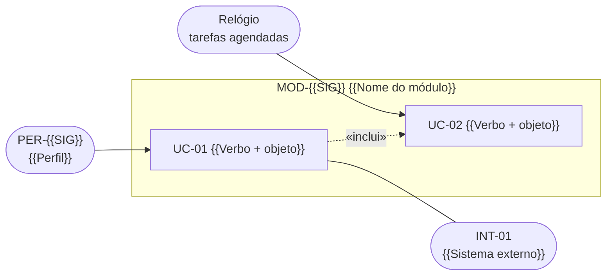
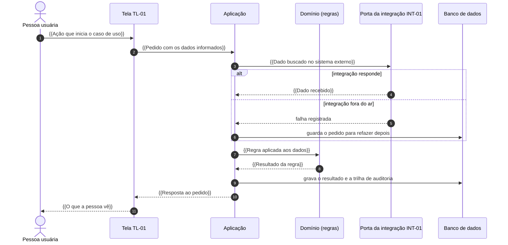
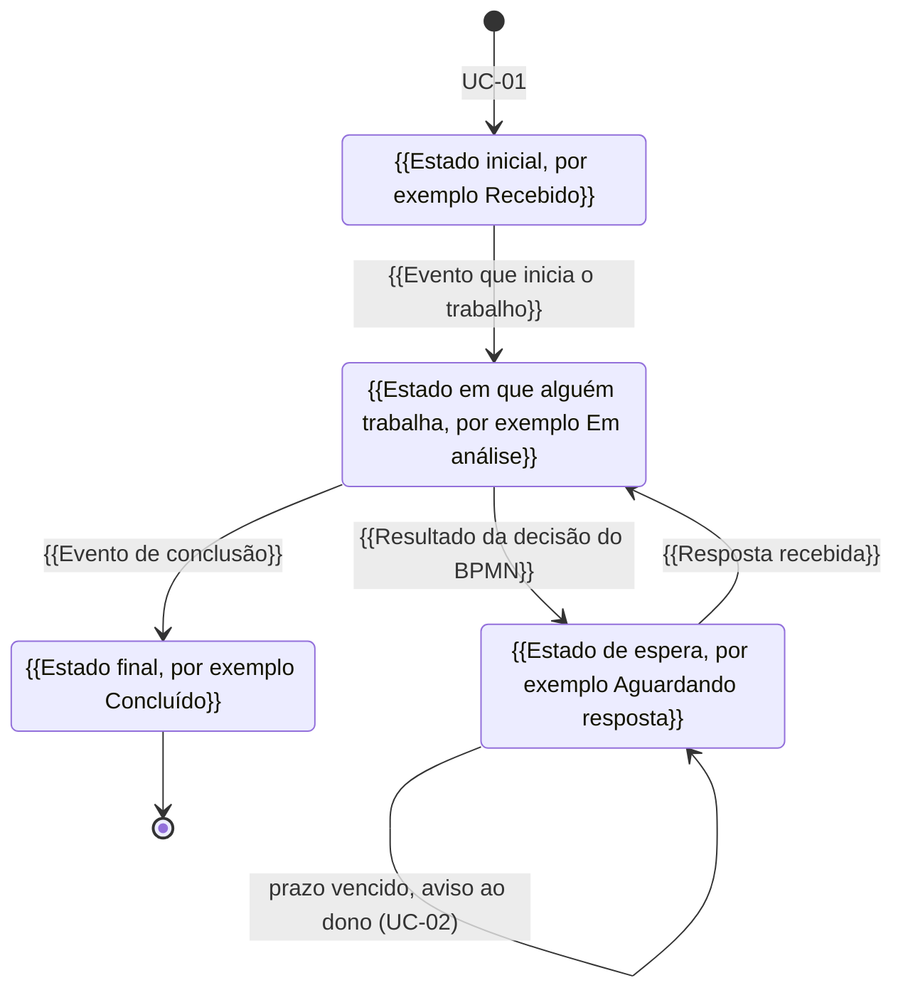

# 04. Casos de uso, sequências e estados

<!-- COMO PREENCHER: este documento deriva do quadro de escopo e da lista de casos de uso do 01, dos perfis do 02 e
das decisões e eventos do BPMN. Regras: capítulo 03 da metodologia, §3.3 (casos de uso) e §3.6 (máquina de estados).
Atividade "automatiza" ou "apoia" vira caso de uso ou passo de um caso maior; decisão do BPMN vira fluxo alternativo;
evento de tempo vira caso de uso do sistema, com ator "sistema (agendado)"; mensagem de parte externa vira caso de uso
disparado por integração. Um caso de uso é um objetivo de um ator com resultado observável, nem "clicar em salvar"
nem "gerir o processo". Pronto quando: todo caso de uso da lista do 01 tem descrição aqui; todo caso de uso cita
requisito; toda atividade em escopo do TO-BE aparece na correspondência; existem os diagramas de casos de uso, de
sequência e de estados; toda transição de estado tem evento ou caso de uso no rótulo. O equivalente do caso resolvido
é exemplo/reajusta/especificacao/04_CASOS_DE_USO.md. Ele serve só de referência de formato e de nível de detalhe: não
copie nenhuma frase, nome ou termo dele. -->

Descrição dos casos de uso listados no [01_VISAO_ESCOPO.md](01_VISAO_ESCOPO.md), no estilo de Cockburn. Cada caso
aponta os requisitos do [03_REQUISITOS.md](03_REQUISITOS.md), as regras do [08_REGRAS_NEGOCIO.md](08_REGRAS_NEGOCIO.md),
as telas do [11_TELAS.md](11_TELAS.md) e a atividade do TO-BE de onde saiu.

**Convenções**

- "O sistema" é o {{Nome do sistema}}. Ele prepara, confere, calcula e registra; {{O que continua sendo ato humano,
  por exemplo decidir, assinar ou protocolar}} fica com as pessoas.
- Prazos citados pelo nome, com a regra que os conta:

| Prazo | Duração e contagem | Regra |
|---|---|---|
| {{Nome do prazo}} | {{Duração, unidade e marco de início}} | RN-{{SIG}}-01 |

## 1. Diagrama de casos de uso

<!-- Perfis à esquerda, sistemas externos à direita, casos de uso agrupados por módulo. O "relógio" representa as
tarefas agendadas do próprio sistema e não é perfil. Use «inclui» para passo obrigatório reaproveitado e «estende»
para passo condicional. Rótulos com marcador sempre entre aspas. -->

{{Uma ou duas frases de leitura do diagrama, por exemplo quais casos são disparados por tempo e quais passam por
integração}}.

## 2. Correspondência BPMN × caso de uso

<!-- Toda atividade em escopo do quadro do 01 aparece aqui, com o mesmo código do BPMN. Decisões (gateways) e
eventos também entram, apontando o caso de uso em que acontecem. -->

| Atividade do TO-BE (raia) | Nome no BPMN | Tratamento | Caso de uso | Melhoria |
|---|---|---|---|---|
| {{Código da atividade (raia)}} | {{Nome da atividade}} | {{Automatiza, apoia ou registra}} | UC-01 | {{Código da melhoria}} |
| {{Código do evento de tempo (raia)}} | {{Nome do evento}} | {{Automatiza}} | UC-02 | {{Código da melhoria}} |

## 3. Descrições

<!-- Repita o bloco para cada caso de uso da lista do 01. O fluxo principal é o caminho sem desvio, numerado, e não
tem decisão no meio: decisão vai para fluxo alternativo ("3a." desvia no passo 3). Exceção é o que dá errado (falha de
integração, dado ausente, permissão). Descreva o que acontece, não a tela ("o usuário clica" é sinal de que o caso
virou tela). -->

### UC-01 {{Verbo + objeto}}

| Campo | Conteúdo |
|---|---|
| Ator principal | PER-{{SIG}} |
| Atores secundários | {{Outros perfis, o sistema ou a integração INT-01}} |
| Objetivo | {{Resultado observável que o ator quer alcançar}} |
| Módulo | MOD-{{SIG}} |
| Pré-condições | {{O que precisa ser verdade antes de começar}} |
| Gatilho | {{O que dá início ao caso de uso}} |

**Fluxo principal**

1. {{O ator informa ou pede algo}}.
2. O sistema {{Primeira coisa que o sistema faz}} (RF-{{SIG}}-01).
3. O sistema {{Conferência ou cálculo, aplicando a regra}} (RN-{{SIG}}-01).
4. {{O ator confirma, revisa ou recebe o resultado}}.
5. O sistema {{Registra o resultado, o marco e a trilha de auditoria}}.

**Fluxos alternativos**

- 3a. {{Resultado da decisão do BPMN que desvia o fluxo}}: {{O que acontece e em que passo o fluxo retoma}}.

**Exceções**

- 2a. {{Falha de integração, dado ausente ou falta de permissão}}: {{O que o sistema faz e quem é avisado}}.

**Pós-condições:** {{O que fica verdadeiro ao final: o que foi gravado, o novo estado do objeto, o que foi disparado}}.

| Rastreio | Itens |
|---|---|
| Regras de negócio | RN-{{SIG}}-01 |
| Requisitos | RF-{{SIG}}-01, RNF-01 |
| Telas | TL-01 |
| Atividade do BPMN | {{Código da atividade}} |
| Origem | {{Melhoria, norma ou caso real}} |

### UC-02 {{Verbo + objeto}}

<!-- Modelo de caso de uso disparado por tempo (prazo, lembrete, rotina). Se o seu UC-02 tiver uma pessoa como ator,
use o mesmo formato do UC-01. -->

| Campo | Conteúdo |
|---|---|
| Ator principal | sistema (agendado) |
| Atores secundários | {{Perfil avisado ou integração consultada}} |
| Objetivo | {{O que a rotina garante, por exemplo que nenhum prazo vença sem aviso}} |
| Módulo | MOD-{{SIG}} |
| Pré-condições | {{O que precisa existir para a rotina rodar}} |
| Gatilho | {{Agenda, por exemplo todo dia útil em horário fixo}} |

**Fluxo principal**

1. O sistema {{Seleciona os itens que a rotina trata}}.
2. O sistema {{Aplica a regra de prazo ou de conferência}} (RN-{{SIG}}-01).
3. O sistema {{Avisa o dono, gera o documento ou muda o estado}} (RF-{{SIG}}-01).

**Fluxos alternativos**

- 2a. {{Item sem nada a fazer}}: {{O sistema registra a execução e segue para o próximo}}.

**Exceções**

- 1a. {{A rotina falha ou a integração está fora do ar}}: {{O sistema registra a falha e tenta de novo na próxima execução, sem repetir o que já fez}}.

**Pós-condições:** {{O que fica registrado ao fim de cada execução}}.

| Rastreio | Itens |
|---|---|
| Regras de negócio | RN-{{SIG}}-01 |
| Requisitos | RF-{{SIG}}-01 |
| Telas | TL-02 |
| Atividade do BPMN | {{Código do evento de tempo}} |
| Origem | {{Melhoria, norma ou caso real}} |

## 4. Diagramas de sequência

<!-- Um diagrama para cada caso de uso que cruza mais de uma fronteira (pessoa, sistema, sistema externo) ou tem
ordem crítica. Troque os nomes dos participantes pelos do seu sistema. Mostre o caminho de falha da integração com
alt/else. Marcador só depois de ":" na mensagem. -->

### 4.1 UC-01: {{Verbo + objeto}}

## 5. Estados do {{Objeto que percorre o processo, por exemplo pedido}}

<!-- Todo processo tem um objeto que o percorre. Atividade do TO-BE em que ele fica parado com alguém vira estado
("Em análise"); espera por resposta ou por prazo também vira estado ("Aguardando resposta"). Saída de atividade ou
resultado de decisão vira transição, rotulada com o evento ou o caso de uso que a dispara, sempre depois de ":".
Subprocesso com vida própria pode virar estado composto. Objeto com ciclo de vida próprio (um documento que vai de
rascunho a assinado) ganha uma máquina menor, nesta mesma seção. -->

<!-- Cada estado tem dono (o perfil da raia) e, quando houver, um prazo contado por uma regra do 08. -->

| Estado | Atividade ou espera do TO-BE | Dono | Prazo que corre | Casos de uso |
|---|---|---|---|---|
| {{Nome do estado}} | {{Código da atividade ou do evento}} | PER-{{SIG}} | {{Prazo e regra, por exemplo RN-...}} | UC-01 |
| {{Nome do estado}} | {{Código da atividade ou do evento}} | {{Perfil dono}} | {{Prazo e regra, ou —}} | UC-02 |

**Regras dos estados**

- {{Condição para entrar ou sair de um estado, por exemplo um marco que precisa existir antes}} (RN-{{SIG}}-01).
- Toda mudança de estado grava quem mudou, quando e por qual caso de uso.

**Conferência da máquina**

<!-- Passe cada caso real do levantamento pela máquina. Caminho real que a máquina não permite indica estado ou
transição faltando. -->

| Caso real | Sequência de estados | A máquina permite? |
|---|---|---|
| {{Identificação anonimizada do caso}} | {{Estado → estado → estado}} | {{Sim, ou não e o que falta}} |

## Pronto quando

- [ ] Todo caso de uso da lista do 01 tem descrição aqui, e todo caso descrito aqui está no 01.
- [ ] Todo caso de uso tem fluxo principal numerado, alternativos, exceções, pós-condições e rastreio.
- [ ] Todo caso de uso cita ao menos um requisito funcional.
- [ ] Toda atividade em escopo do TO-BE aparece na correspondência BPMN × caso de uso.
- [ ] Existem o diagrama de casos de uso, ao menos um diagrama de sequência e a máquina de estados.
- [ ] Toda transição de estado tem evento ou caso de uso no rótulo.
- [ ] Todo estado é alcançável a partir do inicial, e todo estado não final tem saída.
- [ ] Todo caso de uso que muda o estado do objeto aparece numa transição.
- [ ] Todo caso real do levantamento passa pela máquina.
