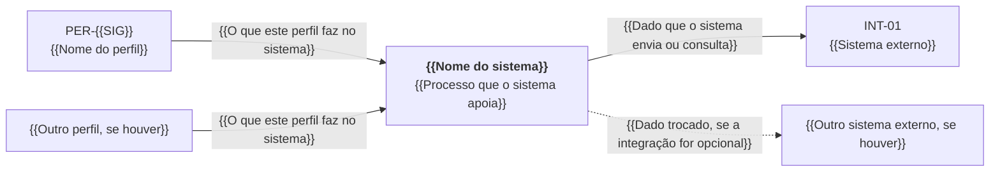
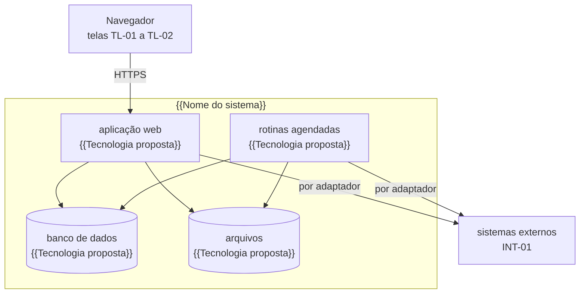
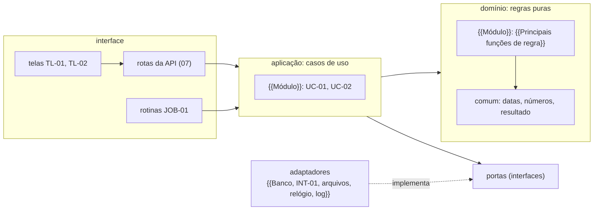
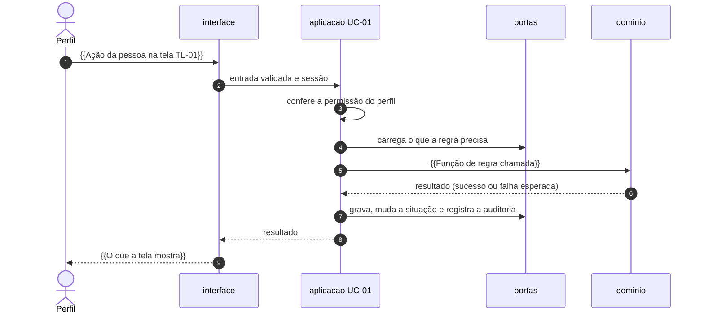

# 05. Arquitetura

<!-- COMO PREENCHER: este documento deriva dos módulos (MOD) e das integrações (INT) listados no 01, das entidades do
06, dos requisitos não funcionais (RNF) do 03 e das restrições da TI do órgão. Siga o capítulo 03 da metodologia,
§3.7 (componentes e arquitetura) e §2 (identificadores). Pronto quando: existem os diagramas de contexto, contêineres
e componentes; todo módulo tem componente de domínio; toda integração tem porta; toda escolha com alternativa real tem
ADR; a regra de dependência tem uma ferramenta que a confere na integração contínua. O arquivo equivalente do caso
resolvido (exemplo/reajusta/especificacao/05_ARQUITETURA.md) serve só de referência de formato e de nível de detalhe:
não copie frase, nome, componente nem decisão dele. O conferidor acusa termo e trecho copiados. -->

{{Uma ou duas frases: como o sistema se divide em partes e o que este documento decide}}. Os identificadores citados
aqui (MOD, UC, RF, RNF, TL, INT) nascem no [01](01_VISAO_ESCOPO.md). As entidades estão no
[06](06_MODELO_DADOS.md), as regras no [08](08_REGRAS_NEGOCIO.md) e as integrações no [09](09_INTEGRACOES.md). Cada
escolha com alternativa real é um ADR da pasta [adr/](adr/), com índice na §17.

Identificadores próprios deste documento: princípios e regras de arquitetura `ARQ-nn` e rotinas agendadas `JOB-nn`.

## 1. Princípios

<!-- Os seis primeiros valem para quase todo sistema de processo. Mantenha, ajuste ou retire, mas preencha a origem de
cada um: o RNF, o ADR ou a restrição da TI que o sustenta. Princípio sem origem é opinião. -->

| ID | Princípio | Origem |
|---|---|---|
| ARQ-01 | A regra de negócio vive no domínio. Tela, rota, rotina agendada e adaptador chamam o domínio; nenhum deles decide | {{RNF ou ADR de origem}} |
| ARQ-02 | Dependência aponta só para dentro: interface → aplicação → domínio. Uma ferramenta confere isso a cada commit (§6) | ADR-0001 |
| ARQ-03 | Tudo o que está fora do processo (banco, rede, arquivo, correio, relógio) é alcançado por uma porta, com adaptador trocável e dublê nos testes | {{RNF ou ADR de origem}} |
| ARQ-04 | Sistema externo fora do ar não para o processo: vale a contingência da ficha do 09 | {{RNF de disponibilidade}} |
| ARQ-05 | Número de negócio (prazo, limite, percentual, valor de referência) não é escrito no código: vem de parâmetro com fonte e vigência (06 §4) | {{RN ou RNF de origem}} |
| ARQ-06 | Ato que a norma reserva a uma pessoa continua com a pessoa: o sistema prepara, confere e registra; quem decide, assina ou publica é gente | {{Norma ou RNF de origem}} |
| ARQ-07 | {{Princípio próprio deste sistema}} | {{Origem}} |

## 2. C4, nível 1: contexto

<!-- O sistema no centro, os perfis (PER) de um lado e os sistemas externos (INT) do outro. Cada seta diz, em poucas
palavras, o que passa por ela. Um nó por perfil e um por integração da lista do 01. -->



| Elemento | Tipo | Papel no contexto | Onde está descrito |
|---|---|---|---|
| PER-{{SIG}} | perfil | {{O que faz e o que precisa ver}} | 02 |
| INT-01 | sistema externo | {{O que fornece ou recebe}} | 09 |

## 3. C4, nível 2: contêineres

<!-- Contêiner aqui é cada coisa que roda ou guarda dado em separado: aplicação web, processo de rotinas agendadas,
banco, armazenamento de arquivos, serviço auxiliar. A tecnologia de cada um vem do ADR de stack; enquanto a TI não
avaliar, escreva "(proposto)". Exemplo de uma stack web comum, só para ilustrar o nível de detalhe: aplicação em
TypeScript com Next.js, banco PostgreSQL, rotinas num processo separado da mesma imagem, arquivos em disco ou em
serviço compatível com S3. Pode ser Python com Django, Java com Spring, .NET ou o que a TI do órgão sustentar. -->



| Contêiner | Tecnologia | Responsabilidade | Observação |
|---|---|---|---|
| aplicação web | {{Tecnologia proposta}} | telas, API, autenticação, casos de uso síncronos | {{Escala, estado em memória, limites}} |
| rotinas agendadas | {{Tecnologia proposta}} | JOB-01 e demais rotinas da §11 | {{Uma instância por rotina? fila?}} |
| banco de dados | {{Tecnologia proposta}} | dados, trilha de auditoria, fila (se houver) | {{Papéis de acesso separados para migração e aplicação}} |
| arquivos | {{Tecnologia proposta}} | documentos recebidos e gerados | acessado só pela porta de arquivos (§8) |

Onde o sistema roda (infraestrutura do órgão ou nuvem contratada) é {{Decisão tomada ou DEC-01 em aberto}}. Ambientes e
implantação estão no [14](14_OPERACAO.md).

## 4. C4, nível 3: componentes

### 4.1 Planejamento: módulo × componente

<!-- Uma linha por módulo do 01. Esta tabela é a ponte entre o escopo e o código: um componente de domínio por módulo,
os casos de uso que ele atende, as entidades que guarda, as regras que aplica e a porta de cada integração que usa.
Se um caso de uso não aparece em nenhuma linha, ou uma integração não tem porta, falta algo. -->

| Módulo | Componente de domínio | Casos de uso atendidos | Entidades | Regras | Portas (integrações) |
|---|---|---|---|---|---|
| MOD-{{SIG}} | `{{Nome do componente}}`: {{O que concentra}} | UC-01, UC-02 | {{Entidades do 06}} | RN-{{SIG}}-01 | {{Nome da porta}} (INT-01) |
| {{Outro módulo}} | {{Componente}} | {{Casos de uso}} | {{Entidades}} | {{Regras}} | {{Portas}} |

### 4.2 Diagrama de componentes



### 4.3 Dependência entre módulos do domínio

<!-- A linha importa a coluna quando a célula diz "sim"; célula vazia é proibido. Todo módulo pode importar o módulo
comum. Sem ciclos. Esta matriz vira regras da ferramenta da §6. -->

| Módulo | MOD-{{SIG}} | {{Outro módulo}} |
|---|---|---|
| MOD-{{SIG}} | — | {{Sim ou vazio}} |
| {{Outro módulo}} | {{Sim ou vazio}} | — |

## 5. Camadas

<!-- Esta divisão (núcleo de contratos, domínio, portas, aplicação, adaptadores, composição e interface) é a da
arquitetura hexagonal pedida no §3.7. Os nomes de pasta são sugestão; troque pelos da linguagem escolhida, mas mantenha
quem pode depender de quem. -->

| ID | Camada | Pasta | O que contém | Pode depender de | Não pode depender de |
|---|---|---|---|---|---|
| ARQ-08 | contratos | `src/contratos` | esquemas do dado de fora e da API (07), tipos gerados deles | biblioteca de validação de esquema | qualquer outra camada |
| ARQ-09 | domínio | `src/dominio/<módulo>` | entidades, objetos de valor, regras do 08, máquina de estados do 04, cálculos e conferências | contratos, o próprio domínio, bibliotecas puras (números decimais, datas) | framework web, banco, rede, sistema de arquivos, relógio do sistema, variável de ambiente, geração aleatória |
| ARQ-10 | portas | `src/portas` | interfaces de repositório, de sistema externo e de serviço técnico | tipos do domínio, contratos | qualquer implementação |
| ARQ-11 | aplicação | `src/aplicacao/<módulo>` | um caso de uso por arquivo: autoriza, abre transação, carrega pelas portas, chama o domínio, grava, registra auditoria | domínio, portas, contratos | adaptadores, interface, bibliotecas de infraestrutura |
| ARQ-12 | adaptadores | `src/adaptadores/<sistema>` | implementação de cada porta: banco, INT-01, arquivos, correio, relógio, log | portas, tipos do domínio, contratos, bibliotecas de infraestrutura | aplicação, interface, outro adaptador |
| ARQ-13 | composição | `src/composicao` | leitura e validação da configuração; ligação de cada porta ao seu adaptador | todas, exceto interface | — |
| ARQ-14 | interface | `src/interface` | telas, rotas da API, definição das rotinas agendadas | aplicação (pela composição), contratos, tipos do domínio | banco, adaptadores, funções de regra do domínio |

Regras complementares:

| ID | Regra |
|---|---|
| ARQ-15 | Cada módulo publica o que oferece num ponto de entrada único (`{{Arquivo de entrada do módulo}}`). Outro módulo só importa por ali |
| ARQ-16 | A rota da API faz, nesta ordem: lê a sessão, valida a entrada contra o esquema de `contratos`, chama o caso de uso e traduz o resultado em resposta HTTP (§12). Nada além disso |
| ARQ-17 | O componente de tela só formata e mostra. Prazo, situação, total e qualquer outro número de negócio chegam prontos da API |
| ARQ-18 | O cliente do banco é criado só no adaptador do banco e entregue pela composição. Nenhuma outra pasta o importa |
| ARQ-19 | Chamada HTTP de saída só existe dentro de adaptador |

## 6. Regra de dependência verificável

<!-- Desenhar camadas não basta: a IA de desenvolvimento quebra a fronteira sem perceber. A regra tem de virar
configuração de uma ferramenta que derruba o portão da integração contínua. Exemplos por linguagem: dependency-cruiser
ou eslint-plugin-boundaries (TypeScript), import-linter (Python), ArchUnit (Java), NetArchTest (.NET). Registre a
escolha no ADR da stack. -->

- **Ferramenta:** {{Ferramenta que verifica as dependências}}.
- **Arquivo de configuração:** `{{Caminho do arquivo de configuração}}`.
- **Comando no portão:** `{{Comando que roda a verificação}}` (portão da §15 e do `AGENTS_DESENVOLVIMENTO.md`).

Regras que a configuração tem de expressar, todas com severidade de erro:

| Regra | Origem (quem importa) | Destino proibido | Motivo |
|---|---|---|---|
| sem-ciclos | qualquer arquivo | qualquer dependência circular | ciclo impede testar uma parte sem a outra |
| contratos-isolados | contratos | qualquer outra camada | o contrato é a fonte; não depende de quem o usa |
| dominio-puro | domínio | tudo fora de domínio, contratos e bibliotecas puras listadas | regra testável sem banco, rede nem relógio |
| aplicacao-para-dentro | aplicação | adaptadores, interface, bibliotecas de infraestrutura | o caso de uso só conhece portas |
| adaptador-nao-sobe | adaptadores | aplicação, interface, composição | o adaptador implementa a porta; não orquestra |
| adaptador-isolado | um adaptador | outro adaptador (exceto o de utilidades comuns) | troca de um sistema externo não afeta outro |
| interface-sem-infra | interface | banco, adaptadores, funções de regra do domínio | a tela não decide nem grava por conta própria |
| modulo-pela-entrada | um módulo | arquivo interno de outro módulo | ARQ-15 |
| matriz-de-modulos | módulo do domínio | módulo marcado vazio na §4.3 | uma regra por célula proibida |

Além das importações, o lint proíbe no domínio e na aplicação: leitura do relógio do sistema, geração de número
aleatório, acesso à rede e leitura de variável de ambiente. O relógio entra pela porta `Relogio`; a configuração, pela
composição.

## 7. Estrutura de pastas do repositório do sistema

<!-- Ajuste os nomes à convenção da linguagem escolhida. Mantenha uma pasta por camada e, dentro do domínio e da
aplicação, uma pasta por módulo. -->

```text
{{Nome do repositório}}/
├── AGENTS.md                 # cópia de AGENTS_DESENVOLVIMENTO.md
├── docs/especificacao/       # este pacote, inclusive fixtures/ dos testes de aceitação
├── {{Pasta de migrações do banco}}/
├── src/
│   ├── contratos/            # esquemas do 07
│   ├── dominio/
│   │   ├── comum/            # datas civis, números decimais, resultado, parâmetros com origem
│   │   └── {{Módulo}}/       # MOD-{{SIG}}
│   ├── portas/
│   ├── aplicacao/
│   │   └── {{Módulo}}/       # um arquivo por caso de uso: uc01-..., uc02-...
│   ├── adaptadores/
│   │   └── {{Sistema}}/      # um por porta implementada (banco, INT-01, arquivos, correio...)
│   ├── composicao/           # configuração validada e ligação porta → adaptador
│   └── interface/            # telas, rotas da API, rotinas agendadas
└── tests/
    ├── dubles/               # portas em memória para testar a aplicação
    ├── integracao/           # adaptadores contra banco de teste e respostas gravadas
    └── ponta-a-ponta/        # fluxos das telas
```

Testes de unidade ficam ao lado do arquivo testado. Os fixtures de aceitação são os do [12](12_TESTES.md), lidos de
`docs/especificacao/fixtures/` e nunca duplicados.

## 8. Portas e adaptadores

<!-- Uma linha por porta. Toda integração do 09 tem porta. Os serviços técnicos (relógio, log, auditoria, transação,
arquivos) também são portas, para o domínio e a aplicação serem testados sem infraestrutura. -->

| Porta | Operações principais | Adaptadores | INT | Módulos que usam |
|---|---|---|---|---|
| `{{NomeDaPorta}}` | `{{Operação e entrada}}` → {{Resultado ou falha tipada}} | `{{Nome do adaptador}}`; dublê em memória nos testes | INT-01 | MOD-{{SIG}} |
| `Repositorio{{Entidade}}` | buscar, listar, gravar | banco; dublê em memória nos testes | — | MOD-{{SIG}} |
| `ArmazenamentoArquivos` | guardar, ler, calcular hash | {{Disco local ou serviço de objetos}} | — | {{Módulos}} |
| `Relogio` | instante atual, data civil de hoje no fuso configurado | sistema; relógio fixo nos testes | — | todos |
| `Log` | registrar evento estruturado por nível | {{Biblioteca de log}} | — | todos |
| `Auditoria` | registrar quem fez o quê, antes e depois, na mesma transação | banco | — | todos |
| `Transacao` | executar um bloco de forma atômica | banco | — | todos |

Todo adaptador de sistema externo tem tempo máximo de espera configurável, repete só operações de leitura (que não
mudam nada do outro lado), converte a falha do outro lado em `FalhaExterna` com o sistema e o tipo
(`{{TEMPO_ESGOTADO, INDISPONIVEL, RESPOSTA_INVALIDA}}`) e nunca repassa a resposta bruta. A conduta em cada falha está
na ficha do [09](09_INTEGRACOES.md).

## 9. Onde fica cada regra

<!-- Uma linha por regra do 08. Cada regra tem uma única casa no domínio; a aplicação traz os insumos pelas portas e
a regra decide. Esta tabela evita a regra copiada em dois lugares. -->

| Regra | O que decide | Função e arquivo no domínio | Insumo trazido pela aplicação (porta) | Requisito | Teste |
|---|---|---|---|---|---|
| RN-{{SIG}}-01 | {{O que a regra decide}} | `{{Nome da função}}` (`{{Arquivo no domínio}}`) | {{Nenhum ou porta}} | RF-{{SIG}}-01 | AT-01 |

Parâmetros usados pelas regras, com a origem ao lado (os que mudam no tempo ficam no banco, com vigência, 06 §4):

| Parâmetro | Valor | Unidade | Origem |
|---|---|---|---|
| `{{NOME_DO_PARAMETRO}}` | {{Valor}} | {{Unidade}} | {{RN, norma com artigo, ou DEC-01 se ainda em aberto}} |

## 10. Fluxo de um caso de uso entre as camadas

<!-- Desenhe o caso de uso principal (o da jornada mais frequente do 02). O diagrama mostra quem chama quem; não repita
o fluxo do 04. -->



## 11. Rotinas agendadas

<!-- Cada evento de tempo dos casos de uso (prazo que vence, lembrete, consulta periódica a sistema externo) vira uma
rotina. Rotina não decide: chama um caso de uso. Toda rotina tem de poder rodar duas vezes sem efeito duplicado. -->

| ID | Rotina | Gatilho | Caso de uso e requisitos | O que faz | Idempotência | Em falha |
|---|---|---|---|---|---|---|
| JOB-01 | `{{Nome da rotina}}` | {{Agenda (proposto) ou evento de fila}} | UC-02; RF-{{SIG}}-01 | {{O que a rotina faz}} | {{Chave que impede efeito em dobro}} | {{Novas tentativas, registro da falha, quem é avisado}} |

## 12. Tratamento de erro

| ID | Camada | Regra |
|---|---|---|
| ARQ-20 | domínio | Falha prevista (dado incompleto, regra não atendida) é resultado devolvido, não exceção. Exceção só para situação impossível, que indica defeito |
| ARQ-21 | aplicação | Devolve resultado com `codigo` estável, igual ao da tabela de erros do [07](07_CONTRATOS_API.md) §2.4. Falha de regra leva o identificador da RN. Recurso fora do escopo do usuário responde como inexistente |
| ARQ-22 | adaptadores | Traduzem a falha de fora (rede, banco, formato) em falha tipada. Nunca repassam mensagem do banco, consulta SQL ou pilha de chamadas |
| ARQ-23 | interface | Converte `codigo` em status HTTP e corpo `application/problem+json` (RFC 9457). A tela mostra o texto do guia de mensagens do [10](10_UX_UI.md), nunca o texto técnico |
| ARQ-24 | rotinas | Falha num item não interrompe os demais. A falha final fica registrada na entidade e aparece para o perfil responsável |

## 13. Logs

| ID | Regra |
|---|---|
| ARQ-25 | Log estruturado (uma linha por evento, em JSON), com: instante, nível, serviço, identificador de correlação, identificador do usuário, caso de uso, duração e resultado |
| ARQ-26 | O identificador de correlação nasce na requisição ou na rotina e acompanha a aplicação, os adaptadores e o registro de auditoria |
| ARQ-27 | Nunca vão para o log: dado pessoal (nome, e-mail, CPF, telefone), senha, token, cookie, chave de acesso, cadeia de conexão e conteúdo de documento. A biblioteca de log é configurada para mascarar esses campos, e um teste confirma |
| ARQ-28 | Log serve à operação; não substitui a trilha de auditoria (06 §5) |
| ARQ-29 | Níveis: erro (exige ação), aviso (falha externa, nova tentativa), informação (início e fim de caso de uso e de rotina), depuração (só fora de produção) |

## 14. Configuração

Toda configuração vem de variável de ambiente, lida e validada num único lugar da composição, na partida. Valor
ausente ou mal formado encerra o processo. O repositório guarda só um arquivo de exemplo com os nomes, sem valores
reais. Parâmetro de negócio não é variável de ambiente: fica no banco ou no domínio, com a fonte (§9).

| Variável | Obrigatória | Uso |
|---|---|---|
| `APP_AMBIENTE` | sim | desenvolvimento, homologação ou produção |
| `{{VARIAVEL_DE_CONEXAO_DO_BANCO}}` | sim | conexão do papel da aplicação |
| `{{VARIAVEL_DO_SEGREDO_DA_SESSAO}}` | sim | assinatura da sessão (14 §2) |
| `FUSO_HORARIO` | sim | fuso usado para converter instantes em datas civis |
| `{{VARIAVEL_DA_INTEGRACAO}}` | {{Sim ou não}} | endereço e credencial do INT-01 (09) |
| `LOG_NIVEL` | não | nível mínimo do log |

## 15. Testes por camada e portões

<!-- As ferramentas vêm do ADR da stack. A lista completa de portões, com os comandos, fica no
AGENTS_DESENVOLVIMENTO.md. -->

| Camada | Ferramenta | O que cobre | Portão |
|---|---|---|---|
| domínio | {{Ferramenta de teste de unidade}} | regras do 08, máquina de estados do 04, cálculos; fixtures de aceitação do 12 | cobertura mínima de {{Percentual}} de linhas e ramos (RNF-01) |
| aplicação | a mesma, com dublês das portas | casos de uso, autorização, mudança de situação, auditoria gravada | todo caso de uso com teste |
| adaptadores | {{Ferramenta}}, banco de teste e respostas gravadas | tradução de respostas e falhas de cada INT; repositórios; regras de integridade do 06 | cada regra de integridade com teste que a vê barrar |
| interface | {{Ferramenta de teste de componente}} | componentes do inventário (CMP-01) e estados de tela | — |
| ponta a ponta | {{Ferramenta de teste de navegador}} com verificação de acessibilidade | fluxos da primeira release | fluxos verdes; nenhuma violação WCAG 2.2 AA séria ou crítica |
| arquitetura | {{Ferramenta que verifica as dependências}} | regras da §6 | zero violação |

## 16. Itens propostos e decisões abertas

**Propostos neste documento** (precisam ser confirmados pela TI ou entrar no documento de origem):

- {{Entidade, rotina, parâmetro ou tecnologia proposta aqui, e para onde vai}}.

**Decisões abertas que tocam a arquitetura.** Ficam registradas como DEC no [08](08_REGRAS_NEGOCIO.md), com dono e
padrão provisório; aqui só a referência.

| DEC | Decisão | Quem decide | Enquanto não decide |
|---|---|---|---|
| DEC-01 | {{Por exemplo: onde o sistema roda}} | {{Unidade}} | {{Padrão provisório}} |

## 17. Índice dos ADRs

<!-- Cada decisão com alternativa real é um arquivo adr/NNNN-nome-curto.md (numeração de quatro dígitos, sem lacunas),
copiado de adr/_MODELO.md. Decisões que quase todo sistema precisa registrar: stack; banco de dados; arquitetura e
regra de dependência; autenticação; hospedagem e implantação; cada integração com mais de uma forma possível; design
system; cadeia de suprimentos; uso de modelo de linguagem, quando houver. Escolha que depende da TI fica "proposta" até
a avaliação. -->

Cada decisão é um arquivo `adr/NNNN-nome-curto.md`, copiado de `adr/_MODELO.md`.

| ADR | Título | Situação |
|---|---|---|
| ADR-0001 | {{Título da decisão}} | {{Proposta, aceita, substituída ou retirada}} |

## Pronto quando

- [ ] Contexto, contêineres e componentes desenhados, com todos os perfis e integrações do 01.
- [ ] Todo módulo tem linha na §4.1, e todo caso de uso aparece em algum módulo.
- [ ] Toda integração do 09 tem porta na §8.
- [ ] Toda regra do 08 tem uma casa só na §9, com requisito e teste.
- [ ] A regra de dependência tem ferramenta, arquivo de configuração e comando no portão.
- [ ] Toda rotina agendada tem gatilho, idempotência e conduta em falha.
- [ ] Toda escolha com alternativa real tem ADR, e o índice está atualizado.
- [ ] Nenhum marcador `{{...}}` sobrou.
