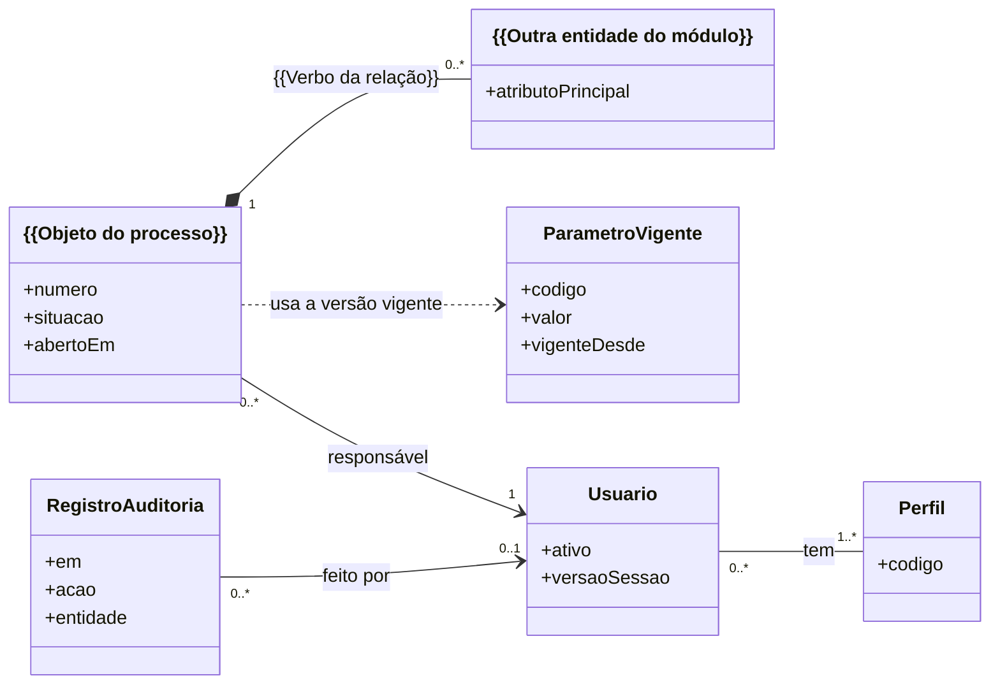

# 06. Modelo de dados

<!-- COMO PREENCHER: este documento deriva dos substantivos dos casos de uso (04) e das regras de negócio (08), do
glossário do 01 e do dado que vem de fora (formulário, arquivo, integração do 09). Siga o capítulo 03 da metodologia,
§3.6 (modelo de domínio e estados) e §2 (identificadores). Pronto quando: toda entidade tem atributos com tipo,
obrigatoriedade, unidade e origem do dado; os parâmetros que mudam no tempo têm vigência; a trilha de auditoria está
definida; existe o diagrama de classes (ou entidade-relacionamento) por módulo; todo campo do dado de fora aponta a
entidade onde é gravado. O arquivo equivalente do caso resolvido (exemplo/reajusta/especificacao/06_MODELO_DADOS.md)
serve só de referência de formato e de nível de detalhe: não copie entidade, enum, atributo nem frase dele. -->

{{Uma ou duas frases: o que este modelo guarda e qual é o objeto que percorre o processo}}. Os nomes seguem o glossário
do [01](01_VISAO_ESCOPO.md). O modelo físico executável fica em `{{Caminho do esquema físico ou das migrações}}`; o que a
ferramenta de esquema não expressa (restrições de verificação, gatilhos, permissões do banco) está na §7 e entra na
primeira migração. A escolha do banco está no ADR-0001.

<!-- Como separar (§3.6): fica como ENTIDADE o que o sistema guarda e tem identidade própria (o pedido, o documento, o
prazo); vira ATRIBUTO o que só qualifica outra coisa (data, valor, situação); vira VALOR, sem identidade, o que se
compara pelo conteúdo (período, endereço, percentual). Entidades marcadas "(proposto)" nasceram aqui e precisam entrar
na lista do 01. -->

## 1. Convenções

<!-- As convenções abaixo servem para quase todo sistema. Ajuste à linguagem e ao banco escolhidos e preencha os
marcadores. -->

| ID | Convenção |
|---|---|
| MD-01 | Nomes do glossário, em português, sem acento: entidades em `PascalCase`, atributos em `camelCase`, valores de enum em `MAIUSCULAS_COM_SUBLINHADO` |
| MD-02 | Tabelas em `snake_case`; {{Como o nome da entidade vira nome de tabela}} |
| MD-03 | Chave primária `id` do tipo {{Uuid ou sequencial}}. A trilha de auditoria usa chave sequencial, porque a ordem importa (§5) |
| MD-04 | Data civil (sem hora) para prazos e datas de negócio; instante com fuso para registros de quando algo aconteceu, gravado em UTC e convertido na borda pelo fuso configurado |
| MD-05 | Valores com casas decimais (moeda, percentual, quantidade fracionada) em tipo decimal de escala fixa, nunca em ponto flutuante binário. A unidade vai no nome ou na tabela de atributos |
| MD-06 | Atributo que pode faltar é anulável e diz, na coluna "Regra", o que a ausência significa |
| MD-07 | Parte que não existe sem o todo é apagada com o todo; o resto é protegido contra exclusão. Nada que já virou prova é apagado (§7) |
| MD-08 | Registro que é prova (dado recebido, resultado de cálculo, decisão, trilha) não é alterado: correção é registro novo que aponta o anterior |
| MD-09 | {{Convenção própria deste sistema}} |

## 2. Enums

<!-- Um enum por conjunto fechado de valores. A situação do objeto do processo tem um valor por estado da máquina de
estados do 04: os dois documentos têm de bater. Na API (07), os mesmos valores em minúsculas. -->

| Enum | Valores | Origem |
|---|---|---|
| `{{SituacaoDoObjeto}}` | `{{ESTADO_INICIAL}}`, `{{OUTRO_ESTADO}}`, `{{ESTADO_FINAL}}` | estados do diagrama do [04](04_CASOS_DE_USO.md) |
| `{{NomeDoEnum}}` | `{{VALOR_A}}`, `{{VALOR_B}}` | {{RN, campo do dado de fora ou glossário}} |
| `CodigoPerfil` | `{{SIG}}` e demais siglas de perfil | perfis do [02](02_PERFIS_E_JORNADAS.md) |
| `OrigemAcao` | `TELA`, `API`, `ROTINA` | trilha de auditoria (§5) |

## 3. Entidades e atributos

Tipos usados: `id`, `texto`, `texto(n)`, `inteiro`, `decimal(p,e)`, `data` (civil), `instante`, `booleano`, `json`,
`hash` (64 caracteres hexadecimais do SHA-256), um enum da §2. Siglas: FK chave estrangeira, UQ única, IX índice.
Todo `id` é chave primária e não é repetido nas tabelas.

<!-- Coluna "Origem do dado": quem informa ou de onde vem (perfil e tela, campo do dado de fora, INT, cálculo do
domínio, sistema). É ela que liga o modelo ao 07 e ao 09. Uma subseção por módulo do 01. -->

### 3.1 MOD-{{SIG}}: {{Nome do módulo}}

**{{ObjetoDoProcesso}}** ({{O que é, em uma frase}}). UQ `{{Atributo único}}`; IX `situacao`.

| Atributo | Tipo | Obrigatório | Unidade | Origem do dado | Regra |
|---|---|---|---|---|---|
| numero | texto | sim | — | {{Sistema ou perfil que informa}} | {{Formato, máscara, unicidade}} |
| situacao | `{{SituacaoDoObjeto}}` | sim | — | domínio (máquina de estados do 04) | muda só por transição permitida |
| {{Atributo}} | {{Tipo}} | {{Sim ou não}} | {{Unidade}} | {{Origem do dado}} | {{RN-SIG-nn ou restrição}} |
| responsavelId | id FK | sim | — | aplicação | → {{Unidade ou Usuario}}; todo objeto tem dono |
| abertoEm | instante | sim | — | sistema | |
| encerradoEm | instante | não | — | sistema | obrigatório no estado final |

**{{OutraEntidade}}** ({{O que é}}). UQ {{Chaves}}; IX `{{Chave do objeto do processo}}`.

| Atributo | Tipo | Obrigatório | Unidade | Origem do dado | Regra |
|---|---|---|---|---|---|
| {{Chave do objeto do processo}} | id FK | sim | — | aplicação | → {{ObjetoDoProcesso}} (parte do todo) |
| {{Atributo}} | {{Tipo}} | {{Sim ou não}} | {{Unidade}} | {{Origem do dado}} | {{Regra}} |

<!-- Repita o bloco para cada entidade do módulo. Documento recebido ou gerado guarda o hash do conteúdo e a chave no
armazenamento de arquivos (nunca o caminho da máquina). Prazo guarda o marco inicial, a regra que o conta e o
vencimento calculado. -->

### 3.2 Entidades transversais

**Usuario.** UQ `{{Atributo de login}}`.

| Atributo | Tipo | Obrigatório | Unidade | Origem do dado | Regra |
|---|---|---|---|---|---|
| nome, email | texto | sim | — | perfil administrador | dado pessoal: fora do log e do token (14 §4) |
| {{Credencial ou identificador no provedor de identidade}} | texto | sim | — | {{Autenticação própria ou login único}} | ver 14 §2 |
| ativo | booleano | sim | — | perfil administrador | usuário desativado perde as sessões |
| versaoSessao | inteiro | sim | — | sistema | aumenta para revogar as sessões abertas |
| {{Atributo de vínculo}} | id FK | {{Sim ou não}} | — | perfil administrador | {{Unidade ou organização externa a que o usuário pertence; define o escopo de acesso}} |

**Perfil.** Atributos: `codigo` (`CodigoPerfil`), `nome`, `descricao`. Relação muitos-para-muitos com `Usuario`.

## 4. Vigência de parâmetros

<!-- Valor de norma, cláusula, tabela de referência ou prazo que pode mudar no tempo não é constante no código. Ele é
guardado com vigência, e cada cálculo grava a versão que usou, para continuar reproduzível depois da mudança. Use este
desenho ou adapte ao seu caso; se nenhum parâmetro do sistema muda no tempo, diga por quê e retire a seção. -->

**ParametroVigente** — UQ (`codigo`, `vigenteDesde`).

| Atributo | Tipo | Obrigatório | Unidade | Origem do dado | Regra |
|---|---|---|---|---|---|
| codigo | texto | sim | — | glossário | igual ao nome usado na RN (ex. `{{PRAZO_DE_RESPOSTA_DIAS}}`) |
| valor | {{Tipo}} | sim | {{Unidade}} | {{Perfil que mantém a tabela}} | |
| vigenteDesde | data | sim | — | ato que fixou o valor | |
| vigenteAte | data | não | — | sistema | preenchida quando a versão seguinte é publicada |
| fonte | texto | sim | — | {{Perfil que mantém a tabela}} | norma, artigo ou cláusula |
| trechoLiteral | texto | sim | — | idem | trecho da fonte que sustenta o valor (08) |
| situacao | `{{SituacaoDaVersao}}` | sim | — | domínio | rascunho, publicada, substituída |
| publicadaPorId | id FK | não | — | sessão | obrigatório ao publicar |

Regras:

1. Versão nova herda da anterior e muda só o que mudou; a anterior ganha `vigenteAte`.
2. Versão publicada e já usada em cálculo não muda nem é apagada (§7).
3. Todo resultado de cálculo grava o identificador das versões de parâmetro usadas.
4. A escolha da versão é por data de referência do caso, não pela data de hoje: {{Qual data de referência vale}}.

## 5. Trilha de auditoria

**RegistroAuditoria** — chave sequencial; IX (`entidade`, `entidadeId`) e (`usuarioId`, `em`).

| Atributo | Tipo | Obrigatório | Unidade | Origem do dado | Regra |
|---|---|---|---|---|---|
| em | instante | sim | — | sistema | UTC |
| usuarioId | id FK | não | — | sessão | vazio só em ação de rotina agendada |
| perfilAtivo | `CodigoPerfil` | não | — | sessão | |
| origem | `OrigemAcao` | sim | — | interface | |
| acao | texto | sim | — | aplicação | nome do caso de uso ou da operação |
| entidade, entidadeId | texto | sim | — | aplicação | o que foi afetado |
| antes, depois | json | não | — | aplicação | só os campos alterados; dado pessoal registrado só pelo nome do campo |
| correlacaoId | texto | sim | — | interface | o mesmo do log (05 §13) |
| hashAnterior, hash | hash | {{Sim ou não}} | — | adaptador do banco | cadeia de hash, se adotada: cada registro guarda o hash do anterior |

Regras: a tabela só aceita inclusão; o papel do banco usado pela aplicação não tem permissão de alterar nem de apagar;
o registro é gravado na mesma transação da mudança que descreve; {{Rotina que confere a cadeia, se houver}}.

## 6. Diagrama de classes

<!-- Um diagrama por módulo quando o modelo for grande. Mostre só os atributos principais; a lista completa está na §3.
Os nomes técnicos das classes (antes dos colchetes) e os rótulos entre aspas são marcadores: troque pelos do
glossário. -->

## 7. Regras de integridade

<!-- Cada regra diz onde é imposta: no domínio, no caso de uso, numa restrição do banco ou num gatilho. Regra que
protege prova (imutabilidade, trilha) fica no banco também, para valer mesmo se o código errar. Cada uma tem teste. -->

| ID | Regra | Onde é imposta | Origem |
|---|---|---|---|
| IG-01 | A trilha de auditoria só aceita inclusão | permissão do papel da aplicação e gatilho no banco | RNF-01 |
| IG-02 | Dado recebido de fora não muda depois de gravado; só a situação do registro muda | gatilho no banco e caso de uso | {{RNF de origem}} |
| IG-03 | Versão de parâmetro usada em cálculo não muda nem é apagada | caso de uso e gatilho | §4 |
| IG-04 | Todo {{Objeto do processo}} tem responsável | coluna obrigatória | {{RF de origem}} |
| IG-05 | O estado final exige `encerradoEm` | restrição de verificação | máquina de estados do 04 |
| IG-06 | {{Regra de integridade própria}} | {{Onde}} | {{RN-SIG-nn ou RF}} |

## 8. Do dado de fora para as entidades

<!-- Uma tabela por origem: formulário de terceiro, arquivo recebido, resposta de integração. Todo campo do esquema do
07 aparece aqui. O caso de uso que recebe é quem grava; o domínio não depende do banco. -->

Origem: {{Formulário, arquivo ou INT-01}}; esquema em [07](07_CONTRATOS_API.md) §4; gravado por UC-01.

| Campo de origem | Entidade.atributo | Transformação | Validação |
|---|---|---|---|
| `{{Campo}}` | `{{Entidade.atributo}}` | {{Nenhuma, conversão de formato, cálculo}} | {{Esquema, regra RN-SIG-nn}} |
| o conteúdo inteiro | `{{Entidade.conteudoRecebido}}` e `{{Entidade.hash}}` | guardado como recebido | imutável (IG-02) |

## 9. Dados iniciais

<!-- A carga inicial é código que lê a fonte; nenhum número digitado à mão. Dado de teste nunca tem dado real de
pessoa. -->

| Dados | Fonte | Como é carregado | Observação |
|---|---|---|---|
| Perfis | perfis do 02 | {{Script de carga inicial}} | |
| Parâmetros vigentes | regras do 08, com trecho literal | {{Script de carga inicial}} | {{Situação inicial: rascunho até a área validar?}} |
| {{Tabela de referência: unidades, feriados, tipos}} | {{Fonte}} | {{Script}} | {{Observação}} |

## Pronto quando

- [ ] Toda entidade tem atributos com tipo, obrigatoriedade, unidade, origem do dado e regra.
- [ ] Os valores do enum de situação batem com os estados do 04.
- [ ] Parâmetros que mudam no tempo têm vigência, e o cálculo grava a versão usada.
- [ ] A trilha de auditoria está definida e protegida contra alteração.
- [ ] Existe o diagrama de classes (ou entidade-relacionamento) de cada módulo.
- [ ] Toda regra de integridade diz onde é imposta e tem origem.
- [ ] Todo campo do dado de fora aponta a entidade e o atributo onde é gravado.
- [ ] Nenhum marcador `{{...}}` sobrou.
