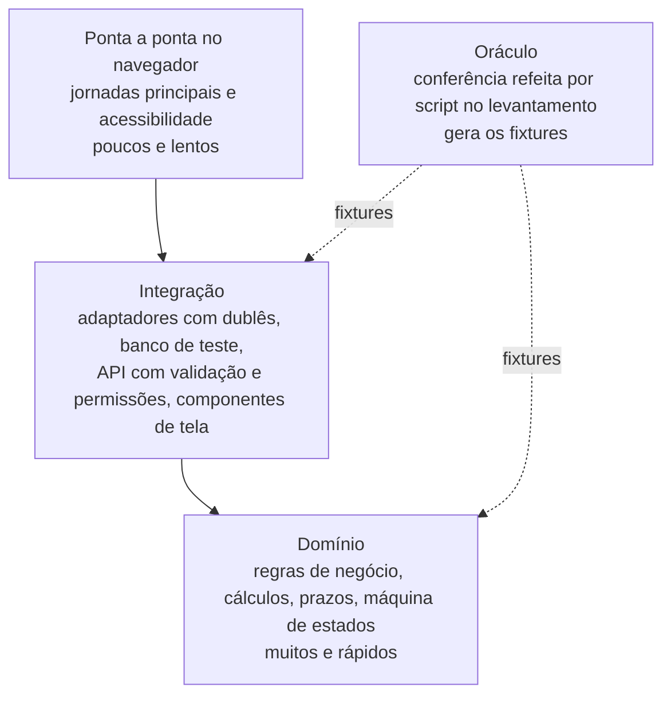

# 12. Testes

<!-- COMO PREENCHER: este documento deriva dos casos reais com resultado conhecido do levantamento
(saida/levantamento/casos/ e saida/levantamento/conferencias/), dos critérios de aceite dos requisitos (03), das
regras de negócio (08) e das integrações (09). O passo a passo está no capítulo 03 da metodologia, §3.11
(docs/metodologia/03_PLANEJAMENTO_DA_ESPECIFICACAO.md). Cada caso real vira um teste "### AT-nn Situação testada";
copie o bloco do AT-01 para cada caso. Caso em que os autos têm erro vira teste de que o sistema acusa o erro. O
resultado esperado sai dos autos ou da conferência refeita por script, nunca é digitado de cabeça.
Pronto quando: todo requisito funcional é citado por teste ou por história do 13 (regra C11 do conferidor); todo
teste tem resultado esperado com origem; os fixtures são gerados por script a partir do levantamento; existem testes
de borda e de permissão; a matriz de rastreabilidade está completa.
Referência de formato: exemplo/reajusta/especificacao/12_TESTES.md. Ele serve só para ver estrutura, seções e nível
de detalhe. Não copie frase, caso, valor nem termo dele: o domínio do seu sistema é outro, e o conferidor acusa termo e
trecho copiados (C03 e C04). -->

Estratégia de testes de {{Nome do sistema}} e testes de aceitação AT-01 em diante. O resultado esperado vem dos autos
sempre que existe caso real: {{Quantos casos reais o levantamento tem, de onde vêm e quantos têm resultado conhecido}}.
Onde não há caso real, o teste é sintético e diz isso na linha "Origem".

Requisitos, casos de uso e telas são citados pelos identificadores do [`01_VISAO_ESCOPO.md`](01_VISAO_ESCOPO.md). A
referência de método é a ISO/IEC/IEEE 29119 (processo e documentação de testes).

## 1. Estratégia

### 1.1 Pirâmide

Muitos testes rápidos na base, onde mora a regra de negócio; poucos testes lentos no topo, onde a pessoa usa a tela.



| Nível | Ferramenta | O que cobre | Regra |
|---|---|---|---|
| Domínio | {{Ferramenta de teste da stack}} | funções do domínio, sem rede, banco nem interface | todo AT de regra, cálculo e prazo roda aqui primeiro, sobre os fixtures; cobertura mínima de {{Percentual}} ({{RNF de manutenibilidade do 03}}) |
| Integração | {{Ferramenta de teste e de dublê de rede}} | adaptadores com respostas gravadas, persistência, API (situação da resposta, validação de entrada, permissão) | nenhuma chamada real a sistema externo; requisição não prevista faz o teste falhar |
| Componentes | {{Ferramenta de teste de componente e verificação de acessibilidade}} | cada tela do 11 nos cinco estados | localizar elementos pelo papel e pelo nome acessível, não pela classe |
| Ponta a ponta | {{Ferramenta de automação de navegador}} | jornadas do 02 com banco semeado pelos fixtures | sem violação de acessibilidade de gravidade séria ou crítica |
| Oráculo | {{Script de conferência do levantamento}} | resultado de referência dos casos reais | se o sistema e o oráculo divergem num fixture, o sistema está errado até prova em contrário |

### 1.2 O oráculo e os fixtures

O **oráculo** é a conferência refeita por script no levantamento (capítulo 02 da metodologia): ele recalcula ou
reconfere cada caso real e diz se o resultado dos autos confere. O **fixture** é o arquivo que leva esse caso para os
testes do sistema, com a entrada e o resultado esperado.

| Oráculo (script do levantamento) | O que faz | Fixture que alimenta | Casos |
|---|---|---|---|
| `{{Caminho do script de conferência}}` | {{O que ele recalcula ou confere}} | `fixtures/{{Nome}}.json` | {{Quantos, e quantos conferem e divergem}} |

Como gerar, da raiz do projeto:

```
python especificacao/ferramentas/gerar_fixtures.py             # escreve os arquivos em fixtures/
python especificacao/ferramentas/gerar_fixtures.py --conferir  # compara sem escrever; código de saída 1 = fixture defasado
```

Regras do gerador de fixtures:

- lê só o levantamento (`saida/levantamento/`), sem rede e sem dado pessoal;
- é determinístico: ordena tudo e não grava data nem hora, para que duas rodadas deem os mesmos bytes;
- **para com erro** se o resultado refeito não bater com a conferência do levantamento;
- grava em cada fixture o resumo criptográfico (por exemplo SHA-256) dos arquivos de origem, para o portão de paridade.

| Fixture | Conteúdo | Contagens |
|---|---|---|
| `fixtures/{{Nome}}.json` | {{Um caso por registro: entrada, resultado esperado, origem nos autos, testes que o usam}} | {{Total de casos e quantos de cada resultado}} |

Os testes leem o fixture e validam a forma dele antes de usar: fixture é entrada, não código. Regra de comparação:
{{Tolerância numérica, casas decimais, regra de arredondamento, campos ignorados, citando a RN do 08}}.

### 1.3 Dublês das integrações

Cada integração do 09 tem respostas gravadas, versionadas com o código, gravadas uma vez na história do adaptador.

| Integração | Resposta gravada | O que precisa estar nela |
|---|---|---|
| Integração INT-01 | {{Recorte da resposta real usada pelos casos}} | {{Valores que os testes conferem}} |
| todas | resposta de indisponibilidade e tempo esgotado | para os testes de integração fora do ar (seção 3) |

### 1.4 Portões da integração contínua

Um pedido de integração de código só entra com todos os portões verdes:

1. Compilação e verificação de tipos sem erro; análise estática sem aviso.
2. Testes de domínio com cobertura de pelo menos {{Percentual}} na camada de domínio.
3. Testes de integração e de componentes.
4. Testes de aceitação da release em curso e das anteriores, cada um nomeado pelo seu identificador (por exemplo,
   um bloco de teste chamado "AT-01 ...").
5. Teste de ponta a ponta com verificação de acessibilidade nas telas alteradas.
6. Paridade dos fixtures: `gerar_fixtures.py --conferir` verde e resumos de origem iguais aos dos fixtures copiados.
7. {{Portão próprio do órgão, por exemplo verificação de dependências ou da regra de camadas, ou retire}}

## 2. Testes de aceitação dos casos reais

Uma seção por caso real do levantamento. A tabela de cada teste tem sempre os mesmos campos.

### AT-01 {{Situação testada}}

| Campo | Conteúdo |
|---|---|
| Dado | {{Entrada: o fixture e o caso, por exemplo os registros de fixtures/nome.json com AT-01 na lista de testes}} |
| Quando | {{O que o sistema faz: o caso de uso ou a regra executada}} |
| Então | {{Resultado esperado, com os valores dos autos e a tolerância}} |
| Nível | {{Domínio, integração, componente ou ponta a ponta}} |
| Requisitos | RF-{{SIG}}-01, RNF-01 |
| Regras exercitadas | RN-{{SIG}}-01 |
| Casos de uso | UC-01 |
| Origem do resultado esperado | {{Documento dos autos ou arquivo da conferência no levantamento, com o código do caso}} |

{{Exemplo calculado com os números do caso, numa ou duas linhas, para quem lê conferir sem abrir o fixture}}.

Quando os autos têm erro, o teste é de que o sistema **acusa** o erro: o "Então" diz o valor que os autos trazem, o
valor correto pela regra, e a mensagem que o sistema mostra (do guia de mensagens do 10).

## 3. Testes de borda e de permissão

Toda situação abaixo que se aplica ao sistema vira um teste com identificador próprio, no mesmo formato do AT-01.
Situação que não se aplica fica na tabela com "não se aplica" e o motivo.

| Situação de borda | Exemplo genérico | Teste |
|---|---|---|
| Prazo que vence em fim de semana ou feriado | prazo de 5 dias úteis contado a partir de uma sexta-feira antes de feriado | {{AT-nn ou não se aplica}} |
| Dado obrigatório ausente | pedido enviado sem o documento exigido | {{AT-nn ou não se aplica}} |
| Valor no limite da regra | valor exatamente igual ao teto ou ao piso da regra | {{AT-nn ou não se aplica}} |
| Arredondamento | valor com mais casas do que a regra admite | {{AT-nn ou não se aplica}} |
| Integração fora do ar | INT-01 responde indisponível, com e sem cópia em cache | {{AT-nn ou não se aplica}} |
| Arquivo fora do formato ou grande demais | anexo com extensão não aceita | {{AT-nn ou não se aplica}} |
| Dado pessoal onde não deveria haver | campo livre com documento de identificação de terceiro | {{AT-nn ou não se aplica}} |
| Ação repetida (idempotência) | o mesmo envio feito duas vezes seguidas | {{AT-nn ou não se aplica}} |
| {{Borda própria do domínio}} | {{Exemplo}} | {{AT-nn}} |

| Situação de permissão | Exemplo genérico | Teste |
|---|---|---|
| Perfil errado abre a tela | PER-{{SIG}} sem acesso abre a TL-02 e recebe a tela de sem permissão | {{AT-nn}} |
| Perfil errado chama a API | o servidor recusa e registra a tentativa na trilha de auditoria | {{AT-nn}} |
| Dado de outra pessoa ou unidade | usuário externo pede um registro que não é seu e o servidor responde como se ele não existisse | {{AT-nn ou não se aplica}} |
| Trilha de auditoria imutável | alteração ou exclusão de registro da trilha é negada | {{AT-nn}} |
| Sessão expirada | ação depois do tempo de expiração volta para a entrada | {{AT-nn}} |

## 4. Rastreabilidade

### 4.1 Requisito × teste × história

Uma linha por requisito funcional do 03. Todo requisito tem pelo menos um teste ou uma história (C11). Requisito sem
teste de aceitação diz, na coluna "Observação", como é verificado.

| Requisito | Caso de uso | Testes de aceitação | Histórias | Release | Observação |
|---|---|---|---|---|---|
| RF-{{SIG}}-01 | UC-01 | AT-01 | HIS-{{SIG}}-01 | {{R1}} | {{Observação ou —}} |
| RF-{{SIG}}-02 | UC-02 | {{AT-nn}} | HIS-{{SIG}}-02 | {{Release}} | {{Observação}} |
| Não funcional: RNF-01 | — | {{AT-nn}} | {{HIS}} | {{Release}} | {{Forma de medir}} |

### 4.2 Teste × release × fixture

| Teste | Release | Casos de uso | Fixture |
|---|---|---|---|
| AT-01 | {{R1}} | UC-01 | `fixtures/{{Nome}}.json` |
| {{AT-nn}} | {{Release}} | {{UC}} | {{Fixture ou sintético}} |

Os testes da primeira release entram já no esqueleto que anda do 13: primeiro no domínio, depois pela API, depois na
tela.

## Pronto quando

- [ ] Todo caso real do levantamento com resultado conhecido virou um AT, ou está registrado por que não virou.
- [ ] Todo AT tem entrada (fixture), resultado esperado com origem nos autos ou na conferência, regras e requisitos.
- [ ] Todo caso em que os autos têm erro tem teste de que o sistema acusa o erro.
- [ ] Os fixtures são gerados por script a partir do levantamento, e o portão de paridade confere.
- [ ] Toda integração tem dublê com resposta gravada e resposta de indisponibilidade.
- [ ] As situações de borda e de permissão estão cobertas ou marcadas "não se aplica" com motivo.
- [ ] Todo requisito funcional é citado por teste ou por história (C11), e a matriz 4.1 está completa.
- [ ] Nenhum marcador `{{...}}` sobrou.
