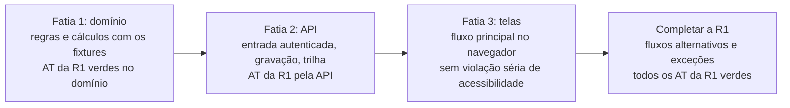

# 13. Backlog

<!-- COMO PREENCHER: este documento deriva dos casos de uso (04), dos requisitos (03), das telas (11), dos testes de
aceitação (12) e das ondas definidas no 01. O passo a passo está no capítulo 03 da metodologia, §3.12
(docs/metodologia/03_PLANEJAMENTO_DA_ESPECIFICACAO.md). Um épico por módulo do 01 (EP-SIG, com a sigla do módulo).
Cada história é uma fatia vertical de um caso de uso: entrega algo testável de ponta a ponta, da tela ao banco, e não
uma camada isolada. A primeira release é um esqueleto que anda. Copie a linha de história para cada fatia nova.
Pronto quando: toda história cita requisito ou caso de uso na própria linha (regra C15 do conferidor); toda história
está numa release; toda release tem critério de aceite; todo requisito funcional é citado por história ou teste (C11).
Referência de formato: exemplo/reajusta/especificacao/13_BACKLOG.md. Ele serve só para ver estrutura, seções e nível
de detalhe. Não copie frase, história nem termo dele: o domínio do seu sistema é outro, e o conferidor acusa termo e
trecho copiados (C03 e C04). -->

Este documento organiza a construção: um épico por módulo, as histórias de cada épico com seus critérios, a
sequência das releases e as duas definições de pronto (para começar e para fechar). Quem desenvolve pega **uma história por vez, na ordem da seção 3**, e só a fecha com a Definition
of Done cumprida.

Módulos, perfis, casos de uso, requisitos e telas aparecem pelo identificador dado no
[`01_VISAO_ESCOPO.md`](01_VISAO_ESCOPO.md); os testes AT vêm do [`12_TESTES.md`](12_TESTES.md).

**Tamanho** (estimativa de esforço; é hipótese até ser medida na primeira release): P até {{Dias}} dias,
M de {{Dias}} a {{Dias}} dias, G de {{Dias}} a {{Dias}} dias. História maior que G é dividida antes de entrar numa
release.

## 1. Épicos

| Épico | Módulo | Objetivo | Releases | Histórias |
|---|---|---|---|---|
| EP-{{SIG}} {{Nome do épico}} | MOD-{{SIG}} | {{O que o módulo entrega ao processo, em uma linha}} | {{R1}} | HIS-{{SIG}}-01 a {{Última}} |
| EP-{{SIG}} {{Nome do épico}} | MOD-{{SIG}} | {{Objetivo}} | {{Releases}} | {{Histórias}} |

Épico transversal de fundação (repositório, camadas, portões, autenticação, perfis, trilha de auditoria) costuma ter
o módulo de administração do 01 como dono: {{Diga qual módulo cuida da fundação}}.

## 2. Histórias

Uma tabela por épico. A primeira célula é o identificador da história. Os critérios Dado/Quando/Então saem dos
critérios de aceite do requisito (03) e da tela (11), com o resultado esperado tirado do fixture ou dos autos; critério
sintético diz "sintético". Para quebrar linha dentro da célula, use ` `.

### EP-{{SIG}} {{Nome do épico}}

| História | Como / quero / para | Critérios de aceite | RF | UC | RN | TL | AT | Release | Tamanho | Depende de |
|---|---|---|---|---|---|---|---|---|---|---|
| HIS-{{SIG}}-01 {{Título curto}} | Como PER-{{SIG}}, quero {{Ação}}, para {{Resultado no processo}}. | Dado {{Situação inicial}}, quando {{Ação}}, então {{Resultado verificável}}. Dado {{Situação}}, quando {{Ação}}, então {{Resultado}}. | RF-{{SIG}}-01 | UC-01 | RN-{{SIG}}-01 | TL-01 | AT-01 | {{R1}} | {{P, M ou G}} | {{Nenhuma}} |
| HIS-{{SIG}}-02 {{Título curto}} | Como PER-{{SIG}}, quero {{Ação}}, para {{Resultado}}. | Dado {{Situação}}, quando {{Ação}}, então {{Resultado}}. | RF-{{SIG}}-02 | UC-02 | {{RN ou —}} | TL-02 | {{AT ou —}} | {{Release}} | {{Tamanho}} | HIS-{{SIG}}-01 |

Exemplo genérico de fatia vertical bem cortada: "Como analista, quero registrar o parecer sobre um pedido, para que o
pedido siga para a decisão" atravessa tela, API, regra e banco, e termina com algo que alguém consegue usar. Fatia
mal cortada: "criar as tabelas do banco do módulo" (só uma camada, ninguém usa).

## 3. Ordem por release

As releases seguem as ondas do 01. Cada release tem lista de histórias na ordem e critério de aceite.

### R1 {{Nome da release}}: esqueleto que anda

A primeira release atravessa todas as camadas com um caso real antes de alargar qualquer uma delas: o fluxo
principal do processo de ponta a ponta, com o mínimo de cada camada. Ela não é um módulo inteiro terminado sozinho.

| Fatia | Histórias, na ordem | Pronto quando |
|---|---|---|
| 1 Domínio | {{HIS-SIG-nn, na ordem}} | {{O caso real de referência dá, no domínio, o mesmo resultado do oráculo; quais AT ficam verdes}} |
| 2 API | {{Histórias}} | {{O caso entra pela API com autenticação e fica gravado, com trilha}} |
| 3 Telas | {{Histórias}} | {{A pessoa percorre o fluxo principal no navegador}} |
| Completar | {{Histórias}} | {{Todos os AT da R1 verdes}} |

**Critério de aceite da R1:** {{Prova de aceite: o caso real que percorre o fluxo principal e os AT que precisam
estar verdes}}.

### R2 {{Nome da release}}

{{Histórias na ordem}}. **Critério de aceite:** {{AT e indicadores que provam a release}}.

### R3 {{Nome da release, ou retire}}

{{Histórias na ordem}}. **Critério de aceite:** {{Critério}}.

## 4. Definition of Ready

Uma história está pronta para começar quando cumpre todos os itens:

1. Está no formato "Como PER-..., quero..., para...", com perfil do 01.
2. Cita na própria linha os RF, UC e TL que implementa, todos existentes no pacote.
3. Tem pelo menos um critério Dado/Quando/Então verificável, com resultado esperado tirado de fixture ou dos autos, ou
   marcado como sintético.
4. As regras de negócio que usa estão no 08, numeradas.
5. Cada dependência já foi entregue, ou a história inclui um dublê no lugar dela.
6. Quando há tela, ela está descrita no 11, com os cinco estados.
7. A operação da API, se houver, está no 07.
8. Nenhuma decisão pendente (DEC-01 e seguintes, no 08) impede o critério; quando impede, separa-se a história em
   duas e a parte que depende da decisão fica para depois.
9. O tamanho é P, M ou G.
10. {{Critério próprio do órgão, ou retire}}

## 5. Definition of Done

A história é dada como concluída quando cumpre todas as linhas:

| Aspecto | Exigência |
|---|---|
| Testes | Os testes nasceram antes do código; cada critério Dado/Quando/Então virou teste automático e passa; os AT da história passam; a cobertura do domínio está no mínimo combinado; nenhum teste foi desligado |
| Paridade | Para regra, cálculo ou prazo: resultado igual ao do oráculo nos fixtures, e fixtures atualizados |
| Código | Tipos verificados e análise estática sem aviso; toda entrada externa validada |
| Camadas | Regra de negócio só no domínio; domínio sem dependência de interface, banco ou rede; integração só por porta (05) |
| Acessibilidade | Telas tocadas sem violação séria ou crítica; tudo pelo teclado; foco visível; contraste dentro do 10; situação em texto; 320 px sem rolagem horizontal (WCAG 2.2 AA, eMAG 3.1) |
| Segurança e privacidade | Checagem de perfil no servidor; nenhum segredo no código; registro de eventos sem dado pessoal (14 e 15) |
| Rastreabilidade | A mensagem de commit e o pedido de integração trazem o identificador da história e dos requisitos; toda ação que altera dado deixa registro na trilha de auditoria |
| Revisão | Outra pessoa revisou código e testes, e cada observação foi tratada |
| Documentação | Mudança de regra, contrato ou tela atualiza o documento correspondente do pacote, no mesmo pedido de integração |
| Linguagem | Termos do glossário do 01 no código e na tela; textos em português com acentuação correta |
| {{Grupo próprio do órgão}} | {{Critério, ou retire a linha}} |

## Pronto quando

- [ ] Todo módulo do 01 tem épico.
- [ ] Toda história é fatia vertical de um caso de uso e cita, na própria linha, RF ou UC (C15).
- [ ] Toda história tem critério Dado/Quando/Então com resultado esperado de fixture, dos autos ou marcado sintético.
- [ ] Toda história está numa release, e toda release tem critério de aceite.
- [ ] A R1 é um esqueleto que anda: fluxo principal de ponta a ponta com um caso real.
- [ ] Todo requisito funcional do 03 aparece em alguma história ou teste (C11).
- [ ] A Definition of Ready e a Definition of Done estão ajustadas ao órgão.
- [ ] Nenhum marcador `{{...}}` sobrou.
