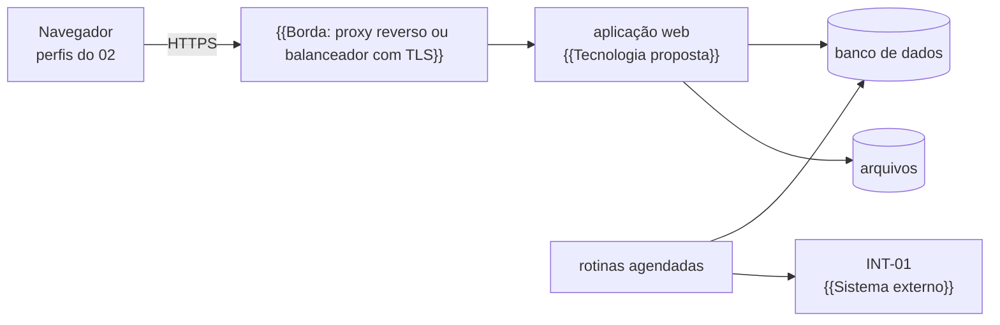

# 14. Operação

<!-- COMO PREENCHER: este documento deriva dos perfis (02), dos casos de uso (04), das entidades e dos dados pessoais
do 06, das integrações (09) e das metas e linhas de base do 01. Siga o capítulo 03 da metodologia, §3.13 (operação e
segurança) e §2 (identificadores). Pronto quando: a matriz de permissões cobre todo perfil e todo caso de uso; todo
dado pessoal tem finalidade, base legal, retenção e quem acessa; ambientes, segredos, implantação, cópias de segurança
e observabilidade estão definidos; o plano do piloto tem critério para seguir em cada etapa; cada indicador tem linha
de base, meta e forma de medir antes e depois com a mesma régua. O arquivo equivalente do caso resolvido
(exemplo/reajusta/especificacao/14_OPERACAO.md) serve só de referência de formato e de nível de detalhe: não copie
perfil, prazo, número nem frase dele. -->

Como o sistema é operado: quem pode o quê, como se entra, o que fica registrado, como o dado pessoal é tratado, onde o
sistema roda e como se prova, no piloto, que ele melhorou o processo. Os requisitos de segurança e a forma de
verificar cada um estão no [15](15_SEGURANCA.md).

Valores marcados "(proposto)" são pontos de partida sugeridos aqui, a confirmar com a TI e com a área responsável.

## 1. Matriz de permissões

<!-- Perfil × caso de uso: uma linha por caso de uso do 04, uma coluna por perfil do 02. Quando o acesso depende de a
quem o dado pertence (o usuário externo só vê o que é dele, a unidade só vê os casos dela), diga na nota. Esta tabela é
a fonte única: o teste de autorização (15, SEG-AUZ-02) a lê e compara com o código. -->

Ações: **L** ler · **C** criar · **A** alterar · **P** confirmar, aprovar ou publicar · **X** exportar · **—** sem
acesso. A tela só esconde o que o perfil não pode; quem nega é o servidor.

| Caso de uso | PER-{{SIG}} | {{Outro perfil}} | {{Perfil administrador}} | Nota |
|---|---|---|---|---|
| UC-01 | {{Ações}} | {{Ações}} | — | {{Escopo: só os registros do próprio vínculo?}} |
| UC-02 | {{Ações}} | {{Ações}} | — | |
| {{Administrar usuários e perfis}} | — | — | C, A | |
| {{Consultar a trilha de auditoria}} | — | {{Ações}} | L | |

**Escopo por titularidade:** {{Regra de escopo, por exemplo "o perfil externo só alcança os pedidos da organização a
que está vinculado; pedido fora do escopo responde como inexistente"}}.

**Segregação de funções (proposto):** {{Pares de ações que a mesma pessoa não pode fazer no mesmo caso, por exemplo
quem elabora não aprova}}. O sistema não executa ato reservado a pessoa ({{Assinar, publicar, decidir}}).

## 2. Autenticação e sessão

<!-- Escolha o método com a TI e registre num ADR: login único do governo (gov.br), diretório do órgão, provedor de
identidade institucional ou autenticação própria. Login único costuma trazer o segundo fator pronto. -->

| Item | Regra |
|---|---|
| Método | {{Login único, diretório do órgão ou autenticação própria}} (ADR-0001) |
| Senha (se houver autenticação própria) | guardada só como hash lento e com sal, por algoritmo próprio para senha; tamanho mínimo de {{Número}} caracteres (proposto); sem regra de composição; troca obrigatória no primeiro acesso |
| Segundo fator | {{Para quais perfis, e desde quando}} |
| Tentativas | após {{Número}} erros consecutivos (proposto), a conta fica suspensa por um tempo; cada erro é registrado na trilha, nunca com o que foi digitado |
| Cookie de sessão | `httpOnly`, `Secure`, `SameSite`; nenhum token em armazenamento do navegador acessível por script |
| Expiração | {{Minutos}} sem uso e {{Horas}} no total (proposto), com aviso antes de expirar e opção de continuar (WCAG 2.2, critério 2.2.1) |
| Revogação | desativar o usuário, trocar a senha ou mudar os perfis derruba as sessões abertas |
| Conteúdo da sessão | identificador do usuário, perfis e vínculo; nunca nome, e-mail ou CPF |

**Usuário interno.** {{Quem pede a criação, quem cria, qual é o login, quem pede a desativação quando a pessoa sai}}.

**Usuário externo (se houver).** {{Como a organização externa indica os representantes, a que o usuário fica vinculado,
de quanto em quanto tempo os acessos são revistos (proposto)}}.

## 3. Trilha de auditoria

| Item | Regra |
|---|---|
| O que registra | toda ação que muda dado ou documento; entrada e saída; falha de autenticação e negação de permissão; exportação; publicação de parâmetro ou modelo; {{Outros eventos do domínio}} |
| Campos | os do `RegistroAuditoria` do [06](06_MODELO_DADOS.md) §5 |
| Imutável | só inclusão; o papel do banco da aplicação não altera nem apaga; {{Cadeia de hash conferida por rotina, se adotada}} |
| Quem consulta | {{Perfis}}, com filtro por caso, usuário, recurso e período; a própria consulta e a exportação ficam registradas |
| O que não entra | senha, token, conteúdo integral de documento (só o hash), {{Outro dado sensível}} |
| Retenção | {{Prazo}} (proposto), a confirmar com a gestão documental e a área jurídica |

## 4. LGPD

<!-- Inventário de dado pessoal: uma linha por dado pessoal que o sistema guarda, mostra ou envia. Para órgão público, a
base legal mais comum é o art. 7º, III, com o art. 23 da Lei 13.709/2018 (execução de competência legal), citando a lei
que dá a competência ao órgão. Valide cada linha com o encarregado e a área jurídica. -->

O sistema trata o mínimo de dado pessoal necessário ao processo. {{Diga o que o sistema recusa na entrada, se houver,
por exemplo dado de terceiro que não é preciso para a decisão}}.

| Dado pessoal | Titular | Finalidade | Base legal (Lei 13.709/2018) | Minimização | Quem acessa | Retenção |
|---|---|---|---|---|---|---|
| Nome, e-mail institucional e perfil do usuário | servidor | autenticação, permissão, trilha | {{Artigo e lei de competência}} | {{O que não se pede}} | {{Perfis}} | {{Enquanto ativo; depois, só o identificador na trilha}} |
| Endereço IP na trilha | usuários | segurança e apuração de incidente | {{Artigo}} | só na trilha, não no log técnico | {{Perfis}} | {{Prazo da trilha}} |
| {{Dado pessoal do processo}} | {{Titular}} | {{Finalidade}} | {{Artigo}} | {{Minimização}} | {{Perfis}} | {{Retenção}} |

Regras:

- Log técnico e métrica usam o identificador do usuário, nunca nome nem e-mail (05 §13).
- Pedido do titular (acesso, correção) segue o canal do encarregado do órgão; o sistema exporta os dados de um usuário
  pelo identificador.
- Se um incidente atinge dado pessoal, o encarregado é avisado no dia da detecção; cabe a ele avaliar se a ANPD deve
  ser comunicada (art. 48).
- Antes da produção, o órgão decide se elabora o relatório de impacto à proteção de dados (art. 38):
  {{Decisão ou DEC-01}}.
- Dado guardado fora do Brasil é transferência internacional (art. 33): {{Onde o dado fica}}.

## 5. Segredos e ambientes

| Ambiente | Para quê | Dados | Quem acessa | Integrações |
|---|---|---|---|---|
| Desenvolvimento | máquina de quem desenvolve e integração contínua | fixtures do 12 e dados sintéticos | equipe de desenvolvimento | só dublês; nenhuma chamada real |
| Homologação | aceite com a área de negócio | {{Casos reais anonimizados ou cópia controlada}}; usuários de teste | equipe e servidores do piloto | {{Quais integrações reais, e com que restrição}} |
| Produção | operação | dados reais | perfis da §1 | as do quadro geral do [09](09_INTEGRACOES.md) |

Nenhum segredo no repositório nem na imagem. O repositório tem só o arquivo de exemplo com os nomes das variáveis (05
§14). Os valores vêm de {{Cofre de segredos do órgão ou do provedor}} por variável de ambiente.

| Segredo | Uso | Onde fica | Rotação |
|---|---|---|---|
| `{{VARIAVEL_DE_CONEXAO_DO_BANCO}}` | conexão do papel da aplicação | {{Cofre}} | {{Quando troca}} (proposto) |
| `{{VARIAVEL_DO_SEGREDO_DA_SESSAO}}` | assinatura da sessão | {{Cofre}} | {{Periodicidade}} (proposto); a troca derruba as sessões |
| `{{VARIAVEL_DA_INTEGRACAO}}` | INT-01 | {{Cofre}} | {{Conforme o dono do outro lado}} |

## 6. Implantação

<!-- Desenhe onde cada contêiner do 05 §3 roda. Exemplo de arranjo comum, só como ilustração: contêineres Docker atrás
de um proxy reverso com TLS, banco gerenciado na mesma rede privada, implantação por etiqueta de versão numa
plataforma de contêineres. A escolha da hospedagem é da TI e vai para um ADR. -->

| Item | Regra |
|---|---|
| Onde roda | {{Infraestrutura do órgão ou nuvem contratada}} (ADR-0001) |
| Imagem | construída na integração contínua, executada sem privilégio de administrador, com sistema de arquivos só de leitura fora das pastas de trabalho |
| Banco | acesso só pela rede interna; papel da aplicação separado do papel de migração |
| Migrações | passo próprio da implantação, com o papel de migração; nunca na partida da aplicação |
| Saúde | rota que confere o banco e responde 200 ou 503; o ambiente reinicia o que falha |
| Promoção | produção recebe a mesma imagem aprovada em homologação, depois de registrado o aceite; reverter é reimplantar a etiqueta da versão anterior |
| Superfície pública | só a aplicação web tem endereço público |

## 7. Cópias de segurança e observabilidade

### 7.1 Cópias de segurança

| Item | Regra |
|---|---|
| Banco | {{Cópia completa diária e arquivamento contínuo do log de transações}}; perda máxima tolerada de {{Horas}} e retorno em até {{Horas}} (proposto) |
| Arquivos | cópia {{Periodicidade}}, com o hash de cada arquivo conferido na restauração |
| Onde | fora do servidor de origem, cifrada, com acesso só da TI |
| Retenção | {{Diárias por N dias, mensais por N meses}} (proposto) |
| Teste | restauração {{Periodicidade}} em homologação, registrada; cópia nunca restaurada não conta |

### 7.2 Logs

Formato e campos no [05](05_ARQUITETURA.md) §13. Nunca no log: dado pessoal, senha, token, conteúdo de documento. Um
teste automatizado percorre as rotas e falha se algum desses aparecer.

### 7.3 Métricas

| Métrica | Meta ou limiar | Origem |
|---|---|---|
| {{Tempo de resposta da operação principal}} | {{Limiar}} | RNF-01 |
| Última consulta com sucesso a cada sistema externo | {{Limiar}} | 09 |
| Rotinas agendadas executadas no horário | {{Limiar}} | 05 §11 |
| {{Objetos do processo sem responsável}} | zero | {{RF de origem}} |
| Erros 5xx da API | tendência semanal; {{Limiar de alerta}} | {{RNF de disponibilidade}} |

### 7.4 Alertas de operação

- {{Sistema externo sem resposta há mais de N horas}}.
- Rotina agendada não executada no horário.
- Cópia de segurança ou teste de restauração com falha.
- Trilha de auditoria com registro alterado ou cadeia quebrada.
- {{Alerta próprio do domínio}}.

## 8. Plano de implantação no piloto

<!-- O piloto é um recorte real e pequeno: uma unidade, um tipo de caso, um período. Cada etapa tem critério objetivo
para passar à seguinte. A operação assistida corre em paralelo ao modo atual até o resultado conferir. -->

Recorte do piloto: {{Unidade, tipo de caso e período}}.

| Etapa | O que acontece | Quem | Saída | Critério para seguir |
|---|---|---|---|---|
| 0 Decisões | decisões pendentes que bloqueiam o piloto (DEC-01) | {{Quem decide}} | decisões registradas no 08 | {{Decisões indispensáveis tomadas}} |
| 1 Homologação | releases em homologação; testes de aceitação (AT-01) com casos reais anonimizados | equipe e área de negócio | aceite das releases | todos os testes de aceitação da release verdes |
| 2 Medição antes | linha de base recalculada com a régua do sistema (§9) | {{Gestão}} | tabela "antes" | linha de base aprovada |
| 3 Operação assistida | casos reais entram pelo sistema; o modo atual continua em paralelo | {{Perfis}} | casos completos nas duas vias | nenhuma diferença sem causa explicada |
| 4 Medição depois | indicadores dos casos do piloto | {{Gestão}} | tabela "antes e depois" | resultado apresentado a {{Instância de decisão}} |
| 5 Ampliação | {{Próximas unidades ou tipos de caso}} | {{Quem}} | {{Saída}} | {{Critério}} |

Treinamento: {{Uma sessão por perfil antes da etapa 3, com um caso de homologação como exercício}}.

## 9. Medição dos indicadores antes e depois

<!-- O "antes" e o "depois" usam a mesma definição e a mesma fonte. Se o "antes" veio do sistema de processos (trilha
de andamentos) e o "depois" vem dos marcos do novo sistema, recalcule o "antes" pela régua nova ou mostre as duas lado a
lado. Os números vêm do levantamento por script, nunca digitados. -->

| Indicador | Linha de base | Meta | Como medir no piloto | Fonte da linha de base |
|---|---|---|---|---|
| {{Indicador do TO-BE}} | {{Valor e unidade}} | {{Valor da meta}} | {{Marcos do sistema usados no cálculo}} | {{Arquivo do levantamento ou fato}} |

**Limites da medição.** {{Quantos casos o piloto alcança e o que isso permite concluir: estatística ou estudo de caso}}.
Horas e custos são hipótese até a calibração com os servidores, e todo entregável que os mostra diz isso.

## Pronto quando

- [ ] A matriz de permissões tem todo perfil do 02 e todo caso de uso do 04, com o escopo por titularidade.
- [ ] O método de autenticação está decidido ou registrado como decisão pendente, com ADR.
- [ ] A trilha de auditoria diz o que registra, o que não registra e quem consulta.
- [ ] Todo dado pessoal tem titular, finalidade, base legal, minimização, quem acessa e retenção.
- [ ] Ambientes, segredos, implantação, cópias de segurança, métricas e alertas estão definidos.
- [ ] O plano do piloto tem critério para seguir em cada etapa.
- [ ] Todo indicador tem linha de base com fonte, meta e forma de medir com a mesma régua.
- [ ] Nenhum marcador `{{...}}` sobrou.
